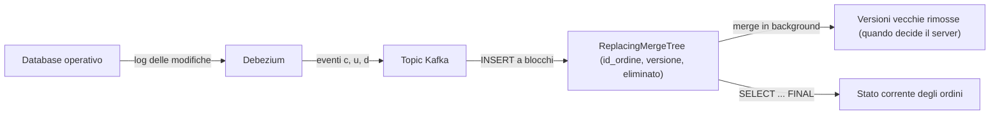

La dashboard dei ricavi mostra 15.052.864 euro. Il database degli ordini ne conta 9.025.122. La tabella in ClickHouse è alimentata dal CDC, le query usano `FINAL`, le cancellazioni risultano applicate: il numero resta sbagliato del 67 per cento e nessun componente segnala un errore.

## Centocinquantamila righe per novantamila ordini

Il caso è ricostruito con numeri di esempio: centomila ordini e 185.000 eventi di modifica, generati dal codice di questa pagina. Un decimo degli ordini viene cancellato, quindi nella sorgente ne restano 90.000. Le cifre sono l'output di chDB, il motore ClickHouse in-process per Python, e le ottieni rieseguendo i blocchi `sql` nell'ordine in cui compaiono.

La tabella è quella che nasce dai tutorial sul CDC: un motore `ReplacingMergeTree` con una colonna di versione, che «tiene l'ultima versione di ogni riga». Il team ha letto con `FINAL`, come suggerisce la documentazione, e ha cancellato con `ALTER TABLE … DELETE`. Il risultato sono 150.000 righe e 15.052.863,68 euro, contro 90.000 ordini e 9.025.122,29 euro nella sorgente.

Il CDC ha senso quando il database operativo deve alimentare l'analitica quasi in tempo reale. Se una latenza di ore è accettabile, un ETL batch è più semplice e costa meno. Non serve quando i dati nascono già come eventi, come clickstream e log: vanno direttamente su Kafka, senza passare dal log transazionale. Qui la scelta è fatta e il problema sta nel modo in cui si costruisce e si legge la replica.

La causa non è il CDC e non è `FINAL`. `ReplacingMergeTree` considera duplicate solo le righe con la stessa chiave `ORDER BY`, e ne toglie i duplicati quando i merge lo decidono.

## Cosa deduplica ReplacingMergeTree

Il resto discende da tre fatti.

Il primo: un evento CDC porta la riga com'è dopo la modifica, una versione crescente e l'indicazione che la riga è stata cancellata. Debezium emette per ogni modifica un evento con il tipo di operazione (`c`, `u` oppure `d`) e le immagini prima e dopo. La versione si ricava dalla posizione nel log del database, per esempio l'LSN su PostgreSQL.

Il secondo: `ReplacingMergeTree(versione, eliminato)` considera duplicate le righe con gli stessi valori nelle colonne `ORDER BY`. Al merge tiene quella con la versione più alta, e se è marcata come eliminata la riga sparisce dal risultato. La documentazione chiama questo comportamento «eventual correctness»: la deduplica non è garantita e non bisogna affidarvisi per i conteggi.

Il terzo: prima del merge le versioni coesistono, e quando il merge avvenga lo decide il server. In lettura `FINAL` completa la deduplica mentre la query gira. Ha un costo, perché il motore deve leggere e ordinare le versioni coinvolte, e per questo conviene filtrare sulle colonne della chiave.

> **Idea chiave:** `ReplacingMergeTree` deduplica ai merge e non alla lettura: la tabella contiene versioni vecchie e righe cancellate finché non le togli tu, nella query, con `FINAL`.



Il diagramma mostra dove si decide che cosa è giusto: la chiave decide quali righe sono «la stessa», la versione decide quale vince, il flag decide se sparisce. Se una delle tre cose è sbagliata, nessun parametro del server la corregge.

## Il conto dei totali: da dove arrivano i 15 milioni

Prima del codice, il conto con la calcolatrice. È l'unico modo per capire che il numero sbagliato ha una spiegazione esatta e non è un'anomalia misteriosa.

Il flusso genera un evento per ogni cambio di stato. Ogni ordine nasce «nuovo»: sono 100.000 eventi. Metà degli ordini diventa «pagato», cioè gli id pari: 50.000 eventi. Un quarto diventa «spedito», gli id multipli di 4: 25.000 eventi. Un decimo viene cancellato, gli id multipli di 10: 10.000 eventi con il flag attivo. Il totale degli eventi è 100.000 + 50.000 + 25.000 + 10.000 = 185.000.

Nella sorgente sopravvivono 100.000 − 10.000 = 90.000 ordini, con un fatturato di 9.025.122,29 euro.

La tabella sbagliata ha la chiave `(id_ordine, stato)`. Gli eventi di cancellazione non sono inseriti, perché le cancellazioni passano da `ALTER TABLE … DELETE`. Restano 175.000 righe: 100.000 di «nuovo», 50.000 di «pagato», 25.000 di «spedito». Ogni ordine compare tante volte quanti stati ha attraversato, perché stati diversi significano chiavi diverse e nessuna riga collassa. `FINAL` non toglie nulla.

Poi arriva la mutation. I 10.000 ordini cancellati hanno tutti un evento «nuovo» e uno «pagato», perché i multipli di 10 sono pari: 10.000 + 10.000 = 20.000 righe rimosse. Quelli che erano anche multipli di 4, cioè i multipli di 20, avevano anche la riga «spedito»: 100.000 ÷ 20 = 5.000 righe in più. Si tolgono 25.000 righe e restano 175.000 − 25.000 = 150.000, che è il numero della dashboard.

Sul fatturato, la differenza è 15.052.863,68 − 9.025.122,29 = 6.027.741,39 euro, pari a +66,8% rispetto al valore giusto. Ogni ordine pagato o spedito è contato due o tre volte con lo stesso importo, e il totale gonfia in proporzione.

## Tre errori che si leggono nei totali

Questo è il codice che produce il numero sbagliato. Il flusso CDC è una vista che genera un evento per modifica, con la tupla `(passo, stato, eliminato)`. Gli eventi arrivano da due consumer, fuori ordine, ma la versione resta crescente: è quella a dire quale riga è la più recente, non l'ordine di inserimento.

```sql
-- Il flusso CDC: un evento per ogni modifica, con versione e flag di cancellazione.
-- La tupla è (passo, stato, eliminato).
CREATE VIEW flusso_cdc AS
SELECT id_ordine, evento.2 AS stato, importo, id_ordine * 10 + evento.1 AS _versione, toUInt8(evento.3) AS _eliminato
FROM
(
    SELECT
        number + 1 AS id_ordine,
        round((cityHash64(number) % 20000) / 100, 2) AS importo,
        arrayJoin(arrayConcat(
            [(1, 'nuovo', 0)],
            if(id_ordine % 2 = 0, [(2, 'pagato', 0)], []),
            if(id_ordine % 4 = 0, [(3, 'spedito', 0)], []),
            if(id_ordine % 10 = 0, [(4, 'spedito', 1)], [])
        )) AS evento
    FROM numbers(100000)
);

-- Lo stato vero del database operativo: 90.000 ordini, 9.025.122,29 di fatturato.
CREATE TABLE ordini_sorgente
(
    id_ordine UInt64,
    stato LowCardinality(String),
    importo Decimal(10, 2)
)
ENGINE = MergeTree
ORDER BY id_ordine;

INSERT INTO ordini_sorgente
SELECT
    number + 1,
    multiIf((number + 1) % 4 = 0, 'spedito', (number + 1) % 2 = 0, 'pagato', 'nuovo'),
    round((cityHash64(number) % 20000) / 100, 2)
FROM numbers(100000)
WHERE (number + 1) % 10 != 0;

SELECT count() AS ordini, sum(importo) AS fatturato FROM ordini_sorgente;

CREATE TABLE ordini_v1
(
    id_ordine UInt64,
    stato String,
    importo Decimal(10, 2),
    _versione UInt64,
    _eliminato UInt8
)
ENGINE = ReplacingMergeTree(_versione)
ORDER BY (id_ordine, stato);

-- Gli eventi arrivano fuori ordine: prima gli ultimi stati, poi i primi.
INSERT INTO ordini_v1 SELECT * FROM flusso_cdc WHERE _eliminato = 0 AND _versione % 10 = 3;
INSERT INTO ordini_v1 SELECT * FROM flusso_cdc WHERE _eliminato = 0 AND _versione % 10 < 3;

-- Anche con FINAL le versioni non collassano: 175.000 righe e 17.547.413,29.
SELECT count() AS righe, sum(importo) AS fatturato FROM ordini_v1 FINAL;

-- Le cancellazioni con ALTER DELETE, una mutation: ancora 150.000 righe e 15.052.863,68.
ALTER TABLE ordini_v1 DELETE WHERE id_ordine IN (SELECT id_ordine FROM flusso_cdc WHERE _eliminato = 1) SETTINGS mutations_sync = 1;

SELECT count() AS righe, sum(importo) AS fatturato FROM ordini_v1 FINAL;
```

### Una colonna che cambia nella chiave

Sintomo: anche con `FINAL` la tabella ha quasi il doppio delle righe della sorgente. Qui sono 175.000 righe e 17.547.413,29 euro, contro 90.000 ordini. Sembra ragionevole perché `stato` descrive l'ordine e una chiave `(id_ordine, stato)` pare più completa del solo identificativo. Ma due versioni con stato diverso hanno chiavi diverse e non sono duplicate, quindi nessuna collassa mai.

È l'errore più insidioso perché `FINAL` sembra funzionare e il motore non segnala nulla. La documentazione avverte che `ReplacingMergeTree` non può aggiornare i valori della chiave. La correzione è una chiave fatta solo dalla chiave primaria della tabella operativa.

### Leggere senza FINAL

Sintomo: i totali cambiano da una lettura all'altra, senza che la sorgente sia cambiata. Il nome del motore dice che «tiene l'ultima versione», e si legge la tabella di conseguenza. Ma la deduplica avviene ai merge, non alle letture. Nella sezione successiva la stessa tabella con la chiave giusta restituisce 130.000 righe e 13.033.869,23 euro senza `FINAL`, e 90.000 righe e 9.025.122,29 euro con.

Il numero 130.000 ha una spiegazione: ClickHouse unisce già all'insert le versioni con la stessa chiave che cadono nello stesso blocco (`optimize_on_insert`). Il primo blocco contiene gli eventi di spedizione e cancellazione, che toccano 25.000 + 10.000 − 5.000 = 30.000 ordini distinti. Il secondo contiene «nuovo» e «pagato», che collassano a 100.000 righe. Il totale è 100.000 + 30.000 = 130.000. Il resto spetta ai merge, a un'ora che non decidi.

### Le cancellazioni con ALTER DELETE

Sintomo: il flusso CDC rallenta, i merge si accumulano, il disco lavora a vuoto. Arriva un evento di cancellazione e si cancella: è la mossa più diretta. In ClickHouse però `ALTER TABLE … DELETE` è una mutation, cioè una riscrittura delle parti che contengono le righe toccate. La documentazione la descrive come un'operazione pesante da usare con parsimonia e per le correzioni indica motori come `ReplacingMergeTree`. Con una mutation per evento il flusso CDC diventa un flusso di riscritture.

## Chiave stabile, versione, flag

I criteri, in ordine di priorità:

1. La chiave `ORDER BY` è l'identità della riga: la chiave primaria della tabella operativa. Nessuna colonna che si aggiorna ne fa parte.
2. La versione cresce e viene dalla sorgente, per esempio dalla posizione nel log. Non è l'orario di arrivo.
3. La cancellazione è un flag nella stessa tabella: `ReplacingMergeTree(versione, eliminato)`. L'evento di cancellazione si inserisce come qualsiasi altro, con una versione più alta.
4. Si legge con `FINAL`, filtrando sulle colonne della chiave dove si può.
5. Si riconcilia con la sorgente: stesso numero di righe e stesso totale.

La tabella corretta, con gli stessi eventi:

```sql
-- Chiave = solo id_ordine; versione crescente; cancellazione come flag.
CREATE TABLE ordini_v2
(
    id_ordine UInt64,
    stato LowCardinality(String),
    importo Decimal(10, 2),
    _versione UInt64,
    _eliminato UInt8
)
ENGINE = ReplacingMergeTree(_versione, _eliminato)
ORDER BY id_ordine;

-- Si fermano i merge per vedere la tabella com'è prima che il server la ripulisca.
SYSTEM STOP MERGES ordini_v2;

INSERT INTO ordini_v2 SELECT * FROM flusso_cdc WHERE _versione % 10 >= 3;
INSERT INTO ordini_v2 SELECT * FROM flusso_cdc WHERE _versione % 10 < 3;

-- Senza FINAL: 130.000 righe e 13.033.869,23, con versioni vecchie e ordini cancellati.
SELECT count() AS righe, sum(importo) AS fatturato FROM ordini_v2;

-- Con FINAL: 90.000 righe e 9.025.122,29, come la sorgente.
SELECT count() AS righe, sum(importo) AS fatturato FROM ordini_v2 FINAL;

-- La riconciliazione con la sorgente: due zeri.
SELECT
    (SELECT count() FROM ordini_v2 FINAL) - (SELECT count() FROM ordini_sorgente) AS differenza_ordini,
    (SELECT sum(importo) FROM ordini_v2 FINAL) - (SELECT sum(importo) FROM ordini_sorgente) AS scostamento;

-- Con un filtro sulla chiave FINAL legge pochi granuli: 16.384 righe su 130.000.
SELECT stato, importo FROM ordini_v2 FINAL WHERE id_ordine = 4242;
```

Dalle 150.000 righe e dai 15.052.863,68 euro della tabella sbagliata si arriva a 90.000 righe e 9.025.122,29, identici alla sorgente. Le cancellazioni sono diventate righe come le altre, senza nessuna mutation. Il filtro sulla chiave riduce le righe lette a 16.384, cioè due granuli da 8.192, contro le 130.000 della lettura completa: 130.000 ÷ 16.384 = 7,9 volte in meno.

La lettura è reversibile: `FINAL` si può sostituire con un'altra forma di query senza toccare i dati. La chiave no: cambiarla vuol dire tabella nuova e ricarica. E per ricaricare serve ancora il flusso, perché dopo i merge le versioni vecchie non ci sono più. Conserva gli eventi, per esempio nel topic Kafka con una retention adeguata, oppure una copia della sorgente.

## Replacing o Collapsing

`ReplacingMergeTree` risponde a una domanda sola: qual è la riga adesso. Se servono invece somme e conteggi sulle variazioni, per esempio quanti ordini sono passati da «nuovo» a «pagato», c'è la famiglia Collapsing. Ogni modifica si scrive come una riga con segno meno uno, che annulla la precedente, e una con segno più uno, che porta il nuovo stato. Debezium emette già immagine prima e immagine dopo, e sembra fatto apposta.

Il criterio: **ReplacingMergeTree se serve la riga com'è adesso, CollapsingMergeTree se servono somme sulle variazioni e puoi garantire l'ordine d'arrivo.**

```sql
-- Collapsing: ogni modifica è una coppia (-1 annulla la vecchia, +1 porta la nuova).
CREATE TABLE ordini_collapsing
(
    id_ordine UInt64,
    stato String,
    segno Int8
)
ENGINE = CollapsingMergeTree(segno)
ORDER BY id_ordine;

CREATE TABLE ordini_versioned
(
    id_ordine UInt64,
    stato String,
    segno Int8,
    versione UInt64
)
ENGINE = VersionedCollapsingMergeTree(segno, versione)
ORDER BY id_ordine;

SYSTEM STOP MERGES ordini_collapsing;
SYSTEM STOP MERGES ordini_versioned;

-- L'ordine 1 passa da «nuovo» a «pagato»: immagine prima con segno -1, immagine dopo con +1.
-- L'aggiornamento arriva prima della riga «nuovo» originale.
INSERT INTO ordini_collapsing VALUES (1, 'nuovo', -1), (1, 'pagato', 1);
INSERT INTO ordini_collapsing VALUES (1, 'nuovo', 1);

INSERT INTO ordini_versioned VALUES (1, 'nuovo', -1, 1), (1, 'pagato', 1, 2);
INSERT INTO ordini_versioned VALUES (1, 'nuovo', 1, 1);

-- CollapsingMergeTree con FINAL: «nuovo», sbagliato.
SELECT id_ordine, stato FROM ordini_collapsing FINAL;

-- VersionedCollapsingMergeTree con FINAL: «pagato».
SELECT id_ordine, stato FROM ordini_versioned FINAL;

-- La somma con segno non dipende dall'ordine d'arrivo: resta solo «pagato».
SELECT stato, sum(segno) AS ordini FROM ordini_collapsing GROUP BY stato HAVING ordini != 0;
```

Con Collapsing le query cambiano forma: si scrive `sum(valore * segno)` e si scartano i gruppi con `HAVING sum(segno) > 0`, invece di leggere una riga. È il prezzo della semplicità in scrittura.

La confusione comune è scegliere Collapsing perché il CDC emette immagine prima e dopo, e poi leggere lo stato con `FINAL`. Se l'aggiornamento arriva prima della riga originale, `FINAL` restituisce «nuovo» al posto di «pagato», senza errori. La somma con segno resta corretta perché una somma non dipende dall'ordine. `VersionedCollapsingMergeTree` dà la riga giusta anche con `FINAL`, ma chiede la colonna di versione, cioè la stessa cosa che `ReplacingMergeTree` chiedeva già, con una complessità maggiore.

## Riconciliare con la sorgente a una versione fissa

Il numero di righe della tabella grezza non dice nulla, perché dipende da quando passano i merge. La metrica che conta è lo scostamento di righe e totali tra la tabella letta con `FINAL` e la sorgente, misurato a una versione fissa, insieme al ritardo del CDC.

Il controllo si automatizza con la query a due zeri del blocco precedente, eseguita ogni ora da un job. Due condizioni vanno rispettate: la sorgente va letta in uno snapshot coerente, altrimenti le due cifre misurano momenti diversi, e il confronto deve fermarsi alla stessa posizione del log, altrimenti il ritardo del CDC viene scambiato per un errore di replica.

Se la riconciliazione non torna, la sequenza di diagnosi è fissa. Prima si controlla la chiave, perché una colonna mutabile produce righe in più. Poi la versione, perché un orario di arrivo al posto della posizione nel log fa vincere eventi vecchi. Poi il flag, perché cancellazioni inserite senza versione più alta non nascondono nulla. In ultimo si guarda il ritardo.

Il flusso di questa pagina è sintetico e le versioni sono costruite: nella realtà vengono dal log. Configurazione di Debezium, Kafka Connect e cambi di schema della sorgente sono un altro livello del problema, con i loro errori.

## Controllo prima della messa in produzione

1. Una tabella operativa ha chiave primaria `id_ordine` e colonna `stato` che cambia. Quale `ORDER BY` scegli per la replica e perché?

<details>
<summary>Mostra risposta</summary>

`ORDER BY id_ordine`. Una colonna che si aggiorna nella chiave produce chiavi diverse per lo stesso ordine, e le versioni non collassano mai. Nell'esempio, con `(id_ordine, stato)`, restano 175.000 righe per 90.000 ordini anche con `FINAL`.

</details>

2. Il consumer inserisce gli eventi con `now()` al momento dell'arrivo come versione. Che cosa può andare storto?

<details>
<summary>Mostra risposta</summary>

Se due consumer elaborano eventi fuori ordine, l'evento vecchio arrivato dopo ottiene una versione più alta e vince al merge: la replica mostra lo stato precedente. La versione deve venire dalla sorgente, per esempio dalla posizione nel log, e crescere con l'ordine reale delle modifiche.

</details>

3. Una tabella senza `FINAL` restituisce 130.000 righe e con `FINAL` 90.000. Quante righe sono versioni vecchie o cancellate, e perché non sono già sparite?

<details>
<summary>Mostra risposta</summary>

130.000 − 90.000 = 40.000 righe: sono 30.000 versioni superate e 10.000 ordini cancellati con flag. Non sono sparite perché la deduplica completa avviene ai merge, quando il server li pianifica, e qui i merge sono stati fermati con `SYSTEM STOP MERGES` per mostrare la tabella intatta.

</details>

4. Quando scegli `CollapsingMergeTree` al posto di `ReplacingMergeTree`, e quale condizione devi garantire?

<details>
<summary>Mostra risposta</summary>

Quando servono somme e conteggi sulle variazioni, per esempio quanti ordini passano da «nuovo» a «pagato». Devi garantire l'ordine d'arrivo delle coppie con segno, altrimenti `FINAL` restituisce lo stato sbagliato. Se l'ordine non è garantito, `VersionedCollapsingMergeTree` risolve il problema ma richiede anche la colonna di versione.

</details>
