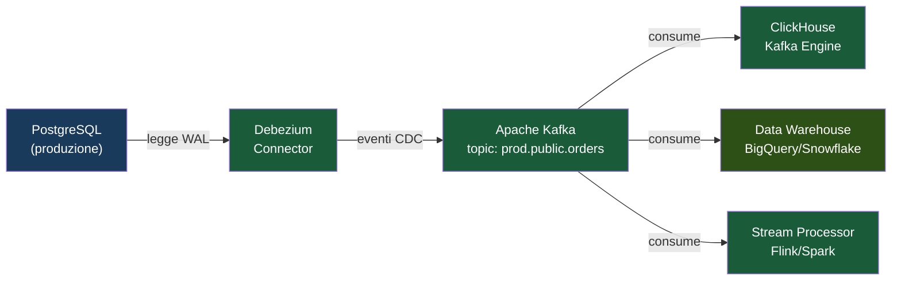

import { Aside, Steps, Tabs, TabItem } from '@astrojs/starlight/components'

Yelp gestisce oltre 100 tabelle MySQL in produzione. Ogni ordine, ogni recensione, ogni aggiornamento di business — tutto passa dal database operazionale. Il problema: il data warehouse per l'analytics era sempre in ritardo di 24 ore. Quando hanno costruito "Maxwell" — il loro sistema CDC open-source — hanno portato la latenza da 24 ore a meno di 10 secondi, senza impatto sulla produzione.

Change Data Capture (CDC) è la tecnica che risolve il problema strutturale di ogni architettura dati: il database operazionale ha dati aggiornati al secondo, il data warehouse ha dati di ieri. Colmare questo gap senza toccare la produzione è il cuore del CDC.

## Il problema che CDC risolve

Prima del CDC, i team sincronizzavano i dati in tre modi, tutti problematici:

**Full table scan notturno**: `SELECT *` ogni notte su tutta la tabella. Funziona per tabelle piccole, distrugge le performance su tabelle da miliardi di righe. Non scala.

**Timestamp-based polling**: `SELECT * WHERE updated_at > last_run`. Migliore, ma ha un difetto critico: i `DELETE` sono invisibili. Se un record viene cancellato, il data warehouse non lo saprà mai. Genera data drift silenzioso nel tempo.

**Trigger-based CDC**: trigger DB su ogni operazione che scrive su una tabella di audit. Funziona, ma aggiunge overhead a ogni scrittura. Su database ad alto traffico, questo overhead può degradare le performance del 15-30%.

Il **Log-based CDC** è il gold standard: legge direttamente il transaction log del database (WAL in PostgreSQL, binlog in MySQL) già scritto per garantire la durabilità delle transazioni. Zero impatto sulle performance. Ogni cambiamento è catturato fedelmente.

## I quattro approcci CDC a confronto

| Approccio | Latenza | Impatto DB | Cattura DELETE | Scalabilità |
|-----------|---------|------------|----------------|-------------|
| Full snapshot | Ore | Alto (I/O) | No | Scarsa |
| Timestamp polling | Minuti | Basso | **No** | Buona |
| Trigger-based | Secondi | **Alto** (CPU) | Sì | Media |
| Log-based (WAL/binlog) | Secondi | **Minimo** | Sì | Eccellente |

## Log-based CDC: come funziona internamente

### PostgreSQL WAL

PostgreSQL scrive ogni transazione nel WAL *prima* di applicarla al database, garantendo la durabilità. Il CDC log-based intercetta questo log come farebbe una replica standby.

Per abilitare il CDC su PostgreSQL:

```sql
-- In postgresql.conf (riavvio richiesto)
wal_level = logical        -- abilita la logical replication
max_replication_slots = 4  -- slot CDC per connettore
max_wal_senders = 4        -- worker che inviano il WAL

-- Utente dedicato con permessi minimi
CREATE USER debezium_user REPLICATION LOGIN PASSWORD 'secure_password';
GRANT SELECT ON ALL TABLES IN SCHEMA public TO debezium_user;

-- Publication: cosa replicare
CREATE PUBLICATION debezium_pub FOR TABLE orders, customers, products;
```

### MySQL binlog

```ini
# in my.cnf
[mysqld]
server-id     = 1
log_bin       = /var/lib/mysql/mysql-bin.log
binlog_format = ROW     # CRITICO: deve essere ROW, non STATEMENT
binlog_row_image = FULL # cattura il record completo (before + after)
expire_logs_days = 7    # retention del binlog
```

### MongoDB Change Streams

MongoDB offre Change Streams nativamente dalla versione 3.6, senza configurazione del log:

```javascript
const changeStream = db.collection('orders').watch();
changeStream.on('change', (change) => {
  // change.operationType: 'insert', 'update', 'replace', 'delete'
  // change.fullDocument: documento dopo il cambiamento
  // change.updateDescription: campi modificati (solo per update)
});
```

## Debezium: il connettore CDC più usato

Debezium è il progetto open-source di Red Hat che implementa CDC log-based per PostgreSQL, MySQL, MongoDB, SQL Server, Oracle. Funziona come insieme di Kafka Connect connectors.



### Configurazione del connettore PostgreSQL

```json
{
  "name": "pg-orders-connector",
  "config": {
    "connector.class": "io.debezium.connector.postgresql.PostgresConnector",
    "database.hostname": "postgres.internal",
    "database.port": "5432",
    "database.user": "debezium_user",
    "database.password": "${file:/opt/kafka/secrets/debezium.properties:db.password}",
    "database.dbname": "production",
    "table.include.list": "public.orders,public.order_items,public.customers",
    "plugin.name": "pgoutput",
    "slot.name": "debezium_orders_slot",
    "publication.name": "debezium_pub",
    "decimal.handling.mode": "double",
    "snapshot.mode": "initial",
    "heartbeat.interval.ms": "30000",
    "topic.prefix": "prod"
  }
}
```

<Aside type="caution">
Non mettere mai le password in chiaro nella configurazione. Usa il pattern `${file:...}` o meglio ancora HashiCorp Vault / AWS Secrets Manager tramite il Kafka Connect ExternalSecretConfigProvider.
</Aside>

### Il formato del messaggio Debezium

```json
{
  "payload": {
    "op": "u",
    "before": {
      "id": 1234,
      "status": "pending",
      "amount": 99.99,
      "updated_at": 1706789000000
    },
    "after": {
      "id": 1234,
      "status": "shipped",
      "amount": 99.99,
      "updated_at": 1706789012345
    },
    "source": {
      "ts_ms": 1706789012345,
      "db": "production",
      "table": "orders",
      "lsn": 987654321
    }
  }
}
```

Valori di `op`: `"c"` (INSERT), `"u"` (UPDATE), `"d"` (DELETE), `"r"` (snapshot).

## CDC verso ClickHouse: tre pattern

<Tabs>
<TabItem label="Kafka Engine (semplice)">

```sql
-- 1. Tabella Kafka che legge il topic Debezium
CREATE TABLE cdc_orders_kafka (
    op String,
    after_id     Nullable(UInt64),
    after_status Nullable(String),
    after_amount Nullable(Float64),
    source_ts_ms UInt64
) ENGINE = Kafka
SETTINGS
    kafka_broker_list   = 'kafka:9092',
    kafka_topic_list    = 'prod.public.orders',
    kafka_group_name    = 'clickhouse_cdc_orders',
    kafka_format        = 'JSONEachRow',
    kafka_skip_broken_messages = 100;

-- 2. Tabella destinazione
CREATE TABLE orders (
    id         UInt64,
    status     LowCardinality(String),
    amount     Float64,
    updated_at DateTime,
    _deleted   UInt8 DEFAULT 0
) ENGINE = ReplacingMergeTree(updated_at)
ORDER BY id;

-- 3. Materialized View che trasforma e carica
CREATE MATERIALIZED VIEW cdc_orders_mv TO orders AS
SELECT
    after_id AS id,
    if(op = 'd', '', after_status)  AS status,
    if(op = 'd', 0,  after_amount)  AS amount,
    toDateTime(intDiv(source_ts_ms, 1000)) AS updated_at,
    if(op = 'd', 1, 0) AS _deleted
FROM cdc_orders_kafka
WHERE op IN ('c', 'u', 'd');
```

</TabItem>
<TabItem label="CollapsingMergeTree (DELETE fisici)">

```sql
-- Per DELETE fisici reali usa CollapsingMergeTree
CREATE TABLE orders_collapsing (
    id         UInt64,
    status     String,
    amount     Float64,
    updated_at DateTime,
    sign       Int8   -- +1 per insert/update, -1 per delete
) ENGINE = CollapsingMergeTree(sign)
ORDER BY id;

-- Query corretta (somma i sign)
SELECT id, sum(sign * amount) AS amount
FROM orders_collapsing
GROUP BY id
HAVING sum(sign) > 0;
```

</TabItem>
</Tabs>

### Leggere dati deduplicati da ReplacingMergeTree

```sql
-- Query con FINAL: deduplicazione sincrona (più lenta ma corretta)
SELECT id, status, amount
FROM orders FINAL
WHERE _deleted = 0;

-- Pattern alternativo per grandi tabelle: window function
SELECT id, status, amount
FROM (
    SELECT *,
           row_number() OVER (PARTITION BY id ORDER BY updated_at DESC) AS rn
    FROM orders
    WHERE id IN (1234, 5678)
)
WHERE rn = 1 AND _deleted = 0;
```

## Schema Evolution: gestire i cambiamenti del database

Il problema più insidioso del CDC in produzione è quando lo schema del database sorgente cambia senza preavviso.

**Operazioni sicure** (non rompono il CDC):
- Aggiungere una colonna con valore DEFAULT
- Aumentare la lunghezza di un campo VARCHAR
- Aggiungere un nuovo indice

**Operazioni pericolose** (richiedono coordinamento preventivo):
- Rinominare una colonna → Debezium non la trova più
- Cambiare il tipo (es. `INT` → `BIGINT`) → errore di deserializzazione
- Aggiungere `NOT NULL` su colonna esistente → rompe lo snapshot iniziale

<Steps>
1. Comunicare le modifiche schema al team data engineering *prima* del deploy in produzione
2. Usare Schema Registry con Avro per versioning esplicito degli schemi
3. Seguire la policy di compatibilità BACKWARD: aggiungere è ok, rinominare e rimuovere no
4. Testare sempre in staging con traffico simulato prima della produzione
</Steps>

## Monitoring: il CDC silenziosamente rotto è il peggiore

Un CDC che non funziona è ovvio. Un CDC che funziona a metà genera dati sbagliati che nessuno sa essere sbagliati — molto peggio.

```sql
-- Replication slot lag in PostgreSQL (WAL in attesa)
SELECT
    slot_name,
    pg_size_pretty(pg_wal_lsn_diff(pg_current_wal_lsn(), restart_lsn)) AS lag_size,
    active
FROM pg_replication_slots;
-- Alert se lag_size > 500 MB
```

**Heartbeat pattern** — verifica che il CDC sia vivo end-to-end:

```sql
-- Nel DB sorgente: aggiorna ogni 30 secondi
CREATE TABLE cdc_heartbeat (
    id INT PRIMARY KEY DEFAULT 1,
    ts TIMESTAMP DEFAULT NOW()
);
UPDATE cdc_heartbeat SET ts = NOW() WHERE id = 1;

-- Nel data warehouse: alert se heartbeat > 2 minuti fa
SELECT ts FROM heartbeat_replica
WHERE source_ts > NOW() - INTERVAL 120 SECOND
LIMIT 1;
-- Se 0 righe → CDC interrotto
```

## Checklist pre-produzione CDC

- [ ] Utente DB con permessi minimi (REPLICATION + SELECT)
- [ ] Replication slot con nome descrittivo e cleanup policy
- [ ] Schema Registry configurato con compatibilità BACKWARD
- [ ] Monitoring del replication slot lag (alert su > 500 MB)
- [ ] Monitoring del consumer lag Kafka (alert su > 10.000 messaggi)
- [ ] Heartbeat table nel DB sorgente con alert su > 2 minuti
- [ ] Strategia UPDATE in destinazione (ReplacingMergeTree o soft delete)
- [ ] Strategia DELETE in destinazione documentata
- [ ] Piano per schema evolution comunicato ai team
- [ ] Test con failover simulato (Debezium offline per 30 minuti → recovery)
- [ ] Runbook di troubleshooting scritto e testato

<Aside type="tip">
Un CDC ben monitorato può avere SLA di latenza ≤ 10 secondi con uptime del 99.9%. La maggior parte degli incidenti CDC deriva da slot lag non monitorato o da schema evolution non coordinata — entrambi prevenibili.
</Aside>
