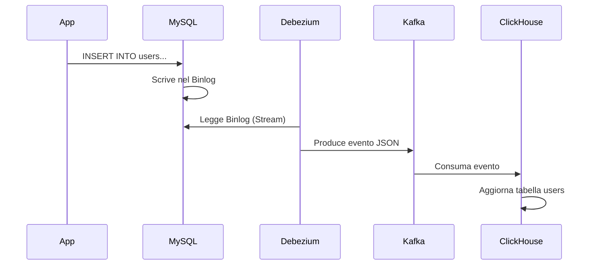
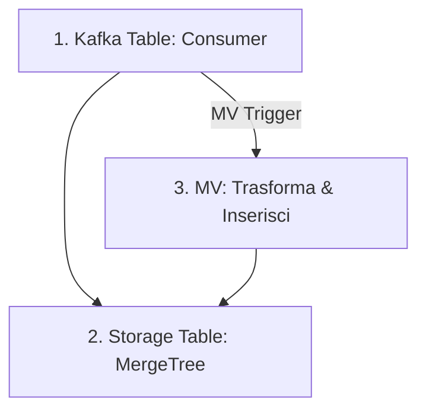

## Concetti Chiave

- **Kappa Architecture**: Un'architettura dove tutto è uno stream. Elimina la complessità della Lambda Architecture (Batch + Speed Layer).
- **Materialized View (ClickHouse)**: Un trigger che esegue una query `INSERT INTO` ogni volta che arrivano nuovi dati. Fondamentale per pre-aggregare i dati in tempo reale.
- **CDC (Change Data Capture)**: Catturare le modifiche (Insert, Update, Delete) da un database transazionale leggendo i log (WAL/Binlog) invece di fare query.
- **Kafka Engine**: Motore di ClickHouse che si comporta come un consumer Kafka. Legge lo stream ma non salva i dati (serve una MV per persistirli).
- **Dictionary**: Struttura dati in-memory (Key-Value) ottimizzata per lookup rapidissimi (join) durante l'ingestione.
- **Redpanda**: Alternativa a Kafka scritta in C++. Compatibile API, ma senza ZooKeeper e JVM (più veloce e semplice).

## Architetture di Streaming

### Pipeline di Ingestione ClickHouse
Il pattern standard per portare i dati da Kafka a una dashboard in < 1 secondo.

```mermaid
flowchart TD
    K[Kafka Topic: events] -->|Kafka Engine| KT[Table: queue_events]
    KT -->|Materialized View<br/>(Trigger)| MV[MV: Trasforma & Pulisce]
    MV -->|Insert| MT[Table: events<br/>(MergeTree)]
    MT -->|Aggregated MV| Agg[Table: hourly_stats<br/>(SummingMergeTree)]
    Agg -->|Query SQL| D[Dashboard Grafana]
```

### CDC Pattern (Debezium)
Come replicare un DB di produzione senza ucciderlo.



## Formule e Ottimizzazioni

| Concetto | Regola / Query | Perché |
|----------|----------------|--------|
| **Deduplica** | `ReplacingMergeTree` | Kafka garantisce "At-least-once". I duplicati arrivano. Questo engine tiene solo l'ultima versione. |
| **Lookup Veloce** | `dictGet('user_dict', 'name', user_id)` | Sostituisce le JOIN lente con lookup in RAM. Ideale per arricchire lo stream. |
| **Aggregazione** | `SummingMergeTree` | Somma i valori man mano che vengono inseriti. Le query di lettura devono solo leggere il risultato pre-calcolato. |
| **Latenza** | `stream_flush_interval_ms` | Abbassalo (es. 1000ms) per ridurre la latenza, ma aumenta il carico di I/O (più parti piccole). |

## Processo Step-by-Step: Configurare Kafka in ClickHouse

1.  **Crea la Tabella Kafka (Consumer)**:
    ```sql
    CREATE TABLE queue (json String) ENGINE = Kafka SETTINGS kafka_topic_list = 'topic', kafka_group_name = 'ch_group';
    ```
2.  **Crea la Tabella di Destinazione (Storage)**:
    ```sql
    CREATE TABLE events (id UInt64, data String) ENGINE = MergeTree ORDER BY id;
    ```
3.  **Crea la Materialized View (Il tubo)**:
    ```sql
    CREATE MATERIALIZED VIEW mv TO events AS SELECT JSONExtractUInt(json, 'id'), ... FROM queue;
    ```
    *Nota:* Non fare mai `SELECT *` dalla tabella Kafka direttamente per test, consuma i messaggi!



## Errori da Evitare

-   ❌ **Query diretta su Kafka Engine** → ✅ Ogni SELECT consuma i messaggi e sposta l'offset. I dati spariscono per sempre. Usa sempre una MV.
-   ❌ **Polling sul DB (SELECT * FROM users)** → ✅ Lento, costoso, non real-time. Usa CDC (Debezium).
-   ❌ **Troppe Materialized Views a cascata** → ✅ Ogni MV rallenta l'inserimento. Mantieni la catena corta (Raw -> Clean -> Aggregated).
-   ❌ **Ignorare la Backpressure** → ✅ Se ClickHouse è lento a inserire, Kafka continua a riempirsi. Monitora il `Consumer Lag`.
-   ❌ **JOIN su tabelle giganti in stream** → ✅ ClickHouse non supporta bene le JOIN durante l'inserimento stream. Usa i Dictionary.

## Quick Reference

| Strumento | A cosa serve | Quando usarlo |
|-----------|--------------|---------------|
| **ClickHouse** | Real-time DB | Analytics ultra-veloce su terabyte di dati. |
| **Redpanda / Kafka** | Event Bus | Trasportare i dati tra servizi in modo affidabile. |
| **Debezium** | CDC Platform | Estrarre modifiche dai DB transazionali. |
| **Grafana** | Visualization | Visualizzare le metriche in tempo reale (refresh ogni 5s). |
| **ZooKeeper** | Coordinator | Gestire il cluster Kafka (non serve con Redpanda). |
