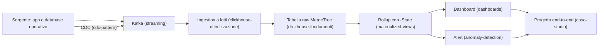

Una piattaforma di scommesse sportive rilascia il nuovo motore di telemetria alla vigilia della domenica di campionato. In staging, con 50 messaggi al secondo, ogni pannello risponde in 10 millisecondi. Alle 15:00, quando il flusso sale a 30.000 messaggi al secondo, le scritture vengono rifiutate, le dashboard rallentano e i conteggi degli utenti sono gonfiati.

## Un test locale perfetto e un picco che non perdona

Lo scenario è costruito, con numeri di esempio che riassumono i guasti di messa in produzione più frequenti su pipeline Kafka e ClickHouse. A basso volume i tre problemi non si vedono, e per questo i test funzionali non li trovano.

Il consumer scrive in ClickHouse con un `INSERT` per messaggio, e ogni `INSERT` crea una parte sul disco. A 30.000 messaggi al secondo sarebbero 30.000 parti al secondo: ben prima di arrivare a 3.000 parti attive in una partizione il motore rifiuta le scritture con l'errore `TOO_MANY_PARTS`. La chiave `ORDER BY (event_uuid, occurred_at)` mette in testa un valore casuale, quindi il filtro per sport e intervallo di tempo scansiona l'intera tabella a ogni refresh. Una vista materializzata salva `uniqExact(user_id)` come numero, e quando la dashboard somma i minuti per ottenere l'ora conta sessanta volte lo stesso spettatore.

> **Idea chiave:** in una pipeline Kafka e ClickHouse i guasti di produzione nascono da quattro vincoli fisici, cioè dimensione dei lotti, ordine delle colonne nella chiave, stati componibili nei rollup e confronto con una baseline stagionale. Una review serve a controllarli uno per uno, prima del picco.

Questa scheda fa da indice del modulo. Non spiega i meccanismi da capo: indica dove sono spiegati, a quali sintomi corrispondono e quali controlli applicare. Ognuna delle lezioni citate ha il proprio caso numerico completo.

## La mappa del modulo, dal sintomo alla lezione

Il diagramma mostra il percorso di un evento e dove ogni lezione interviene.



La tabella seguente è lo strumento di consultazione vero e proprio. Parte da quello che si osserva in produzione.

| Sintomo osservato | Causa tipica | Lezione | Controllo rapido |
|---|---|---|---|
| Errore `TOO_MANY_PARTS`, insert lenti | un insert per messaggio | ingestion in tempo reale | righe per insert e parti attive per partizione |
| Query per cliente legge milioni di righe | `ORDER BY ts` con filtro su altra colonna | ClickHouse e MergeTree | `EXPLAIN indexes = 1`, granuli letti su totali |
| Totale della replica diverso dalla sorgente | colonna mutabile nella chiave, lettura senza `FINAL` | CDC | differenza di righe e di somma con la sorgente |
| Utenti unici gonfiati su finestre larghe | `uniqExact` salvato come numero | materialized view | tipo `AggregateFunction` e lettura con `-Merge` |
| Dashboard lenta o con ultimo minuto che cala | lettura della raw e minuto aperto incluso | dashboard real-time | tabella letta e filtro `minuto < toStartOfMinute(now())` |
| Allarme notturno continuo, guasto non visto | soglia fissa sul totale | alerting e anomaly detection | baseline per giorno, minuto e segmento |
| Ricavi doppi dopo un retry di Kafka | somma diretta nella vista | progetto end-to-end | deduplica con `uniqState(event_id)` |

Usa la tabella da sinistra a destra: nella review non si parte dalla tecnica ma dal numero che non torna. Un conteggio troppo alto rimanda a deduplica e stati, una query lenta rimanda alla chiave, un allarme rumoroso rimanda alla baseline.

## Il budget di latenza, calcolato fase per fase

Dire «real-time» non basta, perché ogni fase aggiunge ritardo e qualcuno deve sommarlo. Il budget di latenza è il calcolo che trasforma un obiettivo di freschezza in vincoli per ogni componente. Lo scenario è costruito: la dashboard operativa deve mostrare un evento entro 5 secondi dalla sua generazione, al caso peggiore.

Passo uno: elenca le fasi e il ritardo massimo di ciascuna. Il producer accumula messaggi per 0,5 secondi prima di inviarli (`linger`). Il broker Kafka conferma in 0,1 secondi. Il consumer fa il flush ogni 1,0 secondi. L'insert in ClickHouse, con la vista materializzata che aggiorna il rollup, impiega 0,3 secondi. La dashboard si aggiorna ogni 2,0 secondi, e al caso peggiore l'evento arriva subito dopo un refresh. La query sul rollup richiede 0,05 secondi.

Passo due: somma. 0,5 + 0,1 + 1,0 + 0,3 + 2,0 + 0,05 = 3,95 secondi.

Passo tre: confronta con l'obiettivo. 5,0 − 3,95 = 1,05 secondi di margine, pari al 21% del budget. Il margine serve a coprire i picchi, per esempio un merge più lento o un ritardo di rete, e non va speso in anticipo.

Passo quattro: verifica la scelta del lotto. A 200 righe al secondo, un consumer che aspetta un lotto di 10.000 righe prima di scrivere attende 10.000 ÷ 200 = 50 secondi, dieci volte l'intero budget. Per questo la regola è doppia: flush quando il lotto raggiunge la dimensione target o quando scade un tempo massimo, e il tempo massimo vince nei flussi lenti. Con flush a 1 secondo il lotto contiene 200 righe: 1 parte al secondo, cioè 60 parti al minuto. Con un insert per riga sarebbero 200 parti al secondo, 12.000 al minuto, e il rapporto è 12.000 ÷ 60 = 200 volte in più.

Il budget indica anche dove intervenire per guadagnare tempo. Il peso maggiore è il refresh della dashboard: 2,0 secondi su 3,95, cioè il 51%. Portarlo a 1,0 secondo recupera un secondo e porta il totale a 2,95 secondi, ma moltiplica per due le query sul rollup. Un rollup piccolo regge la cosa, la tabella raw no.

## Controlli minimi in SQL

Il blocco seguente crea una raw con chiave per cardinalità crescente, un rollup con stati componibili e la query che li fonde, più il controllo delle parti attive. È lo scheletro che la review dovrebbe riconoscere.

```sql
-- Raw: chiave dal filtro più selettivo al dettaglio; partizione mensile solo per il ciclo di vita.
CREATE TABLE eventi_raw
(
    tenant_id LowCardinality(String),
    occorso DateTime('UTC'),
    event_id String,
    utente UInt64,
    latenza_ms UInt32
)
ENGINE = MergeTree
PARTITION BY toYYYYMM(occorso)
ORDER BY (tenant_id, toStartOfHour(occorso), event_id);

-- Rollup al minuto: somme semplici e stati binari per le misure non additive.
CREATE TABLE rollup_1m
(
    tenant_id LowCardinality(String),
    minuto DateTime('UTC'),
    eventi SimpleAggregateFunction(sum, UInt64),
    utenti_state AggregateFunction(uniq, UInt64),
    p95_state AggregateFunction(quantile(0.95), UInt32)
)
ENGINE = AggregatingMergeTree
ORDER BY (tenant_id, minuto);

-- La vista scrive gli stati a ogni blocco inserito.
CREATE MATERIALIZED VIEW mv_rollup_1m TO rollup_1m AS
SELECT
    tenant_id,
    toStartOfMinute(occorso) AS minuto,
    count() AS eventi,
    uniqState(utente) AS utenti_state,
    quantileState(0.95)(latenza_ms) AS p95_state
FROM eventi_raw
GROUP BY tenant_id, minuto;

-- 10 insert da 20.000 righe ciascuno.
-- ripeti: 10
INSERT INTO eventi_raw
SELECT
    ['acme', 'beta'][1 + cityHash64(number) % 2],
    toDateTime('2026-11-15 15:00:00', 'UTC') + intDiv(number, 500),
    concat(toString(rand64()), '-', toString(number)),
    cityHash64(number) % 5000,
    50 + cityHash64(number, 7) % 400
FROM numbers(20000);

-- Utenti distinti reali sulla raw: 4.902 su 200.000 righe.
SELECT count() AS righe, uniqExact(utente) AS utenti FROM eventi_raw;

-- Lettura dal rollup con -Merge, escludendo il minuto aperto.
SELECT
    tenant_id,
    toStartOfFifteenMinutes(minuto) AS finestra,
    sum(eventi) AS eventi,
    uniqMerge(utenti_state) AS utenti_unici,
    round(quantileMerge(0.95)(p95_state)) AS p95_ms
FROM rollup_1m
WHERE minuto < toDateTime('2026-11-15 15:41:00', 'UTC')
GROUP BY tenant_id, finestra
ORDER BY tenant_id, finestra;

-- Controllo di salute: parti attive per tabella. Il numero dipende da quando passano i merge.
SELECT table, count() AS parti_attive FROM system.parts WHERE active AND table IN ('eventi_raw', 'rollup_1m') GROUP BY table ORDER BY table;
```

Il risultato dei due tenant, 2.447 e 2.455 utenti unici, somma a 4.902, che coincide con gli utenti distinti calcolati direttamente sulla raw: dieci insert separati non hanno moltiplicato nulla, perché `uniqMerge` fonde stati e non somma numeri. Il 95° percentile della latenza esce 429 millisecondi su valori uniformi tra 50 e 449, coerente con 50 + 0,95 × 400 = 430.

Nota che `eventi` è una `SimpleAggregateFunction(sum, UInt64)` e non un `UInt64` semplice: ClickHouse rifiuta la creazione di un `AggregatingMergeTree` con una colonna che non sia nella chiave né una misura aggregata, perché i merge la lascerebbero con un valore arbitrario.

## Tre antipattern da respingere in code review

### Partizione per ora e UUID in testa alla chiave

Sintomo: `TOO_MANY_PARTS` anche con lotti ragionevoli, scansioni complete sulle dashboard. Succede perché la partizione viene letta come un acceleratore di query, mentre serve per il ciclo di vita dei dati, e perché un UUID in testa alla chiave impedisce all'indice sparso di scartare granuli. Si corregge con partizione mensile e chiave per cardinalità crescente, con l'identificativo in coda.

### Distinti e percentili salvati come numeri

Sintomo: utenti unici sulla finestra oraria più alti della somma reale, percentili che non tornano. Un conteggio distinto per minuto non è additivo: lo stesso utente compare in minuti diversi e la somma lo conta più volte. Si corregge con `AggregateFunction` e combinatori `-State` in scrittura, `-Merge` in lettura, come nel blocco qui sopra.

### FINAL su tutta la tabella a ogni refresh

Sintomo: CPU satura e timeout con venti dashboard aperte. `FINAL` su una `ReplacingMergeTree` senza filtro sulla chiave costringe il motore a ordinare tutte le versioni. Si corregge filtrando sulle colonne della chiave, oppure costruendo un rollup che le dashboard leggano al posto della raw.

## Controllo prima del rilascio

1. Un consumer scrive 120 righe al secondo con flush ogni 2 secondi. Quante righe ha ogni parte e quante parti al minuto produce?

<details>
<summary>Mostra risposta</summary>

Ogni parte contiene 120 × 2 = 240 righe. Le parti al minuto sono 60 ÷ 2 = 30. Con un insert per riga sarebbero 120 al secondo, cioè 7.200 al minuto, 240 volte di più. Il budget di latenza assorbe 2 secondi di flush solo se l'obiettivo di freschezza li prevede.

</details>

2. Il budget di freschezza è 3 secondi. Le fasi sommano 0,4 + 0,1 + 1,5 + 0,3 + 1,0 + 0,05 secondi. Il budget regge?

<details>
<summary>Mostra risposta</summary>

La somma è 0,4 + 0,1 + 1,5 + 0,3 + 1,0 + 0,05 = 3,35 secondi, quindi supera l'obiettivo di 0,35 secondi. Si recupera ridimensionando la fase più pesante, il flush a 1,5 secondi: portarlo a 1,0 secondo riduce il totale a 2,85 secondi, con 0,15 secondi di margine, il 5%. Il margine è sottile e conviene intervenire anche su un'altra fase.

</details>

3. Una dashboard mostra utenti unici orari più alti della somma reale di circa il 18%. Quale controllo fai per primo?

<details>
<summary>Mostra risposta</summary>

Il tipo della colonna nel rollup. Se è un intero salvato con `uniqExact` per minuto, la somma sull'ora conta più volte gli stessi utenti. Deve essere `AggregateFunction(uniq, UInt64)`, alimentata con `uniqState` e letta con `uniqMerge`.

</details>

4. Perché un allarme sul totale degli ordini non basta, e quale scomposizione aggiungi?

<details>
<summary>Mostra risposta</summary>

Il totale mescola segmenti, e il crollo di uno viene coperto dagli altri. Si scompone per le dimensioni di guasto, come piattaforma, gateway di pagamento o paese, confrontando ogni segmento con la mediana della stessa ora dello stesso giorno della settimana e richiedendo tre minuti chiusi consecutivi.

</details>
