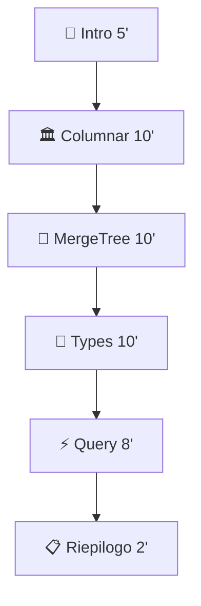

## Fondamenti di ClickHouse: Il database analitico più veloce al mondo — Lezione Completa

Se sei abituato a MySQL o PostgreSQL, dimentica tutto. ClickHouse è un animale diverso. È stato progettato da Yandex per analizzare il traffico web di milioni di siti in tempo reale (Yandex.Metrica). Non è fatto per gestire transazioni bancarie (OLTP), è fatto per macinare miliardi di righe al secondo (OLAP). In questa lezione, capiremo perché è così veloce e come scrivere le prime query che ti faranno sentire un supereroe dei dati.

### Obiettivi di Apprendimento

Al termine di questa lezione, lo studente sarà in grado di:
1.  Spiegare la differenza architetturale tra Row-Store (MySQL) e Column-Store (ClickHouse).
2.  Creare una tabella ottimizzata usando il motore `MergeTree`.
3.  Scegliere i tipi di dati corretti per massimizzare la compressione (es. `UInt32` vs `Int64`, `LowCardinality`).
4.  Eseguire inserimenti massivi (Bulk Insert) evitando l'errore comune di inserire riga per riga.
5.  Scrivere query analitiche di base con aggregazioni veloci.

### Timeline della Lezione

| Fase | Argomento | Durata |
|------|-----------|--------|
| 1 | Introduzione: OLTP vs OLAP | 5 min |
| 2 | Architettura: Column-Oriented Storage | 10 min |
| 3 | Pratica: MergeTree Engine e Table Creation | 10 min |
| 4 | Data Types: Ottimizzazione dello Spazio | 10 min |
| 5 | Esercizi: Inserimento e Query | 8 min |
| 6 | Riepilogo e Domande | 2 min |
| **Totale** | | **45 min** |



### Fase 1 — Introduzione: OLTP vs OLAP (5 min)

Immagina una biblioteca.
*   **OLTP (Online Transactional Processing):** È come il bibliotecario che gestisce i prestiti. "Mario Rossi ha preso il libro X oggi". Deve essere veloce a scrivere singole righe, garantire coerenza (ACID) e non perdere nulla. (MySQL, Postgres, Oracle).
*   **OLAP (Online Analytical Processing):** È come un ricercatore che vuole sapere: "Qual è il genere più letto dalle donne sotto i 30 anni nel 2023?". Non gli interessa il singolo prestito, gli interessa l'aggregato di milioni di prestiti. (ClickHouse, Snowflake, BigQuery).

Se usi MySQL per fare OLAP su 100 milioni di righe, il server esplode. ClickHouse lo fa in 0.5 secondi.

### Fase 2 — Architettura: Column-Oriented Storage (10 min)

Perché ClickHouse è veloce? Perché è **Colonnare**.

**Row-Store (Tradizionale):**
I dati sono salvati riga per riga su disco.
`[ID=1, Nome=Mario, Spesa=50]`, `[ID=2, Nome=Luigi, Spesa=30]`...
Per calcolare la `SUM(Spesa)`, il database deve leggere *tutto* (anche ID e Nome), sprecando il 90% dell'I/O.

**Column-Store (ClickHouse):**
I dati sono salvati colonna per colonna in file separati.
File 1 (Spesa): `[50, 30, ...]`
File 2 (Nome): `[Mario, Luigi, ...]`
Per calcolare `SUM(Spesa)`, ClickHouse legge *solo* il File 1. È 100 volte più efficiente.

Inoltre, numeri vicini si comprimono benissimo. `[0, 0, 0, 1, 1]` diventa `3x0, 2x1`. ClickHouse usa compressione aggressiva (LZ4/ZSTD) risparmiando spazio (e soldi).

### Fase 3 — Pratica: MergeTree Engine e Table Creation (10 min)

Il motore principale di ClickHouse si chiama `MergeTree`. Non è un albero, è una famiglia di motori che gestisce l'inserimento veloce e la fusione dei dati in background.

```sql
CREATE TABLE visits (
    visit_id UInt64,
    visit_time DateTime,
    user_id UInt64,
    url String,
    duration UInt32
) ENGINE = MergeTree()
ORDER BY (visit_time, user_id)
PARTITION BY toYYYYMM(visit_time);
```

**Analisi della DDL:**
*   `ENGINE = MergeTree()`: Standard.
*   `ORDER BY`: La chiave primaria fisica. I dati sono ordinati su disco per Tempo e poi per Utente. Le query che filtrano per tempo saranno istantanee.
*   `PARTITION BY`: Divide i dati in cartelle mensili (es. `202310`, `202311`). Utile per cancellare vecchi dati (`DROP PARTITION`).

### Fase 4 — Data Types: Ottimizzazione dello Spazio (10 min)

In ClickHouse, il tipo di dato conta.
*   **Int vs UInt:** Se una colonna non può essere negativa (es. `clicks`), usa `UInt` (Unsigned Integer). Raddoppi il range positivo.
    *   `UInt8`: 0-255 (es. età, flag).
    *   `UInt32`: 0-4 miliardi (es. ID utente).
*   **String vs LowCardinality:**
    *   Se hai una colonna `Country` con 200 valori ripetuti milioni di volte, usa `LowCardinality(String)`. ClickHouse la trasforma internamente in numeri (Dictionary Encoding), rendendola minuscola e velocissima da filtrare.
*   **Date vs DateTime:** Usa `Date` (2 byte) se non ti serve l'ora. Risparmi spazio.
*   **Nullable:** Evitalo se puoi. Rallenta le performance e occupa più spazio. Meglio usare valori di default (es. 0 o stringa vuota) invece di NULL.

### Fase 5 — Esercizi: Inserimento e Query (8 min)

**Inserimento (Bulk Insert):**
Mai fare `INSERT INTO ... VALUES (...)` in un loop per ogni riga. ClickHouse odia le piccole insert.
Accumula i dati (buffer) e inserisci 10.000 righe alla volta.
`INSERT INTO visits FORMAT JSONEachRow ...`

**Query Analitica:**
```sql
SELECT
    url,
    count() as visite,
    avg(duration) as durata_media,
    quantile(0.95)(duration) as p95_durata
FROM visits
WHERE visit_time > now() - INTERVAL 1 HOUR
GROUP BY url
ORDER BY visite DESC
LIMIT 10
```
*   `count()`: Veloce.
*   `quantile(0.95)`: Calcola il 95° percentile (escludendo gli outlier estremi). Molto più utile della media per le performance web.

### Fase 6 — Riepilogo e Domande (2 min)

1.  **Non usare ClickHouse per transazioni.** Niente `UPDATE` o `DELETE` su singole righe (sono operazioni pesanti chiamate `MUTATION`).
2.  **Bulk Insert.** Inserisci a blocchi grossi.
3.  **Tipi stretti.** Usa il tipo di dato più piccolo possibile (`UInt8` invece di `Int64`).
4.  **Colonnare.** Seleziona solo le colonne che ti servono (`SELECT *` è il male).

### Domande di Verifica

1.  Perché un database colonnare è molto più veloce di uno row-based per calcolare la somma di una colonna su miliardi di righe?
2.  Qual è la funzione della clausola `ORDER BY` nel motore `MergeTree` e come differisce dalla Primary Key di MySQL?
3.  Perché è sconsigliato eseguire frequenti `UPDATE` o `DELETE` di singole righe in ClickHouse?
4.  Spiega il vantaggio del tipo di dato `LowCardinality(String)` rispetto a `String` standard.
5.  Cos'è una "Partizione" in ClickHouse e qual è il criterio tipico per definire la chiave di partizionamento (`PARTITION BY`)?

### Riferimenti Bibliografici

-   ClickHouse Official Documentation (Introduction).
-   Mark Litwintschik, "Billion Taxi Rides Benchmark" (confronto performance DB).
-   Altinity Blog (ClickHouse training resources).
