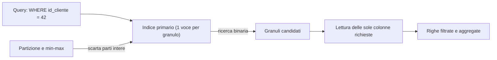

La scheda di un cliente impiega quasi un secondo a caricarsi. La tabella sta in ClickHouse, scelto proprio perché legge in fretta, e la query ha il filtro giusto: `WHERE id_cliente = 42`. Nessun errore, nessun avviso nei log. Eppure per restituire 4.967 righe il motore ne legge cinque milioni.

## Cinque milioni di righe per trovarne 4.967

Il caso è ricostruito con numeri di esempio: cinque milioni di eventi web, mille clienti, centosedici giorni di storia, tutti generati dal codice che trovi più sotto. Non sono misure di produzione. Sono l'output di chDB, il motore ClickHouse in-process per Python, e li ottieni rieseguendo i blocchi `sql` nell'ordine in cui compaiono.

La tabella è quella che nasce il primo giorno di ogni progetto: `ORDER BY ts`, una partizione per giorno, stringhe dove capita. La scheda cliente seleziona 4.967 righe, cioè lo 0,1% del totale, ma ClickHouse ne legge 5.000.000 e scarica 45 MB di colonne. Il lavoro è mille volte più grande del risultato.

La reazione tipica è aggiungere nodi, e funziona finché la tabella cresce meno della macchina. Con un altro ordine delle righe sul disco la stessa query, sullo stesso hardware, legge 49.152 righe e 372 KB.

> **Idea chiave:** l'indice primario di ClickHouse non cerca righe, scarta blocchi di 8.192 righe, e li scarta bene solo se l'ordine fisico dei dati segue i filtri delle tue query.

Il motore non è lento. Esegue quello che gli è stato chiesto: righe ordinate per tempo, interrogate per cliente. Il problema non è la potenza del cluster ma l'ordine in cui le righe stanno su disco, e quell'ordine lo decidi tu nel `CREATE TABLE`, una volta sola.

## Come MergeTree salva e legge una colonna

Per capire perché l'ordine pesa tanto serve il modello fisico, che si riduce a tre fatti.

Il primo: ogni colonna vive in un file separato. Una query che usa due colonne su sei apre due file e ignora gli altri quattro. Per questo `SELECT *` costa in proporzione alle colonne della tabella e non a quelle che ti servono davvero.

Il secondo: ogni `INSERT` crea una parte, cioè una cartella immutabile in cui le righe sono ordinate secondo la chiave `ORDER BY`. Dentro la parte ogni colonna è divisa in granuli da 8.192 righe, valore di default. L'indice primario ha una sola voce per granulo: il valore della chiave della prima riga. È un indice sparso, non punta alle righe ma ai blocchi ([indici primari nella documentazione](https://clickhouse.com/docs/primary-indexes)).

Il terzo: la query fa una ricerca binaria tra le voci dell'indice e scarta i granuli che non possono contenere il valore cercato. Quelli che restano vengono letti per intero. Quanti se ne scartano dipende da una sola cosa, cioè da quanto il filtro coincide con l'ordine fisico.



Con `ORDER BY ts` i mille clienti sono mescolati: ognuno compare in ogni blocco, quindi nessun granulo può essere escluso. Con `ORDER BY (id_cliente, ts)` le righe di un cliente stanno una accanto all'altra e occupano pochi granuli consecutivi.

## Il conto dei granuli, passo per passo

Prima di toccare codice conviene saper prevedere il risultato con una calcolatrice. Il calcolo è corto e vale per qualunque tabella MergeTree.

Partiamo dalla tabella con `ORDER BY ts`. Contiamo i granuli: 5.000.000 righe ÷ 8.192 righe per granulo = 610,4, quindi 611 granuli. In pratica sono 612, perché la tabella è composta da 4 parti e ogni parte arrotonda per eccesso il proprio ultimo granulo. Il filtro su `id_cliente` non coincide con l'ordine, quindi tutti i 612 granuli sono candidati: 612 × 8.192 ≈ 5.000.000 righe lette.

Passiamo alla tabella con `ORDER BY (id_cliente, ts)`. Il cliente 42 ha 4.967 righe. Dentro ogni parte le sue righe sono contigue, quindi occupano al più 2 granuli per parte quando attraversano un confine. Su 4 parti il massimo teorico è 8 granuli, e il motore ne legge 6: 6 × 8.192 = 49.152 righe.

Ora i rapporti, che sono il vero risultato dell'esempio:

- Righe lette rispetto a quelle restituite, tabella v1: 5.000.000 ÷ 4.967 = 1.006,6 righe lette per ogni riga utile.
- Stesso rapporto, tabella v2: 49.152 ÷ 4.967 = 9,9 righe lette per ogni riga utile.
- Riduzione del lavoro: 5.000.000 ÷ 49.152 = 101,7 volte in meno sulle righe, e 45.000.000 ÷ 372.216 = 120,9 volte in meno sui byte.

Il rapporto 9,9 non scende mai a 1, perché si legge sempre il granulo intero anche quando contiene poche righe utili. Le 49.152 righe sono l'ordine di grandezza giusto: la query è passata da centinaia di migliaia di blocchi a una manciata.

Un controllo sui byte conferma il modello della prima sezione: nella v1 la query legge due colonne, `id_cliente` (4 byte più 1 byte di maschera per il `Nullable`) e `durata_ms` (4 byte), cioè 9 byte per riga. E infatti 5.000.000 × 9 byte = 45.000.000 byte, esattamente i 45 MB misurati.

## Tre errori di schema che passano ogni test

Questo è lo schema che esce da un tutorial e da una scadenza. Il blocco crea la tabella, la riempie con i dati sintetici e misura la scheda cliente.

```sql
-- Schema di partenza: ordinato per tempo, partizione giornaliera, tipi larghi.
CREATE TABLE eventi_web_v1
(
    ts DateTime,
    id_cliente Nullable(UInt32),
    id_campagna UInt16,
    pagina String,
    stato String,
    durata_ms UInt32
)
ENGINE = MergeTree
PARTITION BY toDate(ts)
ORDER BY ts;

-- Cinque milioni di eventi sintetici, uno ogni due secondi.
INSERT INTO eventi_web_v1
SELECT
    toDateTime('2026-01-01 00:00:00') + number * 2,
    cityHash64(number) % 1000,
    cityHash64(number, 1) % 50,
    concat('/prodotto/', toString(cityHash64(number, 2) % 40)),
    ['ok', 'errore', 'timeout', 'redirect', 'bloccato'][1 + cityHash64(number, 3) % 5],
    cityHash64(number, 4) % 5000
FROM numbers(5000000);

-- Solo per questa misura: fonde le parti, così i conteggi sono ripetibili.
OPTIMIZE TABLE eventi_web_v1 FINAL;

-- La scheda cliente: 4.967 righe restituite, 5.000.000 lette.
SELECT count(), avg(durata_ms) FROM eventi_web_v1 WHERE id_cliente = 42;
```

### L'ordine parte dal tempo

Sintomo: la query per cliente, per campagna o per pagina legge l'intera tabella, e il tempo cresce in modo lineare con le righe. Succede perché gli eventi arrivano in ordine cronologico, i grafici sono sul tempo e `ORDER BY ts` è la prima chiave che viene in mente. Ogni filtro che non sia il tempo non guadagna nulla.

È l'errore peggiore perché tace finché la tabella è piccola: su diecimila righe la differenza non si vede, e quando si vede la tabella ha già un anno di storia. La correzione è partire dall'elenco dei filtri della query dominante e metterli in testa alla chiave.

### Una partizione al giorno per andare più veloce

Sintomo: centinaia di partizioni, tante cartelle da aprire, merge che non possono unire parti di partizioni diverse. Qui nascono 116 partizioni per cinque milioni di righe. Si partiziona sul tempo perché le query filtrano sul tempo, ma la documentazione è chiara: la partizione serve a gestire i dati, per cancellare un mese o spostarlo su storage più economico, non ad accelerare le query. La cardinalità ottimale della chiave di partizione sta sotto i 100–1.000 valori.

La correzione è partizionare per mese e solo se hai davvero una scadenza da applicare con `TTL` o `DROP PARTITION`. Altrimenti anche una sola partizione va bene.

### Tipi larghi per abitudine

Sintomo: la tabella occupa il doppio dello spazio necessario. `stato String` con cinque valori distinti, `id_cliente Nullable(UInt32)` perché «potrebbe mancare». La si scambia per prudenza, ma `LowCardinality` conviene sotto i 10.000 valori distinti e `Nullable` aggiunge una seconda colonna `UInt8` da leggere a ogni query.

Questo difetto non spiega il rallentamento della scheda, gonfia lo spazio: 95,21 MiB per la v1 contro 48,29 MiB della versione corretta. L'esperimento cambia tipi, chiave e partizione insieme, quindi non separa il peso di ciascuna scelta. Per isolarlo basta ricreare la tabella cambiando una sola cosa per volta.

## La tabella ricostruita: ordine, partizione e tipi giusti

I criteri, in ordine di priorità:

1. Elenca i filtri della query dominante, quella che parte più volte al giorno. Quelle colonne aprono la chiave.
2. Tra le colonne di filtro, prima quelle con meno valori distinti: la documentazione consiglia la cardinalità crescente, per l'indice e per la compressione. La regola cede alla query dominante, perché un filtro su una colonna in coda è meno efficace di uno in testa ([scelta della chiave](https://clickhouse.com/docs/best-practices/choosing-a-primary-key)).
3. Partiziona solo per il ciclo di vita dei dati, un mese alla volta.
4. Usa tipi stretti: `LowCardinality` per le stringhe con pochi valori, nessun `Nullable` senza una ragione.

Lo schema corretto, con la copia dei dati dalla tabella sbagliata e la stessa misura:

```sql
-- Schema corretto: la chiave parte dal filtro della scheda cliente.
CREATE TABLE eventi_web_v2
(
    ts DateTime,
    id_cliente UInt32,
    id_campagna UInt16,
    pagina LowCardinality(String),
    stato LowCardinality(String),
    durata_ms UInt32
)
ENGINE = MergeTree
PARTITION BY toYYYYMM(ts)
ORDER BY (id_cliente, ts);

INSERT INTO eventi_web_v2 SELECT * FROM eventi_web_v1;

OPTIMIZE TABLE eventi_web_v2 FINAL;

-- Stessa query, stesso risultato: 49.152 righe lette invece di 5.000.000.
SELECT count(), avg(durata_ms) FROM eventi_web_v2 WHERE id_cliente = 42;

-- Granuli letti dopo l'indice primario: 6 su 612.
EXPLAIN indexes = 1 SELECT count() FROM eventi_web_v2 WHERE id_cliente = 42;

-- Partizioni e spazio delle due tabelle: 116 e 4 partizioni.
SELECT table, uniqExact(partition) AS partizioni, formatReadableSize(sum(data_compressed_bytes)) AS su_disco
FROM system.parts
WHERE active AND table LIKE 'eventi_web_v%'
GROUP BY table
ORDER BY table;
```

Il risultato è quello previsto dal conto dei granuli: da 5.000.000 righe a 49.152, due ordini di grandezza sulla stessa query e con lo stesso risultato. Lo spazio su disco scende da 95,21 a 48,29 MiB, quindi del 49%, perché 48,29 ÷ 95,21 = 0,507.

La correzione non si fa sul posto. ClickHouse non permette di modificare la chiave primaria di una tabella esistente: si crea la tabella nuova, si copia con `INSERT … SELECT` come nel blocco qui sopra e si scambiano i nomi con `EXCHANGE TABLES`, che è atomico. Costa tempo e spazio doppio durante la copia, e se le scritture continuano devi decidere come non perderle. La chiave si sceglie prima del primo milione di righe, non dopo il miliardo.

## La seconda domanda: indice di salto o projection

La scheda cliente ora è veloce. Poi arriva la seconda domanda: tutti gli eventi di una campagna. `id_campagna` non è in testa alla chiave e le campagne sono mescolate in ogni granulo, quindi la query torna a leggere tutto.

Gli strumenti sono due. L'indice di salto (data skipping index) tiene un riassunto di ogni blocco di granuli e scarta quelli che non possono contenere il valore. La projection tiene una seconda copia della tabella con un altro ordine, scelta in automatico dal motore quando conviene.

Il criterio: **indice di salto se i valori della colonna sono già raggruppati dall'ordine fisico, projection se non lo sono.** Per controllare, non servono ipotesi: basta confrontare i granuli letti prima e dopo.

```sql
-- Senza indici: 5.000.000 righe lette.
SELECT count() FROM eventi_web_v2 WHERE id_campagna = 7;

ALTER TABLE eventi_web_v2 ADD INDEX idx_campagna id_campagna TYPE set(100) GRANULARITY 1;
ALTER TABLE eventi_web_v2 MATERIALIZE INDEX idx_campagna SETTINGS mutations_sync = 1;

-- Con l'indice di salto: ancora 5.000.000 righe, 612 granuli su 612.
SELECT count() FROM eventi_web_v2 WHERE id_campagna = 7;
EXPLAIN indexes = 1 SELECT count() FROM eventi_web_v2 WHERE id_campagna = 7;

ALTER TABLE eventi_web_v2 ADD PROJECTION per_campagna (SELECT * ORDER BY id_campagna, ts);
ALTER TABLE eventi_web_v2 MATERIALIZE PROJECTION per_campagna SETTINGS mutations_sync = 1;

-- Con la projection: 139.264 righe, 17 granuli su 612.
SELECT count() FROM eventi_web_v2 WHERE id_campagna = 7;
EXPLAIN indexes = 1 SELECT count() FROM eventi_web_v2 WHERE id_campagna = 7;

-- Il costo della projection: una copia della tabella.
SELECT formatReadableSize(sum(data_compressed_bytes)) AS su_disco
FROM system.projection_parts
WHERE active AND table = 'eventi_web_v2';
```

L'indice di salto ha controllato tutti i 612 granuli e non ne ha scartato nessuno, perché ogni granulo contiene righe di tutte le cinquanta campagne. Si paga in scrittura e in spazio senza guadagnare in lettura, e lo si scopre quando la tabella ha già un miliardo di righe. Con poca correlazione tra la colonna filtrata e la chiave di ordinamento l'indice non salta nulla.

La projection riporta le righe lette da 5.000.000 a 139.264: 17 granuli × 8.192 righe = 139.264. È una riduzione di 5.000.000 ÷ 139.264 = 35,9 volte. Ha però un prezzo: 54,83 MiB, più della tabella che la contiene (48,29 MiB), perché ordinata per campagna si comprime peggio.

Il dataset è sintetico e uniforme, e questo semplifica i numeri. Con clienti reali un cliente grande può occupare da solo centinaia di granuli, e la distribuzione dei valori cambia i conti. Una terza strada, la materialized view verso una seconda tabella, ha la sua lezione nel modulo.

## Misurare il lavoro e non i millisecondi

I millisecondi dipendono dal carico del server in quel momento. Il lavoro no. Per questo la metrica che separa chi ottimizza da chi tira a indovinare è il rapporto tra righe lette e righe restituite, cioè `read_rows` e `result_rows` in `system.query_log`.

La tabella riassume le tre configurazioni dell'esempio, con i numeri letti nelle sezioni precedenti.

| Configurazione | Righe lette | Granuli letti | Spazio su disco |
|---|---:|---:|---:|
| v1, filtro su cliente | 5.000.000 | 612 su 612 | 95,21 MiB |
| v2, filtro su cliente | 49.152 | 6 su 612 | 48,29 MiB |
| v2 con projection, filtro su campagna | 139.264 | 17 su 612 | 48,29 MiB + 54,83 MiB |

Una query lenta si diagnostica in tre mosse: leggi il rapporto, lancia `EXPLAIN indexes = 1` per vedere quali granuli sopravvivono a ogni indice, poi confronta i filtri con le colonne di testa della chiave. Se il rapporto è alto e nessun indice scarta granuli, il problema è nell'ordine, e nessun parametro del server lo risolve.

## Verifica sulle tue tabelle

1. Una tabella di 20 milioni di righe ha `ORDER BY ts` e la query dominante filtra per `tenant_id`. Quanti granuli ti aspetti di leggere e perché?

<details>
<summary>Mostra risposta</summary>

20.000.000 ÷ 8.192 ≈ 2.442 granuli, e con il filtro su `tenant_id` fuori dalla chiave tutti sono candidati. L'indice primario non può scartare nulla perché i tenant sono mescolati in ogni blocco. Serve una chiave che parta da `tenant_id`.

</details>

2. Dopo la correzione la query legge 49.152 righe e ne restituisce 4.967. Perché il rapporto non scende sotto 9,9, e come lo spieghi a un collega?

<details>
<summary>Mostra risposta</summary>

Il motore legge sempre granuli interi da 8.192 righe, quindi legge righe che poi il filtro scarta. 6 granuli × 8.192 = 49.152 righe, mentre le righe utili sono 4.967. Il rapporto 49.152 ÷ 4.967 = 9,9 è il costo dell'arrotondamento al granulo, ed è normale.

</details>

3. Una tabella ha una partizione per ora e dopo un mese conta 720 partizioni. Che cosa cambia se la passi a una partizione per mese?

<details>
<summary>Mostra risposta</summary>

Le partizioni scendono da 720 a 1, quindi meno parti da aprire e più merge possibili tra parti della stessa partizione. Le query non diventano più veloci per effetto della partizione. Perdi la possibilità di scadere i dati ora per ora, che raramente serve.

</details>

4. Una colonna `stato String` ha 5 valori distinti su 5 milioni di righe. Quale tipo usi e quale controllo fai prima di cambiarlo?

<details>
<summary>Mostra risposta</summary>

`LowCardinality(String)`, perché 5 valori sono molto sotto la soglia indicativa di 10.000. Prima verifica con `SELECT uniqExact(stato)` che la cardinalità resti bassa nei dati reali, poi confronta lo spazio su disco con `system.parts` dopo la copia.

</details>

5. Un indice `set(100)` su `id_campagna` non riduce le righe lette. Quale controllo lo conferma e quale alternativa provi?

<details>
<summary>Mostra risposta</summary>

`EXPLAIN indexes = 1` mostra la sezione `Skip` con 612 granuli su 612: l'indice non scarta nulla perché le campagne sono mescolate in ogni granulo. L'alternativa è una projection ordinata per `id_campagna`, che nell'esempio scende a 17 granuli, al costo di una copia della tabella.

</details>
