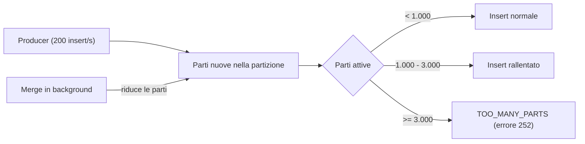

Duecento producer scrivono una riga al secondo ciascuno su una tabella ClickHouse. Dopo qualche minuto gli insert rallentano, poi cominciano a fallire con «Too many parts». Il disco ha spazio, la CPU è sotto il limite, i dati da scrivere sono pochi: il cluster rifiuta un lavoro che sembra leggero. È un caso ricostruito con numeri di esempio, e il blocco di codice della lezione lo riproduce in locale con chDB, il motore ClickHouse in-process.

> **Idea chiave:** ogni insert crea una parte sul disco e i merge in background hanno una velocità limitata. Quello che decide se il sistema regge è il numero di insert al secondo, non il numero di righe.

## Duecento insert al secondo

Il conto è breve. Duecento producer con una riga al secondo fanno 200 insert al secondo, quindi 12.000 parti nuove al minuto, perché ogni insert scrive una parte. La tabella è una tabella di misure con una partizione al giorno, quindi tutte le parti cadono nella stessa partizione, quella di oggi.

Il limite sta in due impostazioni del motore `MergeTree`, contate per partizione. A 1.000 parti attive ClickHouse rallenta gli insert (`parts_to_delay_insert`), a 3.000 li rifiuta con l'errore 252, `TOO_MANY_PARTS` (`parts_to_throw_insert`). Sono i valori predefiniti, e puoi leggerli da `system.merge_tree_settings`. Se i merge non tenessero il passo, 1.000 parti verrebbero raggiunte in 1.000 / 200 = 5 secondi e 3.000 parti in 15 secondi.

La reazione abituale è un cluster più grande o un disco più veloce. Aiuta per un po', perché i merge corrono di più, poi il traffico cresce e il limite torna. Il numero che conta non è quante righe scrivi: è quanti insert fai. Centomila righe in un solo insert sono una parte, o poche se attraversano più partizioni. Centomila righe in centomila insert sono centomila parti. La causa non è la capacità del cluster, è la dimensione dei lotti.

Questa tabella mette in fila tre modi di scrivere lo stesso carico, 20.000 righe al secondo, con i valori ricavati dalla divisione tra righe al secondo e righe per insert.

| Strategia | Righe per insert | Insert al secondo | Parti create al minuto |
|---|---:|---:|---:|
| Una riga per insert | 1 | 20.000 | 1.200.000 |
| Cento righe per insert | 100 | 200 | 12.000 |
| Lotto da un secondo | 20.000 | 1 | 60 |
| Lotto da dieci secondi | 200.000 | 0,1 | 6 |

Fra la prima e l'ultima riga ci sono cinque ordini di grandezza di parti, a parità di righe scritte. Il throughput in righe al secondo è identico in tutti e quattro i casi, ed è il motivo per cui non è una metrica utile per diagnosticare questo problema.

## Perché le parti sono il problema

Bastano tre fatti, e l'ordine conta.

Il primo: ogni insert scrive una parte, cioè una cartella di file immutabili, ordinati secondo la chiave `ORDER BY`. Che l'insert abbia una riga o un milione, la parte c'è, con i suoi file e i suoi metadati.

Il secondo: le parti si riducono con i merge. Girano in background, fondono parti della stessa partizione, mai di partizioni diverse, e hanno una velocità limitata da disco e CPU. Se arrivano più parti di quante il merge ne consuma, il numero cresce.

Il terzo: per impedire che le parti si accumulino, il server prima rallenta gli insert e poi li rifiuta, partizione per partizione. Il rallentamento è un ritardo artificiale che il motore aggiunge a ogni insert, ed è il sintomo che il client vede per primo come latenza di scrittura in crescita.



La tabella da guardare è `system.parts`: una riga per parte, con la partizione, il numero di righe e lo stato. Se le righe per parte sono poche e le parti attive sono tante, il problema è già lì. La documentazione indica lotti di almeno 1.000 righe, idealmente tra 10.000 e 100.000, e circa un insert al secondo per tabella ([strategie di insert](https://clickhouse.com/docs/best-practices/selecting-an-insert-strategy)). Si può inserire a centomila righe al secondo, purché sia un solo insert.

## Tre errori che portano al muro

Il blocco seguente produce il muro. Ferma i merge, per simulare il momento in cui non tengono il passo, poi scrive come i producer dell'esempio. La direttiva `ripeti` è del runner che esegue la pagina: ripete l'istruzione come farebbero mille client.

```sql
CREATE TABLE misure_v1
(
    ts DateTime,
    id_dispositivo UInt32,
    valore Float32
)
ENGINE = MergeTree
PARTITION BY toDate(ts)
ORDER BY (id_dispositivo, ts);

SYSTEM STOP MERGES misure_v1;

-- async_insert = 0 perché chDB lo ha attivo di default: qui serve un insert, una parte.
-- ripeti: 1000
INSERT INTO misure_v1 SETTINGS async_insert = 0 VALUES (toDateTime('2026-03-01 10:00:00'), 42, 0.5);

-- Mille insert da una riga: mille parti, una riga per parte.
SELECT count() AS parti, sum(rows) AS righe FROM system.parts WHERE active AND table = 'misure_v1';

-- Un solo lotto da 100.000 righe che attraversa 58 giorni: 58 parti in più.
INSERT INTO misure_v1
SELECT toDateTime('2026-01-01 00:00:00') + number * 50, number % 200, 0.5
FROM numbers(100000);

SELECT count() AS parti, sum(rows) AS righe FROM system.parts WHERE active AND table = 'misure_v1';

-- Il retry dello stesso lotto, dopo un timeout: le righe raddoppiano.
INSERT INTO misure_v1
SELECT toDateTime('2026-01-01 00:00:00') + number * 50, number % 200, 0.5
FROM numbers(100000);

SELECT count() AS righe FROM misure_v1;

-- Un lotto su 116 giorni supera le 100 partizioni per insert: rifiutato.
-- errore atteso: TOO_MANY_PARTS
INSERT INTO misure_v1
SELECT toDateTime('2026-01-01 00:00:00') + number * 100, number % 200, 0.5
FROM numbers(100000);
```

### Un insert per ogni riga

**Sintomo:** latenza di scrittura che cresce nel tempo, poi errori 252. Nel blocco qui sopra, mille insert da una riga producono mille parti da una riga.

**Perché succede:** sembra ragionevole. L'evento arriva, lo scrivi, il dato è subito visibile e non c'è codice di buffering da mantenere. È l'errore peggiore perché in sviluppo funziona: gli insert sono dieci al minuto, e il problema compare solo con il traffico di produzione.

**Come si corregge:** raggruppa prima di scrivere. Il rimedio che si improvvisa, un `OPTIMIZE TABLE ... FINAL` ogni tanto, aggiunge lavoro di merge a un sistema che già non tiene il passo, e la documentazione lo sconsiglia nella maggior parte dei casi.

### Una partizione al giorno

**Sintomo:** un solo lotto produce decine di parti, e il numero totale di parti non scende con lotti più grandi.

**Perché succede:** il tempo è l'asse di tutte le query, e partizionare per giorno pare la conseguenza naturale. Ma le parti si contano per partizione: un lotto di 100.000 righe distribuite a un passo di 50 secondi copre 100.000 × 50 = 5.000.000 secondi, cioè circa 58 giorni, e scrive 58 parti, non una. Il conteggio nel blocco lo conferma: da 1.000 a 1.058 parti. Oltre le 100 partizioni in un singolo insert il server lo rifiuta del tutto, con lo stesso codice di errore.

**Come si corregge:** partiziona per mese, o per un periodo più lungo. Le partizioni servono a cancellare e archiviare dati vecchi, e per questo una granularità mensile basta quasi sempre.

### Il retry alla cieca

**Sintomo:** i totali crescono senza che il traffico sia cambiato, e nessuna colonna segnala il duplicato. Nel blocco le righe passano da 101.000 a 201.000.

**Perché succede:** un insert scade e il client lo rilancia. Ma un timeout non dice se il lotto è stato scritto. Se lo era, ora c'è due volte.

**Come si corregge:** dai a ogni lotto un'identità stabile, come si vede nella sezione sul token di deduplicazione.

Con le soglie predefinite il muro arriva a 3.000 parti. Per vederlo senza aspettare, abbassiamo la soglia di una tabella a 50.

```sql
-- Le soglie di questa versione, come numero di parti attive per partizione: 1000 e 3000.
SELECT name, value FROM system.merge_tree_settings WHERE name IN ('parts_to_delay_insert', 'parts_to_throw_insert') ORDER BY name;

CREATE TABLE misure_soglia
(
    ts DateTime,
    valore UInt8
)
ENGINE = MergeTree
ORDER BY ts
SETTINGS parts_to_throw_insert = 50;

SYSTEM STOP MERGES misure_soglia;

-- Insert sincroni come sopra: chDB ha async_insert attivo.
-- ripeti: 60
-- errore atteso: TOO_MANY_PARTS
INSERT INTO misure_soglia SETTINGS async_insert = 0 VALUES (now(), 1);
```

L'errore arriva all'insert numero 51, con un messaggio che comincia con «Too many parts» e prosegue dicendo che i merge stanno procedendo molto più lentamente degli insert.

## Dimensionare il lotto con un esempio svolto

Il lotto si calcola, non si indovina. Il dato di partenza è il carico: un flusso di sensori scrive 20.000 righe al secondo, tutte nella partizione corrente. Chi legge la dashboard tollera 10 secondi di ritardo tra l'evento e la sua visibilità.

Il primo passo è il tetto di insert al secondo: ne concediamo uno per tabella. Con 20.000 righe al secondo il lotto minimo è 20.000 / 1 = 20.000 righe, e l'attesa massima nel buffer del writer è di 1 secondo.

Il secondo passo sfrutta la tolleranza. Se la lettura sopporta 10 secondi, il writer può accumulare 10 secondi di traffico: 20.000 × 10 = 200.000 righe per insert, uno ogni dieci secondi, cioè 0,1 insert al secondo. Le parti create scendono da 60 a 6 al minuto, un decimo.

Il terzo passo è controllare che il lotto stia in memoria. Una riga di misura occupa circa 40 byte in formato di scrittura, quindi 200.000 righe pesano 200.000 × 40 = 8.000.000 byte, circa 8 MB. Il buffer è trascurabile, e rimane spazio per lotti più grandi se la latenza tollerata lo permette.

Il quarto passo è il margine rispetto alla soglia. A 6 parti al minuto, con merge che ne consumano anche solo 2 al minuto, il saldo è di 4 parti al minuto in accumulo: raggiungere 1.000 parti richiederebbe 1.000 / 4 = 250 minuti. Nella pratica i merge sono molto più rapidi e il saldo è negativo, ma il conto mostra che anche nel caso peggiore c'è margine di ore. Con il lotto da 100 righe del confronto precedente, 12.000 parti al minuto superano la soglia di rallentamento in meno di un minuto.

Il prezzo del lotto grande è l'attesa nel buffer: la latenza massima di visibilità è la durata della finestra di raccolta, più il tempo di scrittura. È un esempio di conto con numeri costruiti: i valori veri sono quelli del tuo traffico e della tua tolleranza.

```python
# Writer con batching lato client: accumula righe e le scrive in un solo insert.
import time
import clickhouse_connect

client = clickhouse_connect.get_client(host="clickhouse.interno", database="lab")
COLONNE = ["ts", "id_dispositivo", "valore"]
FINESTRA_SEC = 10          # latenza di lettura tollerata
MAX_RIGHE = 200_000        # tetto di sicurezza sulla memoria del buffer

def scrivi(buffer, topic, partizione, offset_da, offset_a):
    # Token stabile: stesso lotto, stesso token, anche dopo un retry.
    token = f"{topic}:{partizione}:{offset_da}-{offset_a}"
    client.insert("misure_v2", buffer, column_names=COLONNE,
                  settings={"insert_deduplication_token": token})

def ciclo(sorgente):
    buffer, inizio = [], time.monotonic()
    for riga, offset in sorgente:
        buffer.append(riga)
        scaduto = time.monotonic() - inizio >= FINESTRA_SEC
        if scaduto or len(buffer) >= MAX_RIGHE:
            scrivi(buffer, "misure", 3, offset - len(buffer) + 1, offset)
            buffer, inizio = [], time.monotonic()
```

## Lotti grandi, poche partizioni, un token

I criteri, in ordine di priorità:

1. Raggruppa prima di scrivere: da 10.000 a 100.000 righe per insert, circa un insert al secondo per tabella. Il limite superiore è la latenza che chi legge tollera.
2. Partiziona per mese, o per un periodo più lungo. Ogni partizione toccata da un lotto è una parte in più.
3. Dai a ogni lotto un'identità stabile e passala come `insert_deduplication_token`. La tabella deve avere una finestra di deduplicazione: nelle tabelle non replicate `non_replicated_deduplication_window` vale 0 e la deduplicazione è spenta, in `ReplicatedMergeTree` è attiva di default.
4. Lascia i merge al server: niente `OPTIMIZE FINAL` di routine.

Lo stesso lotto da 100.000 righe, scritto bene:

```sql
CREATE TABLE misure_v2
(
    ts DateTime,
    id_dispositivo UInt32,
    valore Float32
)
ENGINE = MergeTree
PARTITION BY toYYYYMM(ts)
ORDER BY (id_dispositivo, ts)
SETTINGS non_replicated_deduplication_window = 1000;

SYSTEM STOP MERGES misure_v2;

INSERT INTO misure_v2
SELECT toDateTime('2026-01-01 00:00:00') + number * 50, number % 200, 0.5
FROM numbers(100000)
SETTINGS insert_deduplication_token = 'misure:partizione-3:offset-0-99999';

-- Il retry con lo stesso token viene scartato.
INSERT INTO misure_v2
SELECT toDateTime('2026-01-01 00:00:00') + number * 50, number % 200, 0.5
FROM numbers(100000)
SETTINGS insert_deduplication_token = 'misure:partizione-3:offset-0-99999';

-- Due parti, una per mese, e nessun duplicato.
SELECT count() AS parti, sum(rows) AS righe, round(sum(rows) / count()) AS righe_per_parte FROM system.parts WHERE active AND table = 'misure_v2';
```

Il risultato si legge in una riga: 2 parti, 100.000 righe, 50.000 righe per parte. Prima erano 1.058 parti per 101.000 righe, quindi circa 95 righe per parte. Una parte ogni 95 righe contro una parte ogni 50.000: il rapporto tra le due densità è 50.000 / 95, circa 520 volte. I merge non hanno più niente da recuperare.

Il token identifica il lotto, non il suo contenuto. Due lotti con lo stesso token sono lo stesso lotto, anche se i dati cambiano, e il secondo sparisce senza errore. Derivalo da qualcosa di stabile, come topic, partizione e intervallo di offset, mai da un orologio: con un orologio il retry avrebbe un token diverso e il duplicato passerebbe.

Il batch è reversibile, perché è configurazione del producer. La partizione no: cambiarla vuol dire tabella nuova e copia dei dati.

## Quando non puoi raggruppare

Non sempre c'è un punto dove raccogliere. Cento servizi scrivono ciascuno per conto proprio, poche righe alla volta, e nessuno vuole mantenere un buffer comune. Gli strumenti sono due.

Il batching lato client mette un processo, un consumer, Vector o il writer visto sopra, tra i producer e ClickHouse: raccoglie, scrive un lotto grande e conosce l'esito. `async_insert` sposta il buffer nel server, che tiene insieme gli insert piccoli e li scrive quando il buffer si riempie o scade un timeout.

Il criterio: **`async_insert` se non controlli i client e non puoi raggrupparli a monte, batching lato client se hai un punto unico dove raccogliere.**

```sql
-- Il server raggruppa i dati; l'insert risponde solo a scrittura avvenuta.
INSERT INTO misure_v2 SETTINGS async_insert = 1, wait_for_async_insert = 1 VALUES (toDateTime('2026-02-10 08:00:00'), 7, 0.25);

SELECT count() AS righe FROM misure_v2;
```

La confusione comune è `wait_for_async_insert = 0`, o la vecchia Buffer table. L'insert risponde appena il dato è nel buffer: se la scrittura poi fallisce nessuno lo dice al client, e se il server cade il dato è perso. La documentazione lo definisce rischioso e raccomanda `wait_for_async_insert = 1`, il valore predefinito. Il costo è che con `wait_for_async_insert = 1` il client aspetta il flush, quindi la latenza dell'insert sale fino al timeout del buffer.

Restano fuori da questa lezione il Kafka engine, le tabelle `Distributed` e la replica. I conti con i merge fermi descrivono un caso estremo: in produzione i merge girano e le parti diminuiscono, ma il loro numero cresce comunque in proporzione agli insert. Quale timeout di buffer sia giusto dipende dalla latenza che la lettura tollera, e si misura.

## Verifica sul tuo flusso di ingestion

1. Una tabella riceve 500 insert al secondo da una sola riga ciascuno, tutti nella stessa partizione, e i merge ne consumano 100 al secondo. Dopo quanto tempo, a partire da zero parti, il server comincia a rallentare gli insert?

<details>
<summary>Mostra risposta</summary>

Il saldo è 500 - 100 = 400 parti al secondo in accumulo. La soglia di rallentamento è 1.000 parti, quindi 1.000 / 400 = 2,5 secondi. Il rimedio non è aumentare i merge ma ridurre gli insert: raggruppando le 500 righe al secondo in un lotto ogni secondo, le parti nuove scendono a 1 al secondo, meno dei 100 che i merge consumano.

</details>

2. Un lotto da 100.000 righe copre 4 mesi di dati storici e la tabella è partizionata per giorno. Quante parti scrive, e perché rischia di essere rifiutato?

<details>
<summary>Mostra risposta</summary>

Circa 120 giorni, quindi circa 120 parti, una per partizione toccata. Il server rifiuta un insert che attraversa più di 100 partizioni (`max_partitions_per_insert_block`, default 100) con errore `TOO_MANY_PARTS`. La correzione è la partizione mensile, che porterebbe le parti a 4.

</details>

3. Il writer rilancia un lotto dopo un timeout, usando come token l'ora corrente in secondi. Che cosa succede ai dati?

<details>
<summary>Mostra risposta</summary>

Il token cambia a ogni tentativo, quindi il secondo insert non viene riconosciuto come duplicato e le righe raddoppiano senza errore. Il token deve venire da un identificativo stabile del lotto, per esempio topic, partizione e intervallo di offset.

</details>

4. Quando scegli `async_insert` invece del batching lato client, e quale valore di `wait_for_async_insert` usi?

<details>
<summary>Mostra risposta</summary>

`async_insert` quando i client sono molti, indipendenti e non controllati, e non esiste un punto unico dove raccogliere. Usa `wait_for_async_insert = 1`: il client riceve la risposta solo dopo il flush, quindi sa se la scrittura è riuscita. Con 0 un fallimento successivo o un crash del server perde i dati senza che il client lo sappia.

</details>

5. Quale metrica leggi per sapere se l'ingestione è sana, e perché le righe al secondo non bastano?

<details>
<summary>Mostra risposta</summary>

Le parti attive per partizione da `system.parts`, insieme alle righe per insert. Le righe al secondo sono uguali in tutti gli scenari della tabella a inizio lezione: 20.000 righe al secondo possono venire da un insert al secondo o da 20.000, con 60 o 1.200.000 parti al minuto.

</details>
