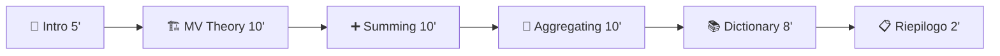
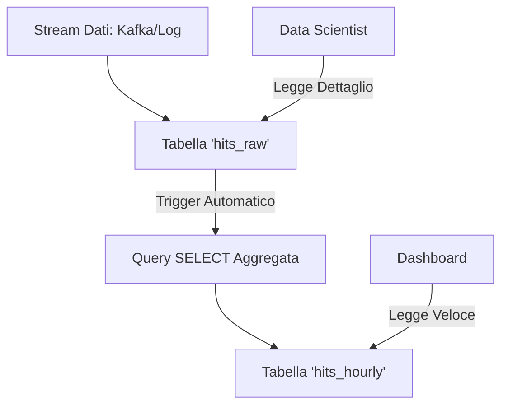

## ClickHouse Real-Time: Materialized Views e Aggregazioni — Lezione Completa

Il segreto di ClickHouse non è solo la velocità di lettura grezza, ma la capacità unica di pre-calcolare i risultati mentre i dati arrivano, senza la complessità di una pipeline separata (es. Spark Streaming o Flink). Immagina di avere un contatore che si aggiorna istantaneamente ogni volta che qualcuno clicca, invece di dover contare milioni di righe ogni volta che apri la dashboard. Questa magia si chiama **Materialized View**. In questa lezione, impareremo a costruire pipeline di aggregazione in tempo reale che rendono le query istantanee, anche su petabyte di dati.

### Obiettivi di Apprendimento

Al termine di questa lezione, lo studente sarà in grado di:
1.  Progettare una Materialized View (MV) per aggregare dati grezzi in tabelle riassuntive, riducendo la latenza delle query di 100x.
2.  Utilizzare i motori `SummingMergeTree` e `AggregatingMergeTree` per gestire le metriche incrementali senza duplicazioni.
3.  Implementare funzioni di aggregazione complesse come `uniqState` (Count Distinct approssimato) e `quantileState` per statistiche avanzate.
4.  Arricchire i dati in tempo reale usando i Dizionari in memoria (`dictGet`), evitando costose operazioni di JOIN.
5.  Gestire la deduplicazione dei dati in scenari di streaming con `ReplacingMergeTree`.

### Timeline della Lezione

| Fase | Argomento | Durata |
|------|-----------|--------|
| 1 | Introduzione: Raw Data vs Pre-Aggregation | 5 min |
| 2 | Teoria: Come funzionano le Materialized View | 10 min |
| 3 | Pratica: SummingMergeTree (Il caso semplice) | 10 min |
| 4 | Avanzato: AggregatingMergeTree (State & Merge) | 10 min |
| 5 | Tecnica: Dictionary Lookup | 8 min |
| 6 | Riepilogo e Domande | 2 min |
| **Totale** | | **45 min** |



### Fase 1 — Introduzione: Raw Data vs Pre-Aggregation (5 min)

Hai 1 miliardo di eventi di pageview. Vuoi sapere quante view ha fatto ogni pagina ieri.
*   *Approccio Raw:* Esegui `SELECT page_url, count() FROM hits WHERE date = yesterday GROUP BY page_url`. ClickHouse deve scansionare fisicamente 1 miliardo di righe, decomprimere le colonne e calcolare. Tempo: 2-5 secondi. Accettabile per un analista, inaccettabile per una dashboard pubblica con 1000 utenti concorrenti.
*   *Approccio Pre-Aggregation:* Mentre i dati arrivano, ClickHouse aggiorna incrementalmente una tabellina `daily_stats`. Quando chiedi i dati di ieri, esegui `SELECT * FROM daily_stats WHERE date = yesterday`. ClickHouse legge solo 100 righe pre-calcolate. Tempo: 0.001 secondi.

Le Materialized View automatizzano questo processo in modo trasparente. Non sono "viste" virtuali (come in SQL standard che rieseguono la query), sono tabelle fisiche reali che si aggiornano tramite trigger interno ad ogni inserimento.

### Fase 2 — Teoria: Come funzionano le Materialized View (10 min)

Una MV in ClickHouse è composta architetturalmente da 3 oggetti distinti:
1.  **Tabella Sorgente (Source):** Dove arrivano i dati grezzi (tipicamente via `INSERT` o da Kafka). Qui i dati possono avere una retention breve (es. 7 giorni).
2.  **Tabella Destinazione (Target):** Una tabella fisica speciale (es. `SummingMergeTree`) dove vengono salvati i dati aggregati. Qui i dati sono compatti e possono essere tenuti per anni.
3.  **Il Trigger (MV):** La query `SELECT` di trasformazione che sposta i dati da Source a Target.

Quando fai `INSERT` nella Source, ClickHouse prende quel blocco di dati, esegue la query della MV in memoria e *aggiunge* il risultato alla Target.



### Fase 3 — Pratica: SummingMergeTree (Il caso semplice) (10 min)

Se devi solo sommare numeri (es. Revenue, Clicks, Impressions, Cost), il motore perfetto è `SummingMergeTree`.

**Scenario:** Vogliamo report orari per Campagna.
1.  **Definizione Target:** Creiamo la tabella con motore `SummingMergeTree`. Le colonne specificate nella `ORDER BY` sono considerate le "chiavi" (Dimensioni). Tutte le altre colonne numeriche sono trattate come metriche da sommare.
2.  **Definizione MV:** Creiamo la MV che raggruppa per `toStartOfHour(time)` e `campaign_id`.

**Meccanismo di Merge:**
Quando inserisci i dati, ClickHouse scrive nuove "parti" su disco. In background, un processo asincrono unisce queste parti. Se trova righe con la stessa chiave primaria (es. "Campagna A, Ore 10:00"), le collassa in una sola riga sommando i valori.
Risultato: La tabella rimane piccolissima e le query di lettura non devono fare quasi nessun calcolo.

```sql
-- La Tabella Target (dove finiscono i dati aggregati)
CREATE TABLE hourly_spend (
    hour DateTime,
    campaign_id UInt32,
    spend Float64,
    clicks UInt64
) ENGINE = SummingMergeTree()
ORDER BY (hour, campaign_id);
```

### Fase 4 — Avanzato: AggregatingMergeTree (State & Merge) (10 min)

Cosa succede se devi calcolare la media? O il conteggio di utenti unici (Count Distinct)? Non puoi sommare le medie (la media delle medie è sbagliata) e non puoi sommare i count distinct (gli utenti si sovrappongono).
Qui entra in gioco `AggregatingMergeTree` con il potente concetto di `*State` e `*Merge`.

*   **Insert (State):** Invece di salvare il numero finale, salvi lo "stato intermedio" dell'aggregazione.
    *   Per la media: salvi (Somma, Conteggio).
    *   Per uniq (HyperLogLog): salvi l'hash set binario.
    *   Per i quantili: salvi l'istogramma digest.
    *   Funzione nella MV: `uniqState(user_id)`.
*   **Select (Merge):** Quando leggi, unisci gli stati intermedi.
    *   Funzione nella Query: `uniqMerge(user_state)`.

**Esempio: Utenti Unici Giornalieri**
1.  Target Table ha una colonna speciale `users_state AggregateFunction(uniq, UInt64)`.
2.  La MV fa `SELECT ... uniqState(user_id) ... GROUP BY day`.
3.  La Dashboard fa `SELECT uniqMerge(users_state) ... GROUP BY day`.

Questo approccio ti permette di avere count distinct precisi (o approssimati con HyperLogLog) su periodi arbitrari (giorno, settimana, mese) partendo dai dati pre-aggregati, mantenendo la capacità di fare "Roll-up".

### Fase 5 — Tecnica: Dictionary Lookup (8 min)

Spesso i log contengono solo ID numerici (`product_id: 123`, `campaign_id: 456`) per risparmiare spazio. Ma nel report finale vuoi vedere il nome (`Scarpe Nike`, `Campagna Natale`).
Fare `JOIN` in tempo reale su miliardi di righe è lento e costoso.
La soluzione di ClickHouse sono i **Dictionaries**.

Un Dictionary è una tabella chiave-valore caricata completamente in RAM (o cacheata).
```sql
CREATE DICTIONARY products_dict (...)
SOURCE(MYSQL(...)) LAYOUT(HASHED()) LIFETIME(300);
```
Nella query della MV (durante l'ingestione), puoi usare:
`dictGet('products_dict', 'name', product_id)`

ClickHouse arricchisce il dato *mentre* lo inserisce. Poiché il dizionario è in memoria, può fare milioni di lookup al secondo senza rallentare l'ingestione. Il dato scritto su disco è già "denormalizzato" e pronto per l'uso.

### Fase 6 — Riepilogo e Domande (2 min)

1.  **SummingMergeTree** è il cavallo di battaglia per metriche additive semplici.
2.  **AggregatingMergeTree** è necessario per metriche complesse (`uniq`, `quantile`, `avg`) che richiedono uno stato intermedio.
3.  **Dictionary** sostituisce le JOIN lente con lookup in memoria ultra-veloci.
4.  **MV** sposta il carico computazionale dalla lettura (Dashboard) alla scrittura (Background Merge), garantendo scalabilità.

### Domande di Verifica

1.  Qual è la differenza fondamentale tra una "View" normale e una "Materialized View" in ClickHouse in termini di esecuzione della query?
2.  Perché non è matematicamente corretto calcolare la media (`AVG`) aggregando delle medie pre-calcolate, e come `AggregatingMergeTree` risolve tecnicamente questo problema?
3.  Cosa succede ai dati nella tabella di destinazione di una MV se cancello per errore dei dati nella tabella sorgente? (Hint: Nulla, sono disaccoppiati fisicamente).
4.  In che modo i Dizionari in memoria migliorano le performance rispetto alle JOIN standard su tabelle MergeTree?
5.  Qual è il ruolo della funzione `toStartOfHour()` (o simili) nella definizione della chiave di raggruppamento di una MV per serie temporali?

### Riferimenti Bibliografici

-   ClickHouse Official Docs (Materialized Views).
-   Altinity Blog (Using AggregatingMergeTree effectively).
-   Uber Engineering Blog (Real-time analytics at scale with ClickHouse).
