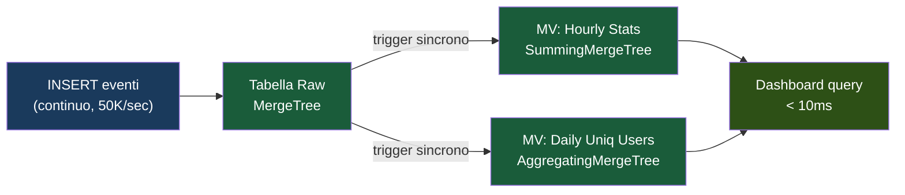

import { Aside, Steps, Tabs, TabItem } from '@astrojs/starlight/components'

Il Black Friday 2022: un retailer europeo riceve 50.000 eventi al secondo. La dashboard delle vendite deve mostrarsi aggiornata ogni 5 secondi. Una query `SELECT sum(amount) FROM raw_events WHERE event_date = today()` su una tabella da 2 miliardi di righe richiederebbe 8-12 secondi — troppo lenta, e il carico di 200 utenti simultanei in dashboard la renderebbe inutilizzabile.

La soluzione non è hardware più potente. È la pre-aggregazione tramite Materialized Views, il meccanismo più potente di ClickHouse per il real-time analytics.

## Come funzionano le Materialized Views in ClickHouse

Una Materialized View (MV) in ClickHouse non è come quella di altri database. Non è una cache periodicamente aggiornata. È un **trigger su INSERT**: ogni volta che un record viene inserito nella tabella sorgente, la MV esegue automaticamente la sua query di trasformazione e inserisce il risultato nella tabella destinazione.



**Caratteristiche fondamentali**:
- La MV viene aggiornata **sincrono** all'INSERT nella tabella sorgente — non in background, non con delay
- Non vede `UPDATE` e `DELETE` — solo `INSERT`
- Se la MV fallisce, l'INSERT nella tabella sorgente comunque va a buon fine (la MV ha errori silenziosi — monitorare!)
- Più MV sulla stessa tabella sorgente = più trigger paralleli

## SummingMergeTree per contatori e revenue

`SummingMergeTree` aggrega automaticamente le colonne numeriche durante i merge in background. È il motore ideale per contatori, somme di revenue, e metriche aggregate.

```sql
-- 1. Tabella raw (fonte dei dati)
CREATE TABLE raw_events (
    event_date    Date,
    event_time    DateTime,
    shop_id       UInt32,
    event_type    LowCardinality(String),
    user_id       UInt64,
    revenue       Decimal(18, 2)
) ENGINE = MergeTree()
PARTITION BY event_date
ORDER BY (shop_id, event_type, event_time);

-- 2. Tabella aggregata per ora
CREATE TABLE hourly_revenue (
    hour       DateTime,
    shop_id    UInt32,
    event_type LowCardinality(String),
    -- Con SimpleAggregateFunction, SummingMergeTree aggrega automaticamente
    revenue    SimpleAggregateFunction(sum, Decimal(18, 2)),
    events     SimpleAggregateFunction(sum, UInt64)
) ENGINE = SummingMergeTree()
ORDER BY (shop_id, event_type, hour);

-- 3. Materialized View che popola hourly_revenue ad ogni INSERT
CREATE MATERIALIZED VIEW mv_hourly_revenue TO hourly_revenue AS
SELECT
    toStartOfHour(event_time) AS hour,
    shop_id,
    event_type,
    sum(revenue) AS revenue,
    count()      AS events
FROM raw_events
GROUP BY hour, shop_id, event_type;
```

**Come interrogare SummingMergeTree correttamente**:

```sql
-- SBAGLIATO: potrebbe leggere parti non ancora merged (dati parziali)
SELECT hour, shop_id, revenue FROM hourly_revenue ORDER BY hour DESC LIMIT 100;

-- CORRETTO: sempre aggregare con GROUP BY + sum() per gestire parts non merged
SELECT
    hour,
    shop_id,
    sum(revenue) AS total_revenue,
    sum(events)  AS total_events
FROM hourly_revenue
WHERE hour >= now() - INTERVAL 24 HOUR
GROUP BY hour, shop_id
ORDER BY hour DESC;
```

<Aside type="caution">
Non leggere mai da `SummingMergeTree` senza `GROUP BY + sum()`. Il merge in background non è garantito essere completato — ci possono essere multiple "parts" con lo stesso key. La query senza GROUP BY restituirà dati parziali sbagliati.
</Aside>

## AggregatingMergeTree per metriche esatte

Quando hai bisogno di metriche che richiedono lo stato (distinct count, percentili, HyperLogLog), usi `AggregatingMergeTree` con le funzioni `-State` e `-Merge`.

```sql
-- Tabella per distinct users giornalieri
CREATE TABLE daily_unique_users (
    date       Date,
    event_type LowCardinality(String),
    -- AggregateFunction conserva lo "stato" della funzione
    uniq_users AggregateFunction(uniq, UInt64)
) ENGINE = AggregatingMergeTree()
ORDER BY (date, event_type);

-- MV che popola con uniqState()
CREATE MATERIALIZED VIEW mv_daily_uniq TO daily_unique_users AS
SELECT
    toDate(event_time)    AS date,
    event_type,
    uniqState(user_id)    AS uniq_users   -- State, non valore finale
FROM raw_events
GROUP BY date, event_type;

-- Query: usa uniqMerge() per ottenere il valore finale
SELECT
    date,
    event_type,
    uniqMerge(uniq_users) AS unique_users  -- Merge degli stati
FROM daily_unique_users
WHERE date >= today() - 30
GROUP BY date, event_type
ORDER BY date DESC;
```

**Funzioni -State/-Merge disponibili**:

| Funzione | Uso | Esempio |
|----------|-----|---------|
| `uniqState` / `uniqMerge` | Distinct count (HyperLogLog) | Utenti unici |
| `uniqExactState` / `uniqExactMerge` | Distinct count esatto (costoso) | Quando la precisione è critica |
| `sumState` / `sumMerge` | Somma | Revenue totale |
| `avgState` / `avgMerge` | Media | Valore medio ordine |
| `quantilesTDigestState` / `quantilesTDigestMerge` | Percentili (p50, p95, p99) | Latenza API |
| `groupArrayState` / `groupArrayMerge` | Array di valori | Top items per utente |

## Cascading Materialized Views

Per supportare multiple granularità temporali (secondi → minuti → ore), si possono creare MV a cascata:

```sql
-- Livello 1: dati al minuto
CREATE TABLE minutely_stats (
    minute     DateTime,
    shop_id    UInt32,
    revenue    SimpleAggregateFunction(sum, Decimal(18,2)),
    events     SimpleAggregateFunction(sum, UInt64)
) ENGINE = SummingMergeTree() ORDER BY (shop_id, minute);

CREATE MATERIALIZED VIEW mv_minutely TO minutely_stats AS
SELECT toStartOfMinute(event_time) AS minute, shop_id,
       sum(revenue) AS revenue, count() AS events
FROM raw_events GROUP BY minute, shop_id;

-- Livello 2: dati all'ora (da minutely_stats)
-- NOTA: le MV a cascata si aggiornano solo quando minutely_stats riceve INSERT
-- (cioè quando la prima MV inserisce dati)
CREATE MATERIALIZED VIEW mv_hourly_from_minutely TO hourly_revenue AS
SELECT toStartOfHour(minute) AS hour, shop_id,
       sum(revenue) AS revenue, sum(events) AS events
FROM minutely_stats GROUP BY hour, shop_id;
```

<Aside type="note">
Il cascading funziona ma con una limitazione: la MV di secondo livello si aggiorna solo quando la MV di primo livello inserisce dati. Se un INSERT nella raw table produce 100 righe nella minutely, la MV hourly viene triggerata 100 volte (overhead). Per granularità molto diverse, può essere più efficiente avere MV separate entrambe sulla raw table.
</Aside>

## Gestione dei dati late-arriving

In un sistema real-time, alcuni eventi arrivano in ritardo (problemi di rete, device offline, retry). Come gestirli:

```sql
-- TTL per auto-cleanup dei dati vecchi (es. raw events dopo 90 giorni)
ALTER TABLE raw_events
    MODIFY TTL event_date + INTERVAL 90 DAY;

-- Per le tabelle aggregate: TTL per granularità diverse
ALTER TABLE minutely_stats
    MODIFY TTL minute + INTERVAL 7 DAY;  -- minutely tenuto solo 7 giorni

ALTER TABLE hourly_revenue
    MODIFY TTL hour + INTERVAL 1 YEAR;   -- hourly tenuto 1 anno
```

**Grace period per late data**: invece di usare la tabella aggregata direttamente, aggiungi una finestra di "grace":

```sql
-- Query che include sia la tabella aggregata (fast) sia i dati recenti (precisi)
WITH recent_raw AS (
    -- Ultime 2 ore dalla raw per catturare late-arriving data
    SELECT toStartOfHour(event_time) AS hour, shop_id,
           sum(revenue) AS revenue, count() AS events
    FROM raw_events
    WHERE event_time >= now() - INTERVAL 2 HOUR
    GROUP BY hour, shop_id
),
historical AS (
    -- Dati storici dalla tabella aggregata
    SELECT hour, shop_id, sum(revenue) AS revenue, sum(events) AS events
    FROM hourly_revenue
    WHERE hour < now() - INTERVAL 2 HOUR
    GROUP BY hour, shop_id
)
SELECT hour, shop_id, sum(revenue) AS revenue, sum(events) AS events
FROM (SELECT * FROM historical UNION ALL SELECT * FROM recent_raw)
GROUP BY hour, shop_id
ORDER BY hour DESC;
```

## Buffer Engine per ingestion ad alta frequenza

Quando hai migliaia di INSERT singoli al secondo (es. da applicazioni che non fanno batching), il Buffer Engine accumula i dati in memoria prima di flushare alla tabella destinazione:

```sql
CREATE TABLE raw_events_buffer AS raw_events
ENGINE = Buffer(
    currentDatabase(),  -- database destinazione
    raw_events,         -- tabella destinazione
    16,                 -- num_layers (parallelismo interno)
    10,                 -- min_time (secondi prima di flush)
    100,                -- max_time (secondi: flush forzato)
    10000,              -- min_rows prima di flush
    1000000,            -- max_rows prima di flush forzato
    10000000,           -- min_bytes
    100000000           -- max_bytes: flush forzato
);

-- Le applicazioni scrivono sul buffer, non sulla tabella raw
INSERT INTO raw_events_buffer VALUES (...);
```

<Aside type="tip">
Il Buffer Engine è utile per client che non supportano il batch insert. Se puoi controllare il client (es. SDK proprietario), è meglio fare batch insert direttamente sulla tabella raw con blocchi da 1.000-10.000 righe.
</Aside>

## Monitoring delle Materialized Views

```sql
-- Verificare che le MV stiano scrivendo dati
SELECT
    name,
    total_rows,
    total_bytes,
    formatReadableSize(total_bytes) AS size
FROM system.tables
WHERE database = currentDatabase()
  AND name IN ('hourly_revenue', 'daily_unique_users', 'minutely_stats')
ORDER BY total_rows DESC;

-- Errori delle MV (controllare regolarmente!)
SELECT
    event_time,
    level,
    message
FROM system.text_log
WHERE message LIKE '%MATERIALIZED VIEW%'
  AND level IN ('Error', 'Warning')
  AND event_time > now() - INTERVAL 1 HOUR
ORDER BY event_time DESC;

-- Parts per tabella (troppi = problema di ingestion troppo veloce)
SELECT
    table,
    count() AS parts,
    sum(rows) AS total_rows
FROM system.parts
WHERE active AND database = currentDatabase()
GROUP BY table
ORDER BY parts DESC;
-- Alert se parts > 300 per tabella: indica merge in ritardo
```

## Anti-pattern comuni

**1. MV con JOIN** — non funziona come ci si aspetta

```sql
-- SBAGLIATO: la MV vede solo i nuovi INSERT della left table
-- Non può fare lookup sulla right table al momento dell'INSERT
CREATE MATERIALIZED VIEW mv_orders_with_customers TO orders_enriched AS
SELECT o.*, c.name
FROM orders o
JOIN customers c ON o.customer_id = c.id;  -- il JOIN non funziona in RT
```

Soluzione: usa un dizionario ClickHouse (`Dictionary`) per lookup real-time invece del JOIN.

**2. INSERT singoli ad alta frequenza senza Buffer Engine**
Ogni INSERT crea una "part". Con 10.000 INSERT/sec si accumulano 10.000 parts in pochi secondi — ClickHouse va in "too many parts" error.

**3. `FINAL` su tabelle enormi senza filtri**
`SELECT ... FROM big_table FINAL` senza `WHERE` su una tabella da 10 miliardi di righe richiede la deduplicazione di tutto il dataset — operazione da ore.

**4. MV senza tabella destinazione esplicita**
La sintassi `CREATE MATERIALIZED VIEW mv AS SELECT ... TO table` è obbligatoria. La sintassi senza `TO` crea una tabella `.inner` nascosta non interrogabile direttamente.

## Caso reale: Contentsquare a 100 miliardi di eventi/mese

Contentsquare, piattaforma di analytics comportamentale, processa 100 miliardi di eventi al mese (circa 38.000/secondo in media, con picchi a 200.000/secondo). Per servire le loro dashboard con latenza ≤ 2 secondi, usano una catena di Materialized Views:

1. Raw events → `SummingMergeTree` per session-level aggregations (aggiornato ogni insert)
2. Session-level → `AggregatingMergeTree` per page-level metrics (aggiornato ogni 30 secondi circa)
3. Page-level → Pre-computed reports per i clienti enterprise (aggiornato ogni ora)

Il risultato: query di dashboard che scannerizzano 10^5 righe pre-aggregate invece di 10^11 righe raw, con latenza scesa da 8 secondi a 80 millisecondi.
