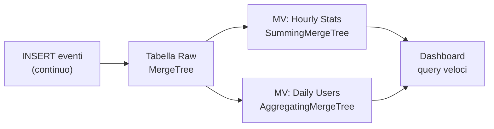

# ClickHouse: Materialized Views e Aggregazioni Real-Time

> **Obiettivo:** Usare le Materialized Views per pre-calcolare aggregazioni e servire dashboard in tempo reale.

## 1. Il Pattern MV per Real-Time



## 2. SummingMergeTree per Contatori
```sql
CREATE TABLE events_hourly (
    event_type LowCardinality(String),
    hour DateTime,
    events UInt64,
    revenue Decimal(18,2)
) ENGINE = SummingMergeTree()
ORDER BY (event_type, hour);

CREATE MATERIALIZED VIEW mv_events_hourly TO events_hourly AS
SELECT
    event_type,
    toStartOfHour(timestamp) AS hour,
    count() AS events,
    sum(revenue) AS revenue
FROM events_raw GROUP BY event_type, hour;
```

## 3. AggregatingMergeTree per Uniq e Percentili
```sql
CREATE TABLE daily_uniq_users (
    date Date,
    event_type LowCardinality(String),
    users AggregateFunction(uniq, UUID),
    latency_p95 AggregateFunction(quantile(0.95), Float64)
) ENGINE = AggregatingMergeTree()
ORDER BY (date, event_type);

CREATE MATERIALIZED VIEW mv_daily_uniq TO daily_uniq_users AS
SELECT
    toDate(timestamp) AS date,
    event_type,
    uniqState(user_id) AS users,
    quantileState(0.95)(latency_ms) AS latency_p95
FROM events_raw GROUP BY date, event_type;

-- Query: merge degli stati
SELECT date, event_type,
    uniqMerge(users) AS unique_users,
    quantileMerge(0.95)(latency_p95) AS p95_latency
FROM daily_uniq_users
WHERE date >= today() - 30
GROUP BY date, event_type;
```

## 4. Performance: Raw vs MV
| Query | Tabella Raw | Materialized View | Speedup |
|:---|:---:|:---:|:---:|
| Conteggio orario ultimi 7gg | 2.3s | 12ms | **190x** |
| Unique users giornalieri | 4.1s | 25ms | **160x** |
| Revenue per canale (30gg) | 1.8s | 8ms | **225x** |

## Risorse
- **Doc:** ClickHouse MV documentation
- **Pattern:** Lambda architecture simplified con ClickHouse
