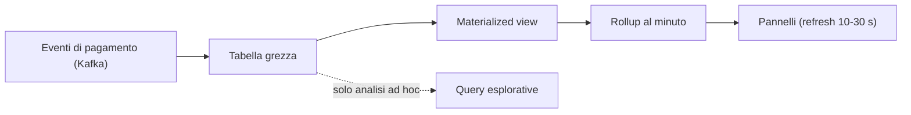

Durante un Black Friday una dashboard in sala controllo ha sedici pannelli che si aggiornano ogni cinque secondi interrogando direttamente la tabella grezza degli eventi in ClickHouse. Quaranta operatori tengono la pagina aperta sul proprio browser. I nodi arrivano al 100% di CPU, l'ingestione da Kafka rallenta e il grafico degli ordini mostra l'ultimo minuto sempre dimezzato, come un falso crollo delle vendite. È uno scenario costruito, con numeri di esempio: la causa non è il traffico dei clienti, è il modo in cui è stata disegnata la dashboard.

> **Idea chiave:** una dashboard real-time è operativa solo se legge tabelle pre-aggregate al minuto, nasconde il bucket ancora aperto, mostra il ritardo del dato e confronta ogni numero con la stessa ora di sette giorni prima.

## Quaranta browser aperti e il falso crollo dell'ultimo minuto

Il negozio incassa 1.200 tentativi di pagamento al minuto nell'ora di punta e vuole sorvegliare il tasso di rifiuto per gateway. Il team costruisce sedici pannelli con refresh a 5 secondi, ciascuno con una `SELECT` sulla tabella grezza delle ultime 24 ore.

Il carico si calcola in tre righe. Ogni browser lancia 16 / 5 = 3,2 query al secondo. Con 40 browser sono 3,2 × 40 = 128 query al secondo. Ogni query scansiona 24 ore × 60 minuti × 1.200 tentativi = 1.728.000 righe, quindi il cluster legge 128 × 1.728.000 = 221.184.000 righe al secondo, solo per tenere aggiornato un monitor.

Il secondo guasto è visivo. Il grafico raggruppa per minuto fino a `now()`. Quando un dirigente guarda lo schermo al secondo 12 del minuto corrente, l'ultimo punto contiene 12 secondi di ordini invece di 60, cioè il 20% del valore normale: la linea scende dell'80% a ogni minuto, e sembra un blocco del sito.

Il terzo guasto è di significato. Un contatore rosso dice «42 pagamenti rifiutati nell'ultimo minuto». Su 1.200 tentativi sono 42 / 1.200 = 3,5%, ma nessuno sa se sia normale per il venerdì alle 11:00 o un'anomalia rispetto alla settimana prima.

## Rollup, minuto aperto, baseline

Tre meccanismi correggono i tre guasti.

Il primo disaccoppia lo stream dalle query dei pannelli con una tabella di rollup al minuto, alimentata da una materialized view (vedi la lezione precedente su `AggregatingMergeTree`). Il pannello chiede sempre gli stessi raggruppamenti, quindi li calcoliamo una volta sola in ingestione. Nel caso del negozio una giornata passa da 1.728.000 righe grezze a 1.440 righe di rollup, un rapporto di 1.728.000 / 1.440 = 1.200 a 1. Il carico del paragrafo precedente scende a 128 × 1.440 = 184.320 righe al secondo.

Il secondo esclude il bucket aperto. Il minuto corrente è incompleto per definizione, quindi la serie si ferma a `minuto < toStartOfMinute(now())`. Un indicatore separato mostra la freschezza, cioè quanti secondi sono passati dall'ultimo evento ricevuto. Così distingui «zero ordini perché il sito è fermo» da «zero ordini perché il connettore Kafka è morto».

Il terzo ancora il numero alla baseline: il valore della stessa ora sette giorni prima, che assorbe l'effetto del giorno della settimana. Ogni soglia riporta nel titolo il proprietario e l'azione, per esempio «se il tasso di rifiuto supera l'8% per 3 minuti, chiama il turno checkout e passa al gateway B».



## Lo scenario in locale

Per toccare i numeri, il blocco seguente costruisce lo scenario in chDB. Genera otto giorni di storia con 20 tentativi al minuto, per tenere la tabella piccola. Il tasso normale di rifiuto è 1 su 20, cioè 5%; negli ultimi 10 minuti chiusi sale a 4 su 20, cioè 20%; il minuto aperto ha ricevuto solo 4 eventi su 20. Gli istanti sono calcolati rispetto a `now()`, quindi i minuti cambiano a ogni esecuzione, mentre i conteggi restano uguali.

```sql
CREATE DATABASE lab ENGINE = Atomic;
USE lab;

CREATE TABLE eventi_pagamento
(
    occurred_at DateTime,
    ingested_at DateTime,
    gateway LowCardinality(String),
    esito LowCardinality(String)
)
ENGINE = MergeTree
ORDER BY occurred_at;

CREATE TABLE agg_pagamenti_1m
(
    minuto DateTime,
    tentativi_state AggregateFunction(count),
    falliti_state AggregateFunction(sum, UInt64),
    ultimo_ingest_state AggregateFunction(max, DateTime)
)
ENGINE = AggregatingMergeTree
ORDER BY minuto;

CREATE MATERIALIZED VIEW agg_pagamenti_1m_mv TO agg_pagamenti_1m AS
SELECT
    toStartOfMinute(occurred_at) AS minuto,
    countState() AS tentativi_state,
    sumState(toUInt64(esito = 'rifiutato')) AS falliti_state,
    maxState(ingested_at) AS ultimo_ingest_state
FROM eventi_pagamento
GROUP BY minuto;

-- Otto giorni di storia, 20 tentativi al minuto. Un minuto k fa vale toStartOfMinute(now()) - k minuti.
-- Normale: 1 rifiuto su 20 (5%). Negli ultimi 10 minuti chiusi: 4 su 20 (20%).
-- Il minuto aperto (k = 0) ha ricevuto solo 4 eventi su 20.
INSERT INTO eventi_pagamento
SELECT
    toStartOfMinute(now()) - toIntervalMinute(intDiv(number, 20)) + toIntervalSecond((number % 20) * 3) AS occurred_at,
    occurred_at + toIntervalSecond(2) AS ingested_at,
    if(number % 2 = 0, 'gateway_a', 'gateway_b') AS gateway,
    if((number % 20) < if(intDiv(number, 20) BETWEEN 1 AND 10, 4, 1), 'rifiutato', 'ok') AS esito
FROM numbers(8 * 1440 * 20)
WHERE intDiv(number, 20) > 0 OR (number % 20) < 4;

SELECT count() AS righe_grezze, (SELECT count() FROM agg_pagamenti_1m) AS righe_rollup FROM eventi_pagamento;
```

La `SELECT` finale del blocco di setup conta le righe: 230.384 righe grezze contro 11.520 righe di rollup, perché 8 giorni × 1.440 minuti = 11.520 e 11.520 × 20 = 230.400, meno le 16 righe che mancano al minuto aperto (ne ha 4 invece di 20). Il rapporto è circa 20 a 1, che coincide con i tentativi al minuto. Con 1.200 tentativi al minuto sarebbe 1.200 a 1.

La tabella di rollup usa tre colonne di stato: il conteggio dei tentativi, la somma dei rifiuti e il massimo del timestamp di ingestione. Sono tutte fondibili, quindi la lettura con `countMerge`, `sumMerge` e `maxMerge` resta corretta anche quando un lotto in ritardo lascia due righe per lo stesso minuto. Il tasso di rifiuto non si memorizza mai come percentuale, perché una percentuale non si somma: si conservano numeratore e denominatore e si divide solo in lettura. È lo stesso principio della lezione sulle materialized view, applicato a un pannello, e spiega perché la query del pannello calcola `falliti * 100.0 / tentativi` solo nell'ultimo passaggio, con `nullIf` per evitare la divisione per zero in un minuto senza traffico.

## Tre errori nella progettazione dei pannelli

Questa è la query di un pannello mal disegnato. Interroga la tabella grezza, include il minuto corrente e non offre né rapporto percentuale né confronto.

```sql
-- Il pannello costruito male: tabella grezza e minuto aperto fino a now().
SELECT
    toStartOfMinute(occurred_at) AS minuto,
    count() AS tentativi
FROM eventi_pagamento
WHERE occurred_at >= now() - INTERVAL 6 HOUR
GROUP BY minuto
ORDER BY minuto DESC
LIMIT 3;
```

Il risultato mostra 20 tentativi per ogni minuto chiuso e 4 per il minuto aperto: è il crollo a scogliera, 4 / 20 = 20% del valore normale.

### Puntare il refresh automatico sulla tabella grezza

**Sintomo:** CPU al 100% quando la sala controllo apre la pagina, ingestione che rallenta, query che si accodano.

**Perché succede:** i pannelli chiedono sempre gli stessi raggruppamenti, ma ogni browser li ricalcola dai dati grezzi. Con i numeri del primo paragrafo sono 221 milioni di righe al secondo contro 184 mila.

**Come si corregge:** pannelli solo su rollup, tabella grezza riservata all'analisi manuale.

### Includere il minuto ancora in corso

**Sintomo:** l'ultimo punto del grafico crolla all'inizio di ogni minuto e risale dopo.

**Perché succede:** il filtro finisce a `now()` e il bucket contiene solo i secondi trascorsi. Sembra innocuo perché il dato è «il più fresco possibile».

**Come si corregge:** ferma la serie all'ultimo minuto chiuso e mostra a parte la freschezza.

### Contatori assoluti senza denominatore né freschezza

**Sintomo:** squadre che reagiscono a numeri normali o ignorano un blocco.

**Perché succede:** 18 rifiuti su 20 tentativi alle tre di notte sono il 90% e un incidente. 18 rifiuti su 2.000 pagamenti al Black Friday sono lo 0,9% e routine. E «0 errori» non dice se il flusso è fermo da venti minuti.

**Come si corregge:** mostra tasso, baseline e secondi dall'ultimo evento accanto al numero.

## Query di pannello su rollup con baseline a sette giorni

I criteri, in ordine di priorità:

1. Alimenta le dashboard con refresh frequente (da 5 a 30 secondi) solo da rollup al minuto, e vieta le query dirette sulla tabella grezza.
2. Ferma i grafici all'ultimo bucket chiuso e mostra la freschezza in un indicatore dedicato.
3. Affianca alla metrica corrente il valore della stessa finestra sette giorni prima, con tasso percentuale e scostamento.
4. Limita la dashboard operativa a 5-7 pannelli e scrivi in ciascuno soglia, team responsabile e link al runbook.

La query del pannello principale, sul rollup dello scenario:

```sql
WITH oggi AS (
    SELECT
        minuto,
        countMerge(tentativi_state) AS tentativi_oggi,
        sumMerge(falliti_state) AS falliti_oggi,
        maxMerge(ultimo_ingest_state) AS ultimo_ingest
    FROM agg_pagamenti_1m
    WHERE minuto >= toStartOfMinute(now()) - INTERVAL 3 HOUR
      AND minuto < toStartOfMinute(now())
    GROUP BY minuto
),
settimana_scorsa AS (
    SELECT
        minuto + INTERVAL 7 DAY AS minuto_allineato,
        countMerge(tentativi_state) AS tentativi_7d,
        sumMerge(falliti_state) AS falliti_7d
    FROM agg_pagamenti_1m
    WHERE minuto >= toStartOfMinute(now()) - INTERVAL 7 DAY - INTERVAL 3 HOUR
      AND minuto < toStartOfMinute(now()) - INTERVAL 7 DAY
    GROUP BY minuto_allineato
)
SELECT
    o.minuto,
    o.tentativi_oggi,
    round(o.falliti_oggi * 100.0 / nullIf(o.tentativi_oggi, 0), 2) AS error_rate_oggi_pct,
    round(s.falliti_7d * 100.0 / nullIf(s.tentativi_7d, 0), 2) AS error_rate_baseline_7d_pct,
    dateDiff('second', o.ultimo_ingest, now()) AS freshness_lag_sec
FROM oggi AS o
LEFT JOIN settimana_scorsa AS s ON o.minuto = s.minuto_allineato
ORDER BY o.minuto DESC
LIMIT 12;
```

Nello scenario, il rollup restituisce 180 righe al massimo per finestra di tre ore, invece delle 3.600 grezze (180 minuti × 20 tentativi). Il tasso di rifiuto di oggi è 5% per i minuti normali e 20% negli ultimi 10 minuti chiusi, mentre la baseline a sette giorni resta al 5%. Lo scostamento è 20% - 5% = 15 punti percentuali, e per 10 minuti consecutivi: quello che fa scattare la soglia, che il singolo minuto da 4 rifiuti su 20 non farebbe scattare da solo. La colonna `freshness_lag_sec` parte da pochi secondi per l'ultimo minuto chiuso e cresce di 60 per ogni riga più vecchia, perché misura il tempo dall'ultimo ingest di quel minuto.

Il controllo di freschezza vero è uno solo, sull'ingestione più recente, ed è la regola di allarme. Il file seguente descrive due pannelli e le loro soglie nel formato interno usato come esempio: ogni soglia ha un proprietario e un'azione.

```yaml
# Definizione dei pannelli operativi (formato di esempio, non di uno strumento specifico).
dashboard: pagamenti-operativa
refresh: 15s            # mai sotto i 5 secondi su rollup
sorgente: realtime.agg_pagamenti_1m
pannelli:
  - nome: tasso-rifiuto
    metrica: falliti / tentativi
    finestra: ultimi 180 minuti chiusi
    baseline: stessa finestra, 7 giorni prima
    soglia: "> 8% per 3 minuti"
    owner: turno-checkout
    runbook: runbook/pagamenti-passa-a-gateway-b
  - nome: freschezza
    metrica: secondi dall'ultimo ingest
    soglia: "> 30 s"
    owner: piattaforma-dati
    runbook: runbook/pipeline-kafka-ferma
```

Aggiungere la condizione sul minuto chiuso costa una riga. Lasciare che il turno di reperibilità apra incidenti per un grafico che crolla a ogni inizio minuto costa fiducia e sonno.

## Operativa o analitica

Un solo cruscotto ibrido non serve né chi gestisce l'emergenza né chi analizza i trend. Il criterio: **costruisci una dashboard operativa su ClickHouse (refresh da 10 a 30 secondi, massimo sei pannelli su rollup al minuto, soglie e runbook) per chi deve intervenire entro cinque minuti, costruisci una dashboard analitica su tabelle modellate (aggiornamento orario o giornaliero, filtri per categoria, coorte e campagna) per prodotto, marketing e direzione.**

| Caratteristica | Operativa | Analitica |
|---|---|---|
| Chi la usa | Turno di reperibilità | Prodotto, marketing, direzione |
| Refresh | 10-30 secondi | Orario o giornaliero |
| Sorgente | Rollup al minuto | Tabelle modellate |
| Filtri | Quasi nessuno | Molti (regione, campagna, coorte) |
| Domanda | Devo intervenire adesso? | Che cosa è cambiato e perché? |

La confusione comune è aggiungere venti filtri a una dashboard al secondo, o un refresh a 10 secondi a un report mensile. Il primo caso produce un cruscotto che nessuno sa usare durante un incidente, il secondo ricalcola continuamente metriche che cambiano una volta al giorno.

Restano fuori dalla lezione la cache HTTP davanti a Grafana o Superset e il calcolo statistico degli allarmi, trattato nella lezione sull'anomaly detection. Se la dashboard è esposta a migliaia di clienti dentro un prodotto, oltre al rollup serve una cache applicativa con un TTL di 5-10 secondi, oppure la cache di query di ClickHouse.

## Controllo prima di pubblicare un pannello

1. Una dashboard con 25 browser aperti e 12 pannelli con refresh a 10 secondi legge una tabella grezza da 864.000 righe al giorno per pannello. Quante righe al secondo scansiona il cluster, e quante con un rollup al minuto?

<details>
<summary>Mostra risposta</summary>

Query al secondo: 25 × 12 / 10 = 30. Righe grezze al secondo: 30 × 864.000 = 25.920.000. Il rollup al minuto ha 1.440 righe al giorno, quindi 30 × 1.440 = 43.200 righe al secondo, circa 600 volte meno (864.000 / 1.440 = 600).

</details>

2. Alle 10:05:12 il grafico raggruppato per minuto fino a `now()` mostra l'ultimo punto a 24 ordini, mentre i minuti precedenti ne hanno circa 120. Si tratta di un incidente?

<details>
<summary>Mostra risposta</summary>

No. Il minuto aperto ha 12 secondi su 60, quindi ne aspetti circa 120 × 12 / 60 = 24. Il filtro deve fermarsi a `minuto < toStartOfMinute(now())`.

</details>

3. Un pannello mostra «9 rifiuti nell'ultimo minuto». Che cosa aggiungi per renderlo decidibile?

<details>
<summary>Mostra risposta</summary>

Il denominatore, per avere un tasso (9 rifiuti su 20 sono il 45%, su 900 sono l'1%), la baseline della stessa ora sette giorni prima e i secondi dall'ultimo evento, per escludere un flusso fermo.

</details>

4. Per quale dei due pubblici scegli la dashboard operativa, e quando ti serve un filtro per campagna?

<details>
<summary>Mostra risposta</summary>

Operativa per il turno che interviene entro cinque minuti. Il filtro per campagna appartiene alla dashboard analitica su tabelle modellate, aggiornata a ore, perché la domanda è esplorativa.

</details>

5. Quale metrica certifica che la dashboard è ben progettata?

<details>
<summary>Mostra risposta</summary>

Il 99° percentile del tempo di esecuzione delle query dei pannelli sotto carico concorrente. Su rollup al minuto deve restare sotto i 50 millisecondi, con tutti i browser aperti.

</details>
