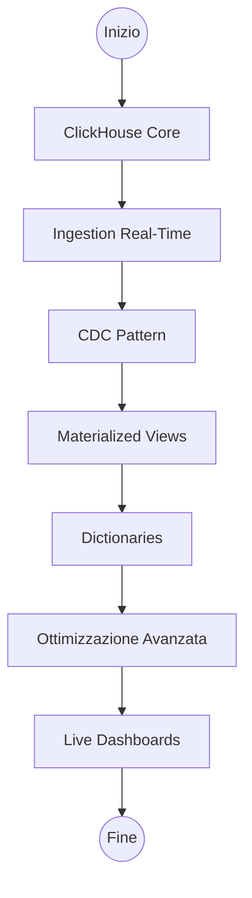

## Panoramica del Modulo

Il modulo **Real-Time Analytics** è dedicato a chi deve analizzare dati che cambiano al millisecondo. Qui ClickHouse non è solo un database veloce, ma il motore di un'intera architettura reattiva.
Approfondiremo pattern complessi come il **Change Data Capture (CDC)** per sincronizzare database transazionali in tempo reale e l'uso di **Materialized Views incrementali** per pre-aggregare i dati all'ingestion.

## Obiettivi di Apprendimento

Al termine di questo modulo sarai in grado di:

- **Implementare** architetture CDC (Change Data Capture) per replicare database Postgres/MySQL in ClickHouse.
- **Progettare** Materialized Views complesse per aggregare dati in tempo reale senza latenza.
- **Utilizzare** i Dizionari di ClickHouse per arricchire i dati (Join-time vs Ingestion-time).
- **Ottimizzare** le performance di query su dataset massivi (Partitioning, Skipping Indices).
- **Costruire** dashboard live che si aggiornano automaticamente.

## Prerequisiti

- Conoscenza intermedia di SQL.
- Aver completato il modulo "Data Warehousing" o avere esperienza pregressa con database analitici.
- Concetti base di Docker (per i lab).

## Percorso delle Lezioni

| N° | Lezione | Argomento Principale | Durata | Difficoltà |
| :-- | :--- | :--- | :--- | :--- |
| 1 | **ClickHouse Fondamenti** | Architettura e motori di tabella (MergeTree) | 50 min | ⭐⭐ |
| 2 | **ClickHouse Real-Time** | Ingestion ad alta frequenza e buffer | 60 min | ⭐⭐⭐ |
| 3 | **Streaming Patterns** | Collegare Kafka a ClickHouse (Approfondimento) | 45 min | ⭐⭐⭐ |
| 4 | **Dashboards Live** | Visualizzare dati real-time (Grafana/Superset) | 40 min | ⭐⭐ |
| 5 | **Ottimizzazione Query** | Indici, compressione e profiler | 55 min | ⭐⭐⭐ |
| 6 | **CDC Pattern** | Replicare modifiche DB (Debezium/ClickHouse) | 60 min | ⭐⭐⭐ |
| 7 | **Materialized Views & Dictionaries** | Pre-aggregazione e lookup veloci | 50 min | ⭐⭐⭐ |

## Competenze Acquisite

**Competenze Tecniche:**
- Tuning avanzato di ClickHouse (`settings.xml`, profili utenti).
- Design di pipeline CDC robuste.
- Scrittura di query SQL con funzioni specifiche per time-series e array.

**Competenze Architetturali:**
- Scelta tra architettura Lambda vs Kappa.
- Gestione della deduplica dei dati in sistemi distribuite (ReplacingMergeTree).

## Tempo Stimato

- **Durata Totale:** Circa 6-7 ore.
- **Tempo Consigliato:** 2-3 settimane.

## Come Usare Questo Modulo

Questo è un modulo per "power user". La lezione sulle **Materialized Views** e i **Dizionari** è quella che trasforma un utente ClickHouse medio in un esperto.
Non limitarti a leggere: prova a implementare un CDC locale con Docker Compose (Postgres -> Debezium -> Kafka -> ClickHouse) per vedere la magia accadere.
