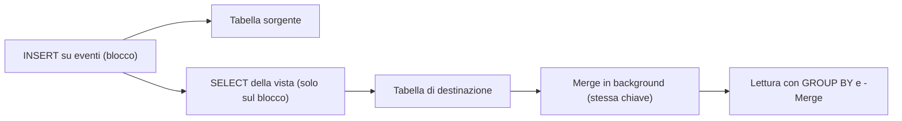

La dashboard mostra 189.705 utenti unici all'ora. La base clienti ne conta 5.000. Nessuna query ha restituito un errore: la vista materializzata ha fatto ciò che le era stato chiesto, minuto per minuto, e la dashboard ha sommato i minuti. È uno scenario costruito, con numeri di esempio generati dal codice di questa pagina e verificati con chDB, il motore ClickHouse in-process.

> **Idea chiave:** una materialized view incrementale è un trigger sull'insert. Calcola sul blocco appena arrivato, mai sui dati già presenti, e ciò che scrive deve poter essere fuso con ciò che c'è già.

## Centottantanovemila utenti su cinquemila

Lo scenario ha cinquemila utenti e 300.000 eventi all'ora. Una materialized view calcola gli utenti unici di ogni minuto con `uniq`, in una tabella `SummingMergeTree`, e la dashboard somma i minuti per ottenere l'ora. Rieseguendo i blocchi `sql` nell'ordine in cui compaiono ottieni gli stessi numeri.

Ogni minuto, preso da solo, è corretto. L'ora no: 189.705 contro 5.000, perché un utente attivo in molti minuti viene contato una volta per ognuno. Il grafico ha l'andamento giusto e il livello sbagliato, e per questo nessuno se ne accorge.

Nella stessa vista ci sono altri due difetti. Manca un'ora intera di dati: 900.000 eventi nella tabella grezza, 600.000 nella vista. E dopo un lotto in ritardo ogni minuto ha due righe, 120 righe per 60 minuti.

La reazione abituale è cercare un bug nella somma o nella query della dashboard. Non c'è. La causa non è la query: è che una materialized view non conserva una query, conserva il risultato di una query calcolata blocco per blocco.

## Perché la somma dei minuti non è l'ora

Il numero 189.705 non è casuale, si può prevedere. Il flusso è di 300.000 eventi all'ora, quindi 300.000 / 60 = 5.000 eventi al minuto, e ogni evento pesca un utente a caso tra 5.000. Gli utenti distinti attesi in un minuto sono 5.000 × (1 - e^-1), cioè circa 5.000 × 0,632 = 3.161. Sommando 60 minuti si ottiene 3.161 × 60 = 189.660 circa, a pochi decimi di punto da 189.705 misurato. Il valore giusto dell'ora è 5.000, perché nell'ora ogni utente compare quasi certamente almeno una volta: la somma sovrastima di 189.705 / 5.000 = 37,9 volte.

Questo calcolo mostra la regola. Le misure additive si sommano su qualsiasi partizione dei dati: conteggi di eventi, somme di importi. Le misure non additive non si sommano: conteggi distinti, medie, percentili. Per queste serve conservare qualcosa di più di un numero.

| Misura | Additiva | Come si conserva | Funzione di lettura |
|---|---|---|---|
| Conteggio eventi | Sì | `SimpleAggregateFunction(sum, UInt64)` | `sum` |
| Somma importi | Sì | `SimpleAggregateFunction(sum, Decimal)` | `sum` |
| Utenti distinti | No | `AggregateFunction(uniqExact, UInt32)` | `uniqExactMerge` |
| Media | No | stato `avgState` | `avgMerge` |
| Percentile p95 | No | stato `quantileState(0.95)` | `quantileMerge(0.95)` |

La riga degli utenti distinti è quella che ha prodotto 189.705. Uno stato di aggregazione è un risultato parziale che si può fondere con altri senza contare due volte lo stesso utente: `uniqExactState` non memorizza un numero, memorizza l'insieme (o una sua rappresentazione) e `uniqExactMerge` unisce due stati.

## Cosa fa una materialized view

Il meccanismo si regge su tre fatti ([viste incrementali](https://clickhouse.com/docs/materialized-view/incremental-materialized-view)).

Il primo: quando un blocco di righe entra nella tabella sorgente, la `SELECT` della vista gira solo su quel blocco e il risultato finisce nella tabella di destinazione. I dati già presenti non vengono rivisitati.

Il secondo: la tabella di destinazione fonde le righe con la stessa chiave in background, secondo il proprio motore. `SummingMergeTree` somma le colonne numeriche, `AggregatingMergeTree` fonde stati di aggregazione. Prima del merge le righe di una stessa chiave coesistono.

Il terzo: uno stato di aggregazione è un risultato parziale fondibile. Lo stesso vale per le medie e per i percentili, che non si possono sommare.



Il diagramma mette in evidenza due punti. La `SELECT` della vista vede solo il blocco, quindi una vista creata dopo non conosce lo storico. E la lettura passa dopo un merge che non puoi programmare: devi sempre scrivere la query di lettura come se le righe fossero ancora separate.

## Tre errori che gonfiano i numeri

Questo è lo schema che esce da un tutorial. Il blocco crea un database `Atomic`, come quello predefinito di un server ClickHouse (le viste refreshable lo richiedono), una vista per minuto con `uniq` e carica le ore. La vista `carica_ora` serve solo a generare i dati: è una vista parametrica.

```sql
CREATE DATABASE lab ENGINE = Atomic;
USE lab;

CREATE TABLE eventi
(
    ts DateTime,
    id_utente UInt32,
    importo Decimal(10, 2)
)
ENGINE = MergeTree
ORDER BY ts;

CREATE VIEW carica_ora AS
SELECT
    toStartOfDay(now()) - toIntervalDay(1) + toIntervalSecond({ora:UInt8} * 3600 + intDiv(number * 3600, 300000)) AS ts,
    toUInt32(cityHash64(number, {ora:UInt8}) % 5000) AS id_utente,
    round((cityHash64(number, 99) % 10000) / 100, 2) AS importo
FROM numbers(300000);

-- L'ora 0 arriva prima che esista una vista.
INSERT INTO eventi SELECT * FROM carica_ora(ora = 0);

CREATE TABLE utenti_minuto_v1
(
    minuto DateTime,
    utenti UInt64,
    eventi UInt64
)
ENGINE = SummingMergeTree
ORDER BY minuto;

CREATE MATERIALIZED VIEW utenti_minuto_v1_mv TO utenti_minuto_v1 AS
SELECT toStartOfMinute(ts) AS minuto, uniq(id_utente) AS utenti, count() AS eventi
FROM eventi
GROUP BY minuto;

INSERT INTO eventi SELECT * FROM carica_ora(ora = 1);
INSERT INTO eventi SELECT * FROM carica_ora(ora = 2);

-- La dashboard somma i minuti: circa 190.000 utenti per ora.
SELECT toStartOfHour(minuto) AS ora, sum(utenti) AS utenti_unici FROM utenti_minuto_v1 GROUP BY ora ORDER BY ora;

-- La verità, dalla tabella grezza: 5.000.
SELECT toStartOfHour(ts) AS ora, uniqExact(id_utente) AS utenti_unici FROM eventi GROUP BY ora ORDER BY ora;

-- La vista non ha l'ora 0: 900.000 eventi contro 600.000.
SELECT (SELECT count() FROM eventi) AS grezzi, (SELECT sum(eventi) FROM utenti_minuto_v1) AS nella_vista;

-- 1.000 eventi in ritardo per l'ora 1: ogni minuto ha ora due righe, finché non c'è un merge.
INSERT INTO eventi
SELECT toStartOfDay(now()) - toIntervalDay(1) + toIntervalSecond(3600 + cityHash64(number) % 3600), 10000 + number % 100, 1.00
FROM numbers(1000);

SELECT count() AS righe, uniqExact(minuto) AS minuti
FROM utenti_minuto_v1
WHERE minuto >= toStartOfDay(now()) - toIntervalDay(1) + toIntervalHour(1)
  AND minuto < toStartOfDay(now()) - toIntervalDay(1) + toIntervalHour(2);
```

### Un valore finale dove serve uno stato

**Sintomo:** un'ora vale 189.705 utenti invece di 5.000, e il grafico sembra sano.

**Perché succede:** `utenti` è un numero e `SummingMergeTree` somma i numeri, quindi sembra ragionevole. Ma la somma di conteggi distinti non è un conteggio distinto, e lo stesso vale per le medie. È l'errore peggiore perché il risultato è plausibile.

**Come si corregge:** conserva lo stato di aggregazione e leggilo con la funzione `-Merge`, come nella sezione successiva.

### Leggere la destinazione come se fosse già fusa

**Sintomo:** dopo 1.000 eventi in ritardo, i 60 minuti dell'ora 1 occupano 120 righe, e la dashboard disegna ogni minuto due volte.

**Perché succede:** la destinazione è una tabella, quindi la si legge come una tabella. Ma le righe con la stessa chiave si fondono più tardi, in un momento che decide il server.

**Come si corregge:** leggi sempre con `GROUP BY` sulla chiave e con la funzione di fusione, mai con un `SELECT *`.

### Una vista su una tabella già piena

**Sintomo:** 900.000 eventi nella sorgente, 600.000 nella vista: manca l'ora 0.

**Perché succede:** una vista incrementale vede solo i dati che arrivano dopo la sua creazione, e l'ora 0 era già nella tabella. `POPULATE` sembra la scorciatoia, ma la documentazione ne sconsiglia l'uso perché può perdere le righe inserite mentre la vista viene creata.

**Come si corregge:** riempi lo storico con un `INSERT ... SELECT` su un confine fissato prima, come mostra la sezione sul backfill.

## Stati di aggregazione e backfill

I criteri, in ordine di priorità:

1. Per ogni misura chiediti se è additiva. Somme e conteggi lo sono; distinti, medie e percentili no.
2. Le misure non additive si memorizzano come stati (`uniqExactState`) in una tabella `AggregatingMergeTree` e si leggono con `uniqExactMerge`. Quelle additive possono restare numeri, con `SimpleAggregateFunction(sum, UInt64)`. Qui si usa `uniqExact` perché il conto deve tornare; `uniq` è approssimato.
3. Leggi la destinazione sempre con `GROUP BY` e con la funzione `-Merge`: prima del merge in background le righe di una chiave sono più d'una.
4. Fissa il confine del backfill prima di creare la vista e non spostarlo: un istante T, la vista copre ciò che entra dopo, un `INSERT ... SELECT` che scrive stati copre ciò che ha `ts` prima di T. Mai `POPULATE`. Il minimo letto dalla destinazione non è un confine: se prima del backfill arriva un evento in ritardo per un minuto vecchio, il minimo torna indietro e lo storico successivo a quel minuto non viene mai riempito.
5. Fai coincidere la `GROUP BY` della vista con l'`ORDER BY` della destinazione: è la chiave su cui il motore fonde le righe. Se la vista raggruppa anche per una colonna fuori dalla chiave, al merge le righe che differiscono solo per quella colonna diventano una e la colonna tiene un valore qualsiasi.

Lo stesso scenario, scritto bene:

```sql
CREATE TABLE utenti_minuto_v2
(
    minuto DateTime,
    utenti AggregateFunction(uniqExact, UInt32),
    eventi SimpleAggregateFunction(sum, UInt64)
)
ENGINE = AggregatingMergeTree
ORDER BY minuto;

-- Confine T: l'inizio dell'ora 3. Si fissa qui, prima della vista, e il backfill lo riusa tale e quale.
CREATE MATERIALIZED VIEW utenti_minuto_v2_mv TO utenti_minuto_v2 AS
SELECT toStartOfMinute(ts) AS minuto, uniqExactState(id_utente) AS utenti, count() AS eventi
FROM eventi
GROUP BY minuto;

-- L'ora 3 arriva dopo la vista: la vista la aggrega da sola.
INSERT INTO eventi SELECT * FROM carica_ora(ora = 3);

-- Il backfill: solo ciò che ha ts prima del confine T.
INSERT INTO utenti_minuto_v2
SELECT toStartOfMinute(ts) AS minuto, uniqExactState(id_utente), count()
FROM eventi
WHERE ts < toStartOfDay(now()) - toIntervalDay(1) + toIntervalHour(3)
GROUP BY minuto;

-- Ora la vista e la tabella grezza coincidono: 1.201.000 eventi.
SELECT (SELECT count() FROM eventi) AS grezzi, (SELECT sum(eventi) FROM utenti_minuto_v2) AS nella_vista;

-- Altri 500 eventi in ritardo per l'ora 1, con 50 utenti nuovi: la vista li fonde senza ricalcolare.
-- I primi 100 utenti nuovi dell'ora 1 erano già nel lotto in ritardo, riempito dal backfill.
INSERT INTO eventi
SELECT toStartOfDay(now()) - toIntervalDay(1) + toIntervalSecond(3600 + cityHash64(number, 1) % 3600), 20000 + number % 50, 1.00
FROM numbers(500);

-- Si legge sempre con GROUP BY e -Merge: 5.000 utenti per ora, 5.150 per l'ora 1 (5.000 + 100 + 50).
SELECT toStartOfHour(minuto) AS ora, uniqExactMerge(utenti) AS utenti_unici, sum(eventi) AS eventi
FROM utenti_minuto_v2
GROUP BY ora
ORDER BY ora;
```

## Verificare i conti con l'esempio svolto

Il risultato si controlla con l'aritmetica, riga per riga. Il totale della vista coincide con la tabella grezza: 1.201.000 eventi su 1.201.000. Quegli 1.201.000 si scompongono come 4 ore × 300.000 = 1.200.000, più 1.000 eventi in ritardo dell'ora 1, e il successivo lotto da 500 si somma solo dopo quel confronto.

Gli utenti per ora si leggono dall'ultima query: 5.000 per le ore 0, 2 e 3, e 5.150 per l'ora 1. L'ora 1 ha 5.000 utenti di base, più 100 utenti nuovi arrivati col primo lotto in ritardo (identificatori da 10.000 a 10.099, già coperti dal backfill), più 50 del secondo lotto da 500 eventi (identificatori da 20.000 a 20.049): 5.000 + 100 + 50 = 5.150. Gli eventi dell'ora 1 sono 300.000 + 1.000 + 500 = 301.500, il valore che compare nella colonna `eventi`.

Il livello torna da 189.705 a 5.000, quasi quaranta volte meno. E l'ora 1 sale da 5.000 a 5.150 senza nessun ricalcolo: la vista ha fuso lo stato nuovo con quello vecchio.

Per le misure, gli eventi in ritardo non sono il problema che sembrano. Ogni evento cade nel minuto che gli spetta e lo stato di quel minuto si aggiorna al merge. Il limite sta nel confine del backfill, che è un confine di inserimento approssimato con un tempo di evento. Un evento con `ts` prima di T che entra dopo la creazione della vista finisce nella vista e poi di nuovo nel backfill: gli utenti unici non cambiano, gli eventi contano due volte. Con il minimo letto dalla destinazione, lo stesso evento fa sparire lo storico. Il controllo è il totale della vista contro quello della sorgente, su una finestra chiusa, dopo ogni backfill. Se la sorgente ha una colonna con l'istante di inserimento, usala come confine al posto di `ts`.

La vista si cancella e si ricrea senza toccare la sorgente, con `DROP VIEW`. Gli stati sbagliati già scritti si ricostruiscono rileggendo la tabella grezza: una scansione, qui di 1,2 milioni di righe. Ma solo se la tabella grezza esiste ancora: se ha un `TTL` più corto della vista, quello che è scaduto non si recupera.

## Quando il risultato dipende da altro

La vista incrementale vede solo il blocco che entra. Che cosa succede se la misura dipende da un'altra tabella, per esempio dal segmento di ogni utente, e il segmento cambia? Gli strumenti sono due: la vista incrementale con un join, e la vista refreshable, che rilancia a intervalli la query su tutti i dati.

Per un'aggregazione su una sola tabella la incrementale scala meglio ed è la scelta di partenza. La documentazione indica la refreshable per le query che l'approccio incrementale non sa esprimere, come i join complessi, quando si può tollerare una freschezza minore.

Il criterio: **incrementale se il risultato dipende solo dalle righe appena inserite, refreshable se dipende da altre tabelle o dall'insieme dei dati.**

```sql
CREATE TABLE segmenti
(
    id_utente UInt32,
    segmento LowCardinality(String)
)
ENGINE = MergeTree
ORDER BY id_utente;

INSERT INTO segmenti SELECT number, if(number < 2500, 'nuovo', 'fedele') FROM numbers(5000);

-- Incrementale: il join con segmenti è valutato quando i dati entrano.
CREATE TABLE eventi_segmento_inc
(
    ora DateTime,
    segmento LowCardinality(String),
    eventi UInt64
)
ENGINE = SummingMergeTree
ORDER BY (ora, segmento);

CREATE MATERIALIZED VIEW eventi_segmento_inc_mv TO eventi_segmento_inc AS
SELECT toStartOfHour(e.ts) AS ora, s.segmento AS segmento, count() AS eventi
FROM eventi AS e
INNER JOIN segmenti AS s ON e.id_utente = s.id_utente
GROUP BY ora, segmento;

INSERT INTO eventi SELECT * FROM carica_ora(ora = 4);

-- Refreshable: rilegge tutto, con i segmenti del momento.
CREATE MATERIALIZED VIEW eventi_segmento_rmv REFRESH EVERY 1 HOUR ENGINE = MergeTree ORDER BY (ora, segmento) AS
SELECT toStartOfHour(e.ts) AS ora, s.segmento AS segmento, count() AS eventi
FROM eventi AS e
INNER JOIN segmenti AS s ON e.id_utente = s.id_utente
GROUP BY ora, segmento;

SYSTEM WAIT VIEW eventi_segmento_rmv;

-- L'ora 4 prima del cambio: le due strade coincidono, 150.057 e 149.943.
SELECT 'incrementale' AS vista, segmento, sum(eventi) AS eventi
FROM eventi_segmento_inc
WHERE ora = toStartOfDay(now()) - toIntervalDay(1) + toIntervalHour(4)
GROUP BY segmento
UNION ALL
SELECT 'refreshable', segmento, sum(eventi)
FROM eventi_segmento_rmv
WHERE ora = toStartOfDay(now()) - toIntervalDay(1) + toIntervalHour(4)
GROUP BY segmento
ORDER BY 1, 2;

-- Mille utenti passano da «nuovo» a «fedele».
ALTER TABLE segmenti UPDATE segmento = 'fedele' WHERE id_utente < 1000 SETTINGS mutations_sync = 1;
SYSTEM REFRESH VIEW eventi_segmento_rmv;
SYSTEM WAIT VIEW eventi_segmento_rmv;

-- L'ora 4 dopo il cambio: la refreshable segue i segmenti di oggi, l'incrementale no.
SELECT 'incrementale' AS vista, segmento, sum(eventi) AS eventi
FROM eventi_segmento_inc
WHERE ora = toStartOfDay(now()) - toIntervalDay(1) + toIntervalHour(4)
GROUP BY segmento
UNION ALL
SELECT 'refreshable', segmento, sum(eventi)
FROM eventi_segmento_rmv
WHERE ora = toStartOfDay(now()) - toIntervalDay(1) + toIntervalHour(4)
GROUP BY segmento
ORDER BY 1, 2;

-- Quanto rilegge un giro di refresh: 1.506.500 righe.
SELECT read_rows, total_rows FROM system.view_refreshes WHERE view = 'eventi_segmento_rmv';
```

Prima del cambio le due strade danno lo stesso risultato: 150.057 eventi «nuovo» e 149.943 «fedele», che sommano a 300.000. Dopo il cambio dei primi mille utenti, la refreshable dice 209.916 eventi «fedele» e 90.084 «nuovo», che sommano ancora a 300.000, mentre l'incrementale è rimasta a 150.057 e 149.943. Lo spostamento è di 209.916 - 149.943 = 59.973 eventi, circa il 20% del totale, per mille utenti su cinquemila. Entrambe le viste sono corrette: una risponde «com'era l'utente quando è entrato l'evento», l'altra «com'è oggi».

La confusione comune è scegliere la refreshable pensando a una incrementale più lenta ma uguale. Non lo è: ogni giro rilegge tutto, qui 1.506.500 righe, mentre l'incrementale tocca solo il blocco inserito. A un insert al secondo e un refresh al minuto la differenza è il costo che porta a spegnere la vista. All'opposto, chi si aspetta che un join in una vista incrementale segua la dimensione resta con numeri vecchi per sempre: la documentazione lo descrive come un join con uno snapshot della dimensione.

Restano fuori da questa lezione le viste a cascata e il Kafka engine. Non è coperto nemmeno `uniqExact` sui grandi insiemi: lo stato cresce con i valori distinti, e lì `uniq` oppure `uniqCombined` sono scelte da misurare. I numeri vengono da dati sintetici.

## Controllo prima di mettere la vista in produzione

1. Una vista per minuto calcola `avg(importo)` e la memorizza come numero in una `SummingMergeTree`. La dashboard fa la media delle medie dei 60 minuti. Perché il risultato è sbagliato e che cosa conservi al suo posto?

<details>
<summary>Mostra risposta</summary>

La media delle medie pesa allo stesso modo un minuto da 10 eventi e uno da 10.000, quindi non coincide con la media dell'ora. Si conserva lo stato `avgState(importo)` in una tabella `AggregatingMergeTree` e si legge con `avgMerge`, che fonde somma e conteggio e restituisce la media pesata corretta.

</details>

2. La destinazione contiene due righe per lo stesso minuto, perché è arrivato un lotto in ritardo. La query della dashboard fa `SELECT minuto, eventi FROM destinazione`. Che cosa vede l'utente e come la correggi?

<details>
<summary>Mostra risposta</summary>

Vede il minuto due volte, con due valori parziali. Si corregge con `GROUP BY minuto` e `sum(eventi)`, oppure `uniqExactMerge(utenti)` per gli stati. Il merge in background le fonderà prima o poi, ma la query non può dipendere da quando.

</details>

3. Hai 900.000 eventi nella sorgente e crei la vista sul 100% dei dati futuri. Come riempi lo storico senza `POPULATE`, e perché non usi il minimo letto dalla destinazione come confine?

<details>
<summary>Mostra risposta</summary>

Fissi un istante T prima di creare la vista, poi con un `INSERT ... SELECT` scrivi gli stati di tutto ciò che ha `ts` prima di T. Il minimo della destinazione non è un confine stabile: un evento in ritardo per un minuto vecchio lo fa tornare indietro e lo storico successivo non viene mai riempito. Dopo il backfill confronti il totale della vista con quello della sorgente su una finestra chiusa.

</details>

4. Una misura dipende dal segmento commerciale dell'utente, che cambia ogni settimana. Scegli vista incrementale o refreshable, e che cosa devi sapere sul costo?

<details>
<summary>Mostra risposta</summary>

Se la domanda è «com'è il segmento oggi», serve la refreshable, perché l'incrementale resta ferma al segmento dell'istante dell'insert. Ogni giro rilegge tutto: nell'esempio 1.506.500 righe a ogni refresh, quindi la frequenza va scelta contro il costo della lettura completa.

</details>

5. Quale metrica ti dice se la vista è sana, e perché il tempo di risposta della dashboard non basta?

<details>
<summary>Mostra risposta</summary>

Lo scostamento tra la vista e la query diretta sulla sorgente, sulla stessa finestra chiusa. Una vista che somma male risponde in fretta lo stesso: nell'esempio 189.705 contro 5.000 utenti, con tempi di risposta normali.

</details>
