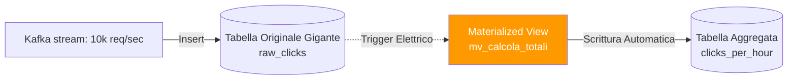

import { Aside, Steps, Tabs, TabItem, CardGrid, Card } from '@astrojs/starlight/components'

# Materialized Views E Dictionaries

In un Data Warehouse tradizionale (Es. Snowflake o BigQuery), quando vuoi calcolare quanti utenti totali hanno visitato una landing page oggi, scrivi un file dbt che fa la `SUM()` alle tre di notte. E in giornata il team marketing guarda il cruscotto aggiornato a ieri.

Ma se sei nel bel mezzo del *Black Friday*, devi sapere *ora* quale campagna sta esaurendo il budget orario. 
Potresti mandare la query `SUM()` al database ogni secondo. Risultato? **Il Database collassa**, perché ogni secondo cercherà di ricalcolare miliardi di righe da capo.

In uno stack DataOps moderno, gettiamo via i tool esterni complicati come Apache Spark e Apache Flink. Facciamo fare tutto il lavoro sporco pre-calcolato al database **nell'istante esatto in cui l'evento sta precipitando dentro (On-Ingest).**

Entrano in gioco le **Materialized Views di ClickHouse**.

---

## 1. Il Segreto della Materialized View (MV) 

Nel mondo SQL classico (PostgreSQL/MySQL), una Materialized View è una "fotografia" statica. Lanci il comando `REFRESH MATERIALIZED VIEW` e il database ricalcola tutto leggendo la tabella base e copiandone i risultati.

In ClickHouse, le MV sono **alienamente diverse**.
Non sono query ritardate. **Sono dei Trigger Reattivi, invisibili, agganciati al cavo di ricezione**.



Ogni singolo evento JSON in ingresso (una riga nuova) non viene solo appoggiato nella tabella Raw. Viene anche intercettato *al volo* dalla Materialized View, che agisce come una porta girevole, calcolando la somma per te e versando l'addizione nella Tabella Piccola.
Così, la tabella "clicks_per_hour" ha sempre 24 piccole righe calcolate in anticipo. Grafana la leggerà in *zero virgola un millisecondo*, mostrandola in Live al CEO senza gravare il Database.

---

## 2. Lo Stato di Aggregazione in 2 Fasi (The State Machine)

La sfida computazionale più alta per un computer non è "fare la somma". 
È fare un "Conteggio Unico" in tempo reale (`COUNT(DISTINCT user_id)`). 

Se alle 14:01 entra l'Utente Luca, e alle 14:05 entra l'Utente Marco, noi abbiamo 2 Unique Users.
Se alle 14:08 entra di nuovo Luca, gli Unique Users devono restare 2, non 3. 
Come fa ClickHouse a mantenere questa regola **senza rileggere all'indietro l'intero mese**?

Usa un motore chiamato **`AggregatingMergeTree`** e la sintassi **Statale (-State) vs Computazionale (-Merge)**.

<Tabs>
  <TabItem label="1. Tabella Somme (AggregatingMergeTree)" icon="setting">
    ```sql
    -- Costruisci una mini-tabella che salva lo "Stato in sospeso" delle somme.
    CREATE TABLE click_aggregati_orari (
        hour DateTime,
        campaign_name String,
        count_utenti_unici AggregateFunction(uniq, String) -- Non è un INT, è uno STATO quantico
    ) ENGINE = AggregatingMergeTree()
    ORDER BY (hour, campaign_name);
    ```
  </TabItem>
  <TabItem label="2. La Materialized View (The Trigger)" icon="puzzle">
    ```sql
    -- Diciamo alla Vista che deve riempire la mini-tabella usando "uniqState" al volo
    CREATE MATERIALIZED VIEW mv_aggiorna_click
    TO click_aggregati_orari 
    AS SELECT
        toStartOfHour(timestamp) AS hour,
        campaign_name,
        -- Non fare uniq(), usa uniqState() per iniettare l'algoritmo matematico sfuso!
        uniqState(user_id) AS count_utenti_unici 
    FROM eventi_raw_giganti
    GROUP BY hour, campaign_name;
    ```
  </TabItem>
</Tabs>

Quando attacchi Metabase per leggere la tabella finale non la leggi da sola, usi il suffisso `-Merge` finale per chiudere i risultati:

```sql
SELECT
    hour,
    campaign_name,
    uniqMerge(count_utenti_unici) AS Total_Users_Live -- Esplosione di Velocità!
FROM click_aggregati_orari
GROUP BY hour, campaign_name;
```

---

## 3. I Dictionaries: Join a Costo Zero

Nelle pipeline c'è un secondo disastro prestazionale.
Da Kafka ricevi eventi anonimi: `{"user_id": 991, "importo": 50€}`.
Nelle Dashboard del Board, il CEO non accetta gli `user_id`. Vuole vedere `"Target_Audience"`, `"Company_Name"`, `"Email"`.
Nel mondo classico, faresti un `JOIN` tra la Tabella Kafka dei Click (Da miliardi di righe) e la Tabella Clienti di PostgreSQL. 
*JOIN* in ambiente Big Data è una maledizione che rallenta le risposte del Server esponenzialmente.

In ClickHouse i JOIN non sono vietati, ma il palladio per arricchire istantaneamente gli ID del cliente è il **Dictionary**.
Un Dictionary (Dizionario) è una connessione che scarica la tabella "Clienti" del CRM remoto tenendola perennememnte accesa e caricata nella **SRAM (RAM velocissima)** del Server ClickHouse, con un aggiornamento cronometrato (Es. ogni 5 minuti).

<Steps>
1. **Dichiara il dizionario remoto (Da un PostgreSQL lento)**:
   ```sql
   CREATE DICTIONARY crm_clienti_dict (
       user_id UInt32,
       nome String,
       company_value LowCardinality(String)
   )
   PRIMARY KEY user_id
   SOURCE(POSTGRESQL(
       HOST 'crm-database.azienda.internal' PORT 5432 
       USER 'read_only' PASSWORD 's3cr3t' TABLE 'utenti'
   ))
   LAYOUT(HASHED()) -- Salva tutto in RAM come un Array velocissimo C++
   LIFETIME(MIN 300 MAX 600); -- Ricarica le novità da PGSQL ogni 5 minuti in background!
   ```

2. **Evoca l'arricchimento in Microsecondi (Nessun Join)**:
   ```sql
   SELECT 
       /* Cerca in memoria RAM la Company collegata senza muovere il Disco: O(1) time complexity! */
       dictGet('crm_clienti_dict', 'company_value', user_id) AS segmento_company,
       SUM(importo) as ricavi
   FROM checkout_events_livestream
   GROUP BY segmento_company
   ```
</Steps>

## Takeaway DataOps

Quando unisci una "Materialized View" con un "Dictionary" all'interno del DB, annienti ogni layer intermedio (Airflow, Python-Pandas per arricchimento). 
Il Json entra grezzo su Kafka, plana in ClickHouse... La vista materializzata lo intercetta, invoca la Funzione Dictionary che traduce silenziosamente l'`ID `in `Nome del Cliente`, la inserisce nella tabellina rimpicciolita con la sommma parziale (State), e la tua Dashboard si aggiorna in real-time senza sprecare 1% di CPU in più.

Questa è la massima efficienza dei dati calcolativi. 
Siamo pronti al gradino finale dello Streaming: Come iniettare direttamente **ClickHouse contro Kafka in un matrimonio perfetto tra Pipeline**.
