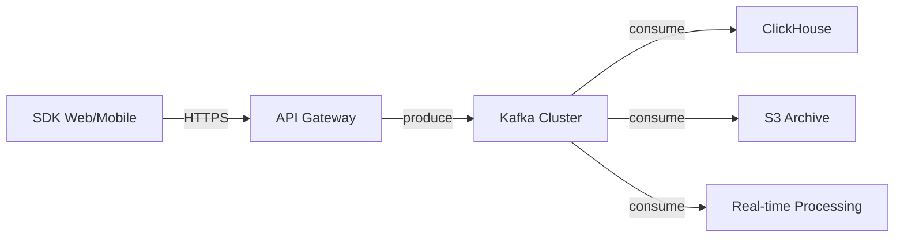

# Streaming Ingestion con Kafka

> **Obiettivo:** Implementare un sistema di ingestion streaming che raccoglie eventi in tempo reale e li rende disponibili per l'analisi.

## 1. Architettura di Ingestion


## 2. Producer: Invio Eventi
```python
from confluent_kafka import Producer
import json, time

config = {
    'bootstrap.servers': 'kafka:9092',
    'acks': 'all',
    'enable.idempotence': True,
    'compression.type': 'lz4',
    'batch.size': 32768,
    'linger.ms': 20
}

producer = Producer(config)

def track_event(user_id: str, event_type: str, properties: dict):
    event = {
        "user_id": user_id,
        "event_type": event_type,
        "properties": properties,
        "timestamp": int(time.time() * 1000),
        "client_ip": "x.x.x.x"
    }
    producer.produce(
        topic='tracking_events',
        key=user_id.encode(),
        value=json.dumps(event).encode(),
        callback=lambda err, msg: print(f"Error: {err}") if err else None
    )
```

## 3. Consumer: Elaborazione
```python
from confluent_kafka import Consumer

consumer = Consumer({
    'bootstrap.servers': 'kafka:9092',
    'group.id': 'analytics-pipeline',
    'auto.offset.reset': 'earliest',
    'enable.auto.commit': False
})
consumer.subscribe(['tracking_events'])

batch = []
while True:
    msg = consumer.poll(1.0)
    if msg and not msg.error():
        batch.append(json.loads(msg.value()))
        if len(batch) >= 1000:
            insert_to_clickhouse(batch)
            consumer.commit()
            batch = []
```

## 4. Gestione degli Errori
| Errore | Pattern | Esempio |
|:---|:---|:---|
| Kafka down | Retry con backoff | SDK bufferizza localmente |
| Messaggio malformato | Dead Letter Queue | Topic separato per errori |
| Consumer crash | Auto-restart + commit manuale | Kubernetes liveness probe |
| Duplicati | Idempotenza | Dedup per event_id |

## Risorse
- **Libreria:** confluent-kafka-python, aiokafka
- **Pattern:** Exactly-once semantics, Dead Letter Queue
