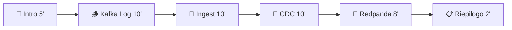
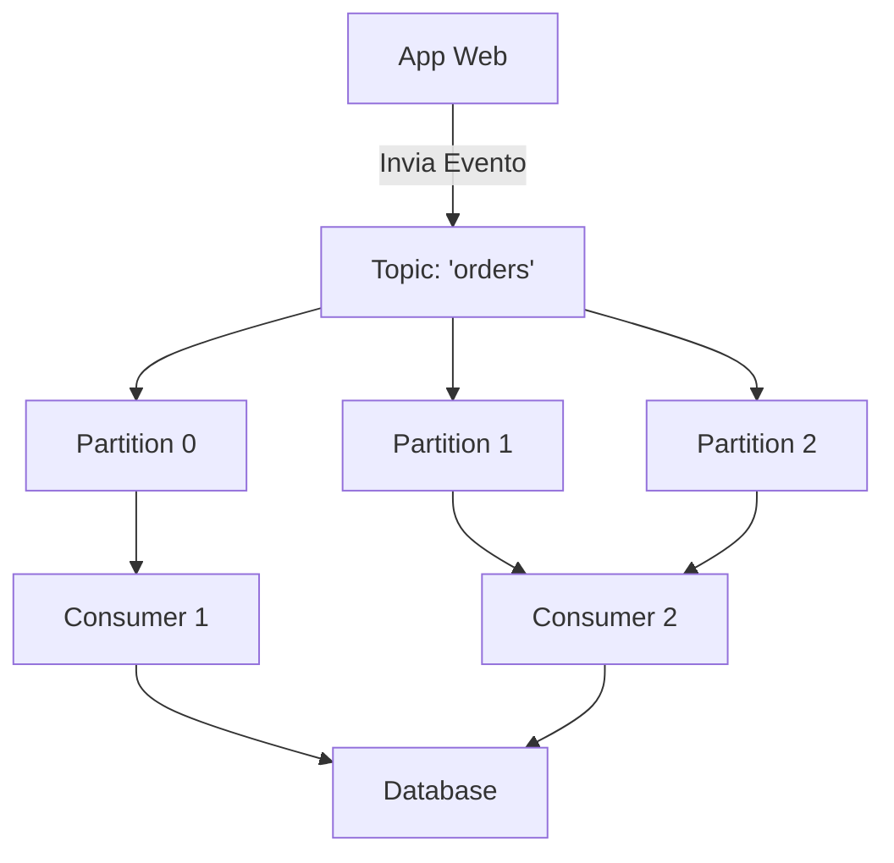

## Streaming Ingestion con Kafka: Il cuore pulsante dei dati — Lezione Completa

Il vecchio modello "Batch" (ETL notturno) è morto. Nell'economia dell'attenzione, aspettare 24 ore per sapere se una campagna sta funzionando è inaccettabile. Oggi i dati non sono laghi statici, sono fiumi in piena. Apache Kafka è la diga che gestisce questo fiume. In questa lezione, impareremo a costruire un'architettura di streaming moderna che porta i dati dall'evento all'analisi in millisecondi.

### Obiettivi di Apprendimento

Al termine di questa lezione, lo studente sarà in grado di:
1.  Spiegare la differenza architetturale tra code di messaggi (RabbitMQ) e log distribuiti (Kafka).
2.  Configurare un `Kafka Engine` in ClickHouse per leggere direttamente dai topic.
3.  Progettare una pipeline di Change Data Capture (CDC) per replicare database transazionali in tempo reale.
4.  Gestire la semantica "Exactly-Once" per evitare duplicati nei dati finanziari.
5.  Valutare alternative moderne a Kafka come Redpanda o Pulsar.

### Timeline della Lezione

| Fase | Argomento | Durata |
|------|-----------|--------|
| 1 | Introduzione: Event-Driven Architecture | 5 min |
| 2 | Teoria: Come funziona Kafka (Log, Topic, Partition) | 10 min |
| 3 | Pratica: Ingestione Kafka -> ClickHouse | 10 min |
| 4 | Strategia: CDC (Change Data Capture) | 10 min |
| 5 | Tecnologia: Redpanda vs Kafka | 8 min |
| 6 | Riepilogo e Domande | 2 min |
| **Totale** | | **45 min** |



### Fase 1 — Introduzione: Event-Driven Architecture (5 min)

In un'architettura classica (Request-Response), il servizio A chiama il servizio B e aspetta. Se B è lento, A si blocca. Se B è giù, A fallisce.
In un'architettura **Event-Driven**, il servizio A dice: "È successo qualcosa (Evento)" e lo scrive in un diario (Broker). Se ne va. Il servizio B, C e D leggono quel diario quando possono e reagiscono.

*   *Vantaggio:* Disaccoppiamento totale. Scalabilità infinita.
*   *Svantaggio:* Complessità. Non sai *quando* B leggerà l'evento (Eventual Consistency).

### Fase 2 — Teoria: Come funziona Kafka (Log, Topic, Partition) (10 min)

Kafka non è una coda (Queue). È un **Distributed Commit Log**.
Una coda cancella il messaggio dopo che è stato letto. Kafka lo tiene (fino a scadenza, es. 7 giorni). Questo permette a più consumatori di leggere gli stessi dati in momenti diversi (Replay).

**Concetti Chiave:**
1.  **Topic:** Una categoria di messaggi (es. `clicks`, `orders`, `users`).
2.  **Partition:** Per scalare, un topic è diviso in pezzi (Partizioni).
3.  **Offset:** Un numero progressivo che indica "a che punto siamo arrivati a leggere".
4.  **Consumer Group:** Un gruppo di server che si dividono le partizioni di un topic per leggere in parallelo.



### Fase 3 — Pratica: Ingestione Kafka -> ClickHouse (10 min)

ClickHouse ha un motore nativo per leggere da Kafka. Non serve scrivere codice Java/Python intermedio!

**Step 1: La tabella Kafka (Il "Tubo")**
Questa tabella non salva nulla su disco. È solo un puntatore al topic Kafka.
```sql
CREATE TABLE queue_clicks (
    timestamp DateTime,
    user_id UInt64,
    url String
) ENGINE = Kafka()
SETTINGS
    kafka_broker_list = 'kafka:9092',
    kafka_topic_list = 'clicks',
    kafka_group_name = 'ch_consumer',
    kafka_format = 'JSONEachRow';
```

**Step 2: La tabella MergeTree (Il "Serbatoio")**
Qui è dove i dati vengono salvati fisicamente.
```sql
CREATE TABLE clicks (
    timestamp DateTime,
    user_id UInt64,
    url String
) ENGINE = MergeTree()
ORDER BY (timestamp, user_id);
```

**Step 3: La Materialized View (La "Pompa")**
Sposta i dati dal Tubo al Serbatoio automaticamente.
```sql
CREATE MATERIALIZED VIEW mv_clicks TO clicks
AS SELECT * FROM queue_clicks;
```

Appena un messaggio arriva su Kafka, ClickHouse lo legge, lo parsa e lo inserisce. Latenza: < 1 secondo.

### Fase 4 — Strategia: CDC (Change Data Capture) (10 min)

Cosa fai se i dati sono in un database "vecchio" (MySQL/PostgreSQL) e li vuoi in ClickHouse in tempo reale? Non puoi fare query ogni secondo (polling), uccideresti il database.

Usi il **CDC (Change Data Capture)**.
Strumenti come **Debezium** leggono il "Transaction Log" del database (binlog in MySQL, WAL in Postgres). Ogni volta che c'è una `INSERT`, `UPDATE` o `DELETE`, Debezium crea un evento Kafka.

*   *MySQL:* `UPDATE users SET plan='pro' WHERE id=1`
*   *Kafka:* `{ "op": "u", "before": { "id": 1, "plan": "free" }, "after": { "id": 1, "plan": "pro" } }`

ClickHouse (con `ReplacingMergeTree`) legge questo evento e aggiorna la sua copia.
Risultato: Replica in tempo reale del DB di produzione senza toccare il DB di produzione.

### Fase 5 — Tecnologia: Redpanda vs Kafka (8 min)

Kafka è scritto in Java/Scala. Richiede ZooKeeper (un altro componente complesso). È pesante (JVM).

**Redpanda** è il nuovo sfidante.
*   Scritto in C++ (niente Garbage Collection, niente JVM).
*   Non serve ZooKeeper (Architettura Raft integrata).
*   100% compatibile con le API di Kafka (usi gli stessi client).
*   Prestazioni 10x su hardware moderno (NVMe).
*   *Consiglio:* Per nuovi progetti nel 2024+, parti con Redpanda. Meno mal di testa operativo.

### Fase 6 — Riepilogo e Domande (2 min)

1.  **Kafka è persistente.** Puoi rileggere i dati di ieri se hai un bug oggi.
2.  **ClickHouse ama Kafka.** L'integrazione è nativa e potentissima.
3.  **CDC per i DB.** Non fare polling, leggi i log.
4.  **Redpanda.** Il futuro (più semplice) dello streaming.

### Domande di Verifica

1.  Qual è la differenza fondamentale tra una "Queue" (come RabbitMQ) e un "Log" (come Kafka) in termini di persistenza del messaggio dopo la lettura?
2.  In ClickHouse, perché serve una "Materialized View" per spostare i dati dalla tabella Kafka Engine alla tabella MergeTree? Perché non scrivere direttamente nella Kafka Engine?
3.  Cosa succede all'"Offset" di un Consumer Group quando crasha e riparte dopo 10 minuti?
4.  Nel contesto del CDC (Change Data Capture), a cosa serve il "Transaction Log" (WAL/Binlog) del database sorgente?
5.  Perché Redpanda è considerato più performante e facile da gestire rispetto al Kafka tradizionale (JVM-based)?

### Riferimenti Bibliografici

-   Jay Kreps, "The Log: What every software engineer should know about real-time data's unifying abstraction", LinkedIn Engineering Blog.
-   Confluent, "Kafka: The Definitive Guide", O'Reilly.
-   Debezium Documentation (Architecture Overview).
