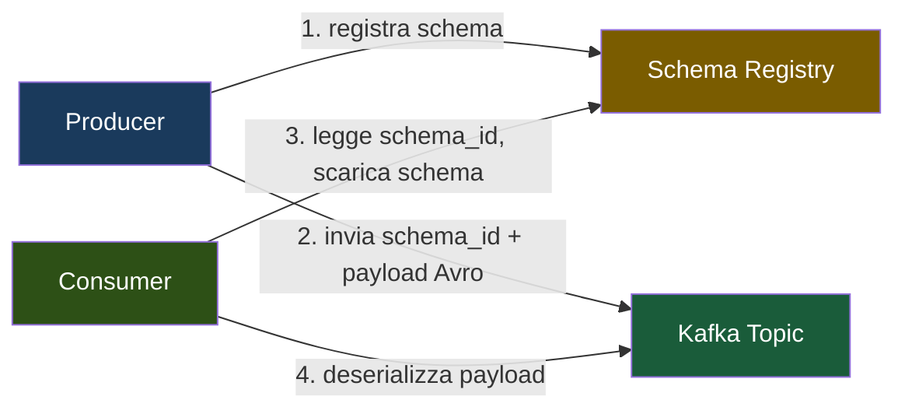

import { Aside, Steps, Tabs, TabItem } from '@astrojs/starlight/components'

Uber calcola il surge pricing ogni 30 secondi in ogni città del mondo. Per farlo, deve sapere in tempo reale quanti driver sono disponibili in ogni zona, quante richieste di corsa stanno arrivando, e qual è il traffico. Questo richiede l'elaborazione di milioni di eventi al secondo — posizioni GPS, richieste, status dei driver — con una latenza totale di pochi secondi. Senza Apache Kafka e stream processing, il modello di surge sarebbe obsoleto nel momento in cui viene calcolato.

La differenza tra batch processing e stream processing non è solo tecnica — è una differenza nel tipo di valore che puoi creare per l'utente.

## Batch vs Streaming: quando scegliere cosa

Il batch processing ha dominato il data engineering per decenni per una ragione: è più semplice, più economico e più robusto. Ma ha un limite fondamentale: la latenza.

| Criterio | Batch | Streaming |
|----------|-------|-----------|
| Latenza | Minuti-ore (T+1 tipico) | Secondi-millisecondi |
| Complessità operativa | Bassa | Alta |
| Costo infrastruttura | Basso | Medio-alto |
| Fault tolerance | Semplice (retry del job) | Complessa (offset management) |
| Use case ideale | Reporting giornaliero, ML training | Fraud detection, pricing, monitoring |
| Tool tipici | Spark batch, dbt, Airflow | Kafka, Flink, Spark Streaming |

**Usa streaming quando**:
- La latenza T+1 ha un costo di business reale (fraud detection, inventory, prezzi)
- Hai bisogno di trigger in tempo reale (alert, notifiche, azioni automatiche)
- Il volume è troppo alto per caricare tutto in batch (es. click-stream, IoT)

**Rimani con il batch quando**:
- Il reporting è giornaliero o settimanale
- La complessità operativa dello streaming non è giustificata
- Il team non ha esperienza con streaming (costo di learning alto)

## Apache Kafka: l'infrastruttura dello streaming

Kafka non è un message queue tradizionale (come RabbitMQ). È un **distributed commit log** — un log ordinato e immutabile di eventi, partizionato per scalabilità, replicato per durabilità.

### I concetti fondamentali

**Topic**: una categoria logica di eventi. `orders`, `user_events`, `payments`. Ogni topic ha N partizioni.

**Partition**: unità di parallelismo. Una partizione è un log ordinato e immutabile. Gli eventi all'interno di una partizione sono ordinati. Tra partizioni diverse, non c'è garanzia di ordine.

**Offset**: la posizione di un evento in una partizione. Immutabile — una volta scritto, l'offset non cambia mai.

**Consumer Group**: un insieme di consumer che si dividono le partizioni. Se un topic ha 6 partizioni e il consumer group ha 3 consumer, ogni consumer legge 2 partizioni. Se un consumer crasha, le sue partizioni vengono riassegnate agli altri.

**Retention**: Kafka non elimina i messaggi dopo la lettura (diverso da un queue). Li tiene per un periodo configurabile (es. 7 giorni). Questo permette a più consumer group di leggere lo stesso topic indipendentemente.

```
Topic "orders" con 3 partizioni:

Partition 0: [offset 0] order_id=101 → [offset 1] order_id=104 → [offset 2] order_id=108 ...
Partition 1: [offset 0] order_id=102 → [offset 1] order_id=105 → ...
Partition 2: [offset 0] order_id=103 → [offset 1] order_id=106 → ...

Consumer Group A (analytics):    Partition 0 → Consumer A1
                                  Partition 1 → Consumer A2
                                  Partition 2 → Consumer A3

Consumer Group B (fraud detect):  Partition 0 → Consumer B1
                                   Partition 1-2 → Consumer B2
```

### Configurazione Producer: durability vs throughput

```properties
# Producer config — bilanciare durabilità e performance
acks = all               # aspetta ack da leader + tutte le repliche
                         # (acks=1 = solo leader, rischio perdita su crash)
retries = 3              # retry automatico su errori transitori
linger.ms = 5            # aspetta 5ms per accumulare messaggi in batch
batch.size = 65536       # 64KB per batch
compression.type = snappy  # compressione (riduce ≤ 70% bandwidth)

# Idempotent producer: garantisce no duplicati su retry
enable.idempotence = true
max.in.flight.requests.per.connection = 5  # con idempotence: max 5
```

### Configurazione Consumer: reliability

```properties
# Consumer config
group.id = analytics-consumer-v1
auto.offset.reset = earliest   # inizia dall'inizio se nuovo gruppo
enable.auto.commit = false     # commit manuale = exactly-once possibile
max.poll.records = 500         # quanti record per poll
session.timeout.ms = 30000     # timeout per rilevare consumer crashed
```

## Delivery Semantics: il triangolo impossibile

La semantica di consegna descrive cosa succede in caso di fallimento (crash del producer o del consumer).

**At-most-once**: il messaggio viene inviato una volta. Se il producer crasha dopo l'invio ma prima dell'ack, il messaggio viene perso. Nessun duplicato, ma possibili perdite. Accettabile solo per metriche non critiche.

**At-least-once**: il messaggio viene inviato finché non riceve un ack. Se il consumer processa il messaggio ma crasha prima di fare commit dell'offset, il messaggio viene rielaborato. Possibili duplicati. Il default più comune.

**Exactly-once**: con Kafka Transactions, il producer può garantire che un messaggio sia scritto esattamente una volta. Il consumer deve essere idempotente (elaborare lo stesso messaggio due volte = stesso risultato).

Per i sistemi di analytics dove un duplicato causa +1 nel count, exactly-once o idempotency del consumer sono necessari.

## Schema Registry e Avro: proteggere le pipeline

Kafka di default accetta qualsiasi bytes come messaggio. Il JSON senza schema è conveniente ma fragile in produzione: se il producer aggiunge un campo, il consumer potrebbe crashare.

**Confluent Schema Registry** (open source) risolve questo:



**Schema Avro per un evento ordine**:

```json
{
  "type": "record",
  "name": "OrderEvent",
  "namespace": "com.mycompany.events",
  "fields": [
    {"name": "order_id", "type": "long"},
    {"name": "customer_id", "type": "long"},
    {"name": "status", "type": {"type": "enum", "name": "OrderStatus",
      "symbols": ["pending", "confirmed", "shipped", "delivered", "cancelled"]}},
    {"name": "amount", "type": {"type": "bytes", "logicalType": "decimal",
      "precision": 10, "scale": 2}},
    {"name": "created_at", "type": {"type": "long", "logicalType": "timestamp-millis"}},
    {"name": "metadata", "type": ["null", "string"], "default": null}
  ]
}
```

**Compatibility modes** (configura per topic):
- `BACKWARD`: nuovi consumatori possono leggere vecchi dati → ok aggiungere field con default
- `FORWARD`: vecchi consumatori possono leggere nuovi dati → ok rimuovere field con default
- `FULL`: entrambi → la più sicura, la più restrittiva
- `NONE`: nessun controllo → pericoloso in produzione

## Ingestion verso ClickHouse via Kafka Engine

ClickHouse ha un Kafka Engine built-in che funge da consumer nativo:

```sql
-- Tabella che "consuma" il topic Kafka
CREATE TABLE orders_kafka_source (
    order_id    UInt64,
    customer_id UInt64,
    status      String,
    amount      Float64,
    created_at  DateTime
) ENGINE = Kafka
SETTINGS
    kafka_broker_list      = 'kafka-1:9092,kafka-2:9092,kafka-3:9092',
    kafka_topic_list       = 'orders',
    kafka_group_name       = 'clickhouse-orders-consumer',
    kafka_format           = 'JSONEachRow',    -- o 'Avro' con Schema Registry
    kafka_num_consumers    = 4,               -- parallelismo
    kafka_max_block_size   = 65536,           -- batch size per insert
    kafka_skip_broken_messages = 1000;        -- tolleranza errori

-- Tabella destinazione
CREATE TABLE orders (
    order_id    UInt64,
    customer_id UInt64,
    status      LowCardinality(String),
    amount      Decimal(18, 2),
    created_at  DateTime,
    ingested_at DateTime DEFAULT now()
) ENGINE = MergeTree()
PARTITION BY toYYYYMM(created_at)
ORDER BY (customer_id, created_at);

-- MV che connette la source alla destination
CREATE MATERIALIZED VIEW orders_kafka_mv TO orders AS
SELECT
    order_id,
    customer_id,
    status,
    toDecimal64(amount, 2) AS amount,
    created_at,
    now() AS ingested_at
FROM orders_kafka_source;
```

### Monitoring del consumer Kafka in ClickHouse

```sql
-- Stato dei consumer Kafka in ClickHouse
SELECT
    consumer_id,
    assignments.topic AS topic,
    assignments.partition_id AS partition,
    assignments.current_offset AS current_offset
FROM system.kafka_consumers
WHERE database = currentDatabase();

-- Errori di parsing (messaggi saltati)
SELECT count(), max(event_time) AS last_error
FROM system.errors
WHERE name LIKE '%Kafka%'
  AND event_time > now() - INTERVAL 1 HOUR;
```

## Architetture: Lambda vs Kappa

Esistono due approcci architetturali principali per combinare batch e streaming.

<Tabs>
<TabItem label="Lambda Architecture">

Proposta da Nathan Marz (2011), la Lambda Architecture separa nettamente:
- **Batch layer**: ricalcola tutto da zero ogni notte, produce views accurate ma lente
- **Speed layer** (streaming): produce views approssimate ma veloci, copre il gap dall'ultimo batch
- **Serving layer**: unisce i risultati dei due layer

**Problema principale**: duplicazione del codice. La stessa logica di business deve essere implementata due volte (in batch e in streaming), con inevitabili divergenze.

```
Dati raw → [Batch Layer: Spark/dbt] → Batch views
         → [Speed Layer: Kafka/Flink] → Real-time views
Serving layer unisce i due = "true answer"
```

</TabItem>
<TabItem label="Kappa Architecture">

Proposta da Jay Kreps (LinkedIn, 2014) in risposta ai problemi della Lambda. L'idea: usa *solo* lo streaming, anche per il batch.

Se hai bisogno di ricalcolare tutto da zero, rileggi Kafka dall'inizio con un nuovo consumer group e riscrivi il risultato.

```
Dati raw → Kafka (con retention lunga) → Stream Processor → Serving layer
                    ↑
              Riprocessamento storico (nuovo consumer group)
```

**Vantaggi**: un solo codice, un solo sistema. **Svantaggi**: Kafka con retention lunga è costoso, alcune elaborazioni batch sono più efficienti su file (Parquet su S3) che su stream.

**Il trade-off reale**: la maggior parte delle aziende moderne usa una variante pragmatica: streaming per i dati real-time, dbt/Spark batch per i dati storici, con Kafka come collante.

</TabItem>
</Tabs>

## Monitoring della pipeline Kafka

```bash
# Consumer lag per gruppo (misura il ritardo del consumer)
kafka-consumer-groups.sh \
  --bootstrap-server kafka:9092 \
  --describe \
  --group clickhouse-orders-consumer

# Output:
# GROUP                        TOPIC    PARTITION  CURRENT-OFFSET  LOG-END-OFFSET  LAG
# clickhouse-orders-consumer   orders   0          45231           45289           58
# clickhouse-orders-consumer   orders   1          38901           38901           0
```

**Metriche critiche da monitorare** (via JMX o Prometheus):

| Metrica | Alert threshold | Significato |
|---------|-----------------|-------------|
| Consumer lag totale | > 100.000 | Consumer in ritardo |
| Producer send rate | Calo > 20% | Problema producer |
| Under-replicated partitions | > 0 | Problema replica |
| Active controller count | ≠ 1 | Problema cluster |
| Bytes in/out per topic | Spike anomalo | Traffico inatteso |

<Aside type="tip">
Il consumer lag è la metrica più importante di una pipeline Kafka. Un lag crescente indica che il consumer non riesce a stare al passo con la produzione. Le cause principali: consumer troppo lento (aumenta parallelismo), batch size troppo piccolo, o downstream (ClickHouse) che non accetta dati abbastanza velocemente.
</Aside>

## Anti-pattern comuni

**1. Troppi topic con poche partizioni**
Un topic con 1 partizione può essere consumato da al massimo 1 consumer in parallelo. Se hai 10 consumer, 9 stanno fermi. Regola generale: partiziona in base al parallelismo desiderato.

**2. Messaggi da > 1 MB**
Kafka è ottimizzato per messaggi piccoli (1 byte - 1 MB). Per payload grandi (immagini, file), metti il payload su S3 e manda solo il reference in Kafka.

**3. Consumer lag ignorato fino al crash**
Un lag che cresce silenziosamente per settimane indica un problema di capacità. Quando diventa critico, il recovery richiede ore di riprocessamento.

**4. No Schema Registry in produzione**
Schema drift causa crash del consumer. È il debito tecnico più comune nelle pipeline Kafka "fatte in fretta".

**5. Auto-commit degli offset**
`enable.auto.commit=true` fa il commit dell'offset periodicamente, non dopo l'elaborazione. Se il consumer crasha dopo il commit ma prima di elaborare, i messaggi vengono persi. Usa sempre commit manuale dopo elaborazione.
