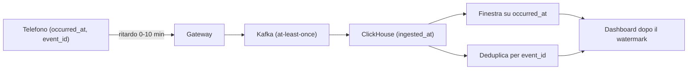

Un'applicazione di consegne a domicilio raggruppa gli ordini per fascia di quindici minuti usando l'orologio del server di ingestione. Seicento clienti completano l'ordine in una galleria alle 19:42 e i loro telefoni riescono a trasmettere solo alle 19:51. In più, un retry di rete invia due volte lo stesso evento. Il cruscotto mostra un calo alle 19:30 e un picco alle 19:45, con il 14% di ordini contati due volte. È uno scenario costruito con numeri di esempio, che il codice della lezione riproduce in chDB.

> **Idea chiave:** uno stream produce gli stessi numeri del batch contabile solo se le finestre si ancorano al tempo in cui il fatto è avvenuto, se tolleri i ritardi entro un limite dichiarato e se neutralizzi i duplicati con una chiave deterministica.

## Sei minuti in galleria e quattordici percento di duplicati

La piattaforma raccoglie gli eventi di checkout dai telefoni, li pubblica su un topic Kafka e alimenta una tabella ClickHouse che regola il prezzo dinamico di consegna quartiere per quartiere. Nell'ora di punta due fenomeni sono normali sulle reti mobili.

Il primo è il ritardo. Gli ordini effettuati tra le 19:41 e le 19:45 arrivano alle 19:51. La pipeline raggruppa sul timestamp di ricezione, quindi la finestra 19:30-19:45 risulta più vuota del vero e la finestra 19:45-20:00 più piena, e il sistema attiva per errore il sovrapprezzo di alta domanda.

Il secondo è il retry. Se il client non riceve l'ACK entro due secondi, rinvia lo stesso pacchetto. Il broker registra entrambi i messaggi, perché la consegna è *at-least-once*, e un `count()` conta due volte l'ordine.

Le due anomalie nascono dall'ignorare tre idee del modello Dataflow ([Akidau et al., 2015](https://doi.org/10.14778/2824032.2824076)): la distinzione tra tempo di evento e tempo di elaborazione, la semantica delle finestre con i watermark, la deduplicazione a valle.

## Tempo di evento, finestre e idempotenza

Elaborare un flusso illimitato senza distorsioni richiede tre meccanismi.

Il primo è la distinzione tra **tempo di evento** (l'istante in cui il fatto è avvenuto sul dispositivo, per esempio `occurred_at`) e **tempo di elaborazione** (l'istante in cui il server legge il messaggio, per esempio `ingested_at`). La rete introduce ritardi variabili e riordinamenti, quindi le metriche di business, di fatturazione e di funnel si ancorano a `occurred_at`. La differenza `ingested_at - occurred_at` si monitora a parte, come metrica di latenza dell'infrastruttura.

Il secondo è il taglio del flusso in finestre finite, governate da un watermark. Il watermark dichiara fino a quale ritardo massimo il sistema aspetta i ritardatari prima di considerare chiusa una finestra.

| Tipo di finestra | Come taglia il flusso | Quando la usi |
|---|---|---|
| Tumbling | Blocchi contigui non sovrapposti (19:00-19:05, 19:05-19:10) | Conteggi contabili, ogni evento in un solo intervallo |
| Sliding (hopping) | Ultimi 15 minuti ricalcolati ogni minuto | Medie mobili e soglie di allerta |
| Sessione | Eventi dello stesso utente finché non passano 30 minuti di silenzio | Comportamento di navigazione |

Il terzo è l'idempotenza. Garantire che nessun messaggio si perda in caso di crash richiede che il produttore possa inviarlo più volte. Il motore di destinazione deve quindi assorbire i duplicati con una chiave deterministica (`event_id`, oppure `(order_id, version)`), usando un motore di deduplicazione come `ReplacingMergeTree` o aggregazioni idempotenti.



## Il guasto riprodotto in locale

Il blocco seguente costruisce lo scenario. Genera 6.000 ordini in due blocchi da 15 minuti: nel primo, 600 ordini sono ricevuti alle 19:51; poi ritenta il 14% degli eventi. I merge sono fermi, così i duplicati restano visibili come in un flusso reale prima del merge in background.

```sql
CREATE DATABASE lab ENGINE = Atomic;
USE lab;

CREATE TABLE checkout_events
(
    occurred_at DateTime,
    ingested_at DateTime,
    event_id String,
    district_id LowCardinality(String),
    amount_eur Decimal(12, 2)
)
ENGINE = ReplacingMergeTree(ingested_at)
ORDER BY (district_id, toStartOfHour(occurred_at), event_id);

-- I merge restano fermi: i duplicati di un retry coesistono finché il server non li fonde.
SYSTEM STOP MERGES checkout_events;

-- Seimila ordini in due blocchi da 15 minuti; 600 del primo sono ricevuti alle 19:51 (galleria).
INSERT INTO checkout_events
WITH
    intDiv(number, 3000) AS blocco,
    number % 3000 AS n,
    toDateTime('2026-03-06 19:30:00') + toIntervalMinute(blocco * 15) + toIntervalSecond(intDiv(n * 29, 100)) AS ts,
    (blocco = 0 AND n >= 2400) AS in_galleria
SELECT
    ts AS occurred_at,
    if(in_galleria, toDateTime('2026-03-06 19:51:00') + toIntervalSecond(n % 60), ts + toIntervalSecond(2)) AS ingested_at,
    concat('ord-', toString(number)) AS event_id,
    if(n % 2 = 0, 'centro', 'periferia') AS district_id,
    toDecimal64(10 + n % 40, 2) AS amount_eur
FROM numbers(6000);

-- Il 14% degli ordini viene ritentato: stesso event_id, ricevuto 4 secondi dopo.
INSERT INTO checkout_events
SELECT occurred_at, ingested_at + toIntervalSecond(4), event_id, district_id, amount_eur
FROM checkout_events
WHERE cityHash64(event_id) % 100 < 14;
```

La prima verifica conta le righe contro gli ordini unici.

```sql
-- Righe, ordini unici e percentuale di duplicati.
SELECT count() AS righe, uniqExact(event_id) AS ordini_unici, round((count() - uniqExact(event_id)) * 100 / uniqExact(event_id), 1) AS duplicati_pct FROM checkout_events;
```

Il risultato è 6.847 righe per 6.000 ordini unici, quindi 847 duplicati, cioè il 14,1% di sovrastima. Il rapporto atteso era 14%, e la differenza dipende dall'hash che sceglie i retry.

Ora il pannello sbagliato, che raggruppa sul tempo di arrivo e conta le righe.

```sql
-- Il pannello sbagliato: finestra sul tempo di arrivo e count() grezzo.
SELECT toStartOfFifteenMinutes(ingested_at) AS finestra_errata, count() AS ordini_contati, sum(amount_eur) AS ricavo_eur
FROM checkout_events
GROUP BY finestra_errata
ORDER BY finestra_errata;
```

Restituisce 2.743 ordini per la finestra 19:30 e 4.104 per la finestra 19:45. Il valore vero è 3.000 in entrambe. Lo scarto della prima è (2.743 - 3.000) / 3.000 = -8,6%, della seconda (4.104 - 3.000) / 3.000 = +36,8%. Il ricavo segue: 81.195 euro e 121.083 euro, per un totale di 202.278 euro contro i 177.000 euro reali, il 14,3% in più.

## Tre errori di progettazione

### Raggruppare le metriche di business sul tempo di elaborazione

**Sintomo:** vendite a zero per dieci minuti e poi un picco mille volte più alto.

**Perché succede:** `ingested_at` è comoda perché cresce sempre e non cambia nel passato. Ma confonde la storia del business con la salute della rete: se un connettore si ferma per manutenzione e poi scarica la coda in trenta secondi, il grafico mostra il vuoto e poi l'esplosione.

**Come si corregge:** finestra su `occurred_at`, con `ingested_at` usato solo per misurare il ritardo.

### Assumere che ogni messaggio sia unico

**Sintomo:** totali gonfiati senza una causa visibile. Nel caso costruito, il 14% in più di ordini.

**Perché succede:** `count()` e `sum()` presuppongono una consegna *exactly-once* dal telefono al disco. Nessun client mobile o webhook esterno la garantisce: a ogni micro-disconnessione il client ritenta la chiamata HTTP.

**Come si corregge:** un `event_id` generato all'origine e una deduplicazione per quella chiave.

### Chiudere la finestra senza margine

**Sintomo:** gli ultimi eventi di ogni minuto mancano nella tabella dei risultati.

**Perché succede:** tra il clic, il buffer del produttore, il broker e il flush del consumer passano da 2 a 15 secondi. Chiudere la finestra al secondo zero perde la coda: nel caso della galleria, 609 secondi.

**Come si corregge:** esponi solo finestre il cui estremo superiore è più vecchio del watermark, calcolato dal percentile alto del ritardo osservato.

## Finestre sul tempo di evento con deduplicazione

I criteri, in ordine di priorità:

1. Ogni payload porta due timestamp, `occurred_at` generato alla sorgente in UTC e `ingested_at` aggiunto all'arrivo, e un `event_id` deterministico.
2. Ancora tutte le finestre a `occurred_at` e usa `ingested_at - occurred_at` solo per il monitoraggio.
3. Scrivi su `ReplacingMergeTree` ordinata per una chiave che contiene `event_id`, oppure deduplica in lettura con `argMax` per `event_id`. Il motore fonde i duplicati solo al merge, quindi in lettura la deduplica esplicita resta necessaria.
4. Mostra nei cruscotti solo le finestre più vecchie del watermark.

La query corretta sul caso ricostruito:

```sql
-- La finestra giusta: tempo di evento, un solo record per event_id, ritardo misurato a parte.
WITH eventi_unici AS (
    SELECT
        event_id,
        min(occurred_at) AS event_time,
        argMax(amount_eur, ingested_at) AS amount_eur,
        max(dateDiff('second', occurred_at, ingested_at)) AS lag_secondi
    FROM checkout_events
    GROUP BY event_id
)
SELECT
    toStartOfFifteenMinutes(event_time) AS finestra,
    count() AS ordini_unici,
    sum(amount_eur) AS ricavo_eur,
    quantile(0.99)(lag_secondi) AS lag_p99_sec,
    max(lag_secondi) AS lag_max_sec
FROM eventi_unici
GROUP BY finestra
ORDER BY finestra;
```

Il risultato è 3.000 ordini e 88.500 euro in ciascuna finestra, esattamente il valore vero. La colonna `lag_max_sec` mostra la causa del guasto: 609 secondi per la finestra 19:30, contro 6 secondi per la 19:45. Il 99° percentile del ritardo, 587 secondi, è il valore che dimensiona il watermark: una finestra 19:30-19:45 non è definitiva prima delle 19:45 + 587 secondi, cioè circa le 19:55. Tutti i 600 ordini della galleria finiscono nella loro finestra naturale e i duplicati vengono collassati.

Lato produttore, l'identificativo si genera in modo deterministico: lo stesso ordine con la stessa versione produce sempre lo stesso `event_id`, anche dopo un retry.

```python
# Costruzione dell'evento lato produttore: event_id deterministico e due timestamp.
import json
import uuid
from datetime import datetime, timezone

NAMESPACE = uuid.UUID("6f1c2a3e-0000-4000-8000-000000000001")  # costante del servizio

def costruisci_evento(order_id: int, version: int, amount_eur: str, district: str) -> str:
    # Stessa coppia (order_id, version) -> stesso event_id, anche dopo un retry.
    event_id = str(uuid.uuid5(NAMESPACE, f"{order_id}:{version}"))
    evento = {
        "event_id": event_id,
        "occurred_at": datetime.now(timezone.utc).isoformat(),  # istante del fatto, mai l'arrivo
        "order_id": order_id,
        "district_id": district,
        "amount_eur": amount_eur,
    }
    return json.dumps(evento)

print(costruisci_evento(1042, 1, "24.90", "centro"))
```

Il tempo di evento si genera sul dispositivo. Se l'orologio del telefono è sballato, per esempio impostato su un anno passato, il gateway deve correggere lo scarto confrontando il timestamp di invio con il momento della richiesta HTTP.

## Il budget di latenza di una finestra

Il watermark non è l'unico ritardo della catena: ogni stadio ne aggiunge uno, e la somma decide quando la dashboard può mostrare un numero affidabile. Il conto con numeri costruiti per una pipeline di checkout, in condizioni normali:

| Stadio | Ritardo tipico |
|---|---:|
| Buffer del produttore sul telefono | 2 s |
| Rete mobile e gateway | 1,5 s |
| Broker Kafka | 0,5 s |
| Flush del consumer verso ClickHouse | 5 s |
| Insert e visibilità in tabella | 1 s |
| Totale senza watermark | 10 s |

Il totale è 2 + 1,5 + 0,5 + 5 + 1 = 10 secondi. Se la pipeline concede un watermark di 30 secondi per i ritardatari ordinari, una finestra si chiude 10 + 30 = 40 secondi dopo il suo estremo superiore. Il requisito del turno operativo è 60 secondi, quindi il margine è 60 - 40 = 20 secondi.

Questo budget regge finché la rete è normale. Il caso della galleria ha un ritardo massimo di 609 secondi, molto oltre i 30 del watermark: gli eventi arrivano dopo la chiusura e vanno trattati come correzioni. Le strade sono due. Si può riaprire la finestra e riscrivere il totale, a patto che la tabella di destinazione accetti aggiornamenti, oppure si pubblica il numero provvisorio con un'etichetta e si consolida in un secondo passaggio quando il 99° percentile del ritardo lo permette. In entrambi i casi si misura la quota di eventi che arrivano dopo il watermark: se supera l'1% del totale, il watermark è troppo corto o la fonte ha un problema da risolvere a monte.

## Streaming continuo o micro-batch

Prima delle finestre va deciso se serve davvero lo streaming. Il criterio: **usa lo stream processing continuo solo quando una macchina o un operatore prende una decisione entro pochi secondi dall'evento (blocco frodi, prezzo dinamico, allerta su guasti di checkout), usa il micro-batch o il batch pianificato per reportistica direzionale, contabilità, attribuzione e coorti.**

La confusione comune è costruire una pipeline Kafka, Flink e ClickHouse con latenza di 500 millisecondi per un report che il direttore guarda il lunedì alle nove. Sbagliare questa scelta moltiplica i costi infrastrutturali e la complessità di reperibilità (offset, ribilanciamento dei consumer, eventi fuori ordine) senza nessun vantaggio economico.

Restano fuori dalla lezione i motori con stato distribuito come Apache Flink, con i checkpoint, e i join tra due stream con buffer temporale.

## Verifica prima del rilascio di una pipeline

1. Un report mostra 4.104 ordini per una finestra che ne ha 3.000 e 2.743 per quella precedente che ne ha 3.000. Quali due cause identifichi e come le distingui?

<details>
<summary>Mostra risposta</summary>

Il ritardo sposta ordini da una finestra all'altra: nell'esempio 600 ordini passano dalla finestra 19:30 alla 19:45. I duplicati gonfiano entrambe di circa il 14%. Per distinguerli confronti `count()` con `uniqExact(event_id)` e il ritardo `ingested_at - occurred_at` per finestra.

</details>

2. Il 99° percentile del ritardo è 587 secondi. A che ora chiudi in modo definitivo la finestra 19:30-19:45?

<details>
<summary>Mostra risposta</summary>

L'estremo superiore è 19:45:00; aggiungi il watermark di 587 secondi, circa 10 minuti, e ottieni le 19:54:47 circa. Prima di allora la finestra è provvisoria e va mostrata come tale.

</details>

3. Perché `uuid4()` generato a ogni invio non basta come `event_id`?

<details>
<summary>Mostra risposta</summary>

Un retry rigenera un identificativo diverso, quindi la deduplicazione non riconosce il duplicato. Serve un identificativo derivato dall'operazione, per esempio `uuid5` su `(order_id, version)`, che resta uguale a ogni tentativo.

</details>

4. Per quale dei casi scegli lo streaming continuo: blocco frodi su un pagamento, report mensile di attribuzione, prezzo dinamico di consegna?

<details>
<summary>Mostra risposta</summary>

Blocco frodi e prezzo dinamico, perché una decisione automatica cambia entro pochi secondi. L'attribuzione mensile tollera il batch e costa molto meno.

</details>

5. Quale finestra scegli per un conteggio contabile, quale per una soglia di allerta?

<details>
<summary>Mostra risposta</summary>

Tumbling per il conteggio contabile, perché ogni evento cade in un solo intervallo e i totali si sommano senza sovrapposizioni. Sliding per la soglia di allerta, che richiede una media mobile ricalcolata a intervalli brevi.

</details>
