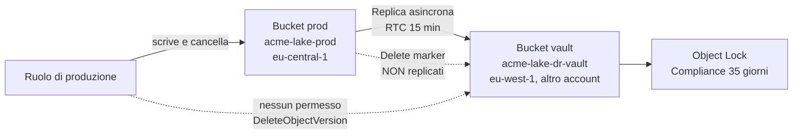

Un martedì pomeriggio un job di pulizia scritto male lancia una cancellazione ricorsiva di tutte le versioni degli oggetti sotto `raw/` precedenti al 2025. Il bucket si chiama `acme-lake-prod`, vive a Francoforte e contiene cinque anni di dati contabili e comportamentali che i database transazionali, ormai fermi agli ultimi sei mesi, non hanno più. Nessuno si preoccupa fino a quando un analista non nota che le query sullo storico restituiscono zero righe. Chi aveva scartato il backup lo aveva fatto con una frase che sembra solida: "S3 ha una durabilità di undici nove".

Questo è uno scenario costruito, con numeri di esempio, ma ogni suo ingrediente compare davvero negli incidenti sui data lake. La durabilità di S3 misura la probabilità di perdere un oggetto per un guasto dell'infrastruttura. Non dice nulla su cosa succede quando un utente autenticato, uno script o un attaccante con una credenziale valida ordina di distruggere quell'oggetto: AWS esegue l'ordine con la stessa affidabilità con cui custodisce il dato.

> **Idea chiave:** la durabilità protegge dai dischi, il backup protegge dalle persone. Un piano di disaster recovery del data lake è una copia isolata (altro account, altra regione, immutabile), un obiettivo di recupero scritto in numeri e un restore provato con il cronometro.

## Perché undici nove non bastano

Nell'incidente descritto sopra il problema non è la ridondanza fisica, che ha funzionato perfettamente: i tre data center della regione hanno cancellato i byte in meno di un minuto, esattamente come richiesto. Il problema è che il piano di protezione presupponeva un solo tipo di minaccia.

Le minacce reali sono almeno tre, e richiedono difese diverse. La prima è l'errore umano o software su un prefisso: un `DELETE` troppo largo, un job che sovrascrive una tabella con dati sbagliati, un deploy di Terraform che distrugge il bucket. La seconda è la compromissione dell'account: una chiave IAM privilegiata rubata, un ransomware che cifra o cancella tutto ciò che raggiunge con quelle credenziali. La terza è la perdita di una regione, rara ma con effetti lunghi, perché i dati sono presenti ma irraggiungibili.

Una replica nello stesso account, con propagazione delle cancellazioni, contrasta solo la terza. Rispetto alle prime due è peggio che inutile, perché trasforma un errore in due errori identici e simultanei. Per questo la discussione sul DR parte dall'isolamento prima che dalla copia: la domanda giusta non è "dove replico" ma "chi può cancellare la replica".

| Minaccia | Esempio | Difesa principale | Dove sta la difesa |
|---|---|---|---|
| Errore su un prefisso | Job di pulizia che cancella partizioni | Versioning e rollback dei delete marker | Stesso bucket |
| Credenziale compromessa | Ransomware con ruolo amministratore | Replica in account separato con Object Lock | Vault account |
| Perdita regionale | Indisponibilità prolungata di eu-central-1 | Replica cross-region con S3 RTC | Seconda regione |
| Metadati persi | Catalogo Glue svuotato, cartella metadata di Iceberg persa | Export del catalogo e replica dell'intero prefisso tabella | Vault account |

## RPO e RTO per zona del lake

Prima di toccare una regola di replica servono due numeri per ciascuna zona. L'**RPO** (Recovery Point Objective) è la quantità massima di dati che l'azienda accetta di perdere, misurata in tempo: un RPO di 15 minuti significa che al peggio si perdono gli ultimi 15 minuti di scritture. L'**RTO** (Recovery Time Objective) è il tempo massimo entro cui il servizio deve tornare utilizzabile dopo l'incidente.

I due numeri non sono uguali per tutto il lake, e trattarli come tali è il modo più rapido per spendere troppo o proteggere troppo poco. La zona `raw/` contiene i dati sorgente che nessun altro sistema possiede più: non sono rigenerabili, quindi il loro RPO deve essere basso e la copia immutabile. La zona `curated/` è derivata da `raw/` attraverso pipeline dbt o Spark: se la pipeline è deterministica, un RTO di otto ore ottenuto rieseguendola può essere più economico di una replica continua. La zona `analytics/` contiene mart che si rigenerano in minuti e non giustificano replica propria.

| Zona | Rigenerabile? | RPO | RTO | Strategia |
|---|---|---|---|---|
| `raw/` | No | 15 minuti | 4 ore | Replica cross-account con RTC e Object Lock |
| `curated/` (tabelle critiche) | Sì, ma in 10 ore | 1 ora | 1 ora | Replica cross-account, senza RTC |
| `curated/` (tabelle derivate) | Sì, in 2 ore | 24 ore | 8 ore | Riesecuzione della pipeline da `raw/` |
| `analytics/` | Sì, in minuti | 24 ore | 2 ore | Nessuna replica, solo versioning |

Questa matrice va concordata con il business e scritta nella procedura di restore, accanto al nome di chi la approva. Un RPO di 15 minuti ha un costo, che vedremo più avanti con i numeri, e il business lo sceglie in modo diverso se qualcuno gli mostra la cifra.

## Versioning, replica e Object Lock insieme

Tre funzionalità di S3 compongono la difesa, e ciascuna copre un buco delle altre. Il **versioning** conserva ogni versione sovrascritta e trasforma una cancellazione semplice in un *delete marker*, un oggetto speciale che nasconde la versione corrente senza rimuoverla. La **replica** copia nuovi oggetti verso un altro bucket, in modo asincrono. **Object Lock** rende le versioni immutabili fino a una data di scadenza: in modalità Compliance nemmeno l'utente root può accorciare la ritenzione.



Il disegno contiene la regola che regge tutto il resto: il ruolo che opera in produzione non ha alcun permesso di cancellazione nel vault, e il vault non replica i delete marker. Se anche un attaccante ottenesse le credenziali di produzione, potrebbe distruggere `acme-lake-prod` ma non toccare le copie.

Per i bucket critici la configurazione parte dal versioning e dalla replica. Il comando seguente crea il vault con Object Lock già attivo (non è possibile attivarlo dopo la creazione senza supporto AWS) e imposta la ritenzione di default.

```bash
# Crea il bucket vault nell'account di sicurezza (profilo 'vault'), con Object Lock abilitato
aws s3api create-bucket \
  --bucket acme-lake-dr-vault \
  --region eu-west-1 \
  --create-bucket-configuration LocationConstraint=eu-west-1 \
  --object-lock-enabled-for-bucket \
  --profile vault

# Ritenzione di default: 35 giorni in modalita' Compliance su ogni nuova versione
aws s3api put-object-lock-configuration \
  --bucket acme-lake-dr-vault \
  --object-lock-configuration '{"ObjectLockEnabled":"Enabled","Rule":{"DefaultRetention":{"Mode":"COMPLIANCE","Days":35}}}' \
  --profile vault

# Versioning sul bucket di produzione (il vault lo ottiene con Object Lock)
aws s3api put-bucket-versioning \
  --bucket acme-lake-prod \
  --versioning-configuration Status=Enabled \
  --profile prod
```

La regola di replica è un documento JSON. Notiamo le tre scelte che contano: filtro sul solo prefisso `raw/`, `DeleteMarkerReplication` disattivato e `ReplicationTime` con soglia di 15 minuti. Con `AccessControlTranslation` il vault diventa proprietario degli oggetti replicati, così il ruolo di produzione non ha più alcun diritto su di essi.

```json
{
  "Role": "arn:aws:iam::111111111111:role/s3-replication-raw-to-vault",
  "Rules": [
    {
      "ID": "raw-to-vault",
      "Priority": 1,
      "Status": "Enabled",
      "Filter": { "Prefix": "raw/" },
      "DeleteMarkerReplication": { "Status": "Disabled" },
      "SourceSelectionCriteria": {
        "SseKmsEncryptedObjects": { "Status": "Enabled" }
      },
      "Destination": {
        "Bucket": "arn:aws:s3:::acme-lake-dr-vault",
        "Account": "222222222222",
        "StorageClass": "GLACIER_IR",
        "AccessControlTranslation": { "Owner": "Destination" },
        "EncryptionConfiguration": {
          "ReplicaKmsKeyID": "arn:aws:kms:eu-west-1:222222222222:key/replica-key-id"
        },
        "ReplicationTime": { "Status": "Enabled", "Time": { "Minutes": 15 } },
        "Metrics": { "Status": "Enabled", "EventThreshold": { "Minutes": 15 } }
      }
    }
  ]
}
```

Il file va applicato con `aws s3api put-bucket-replication --bucket acme-lake-prod --replication-configuration file://replica-raw.json`. La replica copia solo gli oggetti creati dopo l'attivazione: lo storico esistente richiede una S3 Batch Replication, da lanciare una volta.

## Quanto costa un RPO di 15 minuti

I numeri che seguono sono di esempio e usano tariffe arrotondate; prima di decidere vanno sostituiti con quelle aggiornate della propria regione. Prendiamo la zona `raw/` da 40 TB, che cresce di 1,2 TB al mese, e contiamo 1 TB come 1.000 GB per semplicità.

Il primo costo è la copia iniziale dello storico. Il trasferimento inter-regionale costa circa 0,02 USD per GB, quindi 40.000 GB × 0,02 USD/GB = 800 USD. Il supplemento di S3 Replication Time Control costa circa 0,015 USD per GB replicato, quindi 40.000 GB × 0,015 USD/GB = 600 USD. La copia iniziale costa in totale 800 + 600 = 1.400 USD una tantum.

Il secondo costo è ricorrente. Lo storage del vault in `GLACIER_IR` a circa 4 USD per TB al mese dà 40 TB × 4 USD/TB = 160 USD al mese. Ogni mese arrivano 1,2 TB nuovi, cioè 1.200 GB × (0,02 + 0,015) USD/GB = 42 USD di trasferimento e RTC. Il costo mensile a regime è quindi 160 + 42 = 202 USD, a cui si aggiungono le richieste di replica, trascurabili con file da centinaia di megabyte.

Il terzo conto è quello che il business apprezza: 202 USD al mese contro la ricostruzione di cinque anni di storico non rigenerabile. Se la discussione verte su RPO di 15 minuti contro 24 ore, la differenza è il solo costo di RTC: i nuovi dati costerebbero 1.200 GB × 0,02 USD/GB = 24 USD al mese senza RTC e 42 USD con RTC, quindi il supplemento per il livello più stretto è 42 − 24 = 18 USD al mese. Sono cifre piccole, e proprio per questo vanno messe nero su bianco.

Si noti infine una trappola economica: `GLACIER_IR` ha un costo di recupero di circa 0,03 USD per GB. Restaurare un'intera zona da 40 TB costerebbe 40.000 GB × 0,03 USD/GB = 1.200 USD di recupero, più 800 USD di trasferimento verso la regione di produzione, per un totale di 2.000 USD. Per questo la procedura di restore distingue i casi, come spiegato nella sezione successiva.

## Rollback locale o recupero dal vault

Dopo un incidente esistono due strade, e scegliere quella sbagliata costa ore e migliaia di dollari. Il **rollback locale** agisce sul bucket primario: si rimuovono i delete marker oppure si promuove una versione precedente di un oggetto. Il **recupero dal vault** copia i dati dal bucket secondario verso la produzione.

La regola pratica è che per la grande maggioranza degli incidenti quotidiani, come un job che ha sovrascritto o cancellato una partizione negli ultimi giorni, il rollback locale basta. Le versioni originali sono ancora tutte nel bucket primario, a costo zero di rete, e si ripristinano in pochi minuti. Il recupero dal vault serve quando le versioni locali sono state distrutte, l'account è compromesso o la regione è indisponibile.

Il confronto numerico lo rende evidente. Un job ha messo dei delete marker su una partizione da 90 GB. Rimuoverli localmente costa solo richieste API e termina in un paio di minuti. Se invece si riportasse la stessa partizione dal vault a 1,5 GB al secondo di throughput effettivo, 90 GB ÷ 1,5 GB/s = 60 secondi di copia, più 90 GB × 0,03 USD/GB = 2,70 USD di recupero e 90 GB × 0,02 USD/GB = 1,80 USD di trasferimento, per 4,50 USD in totale. È accettabile per una partizione. Ripetuto per tutta la zona diventa 2.000 USD e, a quel throughput, 40.000 GB ÷ 1,5 GB/s ≈ 26.667 secondi, cioè circa 7,4 ore.

Lo script Python seguente rimuove i delete marker di un prefisso con boto3, operazione tipica del rollback locale.

```python
# Rollback locale: rimuove i delete marker di un prefisso, riportando in vista le versioni precedenti
import boto3

s3 = boto3.client("s3", region_name="eu-central-1")
BUCKET = "acme-lake-prod"
PREFIX = "curated/sales/orders/dt=2026-11-10/"

paginator = s3.get_paginator("list_object_versions")
to_delete = []
for page in paginator.paginate(Bucket=BUCKET, Prefix=PREFIX):
    for marker in page.get("DeleteMarkers", []):
        if marker["IsLatest"]:
            # Cancellare il marker piu' recente fa riemergere la versione sottostante
            to_delete.append({"Key": marker["Key"], "VersionId": marker["VersionId"]})

# delete_objects accetta al massimo 1000 chiavi per chiamata
for i in range(0, len(to_delete), 1000):
    s3.delete_objects(Bucket=BUCKET, Delete={"Objects": to_delete[i:i + 1000], "Quiet": True})

print(f"Rimossi {len(to_delete)} delete marker sotto {PREFIX}")
```

Per le tabelle Apache Iceberg esiste una terza via ancora più rapida: se il job ha scritto dati sbagliati senza cancellare fisicamente i vecchi file, basta tornare a uno snapshot precedente con la procedura Spark `CALL system.rollback_to_snapshot`, che non sposta nemmeno un byte.

## Il restore drill

Un piano di DR che nessuno ha mai provato è una dichiarazione di intenti. Una volta a trimestre bisogna simulare la perdita di una partizione reale in un ambiente di collaudo, ripristinarla e confrontare il risultato con una baseline registrata prima dell'incidente. Il drill misura il tempo effettivo, che è l'RTO vero, e fa emergere i blocchi che nessun documento prevede.

Lo script seguente copia una partizione dal vault verso un prefisso di collaudo, poi verifica conteggio di oggetti e byte totali rispetto ai valori attesi. Il ruolo che lo esegue ha bisogno del permesso `kms:Decrypt` sulla chiave del vault, e dimenticarlo è la causa classica di fallimento del primo drill.

```python
# Restore drill: ripristina una partizione dal vault e confronta oggetti e byte con la baseline
import time
import boto3

vault = boto3.client("s3", region_name="eu-west-1")
prod = boto3.client("s3", region_name="eu-central-1")

SRC_BUCKET = "acme-lake-dr-vault"
DST_BUCKET = "acme-lake-prod"
SRC_PREFIX = "raw/sales/orders/dt=2026-11-10/"
DST_PREFIX = "restore-drill/raw/sales/orders/dt=2026-11-10/"
EXPECTED = {"objects": 360, "bytes": 90 * 10**9}   # baseline registrata prima dell'incidente

start = time.time()
count, total = 0, 0
for page in vault.get_paginator("list_objects_v2").paginate(Bucket=SRC_BUCKET, Prefix=SRC_PREFIX):
    for obj in page.get("Contents", []):
        dst_key = DST_PREFIX + obj["Key"][len(SRC_PREFIX):]
        # Copia gestita: usa lo stesso ruolo che la procedura di emergenza userebbe davvero
        prod.copy({"Bucket": SRC_BUCKET, "Key": obj["Key"]}, DST_BUCKET, dst_key,
                  SourceClient=vault)
        count += 1
        total += obj["Size"]

elapsed_min = (time.time() - start) / 60
ok = count == EXPECTED["objects"] and total == EXPECTED["bytes"]
print(f"oggetti={count} byte={total} minuti={elapsed_min:.1f} esito={'PASSED' if ok else 'FAILED'}")
```

Il confronto di conteggio e dimensione intercetta le perdite grossolane. Per una certificazione più forte si confrontano anche i checksum SHA-256 degli oggetti, che S3 può calcolare in scrittura, oppure il numero di righe e la somma dei ricavi letti con Athena sulla partizione ripristinata.

Il drill va completato con il catalogo. Una tabella Iceberg ripristinata senza la propria cartella `metadata/` e senza la definizione nel Glue Data Catalog è un mucchio di file Parquet di cui nessuno sa più dire quali appartengano all'ultimo snapshot valido. L'export giornaliero delle definizioni è una riga di CLI da mettere in uno scheduler.

```bash
# Export giornaliero delle definizioni di tutte le tabelle di un database Glue, salvato nel vault
aws glue get-tables --database-name curated --region eu-central-1 \
  --query 'TableList' --output json > glue-curated-$(date +%F).json

aws s3 cp glue-curated-$(date +%F).json \
  s3://acme-lake-dr-vault/catalog-export/ --profile vault
```

## Tre errori che annullano il backup

### Replicare i delete marker in un bucket dello stesso account

Il sintomo compare nel giorno peggiore: la cancellazione fatta sul bucket di produzione risulta presente anche sulla copia, e le versioni sono sparite da entrambi. La configurazione sembrava ragionevole perché la documentazione presenta la replica delle cancellazioni come comodità di sincronizzazione, e perché un backup "sempre uguale alla produzione" sembra più semplice da ragionare. Il rimedio è disattivare `DeleteMarkerReplication`, mettere il bucket di destinazione in un account separato e dare al ruolo di produzione zero permessi `s3:DeleteObjectVersion` su di esso.

### Fare il backup dei soli file Parquet

Il sintomo è un ripristino lentissimo: i dati ci sono, ma nessuno sa quali file formino l'ultima versione della tabella. Succede perché si replica solo `data/`, che contiene i byte pesanti, e si dimentica `metadata/` con i file `vN.metadata.json` e le liste di manifest. Nella cartella dati restano mescolati i file validi e quelli sostituiti da compattazioni e delete. Il rimedio è replicare l'intero prefisso della tabella e salvare ogni giorno l'export del catalogo, come nel blocco bash sopra.

### Documentare un RTO mai misurato

Il sintomo è un documento che dichiara "RTO 2 ore, RPO 15 minuti" e un primo restore reale che dura una giornata. Succede perché il ruolo IAM dell'operazione di restore non ha `kms:Decrypt` sulla chiave del vault, o perché nessuno sa come eliminare in blocco 50.000 delete marker senza scrivere codice. Il rimedio è il drill trimestrale: si cronometra, si registra l'esito accanto all'RTO dichiarato e si corregge ogni scostamento.

## Verifica del piano di DR

1. Il bucket del vault è in un account diverso da quello di produzione e il ruolo di produzione ha zero permessi di cancellazione su di esso?

<details>
<summary>Mostra risposta</summary>

Il test è semplice: con le credenziali di produzione si prova `aws s3api delete-object --version-id` sul vault e si deve ottenere `AccessDenied`. Se l'operazione riesce, il vault non protegge dalla compromissione dell'account, qualunque sia la regione in cui sta.

</details>

2. Una partizione da 90 GB ha ricevuto dei delete marker per errore. Con throughput effettivo di 1,5 GB/s dal vault, quanto costa e quanto dura il recupero dal vault, e perché di solito non è la scelta giusta?

<details>
<summary>Mostra risposta</summary>

Il recupero dal vault dura 90 GB ÷ 1,5 GB/s = 60 secondi e costa 90 × 0,03 + 90 × 0,02 = 2,70 + 1,80 = 4,50 USD. Non è proibitivo, ma il rollback locale elimina i delete marker in due minuti senza spostare dati, a costo di sole richieste API, e per questo è la prima scelta quando le versioni sono ancora nel bucket primario.

</details>

3. La zona `raw/` è di 40 TB, cresce di 1,2 TB al mese e la replica va in `GLACIER_IR` con RTC. Quanto vale il costo mensile a regime con le tariffe dell'esempio?

<details>
<summary>Mostra risposta</summary>

Lo storage costa 40 TB × 4 USD/TB = 160 USD, i nuovi dati costano 1.200 GB × (0,02 + 0,015) USD/GB = 42 USD, quindi 160 + 42 = 202 USD al mese. La copia iniziale dello storico vale invece 40.000 GB × 0,035 USD/GB = 1.400 USD una tantum.

</details>

4. Perché replicare solo la cartella `data/` di una tabella Iceberg rende il restore lento e rischioso?

<details>
<summary>Mostra risposta</summary>

Senza `metadata/` si perdono i puntatori agli snapshot e le liste dei file validi, quindi la cartella dati contiene sia i file correnti sia quelli superati da compattazioni e cancellazioni. Ricostruire l'ultimo stato corretto richiede analisi manuale. Va replicato l'intero prefisso della tabella, insieme all'export del catalogo.

</details>

5. Quando l'ultimo restore drill è stato eseguito e con quale esito, se l'RTO dichiarato è 30 minuti?

<details>
<summary>Mostra risposta</summary>

La risposta accettabile riporta una data entro gli ultimi 90 giorni, un tempo cronometrato inferiore a 30 minuti e il confronto di oggetti, byte e righe con la baseline. Qualunque risposta diversa significa che l'RTO dichiarato è un'ipotesi e che il prossimo drill va fissato prima del prossimo rilascio.

</details>
