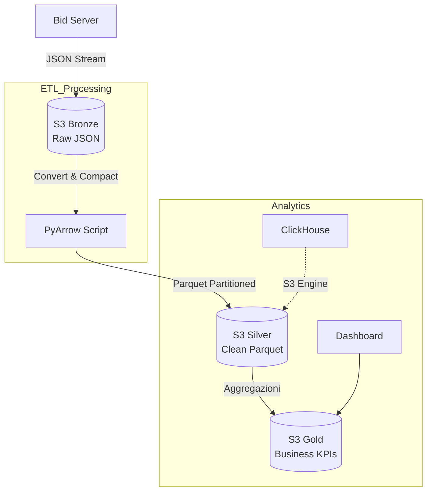
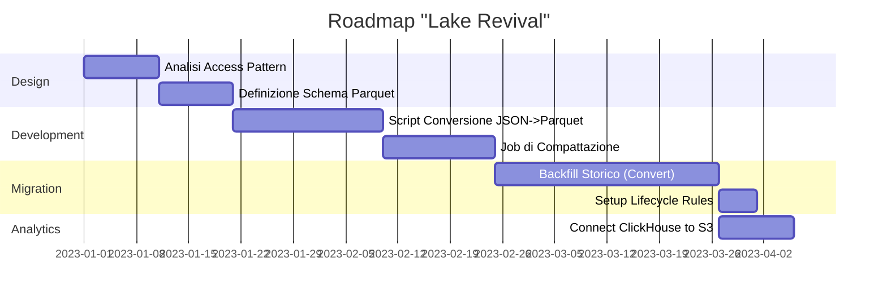
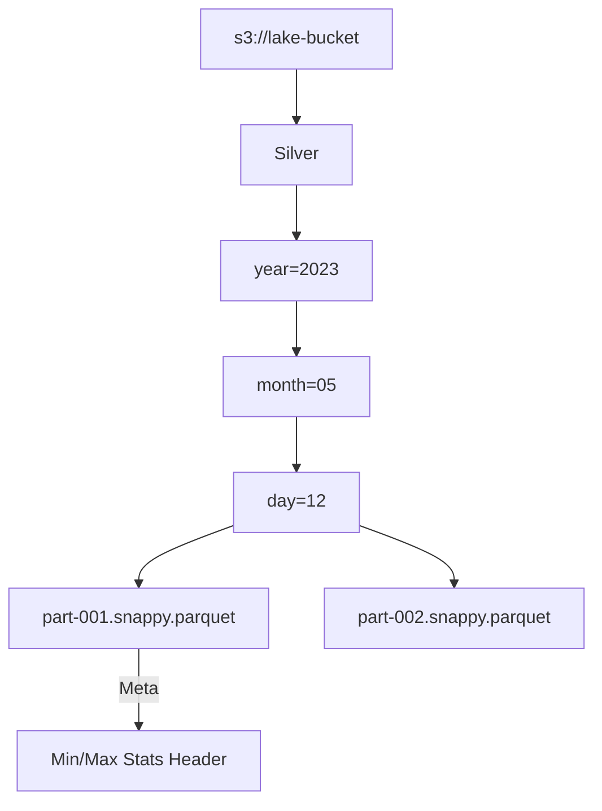

## Contesto Aziendale

**Azienda:** *GlobalAdTech S.p.A.* (nome fittizio)
**Settore:** Programmatic Advertising
**Volume Dati:** 50 TB/giorno di Bid Requests
**Storage Attuale:** Amazon S3 (JSON grezzi)

GlobalAdTech riceve milioni di richieste d'asta pubblicitaria al secondo. Per velocità, i server scaricano questi log come file JSON in un bucket S3 piatto (senza cartelle), creando milioni di piccoli file ogni ora.
Il team Data Science non riesce a usare questi dati: leggere un giorno di storico richiede la scansione di 50TB di testo JSON, costando migliaia di dollari e impiegando ore.
Il CFO è furioso per la bolletta S3 fuori controllo.

### Dati Iniziali

| Metrica | Situazione Attuale (Data Swamp) | Obiettivo (Data Lake) | Note |
| :--- | :--- | :--- | :--- |
| **Formato Dati** | JSON (Testo non compresso) | Parquet (Colonnare + Snappy) | Efficienza spazio/lettura |
| **Dimensione File Medio** | 50 KB (Small Files Problem) | 500 MB | Ottimizzazione I/O |
| **Partizionamento** | Nessuno (Flat Bucket) | Hive-style (An/Me/Gi/Or) | Pruning delle partizioni |
| **Costo Storage** | $50.000 / mese | $15.000 / mese | Target -70% |
| **Tempo Query (1 giorno)** | 4 ore (Scan completo) | 5 minuti (Scan mirato) | Performance analitiche |

**Problema Principale:** L'assenza di una strategia di *Data Engineering* ha trasformato il lago dati in una palude. I dati ci sono, ma sono inaccessibili ed economicamente insostenibili.

## Obiettivi del Progetto

Il progetto "Lake Revival" mira a:

1.  **Ridurre i costi di storage del 70%** convertendo i dati in formati binari compressi.
2.  **Migliorare le performance di lettura di 50x** implementando partizionamento e compattazione dei file.
3.  **Organizzare il Data Lake a Zone** (Bronze, Silver, Gold) per separare i dati grezzi da quelli curati.
4.  **Integrare S3 con ClickHouse** per permettere query SQL ultra-veloci direttamente sul Data Lake (Pattern Lakehouse).

## Analisi e Strategia

### 1. Formati Dati: JSON vs Parquet
Il JSON è ottimo per le API ma terribile per l'analytics.
Passando a **Parquet**:
*   *Compression:* 10TB di JSON diventano ~2TB di Parquet (ratio 5:1).
*   *Columnar Access:* Se la query chiede solo `bid_price`, Parquet legge solo quella colonna, ignorando il resto del payload.

### 2. Partitioning Strategy
Adotteremo uno schema **Hive-Style Partitioning** basato sul tempo, poiché il 99% delle query filtra per data.
Path: `s3://lake/silver/bids/year=2023/month=05/day=12/hour=14/part-001.parquet`

### 3. Compaction (Small Files Problem)
Invece di salvare un file per ogni richiesta (anti-pattern), useremo un buffer (es. Kinesis Firehose o script batch) per scrivere file da almeno 256MB.
Meno file = Meno chiamate API S3 (costose) = Meno overhead di apertura file.

### 4. Lifecycle Management
I dati grezzi (Bronze) servono solo per replay in caso di bug.
*   Policy: Sposta Bronze in *Glacier Instant Retrieval* dopo 7 giorni. Cancella dopo 30 giorni.

### Diagramma Medallion Architecture

**Decisioni Chiave:**
*   **Schema Evolution:** Parquet supporta l'evoluzione dello schema, ma richiede attenzione. Useremo `merge_schema=True` nelle librerie di lettura per gestire colonne aggiunte nel tempo.
*   **Storage Class:** Uso di *S3 Standard* per la Silver (hot data) e *S3 Intelligent-Tiering* per la Gold (access pattern imprevedibili).

## Implementazione

### Timeline (3 Mesi)

### Dati Intermedi: Benchmark Compressione

Abbiamo testato la conversione su un campione di 1TB di log JSON.

| Formato | Compressione | Dimensione Finale | Tempo Scrittura | Tempo Lettura (1 colonna) |
| :--- | :--- | :--- | :--- | :--- |
| **JSON (Raw)** | Nessuna | 1024 GB | Veloce (Dump) | 45 min |
| **JSON (Gzip)** | Gzip | 350 GB | Medio | 30 min (CPU bound) |
| **Parquet (Snappy)** | Snappy | 280 GB | Medio | **2 min** |
| **Parquet (ZSTD)** | Zstandard | **210 GB** | Lento | 2.5 min |

**Scelta:** Parquet con Snappy per il layer Silver (balance velocità/spazio) e Parquet con ZSTD per l'archivio storico (massimo risparmio).

**Problema Incontrato:** *Throttling S3*. Durante il backfill, abbiamo colpito il limite di 3500 PUT/sec per prefisso.
**Soluzione:** Aggiunto un hash casuale (entropy) all'inizio del nome file per distribuire il carico su diverse partizioni fisiche di S3, anche se per l'analytics il partitioning logico è rimasto per data.

## Risultati

Il Data Lake è ora un asset, non una passività.

### KPI Prima vs Dopo

| KPI | Prima (T0) | Dopo (T3) | Variazione |
| :--- | :--- | :--- | :--- |
| **Costo Mensile S3** | $50.000 | $12.500 | -75% |
| **Velocità Query Media** | 4 ore | 3 minuti | 80x Faster |
| **Numero Oggetti S3** | 1 Miliardo | 5 Milioni | Gestibile |
| **Accessibilità Dati** | Solo Devs | Data Analysts (via SQL) | Democratizzazione |

### Analisi ROI

Il progetto ha richiesto 300 ore di ingegneria ($30k).
Il risparmio mensile è di $37.500.
**Payback Period:** < 1 Mese.
Il ROI annuale è stellare (> 1000%).

### Visualizzazione Struttura Cartelle (Hive-Style)

## Lezioni Apprese

1.  **Metadata > Data:** I file Parquet contengono metadati (min/max values) nell'header. I motori come ClickHouse usano questi dati per saltare interi file se non contengono i dati cercati (Data Skipping), velocizzando enormemente le query.
2.  **Non usare S3 come un Filesystem:** `ls` su un bucket con milioni di oggetti è lento e costoso. Bisogna progettare la struttura delle chiavi per evitare operazioni di list.
3.  **Il costo del "PUT":** In S3 si paga anche per le richieste. Scrivere milioni di file piccoli costa più dello storage stesso. La compattazione è vitale anche per il portafoglio, non solo per la velocità.
4.  **Schema Enforcement:** Il JSON accetta tutto. Parquet no. Il processo di conversione ha fatto emergere bug nei logger che inviavano stringhe al posto di numeri. Il Data Lake ha agito da validatore di qualità.
5.  **Tiering Automatico:** Le regole di Lifecycle sono "imposta e dimentica", ma risparmiano migliaia di dollari silenziosamente ogni mese.

## Domande di Discussione

1.  Perché l'uso di `year=YYYY/month=MM` è definito "Hive-Style" e quali vantaggi porta rispetto a una data nel nome del file `data_20230512.parquet`?
2.  Qual è il trade-off tra Parquet (colonnare) e Avro (row-based) e quando sceglieresti Avro per un Data Lake?
3.  Come gestiresti il diritto all'oblio (GDPR) in un Data Lake Parquet immutabile? (Hint: Delta Lake o Iceberg potrebbero aiutare, o riscrittura partizioni).
4.  Che impatto ha la scelta della compressione (Gzip vs Snappy vs ZSTD) sulla capacità di "splittare" i file per il processing parallelo?
5.  In che modo l'integrazione S3-ClickHouse differisce da usare Athena o Redshift Spectrum?

**Cosa faresti diversamente?**
*   *Se servissero update:* Avrei considerato l'uso di Table Formats moderni come **Apache Iceberg** o **Delta Lake** sopra S3, invece di gestire i file Parquet "a mano", per avere transazioni ACID.
*   *Se i dati fossero immagini:* Avrei mantenuto i file originali ma creato un indice di metadati in Parquet per la ricerca veloce.
