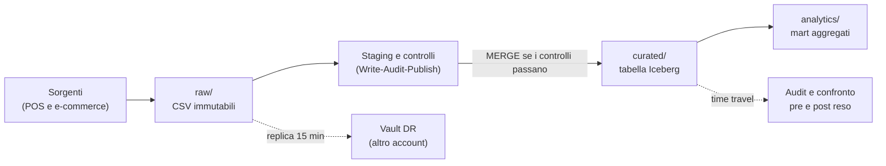

Un'azienda retail con 120 punti vendita tiene da un anno scontrini ed eventi e-commerce in un unico bucket, nella cartella `s3://retail-dump/csv/`. Sono 350 milioni di righe, 100 GB di CSV senza partizioni. Ogni query mensile su Athena legge tutto l'archivio, impiega 68 secondi e costa 0,50 USD, perché Athena fattura circa 5 USD per terabyte scansionato e 100 GB sono 0,1 TB. Quando un cliente restituisce un prodotto dieci giorni dopo l'acquisto, qualcuno deve riscrivere a mano la cartella del giorno dell'acquisto, e nessun controllo verifica i file prima che i report dei negozi li leggano.

Lo scenario è costruito, con numeri di esempio, ma riunisce in un progetto solo i meccanismi del modulo: zone del lake, formato colonnare, tabella transazionale, lifecycle e disaster recovery. Il laboratorio si completa quando le tre prove di accettazione passano: query mensile sotto i 5 secondi, resi applicati con `MERGE` verificabili con time travel, nuovi caricamenti bloccati se non superano il controllo qualità.

> **Idea chiave:** un data lake diventa un warehouse quando i file smettono di essere un archivio e diventano una tabella con confini chiari tra zone, un formato colonnare partizionato e un metadato transazionale che decide quali file appartengono allo stato corrente.

## Cosa non funziona nel sistema di partenza

Il sistema di partenza ha tre limiti che si rinforzano a vicenda. Il primo è fisico: i CSV non hanno schema, compressione colonnare né partizioni, quindi qualunque query sul margine di novembre per la categoria Elettronica in Italia deve leggere 100 GB per esaminare una frazione minima di righe. Il secondo è logico: un reso trasforma una riga esistente, ma un archivio di file CSV non sa aggiornare una riga, e gli script di correzione producono duplicati o bloccano le letture. Il terzo è organizzativo: non esiste un ciclo di vita dei file né un controllo qualità, quindi gli errori di una sorgente arrivano direttamente nei report.

Una prima intuizione sul sistema di arrivo si ottiene guardando dove finiscono i byte scansionati. Con CSV, ogni query legge tutte le 45 colonne di tutti i mesi. Con Parquet partizionato per mese, la stessa query legge solo le colonne richieste dei file del mese interessato, e dentro quei file salta i blocchi che le statistiche minimo e massimo escludono. Il benchmark finale mostrerà il calcolo esatto.

## Zone, sicurezza e ciclo di vita

Il layout ha tre prefissi nello stesso bucket, `raw/`, `curated/` e `analytics/`, con ruoli distinti.

| Zona | Contenuto | Formato | Chi legge | Ciclo di vita |
|---|---|---|---|---|
| `raw/` | Payload sorgente immutabile, per audit e replay | CSV o JSON compressi | Solo i job di trasformazione | Deep Archive dopo 90 giorni |
| `curated/` | Tabella Iceberg pulita e deduplicata | Parquet con zstd | Analisti, dbt, BI | Standard e poi Glacier Instant Retrieval |
| `analytics/` | Mart aggregati per dashboard | Parquet | Strumenti di BI | Standard |



La sicurezza di base si configura prima di scrivere il primo dato. Il blocco seguente crea il bucket, vieta ogni accesso pubblico, imposta la cifratura con una chiave KMS usando la Bucket Key (che riduce le chiamate a KMS e quindi il costo) e attiva il versioning, richiesto per la replica verso il vault.

```bash
# Bucket del lake con accesso pubblico bloccato, cifratura SSE-KMS e versioning
aws s3api create-bucket --bucket acme-retail-lake-prod --region eu-central-1 \
  --create-bucket-configuration LocationConstraint=eu-central-1

aws s3api put-public-access-block --bucket acme-retail-lake-prod \
  --public-access-block-configuration \
  BlockPublicAcls=true,IgnorePublicAcls=true,BlockPublicPolicy=true,RestrictPublicBuckets=true

aws s3api put-bucket-encryption --bucket acme-retail-lake-prod \
  --server-side-encryption-configuration \
  '{"Rules":[{"ApplyServerSideEncryptionByDefault":{"SSEAlgorithm":"aws:kms","KMSMasterKeyID":"alias/acme-lake"},"BucketKeyEnabled":true}]}'

aws s3api put-bucket-versioning --bucket acme-retail-lake-prod \
  --versioning-configuration Status=Enabled
```

Le regole di ciclo di vita differenziano le zone e proteggono dagli errori già visti nella lezione sulle storage class: nessun passaggio in classi asincrone per `curated/`, filtro sui 128 KB per `raw/`, pulizia degli upload multipart incompleti e delle versioni non correnti.

```json
{
  "Rules": [
    {
      "ID": "igiene-bucket",
      "Status": "Enabled",
      "Filter": { "Prefix": "" },
      "AbortIncompleteMultipartUpload": { "DaysAfterInitiation": 7 },
      "NoncurrentVersionExpiration": { "NoncurrentDays": 14 }
    },
    {
      "ID": "raw-archivio",
      "Status": "Enabled",
      "Filter": { "And": { "Prefix": "raw/", "ObjectSizeGreaterThan": 131072 } },
      "Transitions": [{ "Days": 90, "StorageClass": "DEEP_ARCHIVE" }]
    },
    {
      "ID": "curated-interrogabile",
      "Status": "Enabled",
      "Filter": { "And": { "Prefix": "curated/", "ObjectSizeGreaterThan": 131072 } },
      "Transitions": [{ "Days": 90, "StorageClass": "GLACIER_IR" }]
    }
  ]
}
```

L'applicazione avviene con `aws s3api put-bucket-lifecycle-configuration --bucket acme-retail-lake-prod --lifecycle-configuration file://lifecycle.json`. La replica `raw/` verso il vault segue lo schema della lezione dedicata al disaster recovery.

## La tabella Iceberg, il MERGE dei resi e il time travel

La tabella della zona `curated/` è un oggetto Apache Iceberg registrato nel Glue Data Catalog. In Athena si crea con un DDL che dichiara il formato Parquet, la compressione zstd e una partizione nascosta sul mese di `occurred_at`. La partizione nascosta significa che nessuno deve aggiungere una colonna `month` e filtrare su di essa: una condizione sul timestamp basta a potare le partizioni.

```sql
-- Athena (engine v3): tabella Iceberg partizionata per mese nella zona curated/
CREATE TABLE curated.omnicanale_sales (
    receipt_id        string,
    store_id          string,
    customer_id       bigint,
    country_code      string,
    channel           string,
    product_category  string,
    status            string,
    gross_amount_eur  decimal(12, 2),
    net_amount_eur    decimal(12, 2),
    occurred_at       timestamp
)
PARTITIONED BY (month(occurred_at))
LOCATION 's3://acme-retail-lake-prod/curated/sales/omnicanale_sales/'
TBLPROPERTIES (
    'table_type' = 'ICEBERG',
    'format' = 'parquet',
    'write_compression' = 'zstd'
);
```

I resi e i nuovi scontrini del giorno arrivano in una tabella di staging. Un `MERGE INTO` li applica in una sola transazione: ogni reso aggiorna la riga esistente, ogni scontrino sconosciuto viene inserito. La condizione sulla finestra di 35 giorni dichiara che i resi riguardano acquisti recenti e limita la scansione della tabella di destinazione a poche partizioni mensili.

```sql
-- Applicazione atomica di scontrini e resi (Athena, tabelle Iceberg)
MERGE INTO curated.omnicanale_sales AS target
USING raw.daily_receipts_staging AS source
    ON target.receipt_id = source.receipt_id
   AND target.occurred_at >= date_add('day', -35, localtimestamp)
WHEN MATCHED AND source.status = 'returned' THEN
    UPDATE SET status = 'returned', net_amount_eur = CAST(0.00 AS decimal(12, 2))
WHEN NOT MATCHED THEN
    INSERT (receipt_id, store_id, customer_id, country_code, channel,
            product_category, status, gross_amount_eur, net_amount_eur, occurred_at)
    VALUES (source.receipt_id, source.store_id, source.customer_id, source.country_code,
            source.channel, source.product_category, source.status,
            source.gross_amount_eur, source.net_amount_eur, source.occurred_at);
```

Ogni `MERGE` crea uno snapshot, e il time travel permette di leggere lo stato prima del reso. La seconda query confronta il ricavo netto attuale con quello di un'ora prima, che è esattamente la misura dell'impatto dell'ultimo lotto di resi.

```sql
-- Confronto tra lo snapshot corrente e quello di un'ora fa (Athena, time travel Iceberg)
SELECT 'corrente' AS versione, count(*) AS scontrini, sum(net_amount_eur) AS ricavo_netto_eur
FROM curated.omnicanale_sales
WHERE occurred_at >= TIMESTAMP '2026-11-01 00:00:00'
UNION ALL
SELECT 'un_ora_fa', count(*), sum(net_amount_eur)
FROM curated.omnicanale_sales FOR TIMESTAMP AS OF (current_timestamp - INTERVAL '1' HOUR)
WHERE occurred_at >= TIMESTAMP '2026-11-01 00:00:00';
```

Il numero di scontrini è identico nelle due righe perché i resi cambiano lo stato e non cancellano righe, mentre il ricavo netto scende della somma degli importi resi. Se i due conteggi differiscono, il `MERGE` ha inserito righe nuove oltre ad applicare i resi, e il confronto va riletto con quella consapevolezza.

La compattazione completa il ciclo. Dopo molti micro-batch la tabella contiene migliaia di file piccoli; il comando seguente li riscrive in file più grandi e va eseguito sulle sole partizioni recenti.

```sql
-- Compattazione dei file piccoli del mese corrente (Athena)
OPTIMIZE curated.omnicanale_sales REWRITE DATA USING BIN_PACK
WHERE occurred_at >= TIMESTAMP '2026-11-01 00:00:00';
```

## Il gate di qualità prima della pubblicazione

Il modello Write-Audit-Publish separa la scrittura dalla pubblicazione. I dati del giorno atterrano in staging, un controllo automatico li verifica, e solo se il controllo passa parte il `MERGE`. Le due verifiche sono semplici e catturano la maggior parte dei guasti reali: chiavi duplicate, che farebbero fallire o falsare il `MERGE`, e volume anomalo, che segnala una sorgente rotta o un'estrazione incompleta.

Lo script Python seguente esegue le query di controllo in Athena con boto3 e restituisce un codice di uscita diverso da zero se uno dei due controlli fallisce, così l'orchestratore ferma la pubblicazione.

```python
# Gate di qualità: blocca il MERGE se ci sono chiavi duplicate o volume fuori da +-30% sulla media a 7 giorni
import sys
import time
import boto3

athena = boto3.client("athena", region_name="eu-central-1")
OUTPUT = "s3://acme-retail-lake-prod/athena-results/"

def run(sql: str) -> list[list[str]]:
    qid = athena.start_query_execution(
        QueryString=sql,
        ResultConfiguration={"OutputLocation": OUTPUT},
        WorkGroup="primary",
    )["QueryExecutionId"]
    while True:
        state = athena.get_query_execution(QueryExecutionId=qid)["QueryExecution"]["Status"]["State"]
        if state in ("SUCCEEDED", "FAILED", "CANCELLED"):
            break
        time.sleep(1)
    if state != "SUCCEEDED":
        sys.exit(f"query {qid} in stato {state}")
    rows = athena.get_query_results(QueryExecutionId=qid)["ResultSet"]["Rows"][1:]
    return [[c.get("VarCharValue", "") for c in r["Data"]] for r in rows]

duplicati = run("""
    SELECT count(*) FROM (
        SELECT receipt_id FROM raw.daily_receipts_staging
        GROUP BY receipt_id HAVING count(*) > 1)
""")[0][0]

oggi, media = run("""
    SELECT
        (SELECT count(*) FROM raw.daily_receipts_staging),
        (SELECT avg(c) FROM (
            SELECT count(*) AS c FROM curated.omnicanale_sales
            WHERE occurred_at >= date_add('day', -8, localtimestamp)
              AND occurred_at <  date_trunc('day', localtimestamp)
            GROUP BY date(occurred_at)))
""")[0]

scarto = abs(float(oggi) - float(media)) / float(media)
print(f"duplicati={duplicati} righe_oggi={oggi} media_7g={float(media):.0f} scarto={scarto:.1%}")
if int(duplicati) > 0 or scarto > 0.30:
    sys.exit("gate FALLITO: pubblicazione bloccata")
```

Con una media di circa 959.000 righe al giorno (350 milioni diviso 365), una soglia del 30% accetta giornate tra 671.000 e 1,25 milioni di righe. Una giornata di sole 400.000 righe, che indica un'estrazione tagliata, vale uno scarto di (959.000 − 400.000) ÷ 959.000 ≈ 58% e viene fermata. Un picco da Black Friday a 1,6 milioni di righe vale +67% e viene fermato a sua volta, ed è giusto che sia un umano a confermarlo: la soglia va allargata per i giorni noti, non tolta.

## Il benchmark su 100 GB

Il benchmark chiude il progetto con numeri verificabili. Si lancia la query analitica sul mese di novembre per Italia ed Elettronica, selezionando solo le colonne necessarie, e si leggono dal dettaglio dell'esecuzione di Athena i byte scansionati e il tempo.

```sql
-- Query di accettazione: nessun SELECT *, filtro su mese, paese e categoria
SELECT store_id, channel,
       count(*) AS scontrini_validi,
       sum(net_amount_eur) AS fatturato_netto_eur
FROM curated.omnicanale_sales
WHERE occurred_at >= TIMESTAMP '2026-11-01 00:00:00'
  AND occurred_at <  TIMESTAMP '2026-12-01 00:00:00'
  AND country_code = 'IT'
  AND product_category = 'Elettronica'
  AND status = 'completed'
GROUP BY store_id, channel
ORDER BY fatturato_netto_eur DESC;
```

Il calcolo parte dalla dimensione della tabella. I 100 GB di CSV, convertiti in Parquet con zstd, occupano 14,8 GB sull'intero anno, cioè 14,8 GB ÷ 12 ≈ 1,23 GB per partizione mensile. La potatura delle partizioni riduce la lettura da 14,8 GB a 1,23 GB. La proiezione delle sole colonne usate e il salto dei blocchi grazie alle statistiche dei manifest abbassano ulteriormente la lettura a 310 MB.

Il rapporto di scansione rispetto al dato originale è 0,31 GB ÷ 100 GB = 0,31%, una riduzione del 99,69%. Con la tariffa di 5 USD per TB scansionato, la query vale 0,00031 TB × 5 USD/TB ≈ 0,0016 USD contro i 0,50 USD della versione su CSV. Il tempo scende da 68,4 secondi a 1,4 secondi, quindi il 98% in meno. Su 1.000 query mensili la differenza è 500 USD contro circa 1,60 USD.

| Metrica | CSV in `raw/` | Iceberg in `curated/` | Variazione |
|---|---|---|---|
| Dimensione dei dati | 100 GB | 14,8 GB | −85,2% |
| Byte scansionati dalla query | 100 GB | 0,31 GB | −99,69% |
| Tempo di esecuzione | 68,4 s | 1,4 s | −98% |
| Costo per query | 0,50 USD | 0,0016 USD | −99,7% |
| Costo storage mensile (23 USD/TB) | 2,30 USD | 0,34 USD | −85,2% |

I numeri del benchmark sono numeri di esempio che il laboratorio deve riprodurre con i dati reali. Se la lettura reale supera 450 MB o il tempo supera 5 secondi, la prima cosa da controllare è la compattazione: file piccoli e non ordinati per paese e categoria annullano gran parte del salto dei blocchi.

## Athena e ClickHouse nello stesso stack

Rimane una decisione di integrazione: quali carichi servire direttamente da S3 con Athena o Trino e quali spostare in ClickHouse. La regola dipende da latenza e concorrenza. Analisi storiche su più anni, dataset di addestramento, audit e report periodici tollerano 1–4 secondi e si servono dalla tabella Iceberg. Dashboard interattive con decine di utenti simultanei e tempi sotto i 100 millisecondi si servono da tabelle native MergeTree di ClickHouse caricate con gli ultimi 90–365 giorni.

I due livelli non sono alternativi. Lo storage a circa 23 USD per TB al mese in Standard è la memoria storica aperta e transazionale; ClickHouse è il motore veloce che può anche leggere Parquet e Iceberg direttamente da S3, per cui si può partire dalla tabella Iceberg e promuovere in ClickHouse solo i mart che lo richiedono.

## Tre errori che fanno fallire il collaudo

### Interrogare la zona raw invece della tabella curated

Il sintomo è una query da 68 secondi e 0,50 USD che sembra funzionare, ma ogni analista la lancia dieci volte al giorno. Succede perché i file CSV sono i primi a esistere e qualcuno li ha messi in una tabella Athena esterna per comodità. Il rimedio è togliere i permessi di lettura sulla zona `raw/` agli utenti umani e agli strumenti di BI, lasciandoli solo ai job di trasformazione.

### Caricare in micro-batch senza compattare né ordinare

Il sintomo è una query lenta nonostante la partizione mensile. Succede perché 2.000 micro-batch da 50 MB lasciano le righe di Italia ed Elettronica sparse in tutti i file del mese: la partizione si pota, ma dentro il mese il motore apre ogni file. Il rimedio è lanciare `OPTIMIZE ... REWRITE DATA USING BIN_PACK` dopo i caricamenti e, nei motori che lo permettono, scrivere con ordinamento per paese e categoria.

### Dichiarare il time travel senza averlo provato

Il sintomo si manifesta il giorno in cui serve confrontare il fatturato pre e post reso e lo snapshot è sparito. Succede quando un job di `VACUUM` configurato con ritenzione troppo breve ha già rimosso gli snapshot vecchi. Il rimedio è fissare la ritenzione degli snapshot in funzione dell'audit richiesto, almeno sette giorni, e includere nel collaudo una query `FOR TIMESTAMP AS OF` con esito verificato.

## Collaudo finale del progetto

1. Il bucket è diviso nelle tre zone, con Block Public Access, cifratura SSE-KMS con Bucket Key, versioning e una lifecycle che non porta `curated/` in classi asincrone?

<details>
<summary>Mostra risposta</summary>

Il controllo è documentale e verificabile da CLI: `get-public-access-block`, `get-bucket-encryption` e `get-bucket-lifecycle-configuration` devono mostrare rispettivamente quattro flag veri, l'algoritmo `aws:kms` con `BucketKeyEnabled` vero e nessuna transizione di `curated/` verso `GLACIER` o `DEEP_ARCHIVE`. Le regole su `raw/` e `curated/` devono includere il filtro di 128 KB.

</details>

2. Una query mensile legge 310 MB di un dataset di 100 GB con tariffa di 5 USD per TB. Quanto costa, quale percentuale scansiona e qual è il risparmio rispetto alla versione su CSV?

<details>
<summary>Mostra risposta</summary>

310 MB sono 0,31 GB, cioè 0,00031 TB: il costo è 0,00031 × 5 ≈ 0,0016 USD. La percentuale scansionata è 0,31 ÷ 100 = 0,31%. La versione su CSV costa 0,1 TB × 5 USD/TB = 0,50 USD, quindi il risparmio per query è circa 0,4984 USD, pari al 99,7%.

</details>

3. Dopo il `MERGE` dei resi, il conteggio degli scontrini è identico nei due snapshot ma il ricavo netto è sceso di 18.400 EUR. È un risultato coerente?

<details>
<summary>Mostra risposta</summary>

Sì, è coerente con un lotto di soli resi: lo stato di una riga cambia e il suo importo netto va a zero, ma nessuna riga viene aggiunta o tolta. Se il conteggio fosse cambiato, il `MERGE` avrebbe inserito anche scontrini nuovi e il confronto andrebbe rifatto separando i due effetti.

</details>

4. Con una media di 959.000 righe al giorno e una soglia di ±30%, quale intervallo accetta il gate di volume e cosa succede a una giornata da 400.000 righe?

<details>
<summary>Mostra risposta</summary>

L'intervallo accettato è tra 959.000 × 0,7 ≈ 671.000 e 959.000 × 1,3 ≈ 1.247.000 righe. Una giornata da 400.000 righe ha uno scarto di (959.000 − 400.000) ÷ 959.000 ≈ 58%, quindi il gate fallisce, lo script esce con codice diverso da zero e il `MERGE` non parte.

</details>

5. Quali carichi servi direttamente dalla tabella Iceberg e quali sposti in ClickHouse?

<details>
<summary>Mostra risposta</summary>

Restano su Iceberg e Athena le analisi storiche pluriennali, gli audit, i set di addestramento e i report periodici che accettano 1–4 secondi. Passano in ClickHouse i mart delle dashboard interattive con molti utenti simultanei e latenza sotto i 100 millisecondi, tipicamente sugli ultimi 90–365 giorni di dati.

</details>
