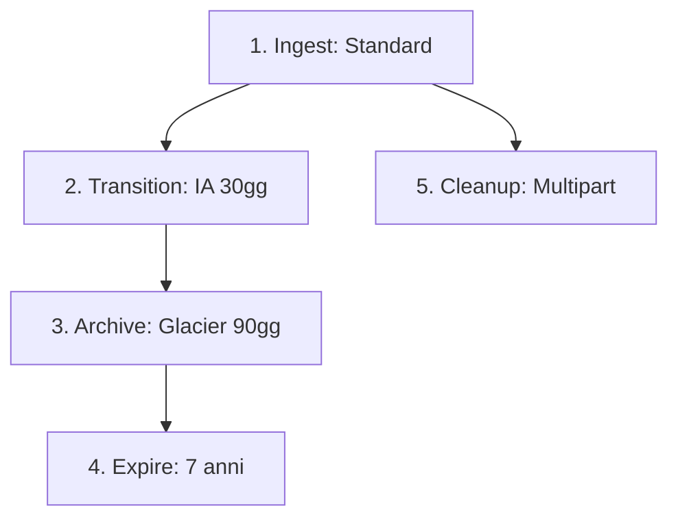

## Concetti Chiave

- **Object Storage**: I dati sono oggetti (File + Metadati) in un Bucket piatto, non in una gerarchia di cartelle reale. La "cartella" è solo parte del nome (Key Prefix).
- **Immutabilità**: Non puoi modificare un oggetto. Puoi solo sovrascriverlo o cancellarlo.
- **Storage Classes**: Livelli di servizio per ottimizzare i costi (Standard, Infrequent Access, Glacier).
- **Partitioning**: Organizzare i dati in "cartelle" logiche (es. `year=2024/month=01`) per permettere ai query engine di leggere solo ciò che serve (**Partition Pruning**).
- **Parquet**: Formato colonnare compresso. Standard de facto per i Data Lake. Molto più efficiente del JSON/CSV per la lettura.
- **Small Files Problem**: Avere milioni di file piccoli (es. 10KB) uccide le performance. Il Data Lake preferisce pochi file grandi (128MB+).

## Storage Classes & Lifecycle

| Classe | Costo ($/GB) | Retrieval | Uso Ideale |
|--------|--------------|-----------|------------|
| **Standard** | ~$0.023 | Immediato | Dati "caldi", accessi frequenti, ETL in corso. |
| **Intelligent-Tiering** | Auto | Immediato | Dati con pattern di accesso sconosciuti. |
| **Standard-IA** | ~$0.0125 | Immediato (ma paghi) | Dati "tiepidi" (es. mese scorso), accesso raro ma veloce. |
| **Glacier Instant** | ~$0.004 | Millisecondi | Archivio accessibile subito (costoso da leggere). |
| **Glacier Deep Archive** | ~$0.00099 | 12-48 ore | Backup di lungo termine, Compliance. |

## Framework e Modelli

### Medallion Architecture (Databricks)
Come organizzare i dati nel Lake.

```mermaid
flowchart LR
    Source[Sorgenti Dati] --> Bronze[Bronze (Raw)<br/>Dati grezzi, immutabili]
    Bronze --> Silver[Silver (Cleaned)<br/>Puliti, deduplicati, tipizzati]
    Silver --> Gold[Gold (Curated)<br/>Aggregati per Business (KPI)]
    Gold --> BI[Dashboard / AI]
```

### Partitioning Strategy
Esempio di struttura Hive-style per ottimizzare le query.

`s3://my-bucket/events/year=2024/month=03/day=15/part-001.parquet`

*   **Vantaggio:** Una query `WHERE year=2024 AND month=03` salta il 90% dei file (Pruning).
*   **Rischio:** Over-partitioning (es. partizionare per `minute` o `user_id`) crea troppi file piccoli.

## Processo Step-by-Step: Lifecycle Management

1.  **Ingest**: Scrivi i dati in **Standard** nella zona Raw.
2.  **Transition (30gg)**: Sposta i dati Raw vecchi di 30 giorni in **Standard-IA** (costa metà).
3.  **Archive (90gg)**: Sposta i dati in **Glacier Deep Archive** (costa 1/20).
4.  **Expire (1-7 anni)**: Cancella automaticamente i dati obsoleti per GDPR/Compliance.
5.  **Multipart Upload**: Usa `AbortIncompleteMultipartUpload` per cancellare i rimasugli di upload falliti dopo 7 giorni.



## Errori da Evitare

-   ❌ **Bucket Pubblici** → ✅ "Block Public Access" deve essere sempre attivo. Usa IAM Roles per l'accesso.
-   ❌ **Small Files (10KB)** → ✅ Uccidono le performance di listing e lettura. Usa un job di **Compaction** per unirli in file da 100MB+.
-   ❌ **Formato JSON/CSV** → ✅ Pesanti e lenti. Converti sempre in **Parquet** o **Avro** nella zona Silver.
-   ❌ **Scansionare tutto** → ✅ Query come `SELECT * FROM bucket` senza filtri di partizione costano una fortuna e sono lentissime.
-   ❌ **Egress Costs** → ✅ Scaricare dati da S3 a Internet costa ($0.09/GB). Tieni il compute (EC2/Lambda) nella stessa regione del bucket.

## Quick Reference

| Strumento | A cosa serve | Quando usarlo |
|-----------|--------------|---------------|
| **AWS CLI** | Gestione S3 | `aws s3 ls`, `aws s3 cp`. Per script e debug rapido. |
| **MinIO** | S3 Locale | Sviluppare in locale con un'API compatibile S3 (Docker). |
| **Athena** | Query Serverless | Fare query SQL direttamente sui file S3 (paghi per TB scansionato). |
| **Glue** | Catalogo Dati | Mantenere i metadati (schema, partizioni) dei file S3. |
| **Mountpoint** | File System | Montare un bucket S3 come fosse un disco locale (Linux). |
