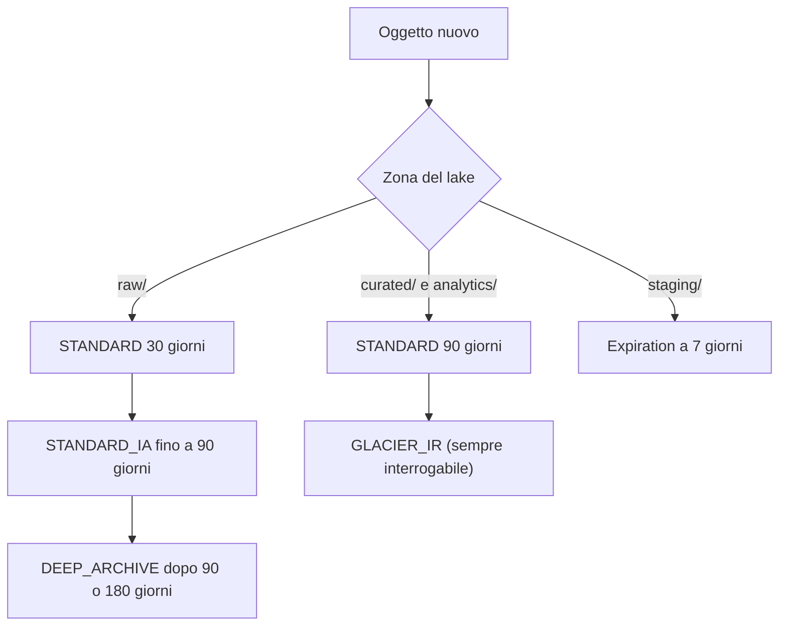

Un amministratore cloud vuole ridurre la fattura di S3 e applica all'intero bucket del data lake una regola unica: dopo 30 giorni ogni oggetto passa in `S3 Glacier Flexible Retrieval`. Due settimane dopo i job dbt che leggono gli ultimi 90 giorni di `curated/` iniziano a fallire con `InvalidObjectState`, la fattura del mese invece di scendere sale, e nessuno capisce perché lo spazio occupato non cali.

È uno scenario costruito, con numeri di esempio, e ogni suo guasto è reale. Il bucket ospita 120 TB: 80 TB di `raw/` con i payload sorgente, 40 TB di `curated/` con tabelle Parquet lette ogni giorno da dbt e Athena, più una zona `staging/` di file temporanei. La regola era corretta per `raw/` e sbagliata per tutto il resto, e l'errore sta nel non aver distinto le zone prima di scegliere la classe.

> **Idea chiave:** la storage class va scelta per come i dati vengono letti, non per quanto costa il gigabyte. Una classe fredda che il query engine non riesce a leggere, o che costa più in transizioni di quanto risparmia, è un aumento di spesa travestito da ottimizzazione.

## Cosa si è rotto e in quale ordine

Il primo guasto è funzionale. Gli oggetti in Glacier Flexible non rispondono a una normale `GET`: serve una richiesta di ripristino asincrona che impiega da 3 a 5 ore. Athena, Trino e ClickHouse leggono direttamente da S3 e non sanno attendere un ripristino, quindi ogni partizione di `curated/` più vecchia di 30 giorni diventa una query fallita.

Il secondo guasto è economico. Nella zona `raw/` ci sono 25 milioni di file JSON da 15 KB. Una transizione verso Glacier costa circa 0,05 USD ogni 1.000 oggetti, quindi 25.000 blocchi da 1.000 oggetti × 0,05 USD = 1.250 USD di sole richieste. In più Glacier aggiunge circa 40 KB di metadati per oggetto, che a 25 milioni di oggetti fanno 25.000.000 × 40 KB = 1.000 GB di spazio fatturato extra, quasi tre volte i 375 GB di dati effettivi (25.000.000 × 15 KB). Il risparmio mensile sullo storage è invece trascurabile: 375 GB × (0,023 − 0,0036) USD/GB ≈ 7,3 USD al mese, per cui i 1.250 USD di transizione si ripagano in oltre 170 mesi.

Il terzo guasto riguarda `staging/`. I file vengono cancellati dopo 15 giorni, ma una classe con durata minima di 90 giorni fattura comunque i 75 giorni mancanti: è la *early deletion fee*. La regola unica ha quindi sommato un errore di lettura, un errore di costo e una penale.

## Classi interrogabili e classi di archivio

La distinzione che governa tutto il resto è se la classe risponde subito a una `GET`. Le classi `STANDARD`, `INTELLIGENT_TIERING` (con i suoi tier Frequent, Infrequent e Archive Instant Access), `STANDARD_IA` e `GLACIER_IR` rispondono in millisecondi e un query engine le legge senza accorgersi della differenza. `GLACIER` (Flexible Retrieval) e `DEEP_ARCHIVE` mettono l'oggetto offline: serve un `RestoreObject` e un'attesa da minuti a 12 ore.

| Classe | Lettura diretta da SQL | Durata minima | Costo indicativo per TB al mese | Uso tipico |
|---|---|---|---|---|
| `STANDARD` | Sì | nessuna | 23 USD | Dati caldi |
| `INTELLIGENT_TIERING` | Sì | nessuna | da 23 a 4 USD secondo gli accessi | Letture imprevedibili |
| `STANDARD_IA` | Sì | 30 giorni | 12,5 USD | Dati letti di rado |
| `GLACIER_IR` | Sì | 90 giorni | 4 USD | Storico interrogabile |
| `GLACIER` | No, serve ripristino | 90 giorni | 3,6 USD | Archivio con audit rari |
| `DEEP_ARCHIVE` | No, serve ripristino | 180 giorni | 0,99 USD | Conservazione legale |

Le tariffe sono indicative e vanno controllate sul listino della propria regione. Il punto è il confronto tra `GLACIER_IR` a 4 USD e `GLACIER` a 3,6 USD: sullo storico che continua a essere interrogato i 0,4 USD per TB di differenza non pagano nemmeno un'ora di lavoro perso, e `curated/` non deve mai finire nelle due classi offline.



## I tre vincoli tariffari delle classi fredde

Il costo vero di una regola dipende da tre vincoli che la tabella del gigabyte non mostra. Il primo è la **dimensione minima di 128 KB**: sotto quella soglia le classi IA, Glacier Instant e Intelligent-Tiering o non applicano il risparmio o non monitorano l'oggetto, ma la richiesta di transizione si paga lo stesso. Il costo della transizione dipende dal numero di oggetti e il risparmio dipende dai gigabyte, quindi spostare un file da 4 KB costa in API più di quanto risparmierebbe in dieci anni.

Il secondo vincolo è la **durata minima**: 30 giorni per `STANDARD_IA`, 90 per `GLACIER_IR` e `GLACIER`, 180 per `DEEP_ARCHIVE`. Cancellare o sovrascrivere prima della scadenza non evita il pagamento dei giorni residui. Il terzo è il **costo di recupero per GB**: circa 0,01 USD per GB su `STANDARD_IA` e 0,03 USD per GB su `GLACIER_IR`, mentre su `GLACIER` e `DEEP_ARCHIVE` si aggiunge anche il ripristino asincrono. Rileggere spesso una tabella in `GLACIER_IR` può costare più dello storage risparmiato.

Un esempio numerico lo rende concreto. Una tabella da 2 TB viene spostata da `STANDARD` a `GLACIER_IR`. Il risparmio di storage è 2 TB × (23 − 4) USD/TB = 38 USD al mese. Se però un backtesting di machine learning rilegge l'intera tabella ogni mese, il recupero costa 2.000 GB × 0,03 USD/GB = 60 USD, superiore al risparmio di 38 USD: in questo caso `GLACIER_IR` fa perdere 22 USD al mese. Con una lettura ogni trimestre il recupero medio scende a 60 ÷ 3 = 20 USD al mese e la classe torna conveniente di 18 USD. La frequenza di rilettura decide, non il prezzo di listino.

## La policy per zona, scritta una volta sola

La policy si scrive come documento JSON con una regola per prefisso. La regola globale di igiene elimina gli upload multipart abbandonati dopo 7 giorni e le versioni non correnti dopo 14. `staging/` ha una semplice expiration. `curated/` usa `GLACIER_IR` con filtro sui 128 KB. `raw/` scende fino a `DEEP_ARCHIVE`.

```json
{
  "Rules": [
    {
      "ID": "igiene-globale",
      "Status": "Enabled",
      "Filter": { "Prefix": "" },
      "AbortIncompleteMultipartUpload": { "DaysAfterInitiation": 7 },
      "NoncurrentVersionExpiration": { "NoncurrentDays": 14 },
      "Expiration": { "ExpiredObjectDeleteMarker": true }
    },
    {
      "ID": "staging-scadenza",
      "Status": "Enabled",
      "Filter": { "Prefix": "staging/" },
      "Expiration": { "Days": 7 },
      "NoncurrentVersionExpiration": { "NoncurrentDays": 1 }
    },
    {
      "ID": "curated-interrogabile",
      "Status": "Enabled",
      "Filter": { "And": { "Prefix": "curated/", "ObjectSizeGreaterThan": 131072 } },
      "Transitions": [{ "Days": 90, "StorageClass": "GLACIER_IR" }]
    },
    {
      "ID": "raw-archivio",
      "Status": "Enabled",
      "Filter": { "And": { "Prefix": "raw/", "ObjectSizeGreaterThan": 131072 } },
      "Transitions": [
        { "Days": 30, "StorageClass": "STANDARD_IA" },
        { "Days": 180, "StorageClass": "DEEP_ARCHIVE" }
      ]
    }
  ]
}
```

Nella regola globale `Expiration` riguarda solo i delete marker orfani, non gli oggetti correnti. L'applicazione e la verifica si fanno da CLI.

```bash
# Applica la policy e rileggila per confermare che S3 l'abbia accettata
aws s3api put-bucket-lifecycle-configuration \
  --bucket acme-lake-prod \
  --lifecycle-configuration file://lifecycle.json

aws s3api get-bucket-lifecycle-configuration --bucket acme-lake-prod \
  --query 'Rules[].{id:ID,stato:Status}' --output table
```

Quando le tabelle sono Apache Iceberg o Delta Lake la lifecycle di S3 non deve però cancellare i file dati: i file orfani vanno rimossi con `expire_snapshots` o `VACUUM`, che aggiornano anche i metadati. Una regola S3 di expiration su `curated/` romperebbe la tabella.

## Regole per età o Intelligent-Tiering

Per `curated/` esistono due strade. Le regole per età spostano i dati in `GLACIER_IR` dopo 90 giorni. `INTELLIGENT_TIERING` sposta ogni oggetto da solo tra tier in base agli accessi, senza costo di recupero per GB, ma con un canone di monitoraggio di circa 0,0025 USD ogni 1.000 oggetti.

Il canone cambia segno secondo la dimensione dei file. Con file da 200 MB, un terabyte contiene 5.000 oggetti, quindi il monitoraggio costa 5 × 0,0025 USD = 0,0125 USD per TB al mese, irrilevante. Con 50 milioni di file da 200 KB il conto è 50.000 blocchi × 0,0025 USD = 125 USD al mese di sola sorveglianza, su soli 10 TB di dati (50.000.000 × 200 KB), cioè 12,5 USD per TB: più di mezzo storage Standard.

La regola operativa è questa. Intelligent-Tiering conviene su `curated/` e `analytics/` con file grandi, sopra i 100 MB, e letture imprevedibili. Le regole per età conviene tenerle su `raw/` e sui log, dove si sa che dopo 30 giorni nessun processo rileggerà i file, e su qualunque prefisso con milioni di oggetti piccoli.

## Auditare la policy sull'inventario

Una lifecycle va verificata come un'applicazione: con i dati. S3 Inventory produce ogni giorno un elenco di oggetti con classe, dimensione e versione, interrogabile da Athena. La query seguente conta le violazioni delle tre regole d'oro e stima il costo mensile per zona e classe.

```sql
-- Athena su S3 Inventory (tabella inventory.lake_daily): violazioni e costo stimato per zona e classe
SELECT
    split_part(key, '/', 1) AS zona,
    storage_class,
    count(*) AS oggetti,
    round(sum(size) / 1e12, 3) AS volume_tb,
    -- Oggetti piccoli transizionati in una classe non STANDARD: devono essere 0
    count_if(size < 131072 AND storage_class <> 'STANDARD') AS violazioni_128kb,
    -- Tabelle interrogabili finite in classi offline: devono essere 0
    count_if(split_part(key, '/', 1) IN ('curated', 'analytics')
             AND storage_class IN ('GLACIER', 'DEEP_ARCHIVE')) AS violazioni_offline,
    round(sum(size) / 1e12 * CASE storage_class
            WHEN 'STANDARD' THEN 23.0
            WHEN 'STANDARD_IA' THEN 12.5
            WHEN 'GLACIER_IR' THEN 4.0
            WHEN 'GLACIER' THEN 3.6
            WHEN 'DEEP_ARCHIVE' THEN 0.99
            ELSE 23.0 END, 2) AS costo_mensile_usd
FROM inventory.lake_daily
WHERE dt = '2026-11-17' AND is_latest
GROUP BY split_part(key, '/', 1), storage_class
ORDER BY zona, volume_tb DESC;
```

Un secondo controllo misura quanto spazio occupano le versioni non correnti. Una percentuale alta significa che manca la regola di expiration.

```sql
-- Athena: quota di byte occupata da versioni non correnti
SELECT
    round(sum(CASE WHEN is_latest THEN 0 ELSE size END) / 1e12, 3) AS tb_non_correnti,
    round(100.0 * sum(CASE WHEN is_latest THEN 0 ELSE size END) / sum(size), 1) AS percentuale
FROM inventory.lake_daily
WHERE dt = '2026-11-17';
```

Il risparmio della configurazione corretta si calcola sull'esempio iniziale. Il lake da 120 TB tutto in Standard costa 120 TB × 23 USD/TB = 2.760 USD al mese. Dopo la policy, supponiamo che 80 TB di `raw/` siano tutti oltre i 180 giorni in `DEEP_ARCHIVE` e che dei 40 TB di `curated/` 30 TB siano oltre i 90 giorni in `GLACIER_IR` e 10 TB ancora caldi in Standard. Il conto è 80 × 0,99 = 79,2 USD, più 30 × 4 = 120 USD, più 10 × 23 = 230 USD, per un totale di 429,2 USD al mese. Il risparmio è 2.760 − 429,2 = 2.330,8 USD, cioè l'84%, e il costo medio scende a 429,2 ÷ 120 ≈ 3,6 USD per TB. Un valore di 6–10 USD per TB è tipico dei lake in cui una quota maggiore resta calda; sopra i 15 conviene cercare cosa è rimasto in Standard senza motivo.

## Tre errori nella scrittura delle policy

### Mandare curated o analytics in Glacier Flexible o Deep Archive

Il sintomo è una query anno su anno che fallisce con `InvalidObjectState` sul primo file archiviato. Succede perché la regola è stata scritta per il costo e non per la lettura, e il bucket sembrava un archivio. Il rimedio è usare `GLACIER_IR` oppure `INTELLIGENT_TIERING` per ogni prefisso interrogato da SQL, e controllare periodicamente con la query di audit che le violazioni offline valgano zero.

### Dimenticare il filtro sui 128 KB

Il sintomo è una fattura di richieste più alta del risparmio sullo storage, visibile nel mese della prima transizione. Succede perché cartelle con file di controllo (`_SUCCESS`, manifest, piccoli log) finiscono nella stessa regola dei file Parquet e il costo di transizione si paga per oggetto. Il rimedio è aggiungere `ObjectSizeGreaterThan: 131072` a ogni regola di transizione e, per `raw/` con molti file minuscoli, aggregarli prima in file più grandi.

### Attivare il versioning senza ripulire le versioni

Il sintomo è un bucket che cresce molto più dei dati dichiarati. Succede perché ogni compattazione riscrive i file e la vecchia versione resta a pagamento per sempre. Con un job che riscrive 500 GB al giorno, dopo 30 giorni ci sono 500 GB × 30 = 15 TB di versioni vecchie, cioè 15 × 23 = 345 USD al mese. Il rimedio è `NoncurrentVersionExpiration` a 14 giorni, `AbortIncompleteMultipartUpload` a 7 e `ExpiredObjectDeleteMarker` attivo.

## Controllo prima di applicare una policy

1. Una tabella da 2 TB passa da `STANDARD` a `GLACIER_IR` e viene riletta per intero ogni mese. Conviene, con 23 e 4 USD per TB e 0,03 USD per GB di recupero?

<details>
<summary>Mostra risposta</summary>

No. Il risparmio è 2 × (23 − 4) = 38 USD al mese, ma il recupero costa 2.000 GB × 0,03 = 60 USD, quindi si perdono 22 USD al mese. Con una rilettura ogni trimestre il recupero medio è 20 USD al mese e la classe diventa conveniente di 18 USD.

</details>

2. Spostare in Glacier 25 milioni di file da 15 KB costa 0,05 USD ogni 1.000 transizioni. Quanto pagano le sole richieste e perché la regola è sbagliata?

<details>
<summary>Mostra risposta</summary>

25.000.000 ÷ 1.000 = 25.000 blocchi, per 25.000 × 0,05 = 1.250 USD. Il dato complessivo è 375 GB e il risparmio mensile è circa 7 USD, quindi la spesa si ripaga in oltre 170 mesi. Serve il filtro sui 128 KB oppure aggregare i file prima di archiviarli.

</details>

3. Per un prefisso con 50 milioni di file da 200 KB scegli Intelligent-Tiering o una regola per età, dato il canone di 0,0025 USD ogni 1.000 oggetti?

<details>
<summary>Mostra risposta</summary>

Una regola per età. Il monitoraggio costerebbe 50.000 × 0,0025 = 125 USD al mese su 10 TB di dati, cioè 12,5 USD per TB, un'imposta molto alta. Intelligent-Tiering è adatto a file grandi con accessi imprevedibili.

</details>

4. Un job riscrive 500 GB al giorno su un bucket con versioning e nessuna regola sulle versioni non correnti. Quanto pesano e quanto costano le versioni dopo un mese?

<details>
<summary>Mostra risposta</summary>

500 GB × 30 giorni = 15 TB di versioni vecchie, che a 23 USD per TB costano 345 USD al mese. Una `NoncurrentVersionExpiration` a 14 giorni porta il carico a circa 7 TB, e a 1 giorno quasi a zero per le zone di lavoro.

</details>
