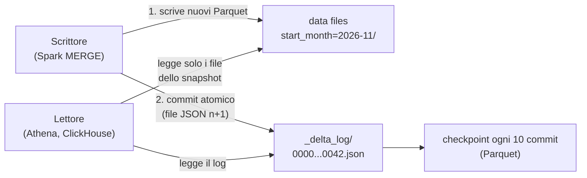

Ogni ora un job Spark aggiorna la tabella dei contratti clienti, `curated.subscriptions_delta`, con i cambi di stato che arrivano dal CRM. Un giorno il team sorgente scrive per errore la colonna `subscrption_amount` invece di `subscription_amount`. Il job non fallisce: aggiunge la colonna sbagliata alla tabella e riempie di `NULL` quella giusta per tutte le nuove righe. Lo stesso pomeriggio un operatore, per liberare spazio, lancia `VACUUM` con ritenzione di zero ore mentre le query di fine mese stanno ancora leggendo lo snapshot di due minuti prima, e quelle query muoiono con un `FileNotFoundException`.

È uno scenario costruito, con numeri di esempio, su una tabella da 150 milioni di contratti e circa 90 GB di Parquet. Delta Lake non ha nessun difetto in questo racconto: il team ha spento a mano le protezioni che il formato offre per impostazione predefinita.

> **Idea chiave:** Delta Lake è un file Parquet più un registro ordinato di transazioni. Tutte le garanzie, dall'atomicità allo schema, dipendono da quel registro, e ogni scorciatoia che lo aggira (autoMerge globale, MERGE senza partizione, VACUUM a zero ore) restituisce il problema dei file sciolti su S3 che il formato doveva risolvere.

## Il transaction log

Su S3 una tabella Delta è una cartella con i file Parquet dei dati e una sottocartella `_delta_log/`. Il log contiene file JSON numerati in sequenza (`00000000000000000000.json`, `00000000000000000001.json`, e così via), uno per ogni commit. Ogni file elenca azioni atomiche: `add` per i file Parquet aggiunti, `remove` per quelli logicamente tolti, `metaData` per lo schema e la partizione. Lo stato della tabella alla versione *V* è l'applicazione in ordine di tutte le azioni fino a *V*. Il formato è descritto nell'articolo di Armbrust e colleghi del 2020 ([Delta Lake: High-Performance ACID Table Storage over Cloud Object Stores](https://www.vldb.org/pvldb/vol13/p3411-armbrust.pdf)).

Rileggere centinaia di file JSON a ogni query sarebbe lento, perciò ogni 10 commit (valore predefinito) Delta scrive un **checkpoint** in Parquet che riassume lo stato. Un lettore parte dall'ultimo checkpoint e applica i JSON successivi. Questo spiega perché motori diversi (Spark, Trino, Athena, ClickHouse) possono ricostruire lo stesso stato: leggono lo stesso registro e quindi sanno quali file Parquet appartengono alla versione corrente.



L'ordine dei passi è la garanzia ACID: i nuovi file Parquet sono scritti prima, ma diventano visibili solo quando il commit JSON compare nel log. Su S3 la creazione condizionale del file di commit impedisce che due scrittori ottengano lo stesso numero di versione, e il perdente rileva il conflitto e riprova o fallisce. Un lettore che ha iniziato su una versione continua a leggere quella: è l'isolamento a snapshot.

## Schema enforcement e evoluzione controllata

Per impostazione predefinita Delta respinge una scrittura se lo schema del dataframe non combacia con quello della tabella: colonna mancante, colonna sconosciuta o tipo incompatibile. L'errore avviene prima di scrivere nel log, quindi la tabella resta intatta. È esattamente la protezione che avrebbe fermato il refuso del nostro scenario.

L'incidente è nato perché `spark.databricks.delta.schema.autoMerge.enabled = true` era impostato globalmente, "per non gestire le eccezioni". Con autoMerge acceso, qualunque colonna nuova viene aggiunta in silenzio. L'evoluzione dello schema è legittima quando è voluta, ma deve essere un'operazione esplicita e testata, applicata a quella singola scrittura.

```python
# Schema enforcement: la scrittura con colonna sbagliata viene respinta; l'evoluzione è esplicita e puntuale
from delta.tables import DeltaTable
from pyspark.sql import SparkSession
from pyspark.sql.utils import AnalysisException

spark = SparkSession.builder.getOrCreate()
TABLE = "s3://acme-lake-prod/curated/subscriptions_delta/"

updates = spark.read.table("staging.hourly_updates")
bad = updates.withColumnRenamed("mrr_eur", "mrr_eurr")   # refuso nel nome della colonna

try:
    # Senza mergeSchema, Delta blocca la scrittura prima del commit nel _delta_log
    bad.write.format("delta").mode("append").save(TABLE)
except AnalysisException as exc:
    print("scrittura respinta:", str(exc).splitlines()[0])

# Evoluzione voluta: colonna nuova prevista dal contratto, dichiarata nel repository di migrazione
spark.sql("ALTER TABLE curated.subscriptions_delta ADD COLUMNS (cancel_reason STRING)")

# mergeSchema solo su questa scrittura, mai come impostazione globale
(updates.withColumn("cancel_reason", updates["status"].cast("string"))
        .write.format("delta").mode("append")
        .option("mergeSchema", "true").save(TABLE))
```

La regola pratica è mantenere l'enforcement sempre attivo e trattare le colonne nuove come migrazioni con `ALTER TABLE ... ADD COLUMNS`, riservando `mergeSchema` a casi puntuali. Ogni colonna aggiunta in silenzio è un contratto cambiato senza che nessuno l'abbia firmato.

## MERGE con predicato di partizione

La tabella è partizionata per `start_month` e contiene 60 mesi di storico. Un `MERGE` che unisce solo su `sub_id` obbliga il motore a cercare quei `sub_id` in tutte le partizioni, perché nulla gli dice dove si trovino. Aggiungendo alla condizione `ON` un predicato sulla colonna di partizione, il motore legge e riscrive solo le partizioni selezionate.

```sql
-- Spark SQL con Delta: upsert orario con predicato sulla partizione start_month nella condizione ON
MERGE INTO curated.subscriptions_delta AS target
USING staging.hourly_updates AS source
    ON target.sub_id = source.sub_id
   AND target.start_month >= DATE '2026-01-01'
WHEN MATCHED AND source.op = 'CANCEL' THEN
    UPDATE SET target.status = 'cancelled', target.updated_at = source.updated_at
WHEN MATCHED THEN
    UPDATE SET target.mrr_eur = source.mrr_eur, target.updated_at = source.updated_at
WHEN NOT MATCHED THEN
    INSERT (sub_id, customer_id, country_code, start_month, status, mrr_eur, updated_at)
    VALUES (source.sub_id, source.customer_id, source.country_code, source.start_month,
            source.status, source.mrr_eur, source.updated_at);
```

L'effetto si calcola sui dati dell'esempio. La tabella pesa circa 90 GB su 60 mesi, quindi 90 GB ÷ 60 = 1,5 GB per partizione mensile. Senza predicato il motore esamina tutti i 90 GB. Con `start_month >= 2026-01-01` e data corrente a novembre 2026, le partizioni coinvolte sono 11 (da gennaio a novembre), quindi 11 × 1,5 GB = 16,5 GB, cioè il 18% dei dati e una riduzione dell'82%. Se la logica di business garantisce che gli aggiornamenti toccano solo contratti dell'ultimo mese, il predicato può restringersi a una partizione e la lettura scende a 1,5 GB, l'1,7% dei dati. Il tempo del `MERGE` segue in modo approssimato i byte letti e riscritti, ed è la ragione per cui un job orario che prima durava 14 minuti può scendere a pochi minuti senza altro intervento.

Il predicato ha un prezzo: se arriva un aggiornamento per un contratto più vecchio del limite, il `MERGE` non lo trova e lo tratta come nuovo, creando un duplicato. Per questo il limite va scelto in base a una regola di business verificabile, e la chiave `sub_id` va controllata a valle con un test di unicità.

## OPTIMIZE con ZORDER e VACUUM

Ogni `MERGE` crea nuovi file e marca come `remove` quelli sostituiti, ma i vecchi file restano su S3. Due manutenzioni schedulate chiudono il ciclo. `OPTIMIZE` compatta i file piccoli in file da circa 1 GB, e con `ZORDER BY` li ordina secondo una curva multidimensionale in modo che le righe con valori vicini nelle colonne indicate finiscano negli stessi file, rendendo efficace il salto dei file in lettura. `VACUUM` elimina fisicamente da S3 i file rimossi da più della ritenzione indicata.

```sql
-- Manutenzione giornaliera della tabella Delta (Spark SQL / Databricks)
-- ZORDER su 2 colonne ad alta cardinalità, mai sulla colonna di partizione start_month
OPTIMIZE curated.subscriptions_delta
WHERE start_month >= DATE '2026-10-01'
ZORDER BY (customer_id, country_code);

-- Ritenzione di 7 giorni: protegge i lettori in corso e il time travel recente
VACUUM curated.subscriptions_delta RETAIN 168 HOURS;
```

Due errori frequenti riguardano lo `ZORDER`. Il primo è includere la colonna di partizione: dentro ogni cartella `start_month` ha un solo valore, quindi ordinare per essa non fa nulla e spreca bit dell'interleaving. Il secondo è usare troppe colonne: la località spaziale della curva si diluisce oltre le 2 o 3 colonne, e con 6 colonne ciascuna ottiene un contributo troppo piccolo per far saltare file.

La ritenzione di `VACUUM` ha due effetti. Il primo è proteggere le query in corso: una query partita sulla versione 41 legge file che il `MERGE` che ha creato la 42 ha marcato `remove`, e un `VACUUM` a 0 ore li cancella sotto i suoi piedi. Il secondo è il time travel: si può leggere una versione vecchia solo finché i suoi file esistono. Il valore predefinito di sette giorni (`delta.deletedFileRetentionDuration`) è un compromesso, e il controllo di sicurezza `retentionDurationCheck` esiste proprio per impedire di scendere sotto di esso per distrazione. Se serve un time travel più lungo si aumentano sia `delta.deletedFileRetentionDuration` sia `delta.logRetentionDuration`.

Un conto di costo aiuta a dimensionare la ritenzione. Il `MERGE` orario riscrive circa 1,5 GB al giorno per partizione corrente e, aggiornando una quota di file sparsi, supponiamo 20 GB di file sostituiti al giorno. Con ritenzione di 7 giorni restano su S3 20 GB × 7 = 140 GB di file in attesa di `VACUUM`, che a 23 USD per TB al mese costano 0,14 TB × 23 = 3,22 USD. È un costo piccolo per avere una settimana di time travel e di sicurezza per i lettori; portare la ritenzione a 30 giorni costerebbe 0,6 TB × 23 = 13,8 USD, comunque modesto rispetto all'audit che permette.

## Leggere la tabella da ClickHouse

Poiché Delta è un formato aperto, motori diversi da Spark leggono la stessa cartella S3. In ClickHouse la funzione `deltaLake` legge il `_delta_log`, determina quali file Parquet appartengono all'ultimo snapshot e ignora quelli obsoleti.

```sql
-- ClickHouse: lettura diretta di una tabella Delta su S3 (il log decide quali Parquet leggere)
SELECT
    country_code,
    status,
    count() AS abbonamenti,
    sum(mrr_eur) AS mrr_totale_eur
FROM deltaLake('https://s3.eu-central-1.amazonaws.com/acme-lake-prod/curated/subscriptions_delta/')
WHERE start_month >= toDate('2026-01-01')
  AND country_code = 'IT'
GROUP BY country_code, status
ORDER BY mrr_totale_eur DESC;
```

Se sulla tabella sono abilitati i *deletion vectors*, i motori esterni devono supportare il protocollo di lettura corrispondente. In caso contrario si esegue `REORG TABLE ... APPLY (PURGE)` prima della lettura esterna, che riscrive i file eliminando le righe marcate come cancellate. Il *Change Data Feed* è un'ulteriore funzione utile a propagare a valle solo le righe modificate da un `MERGE`, ma richiede di essere abilitato a livello di tabella ed è un argomento a parte.

## Delta Lake o Iceberg

I due formati dominanti per rendere transazionale un data lake S3 sono Apache Iceberg e Delta Lake, entrambi sopra file Parquet. La scelta dipende dall'ecosistema più che dalla tecnica.

| Criterio | Apache Iceberg | Delta Lake |
|---|---|---|
| Metadati | Catalogo che punta a `metadata.json` e manifest | `_delta_log/` nella cartella della tabella |
| Partizionamento | Nascosto, con evoluzione delle partizioni | Per colonne esplicite |
| Ecosistema forte | Athena, Trino, Flink, Snowflake, ClickHouse | Spark e Databricks |
| Quando preferirlo | Architetture multi-motore su AWS | Trasformazioni e machine learning centrati su Spark |

La scelta non è un vincolo irreversibile, perché i dati sono Parquet in entrambi i casi e cambiano solo i metadati. Con Delta UniForm (proprietà come `delta.universalFormat.enabledFormats = 'iceberg'`) ogni commit del `_delta_log` genera anche i metadati Iceberg sugli stessi file Parquet, e la tabella è leggibile da entrambi gli ecosistemi senza duplicare lo storage. Apache XTable offre una conversione analoga.

## Tre errori da evitare in produzione

### MERGE senza predicato di partizione

Il sintomo è un job orario che rallenta a ogni mese di storico, che riscrive centinaia di file per aggiornare poche migliaia di righe. Succede perché `ON target.sub_id = source.sub_id` sembra una condizione completa, ma non dice al motore dove cercare. Il rimedio è aggiungere alla condizione il predicato sulla colonna di partizione, scelto con una regola di business, e verificare nel piano di esecuzione quanti file vengono letti.

### ZORDER con la colonna di partizione o con troppe colonne

Il sintomo è un `OPTIMIZE` lungo che non migliora le query puntuali. Succede perché `ZORDER BY (start_month, customer_id, country_code, plan_id, sales_rep_id, currency)` sembra prudente, mentre in realtà diluisce la curva. Il rimedio è limitarsi a 2 o 3 colonne ad alta cardinalità usate nei filtri e lasciare fuori le colonne di partizione.

### VACUUM con ritenzione inferiore a 168 ore

Il sintomo è una query lunga che fallisce a metà con `FileNotFoundException`, accompagnata dalla perdita del time travel recente. Succede quando si disattiva `retentionDurationCheck` per liberare spazio, ignorando che i lettori usano snapshot che non bloccano gli scrittori. Il rimedio è mantenere almeno 7 giorni di ritenzione e, se lo spazio è un problema, ridurre il volume riscritto dal `MERGE` anziché la ritenzione.

## Controllo prima della messa in produzione

1. Una tabella da 90 GB su 60 partizioni mensili viene aggiornata con un `MERGE` il cui predicato copre 11 partizioni. Quanti GB legge il motore e quale quota evita?

<details>
<summary>Mostra risposta</summary>

Ogni partizione pesa 90 ÷ 60 = 1,5 GB, quindi 11 partizioni sono 16,5 GB. Il motore evita 90 − 16,5 = 73,5 GB, cioè l'82% dei dati. Con un predicato su una sola partizione leggerebbe 1,5 GB.

</details>

2. Un collega propone `ZORDER BY (start_month, customer_id, country_code, plan_id)` su una tabella partizionata per `start_month`. Cosa correggi?

<details>
<summary>Mostra risposta</summary>

Togli `start_month`, perché dentro ogni partizione ha un valore solo e ordinare per essa non produce nulla. Riduci inoltre le colonne a 2 o 3 ad alta cardinalità realmente filtrate, per esempio `customer_id` e `country_code`.

</details>

3. Il `MERGE` orario sostituisce 20 GB di file al giorno. Quanto spazio occupano in attesa di `VACUUM` con ritenzione di 7 giorni e quanto costano a 23 USD per TB al mese?

<details>
<summary>Mostra risposta</summary>

20 GB × 7 = 140 GB, cioè 0,14 TB. Il costo è 0,14 × 23 = 3,22 USD al mese. Con ritenzione di 30 giorni sarebbero 600 GB e 13,8 USD: una spesa piccola rispetto al valore della sicurezza per i lettori.

</details>

4. Un job scrive un dataframe con una colonna rinominata per errore. Con enforcement attivo e senza autoMerge cosa accade, e cosa accade con autoMerge globale?

<details>
<summary>Mostra risposta</summary>

Con enforcement attivo la scrittura viene respinta prima del commit nel `_delta_log` e la tabella resta intatta. Con autoMerge globale la colonna sbagliata viene aggiunta e quella corretta riceve valori `NULL` per le nuove righe, un danno silenzioso che i report a valle scoprono solo dopo.

</details>

5. Una tabella Delta deve essere letta da Athena, Trino e Spark. Come eviti di duplicare lo storage?

<details>
<summary>Mostra risposta</summary>

Si abilita Delta UniForm, che genera i metadati Iceberg a ogni commit sugli stessi file Parquet, oppure si usa la funzione `deltaLake` o un connettore Delta nei motori che lo supportano. In entrambi i casi i dati restano un'unica copia su S3.

</details>
