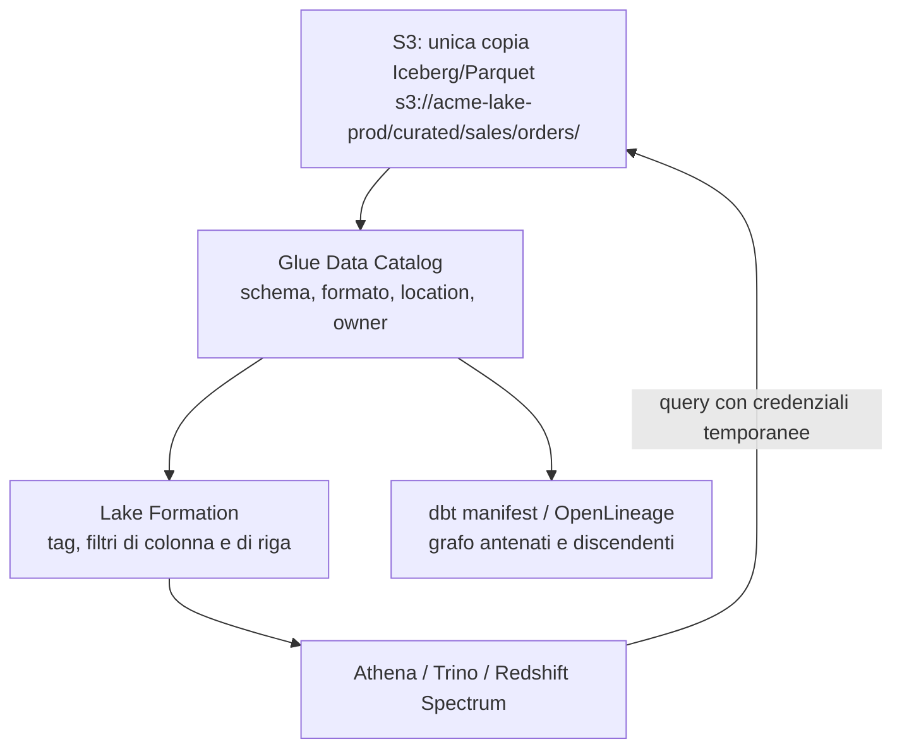

Immagina un'azienda con 300 tabelle Parquet su S3 e un problema banale da enunciare: gli analisti di marketing non devono vedere email e codice fiscale dei clienti, e ogni country manager deve vedere soltanto gli ordini del proprio paese. Questo è uno scenario costruito, con numeri di esempio, ma la sequenza di decisioni è quella che molti team prendono sotto pressione. Una policy IAM su S3 autorizza o nega la lettura di un intero oggetto, quindi non può nascondere una colonna dentro un file Parquet. L'unica via che sembra praticabile è produrre file diversi per pubblici diversi.

## Dodici copie della stessa tabella per nascondere tre colonne

Nello scenario la tabella `customers_orders` pesa 400 GB. Il team scrive un job notturno che produce una copia senza le colonne `customer_email`, `customer_tax_id` e `phone` per il marketing, una copia ridotta per la finanza e dieci copie filtrate per paese, ciascuna in una cartella dedicata come `curated_it/` o `curated_fr/`. Dodici job, dodici cartelle, dodici percorsi da ricordare nei permessi.

Il sistema regge per qualche settimana. Poi il team analytics aggiunge la colonna `discount_eur` alla tabella madre e dimentica di aggiornare tre dei dodici job derivati. A fine mese marketing e filiale italiana presentano due fatturati diversi per lo stesso periodo, e nessuno sa quale dei due sia giusto. Quando un dirigente contesta un numero in dashboard, la domanda "da quale tabella arriva questo campo" non ha una risposta rapida, perché non esiste un registro che colleghi le copie alla sorgente.

> **Idea chiave:** i dati si scrivono su S3 una volta sola per zona; chi può vedere quale riga e quale colonna si decide nel catalogo e nel motore di autorizzazione, mai creando file diversi per pubblici diversi.

Il problema quindi non è la complessità normativa. È l'aver confuso due livelli che vanno tenuti separati: lo strato fisico, dove vive un'unica copia autorevole dei file, e lo strato logico, dove si dichiarano schema, proprietà, riservatezza, permessi e discendenza dei dati.

## Un solo livello fisico e tre livelli logici

Una governance che funziona su un data lake appoggia tre componenti sopra la stessa copia di file. Il catalogo dice che cosa esiste e dove. Il motore di autorizzazione decide chi vede quali celle. Il lineage dice da dove arriva ogni dato e chi lo consuma. Nessuno dei tre sposta un byte su S3.



Il bucket viene chiuso agli utenti finali. I motori di query, quando una tabella è sotto Lake Formation, chiedono al servizio le credenziali temporanee per leggere i soli oggetti e le sole colonne autorizzate. Per questo il permesso `s3:GetObject` diretto sugli utenti va tolto: se resta, l'utente può aggirare Lake Formation leggendo il file direttamente.

La distinzione tra i tre livelli si vede bene confrontando che cosa può decidere ciascuno:

| Livello | Domanda a cui risponde | Strumento tipico | Dove vive il dato |
|---|---|---|---|
| Catalogo | Che tabella è, con quali colonne e di chi è | Glue Data Catalog, dbt | Metadati |
| Autorizzazione | Chi può leggere quale colonna e quale riga | Lake Formation, LF-Tag | Policy |
| Lineage | Da dove arriva e chi la usa | dbt manifest, OpenLineage | Grafo |
| Storage | Dove sono i byte | S3, Iceberg | Oggetti |

Una tabella che non compare in tutte e quattro le righe non è governata: è soltanto un insieme di file con un nome.

## Il catalogo come codice: schema dichiarato, non scoperto

Il Glue Data Catalog può essere popolato in due modi. Il crawler scansiona le cartelle e deduce lo schema dai file. Il codice, invece, dichiara tabella, tipi e posizione con un DDL o con un modello dbt, e il catalogo si limita a registrarli. Per le zone `curated/` e `analytics/` la seconda strada è l'unica difendibile, perché un contratto a valle non può dipendere da una deduzione.

Il motivo è concreto. Se per un errore a monte un file contiene un campo numerico con un valore testuale, il crawler può cambiare il tipo della colonna da `decimal(12,2)` a `string`. Da quel momento ogni vista e ogni modello dbt che somma `amount_eur` fallisce, e il guasto si propaga alla notte successiva. Il crawler resta utile nella zona `raw/`, dove i file sono ancora sconosciuti e l'obiettivo è esplorarli.

Questo comando mette un crawler in sola segnalazione: se trova differenze di schema le scrive nel log, ma non modifica né cancella nulla nel catalogo.

```bash
# Crawler di esplorazione: segnala le differenze di schema ma non tocca il catalogo
aws glue update-crawler \
  --name raw-discovery-crawler \
  --schema-change-policy UpdateBehavior=LOG,DeleteBehavior=LOG \
  --recrawl-policy RecrawlBehavior=CRAWL_NEW_FOLDERS_ONLY
```

Lo schema vero, quello che i consumatori possono considerare un contratto, si dichiara in un file YAML versionato accanto al modello. Con `contract.enforced` dbt rifiuta di materializzare il modello se le colonne prodotte non corrispondono ai tipi dichiarati, e le proprietà in `meta` diventano le informazioni di governance che il catalogo e gli audit leggono.

```yaml
# models/curated/sales/_fct_orders.yml
version: 2
models:
  - name: fct_orders
    description: "Una riga per ordine certificato, zona curated"
    config:
      contract:
        enforced: true
    meta:
      owner: team-data-platform
      domain: sales
      sla: daily_07am
    columns:
      - name: order_id
        data_type: bigint
        data_tests: [unique, not_null]
        meta: {confidentiality: public}
      - name: country_code
        data_type: string
        meta: {confidentiality: public}
      - name: customer_email
        data_type: string
        meta: {confidentiality: pii}
      - name: customer_tax_id
        data_type: string
        meta: {confidentiality: pii}
      - name: amount_eur
        data_type: decimal(12,2)
        meta: {confidentiality: internal}
```

Con questa dichiarazione una modifica di tipo diventa una modifica di codice: passa da una revisione, rompe la compilazione se è incompatibile e lascia una traccia in Git. Con il crawler diventa un effetto collaterale della notte.

## Tag, colonne e righe in Lake Formation con la AWS CLI

Il controllo accessi basato su tag (LF-TBAC) sostituisce l'elenco di permessi per utente con una classificazione. Si definisce una chiave di tag, si assegnano valori a database, tabelle e colonne, e si danno ai ruoli permessi sulle espressioni di tag. Quando nasce una nuova tabella con `confidentiality=pii`, eredita la protezione senza che nessuno scriva una policy.

I comandi seguenti partono dalla creazione del tag e dalla classificazione delle due colonne sensibili, poi concedono al ruolo del marketing la lettura di tutto ciò che non è `pii`. Gli identificativi di account sono segnaposto.

```bash
# 1. Definisce il tag di riservatezza e i suoi valori ammessi
aws lakeformation create-lf-tag \
  --tag-key confidentiality \
  --tag-values public internal pii

# 2. Marca come pii le due colonne sensibili della tabella curated
aws lakeformation add-lf-tags-to-resource \
  --resource '{"TableWithColumns":{"DatabaseName":"curated_sales","Name":"fct_orders","ColumnNames":["customer_email","customer_tax_id"]}}' \
  --lf-tags '[{"TagKey":"confidentiality","TagValues":["pii"]}]'

# 3. Il ruolo marketing legge solo colonne con tag public o internal
aws lakeformation grant-permissions \
  --principal DataLakePrincipalIdentifier=arn:aws:iam::111122223333:role/MarketingAnalyst \
  --resource '{"LFTagPolicy":{"ResourceType":"TABLE","Expression":[{"TagKey":"confidentiality","TagValues":["public","internal"]}]}}' \
  --permissions SELECT
```

Per il filtro di riga serve un *data cells filter*, cioè una definizione che combina un predicato sulle righe con un elenco di colonne visibili. Si scrive in un file JSON e lo si passa alla CLI. Il filtro seguente fa vedere al country manager italiano solo le righe con `country_code = 'IT'` e nasconde il codice fiscale.

```json
{
  "TableCatalogId": "111122223333",
  "DatabaseName": "curated_sales",
  "TableName": "fct_orders",
  "Name": "italy_manager_filter",
  "RowFilter": { "FilterExpression": "country_code = 'IT'" },
  "ColumnWildcard": { "ExcludedColumnNames": ["customer_tax_id"] }
}
```

```bash
# Crea il filtro e lo concede al ruolo del country manager italiano
aws lakeformation create-data-cells-filter --table-data file://italy-filter.json

aws lakeformation grant-permissions \
  --principal DataLakePrincipalIdentifier=arn:aws:iam::111122223333:role/CountryManagerIT \
  --resource '{"DataCellsFilter":{"TableCatalogId":"111122223333","DatabaseName":"curated_sales","TableName":"fct_orders","Name":"italy_manager_filter"}}' \
  --permissions SELECT
```

C'è un ultimo passaggio che molti dimenticano. Quando Lake Formation viene attivato su un database già esistente, il gruppo legacy `IAM_ALLOWED_PRINCIPALS` conserva il permesso `ALL`, e chiunque abbia i vecchi permessi IAM continua a leggere tutto ignorando tag e filtri. Va revocato esplicitamente tabella per tabella, e va tolto dalle impostazioni di default dei nuovi database.

```bash
# Rimuove il bypass legacy: senza questo, filtri e tag sono ignorati dai vecchi permessi IAM
aws lakeformation revoke-permissions \
  --principal DataLakePrincipalIdentifier=IAM_ALLOWED_PRINCIPALS \
  --resource '{"Table":{"DatabaseName":"curated_sales","Name":"fct_orders"}}' \
  --permissions ALL
```

## Quanto costa davvero la duplicazione: il calcolo completo

Nello scenario costruito all'inizio conviene fare i conti, perché l'intuizione tende a sbagliare bersaglio. Lo storage di S3 costa poco: la parte che pesa è altrove. Usiamo numeri di esempio: Standard a 0,023 euro per GB al mese e un cluster di trasformazione a 2 euro l'ora.

Il calcolo procede in sei passi.

1. La tabella madre occupa 400 GB. La copia per il marketing, senza le colonne PII, ne occupa 340 GB. La copia per la finanza ne occupa 380 GB. Le dieci copie per paese si dividono le righe e insieme occupano 400 GB.
2. Le copie derivate valgono quindi 340 + 380 + 400 = 1.120 GB, e con la tabella madre il totale è 400 + 1.120 = 1.520 GB.
3. Lo storage costa 1.520 × 0,023 = 34,96 euro al mese. Con una sola copia sarebbe 400 × 0,023 = 9,20 euro: la differenza è 25,76 euro, pari al 73,7% in meno.
4. Ogni job di copia gira per mezz'ora, quindi costa 0,5 × 2 = 1 euro per notte. Dodici job fanno 12 euro per notte, cioè 12 × 30 = 360 euro al mese.
5. Il costo mensile prima è 34,96 + 360 = 394,96 euro. Dopo, con una sola copia e nessun job di duplicazione, è 9,20 euro.
6. La riduzione è 394,96 − 9,20 = 385,76 euro al mese, pari al 97,7%.

Il risultato corregge un'idea diffusa: lo storage duplicato pesa il 9% del costo totale, mentre i job notturni ne valgono il 91%. E nessuna delle due voci contiene il costo più grosso, quello dei numeri divergenti.

Anche il confronto sul numero di permessi mostra il vantaggio del tag. Assegnare i permessi colonna per colonna a ogni utente su 4.000 colonne e 50 utenti produce 4.000 × 50 = 200.000 concessioni da mantenere. Con tre valori di riservatezza e quattro ruoli bastano 3 × 4 = 12 concessioni sui tag, e una nuova tabella con tag corretto è già coperta.

| Voce | Con copie fisiche | Con catalogo e Lake Formation |
|---|---|---|
| Storage (GB) | 1.520 | 400 |
| Storage al mese (euro) | 34,96 | 9,20 |
| Job di copia al mese (euro) | 360,00 | 0,00 |
| Concessioni da mantenere | 200.000 | 12 |
| Fonti del fatturato | 12 | 1 |

## Lineage: dal numero sospetto alla sorgente in un minuto

Il lineage risponde alla domanda che il dirigente pone in riunione. dbt costruisce già il grafo delle dipendenze e lo salva nel file `target/manifest.json`, nella chiave `child_map`, che associa ogni nodo ai suoi figli diretti. Con poche righe di Python si ottengono tutti i discendenti di una tabella prima di modificarla, e con un secondo controllo si individuano i modelli senza proprietario.

```python
# audit_governance.py: discendenti di un modello e modelli senza owner
import json
from collections import deque

with open("target/manifest.json") as f:
    manifest = json.load(f)

def downstream(unique_id: str) -> list[str]:
    # visita in ampiezza del grafo child_map di dbt
    seen, queue = set(), deque([unique_id])
    while queue:
        for child in manifest["child_map"].get(queue.popleft(), []):
            if child not in seen:
                seen.add(child)
                queue.append(child)
    return sorted(seen)

impacted = downstream("model.acme.fct_orders")
print(f"{len(impacted)} nodi a valle di fct_orders")

# CI: ogni modello di produzione deve dichiarare un owner
missing = [
    uid for uid, node in manifest["nodes"].items()
    if node["resource_type"] == "model"
    and not (node.get("meta") or node.get("config", {}).get("meta", {})).get("owner")
]
if missing:
    raise SystemExit(f"Modelli senza owner: {missing}")
```

Lo script, inserito nella pipeline di integrazione continua, blocca la modifica di una colonna se i discendenti non sono stati avvisati e impedisce che una tabella entri in produzione senza un responsabile. Per i flussi che non passano da dbt, come i topic Kafka o i job Spark, lo stesso grafo si alimenta con eventi OpenLineage.

## Tre errori ricorrenti nella governance del lake

### Duplicare i file per ogni reparto o paese

Il sintomo è un fatturato diverso tra due reparti per lo stesso mese. Succede perché la copia sembra la via più rapida e non richiede di imparare Lake Formation: basta una `CTAS` o un job di export. Il costo emerge più tardi, quando i job derivati si disallineano. La correzione è eliminare le copie e sostituirle con un tag di riservatezza sulle colonne e un data cells filter per le righe, partendo dalla tabella più interrogata.

### Lasciare il crawler libero di aggiornare lo schema in produzione

Il sintomo è una colonna che cambia tipo da un giorno all'altro, o una tabella fantasma con un suffisso casuale come `orders_a8f92`, e tutti i modelli a valle che falliscono insieme. Succede perché il crawler è comodo e il default consente l'aggiornamento. Per evitarlo, le tabelle `curated/` e `analytics/` si registrano da DDL, Iceberg o dbt, e il crawler che resta si imposta con `UpdateBehavior=LOG` oppure si confina alla zona `raw/`.

### Concedere permessi ai singoli utenti e dimenticare il bypass legacy

Il sintomo è un audit in cui un analista legge la colonna `customer_tax_id` pur non avendo alcuna concessione esplicita. Quasi sempre il motivo è `IAM_ALLOWED_PRINCIPALS`, ancora attivo sul database, oppure un utente con `s3:GetObject` sul bucket. La correzione è revocare il gruppo legacy, togliere l'accesso diretto al bucket per gli utenti finali e assegnare i permessi ai ruoli tramite tag, mai nominando le singole tabelle.

## Controllo prima di dichiarare governata una tabella

1. Una tabella della zona `curated/` ha cambiato tipo di colonna dopo il passaggio notturno del crawler: che cosa controlli per primo e come impedisci che si ripeta?

<details>
<summary>Mostra risposta</summary>

Controlli la policy di cambio schema del crawler: se `UpdateBehavior` è `UPDATE_IN_DATABASE`, il crawler ha riscritto il tipo dopo aver letto un file sporco. Lo imposti a `LOG`, ripristini lo schema dichiarato da DDL o dal contratto dbt e sposti la registrazione delle tabelle curated nel codice, lasciando il crawler solo alla zona raw.

</details>

2. Un database ha Lake Formation attivo, ma un analista legge ancora la colonna `customer_email` nonostante il tag `pii` e nessuna concessione esplicita. Dove cerchi la causa?

<details>
<summary>Mostra risposta</summary>

Cerchi un permesso `ALL` assegnato a `IAM_ALLOWED_PRINCIPALS` sulla tabella o sul database, oppure un accesso `s3:GetObject` diretto sul bucket tramite i vecchi permessi IAM. In entrambi i casi Lake Formation viene aggirato. Revochi il gruppo legacy con `revoke-permissions` e rimuovi l'accesso diretto al bucket dai ruoli degli utenti finali.

</details>

3. Una tabella pesa 250 GB e un reparto chiede una copia senza tre colonne PII da 215 GB, aggiornata da un job di 20 minuti a 2 euro l'ora per 30 notti. Quanto costa al mese la copia, con storage a 0,023 euro per GB?

<details>
<summary>Mostra risposta</summary>

Lo storage vale 215 × 0,023 = 4,945 euro, circa 4,95 euro. Il job costa (20 / 60) × 2 = 0,667 euro a notte, quindi 0,667 × 30 = 20 euro al mese. Il totale è circa 24,95 euro al mese per una copia che un permesso di colonna basato su tag renderebbe inutile, oltre al rischio che i numeri divergano dalla tabella madre.

</details>

4. Devi rinominare la colonna `amount_eur` in `net_amount_eur`. Come stabilisci chi rompi, prima di toccare il codice?

<details>
<summary>Mostra risposta</summary>

Interroghi il grafo di lineage: con il `child_map` del manifest di dbt calcoli tutti i discendenti di `fct_orders`, cioè modelli, test ed esposizioni come le dashboard. Avvisi i responsabili indicati in `meta.owner` di ciascun nodo, rilasci prima il nuovo nome affiancato al vecchio e rimuovi quest'ultimo solo quando l'elenco dei discendenti non lo usa più.

</details>
