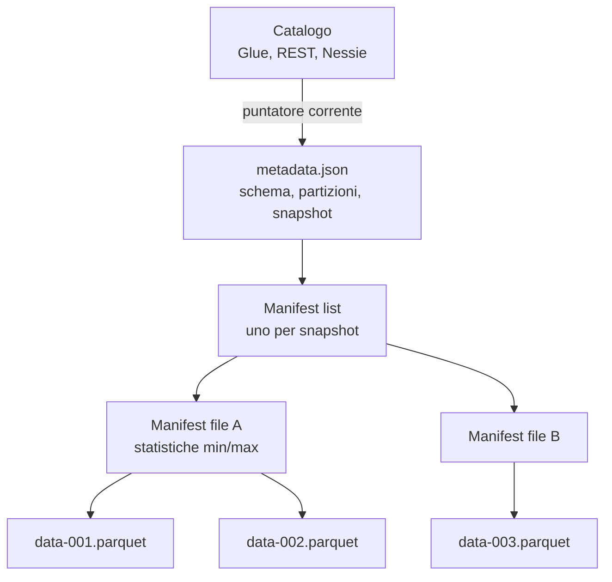

Un job ETL sovrascrive la partizione di novembre di una tabella Parquet su S3 mentre il direttore finanziario aggiorna la sua dashboard. Il caso è ricostruito con numeri di esempio, ma il guasto è reale e prevedibile: a metà dell'operazione il job ha cancellato i vecchi file e ne ha scritto solo un terzo dei nuovi, e per dodici minuti il fatturato in dashboard è dimezzato. Nella stessa settimana arriva una richiesta di cancellazione GDPR per un cliente, e il team deve cercare a mano i 400 file Parquet dove compare e riscriverli.

## Fatturato dimezzato per dodici minuti e quattrocento file da riscrivere

Con il modello Hive una tabella è, per definizione, tutto ciò che si trova dentro una cartella S3. Non c'è nessun elenco ufficiale dei file che la compongono: il motore di query lo ricostruisce ogni volta con un `LIST` sul prefisso. Questo produce tre limiti strutturali.

Il primo è l'assenza di transazioni su più oggetti. Mentre il job sostituisce i file, una query lanciata da Athena, Trino o ClickHouse vede una cartella a metà, e restituisce numeri diversi a ogni esecuzione. Il secondo è l'assenza di una vera `DELETE`: per eliminare un cliente bisogna individuare i file che lo contengono e riscriverli per intero. Il terzo è l'impossibilità di cambiare partizionamento senza riscrivere tutto. Dopo un anno il volume giornaliero decuplica, il team vuole passare dalla partizione mensile a quella giornaliera, e in Hive questo significa rileggere e riscrivere tre anni di terabyte.

> **Idea chiave:** Iceberg sostituisce la scansione delle directory con un elenco di file versionato e immutabile; ogni scrittura prepara nuovi file e nuovi metadati e li rende visibili con un solo cambio di puntatore nel catalogo.

La causa dei tre guasti non è Parquet, che resta il formato dei dati. È l'affidare al file system il compito di dire quali file appartengono alla tabella.

## L'albero di metadati e lo swap atomico

Iceberg aggiunge sopra i file Parquet una gerarchia di metadati, descritta nella specifica ufficiale (https://iceberg.apache.org/spec/). Il motore non fa mai `LIST` sulle directory: chiede al catalogo l'indirizzo del file `metadata.json` corrente e da lì scende fino ai file dati.



Ogni scrittura (`INSERT`, `MERGE`, `DELETE`, compattazione) crea in background nuovi file dati e nuovi manifest. Solo all'ultimo istante il catalogo sostituisce con un'operazione atomica il puntatore da `metadata.json` della versione `s1` a quello della versione `s2`. Le query iniziate prima leggono `s1` fino alla fine; quelle iniziate dopo vedono tutta `s2`. Non esiste uno stato intermedio. Se due scrittori tentano il commit insieme, il secondo fallisce con una `CommitFailedException` e riprova su base aggiornata: è la concorrenza ottimistica.

I manifest contengono per ogni file dati i valori minimo e massimo delle colonne. Un filtro su `occurred_at` consente al planner di scartare interi file senza aprirli, e questo è il motivo per cui Iceberg non ha bisogno di colonne di partizione artificiali.

## Creare la tabella con hidden partitioning

Nelle tabelle Hive bisognava creare una colonna stringa come `dt` e ricordarsi di inserirla in ogni `WHERE`. Se l'analista dimenticava il filtro, la query scansionava l'intera tabella. In Iceberg si dichiara una trasformazione della colonna reale, e gli utenti filtrano sul timestamp come farebbero normalmente.

Questa istruzione, nel dialetto di Athena, crea nel Glue Catalog una tabella partizionata per giorno con compressione Zstandard.

```sql
-- Athena: tabella Iceberg con partizione nascosta sul giorno
CREATE TABLE lakehouse.sales_orders (
    order_id      bigint,
    customer_id   bigint,
    country_code  string,
    status        string,
    amount_eur    decimal(12, 2),
    occurred_at   timestamp
)
PARTITIONED BY (day(occurred_at))
LOCATION 's3://acme-lake-prod-curated/sales_orders/'
TBLPROPERTIES (
    'table_type' = 'ICEBERG',
    'format' = 'parquet',
    'write_compression' = 'zstd'
);
```

Cambiare idea sul partizionamento diventa un'operazione di soli metadati. Con `ALTER TABLE ... ADD PARTITION FIELD` (in Spark) i file esistenti restano partizionati per mese e quelli nuovi per giorno; il motore interroga entrambi in modo trasparente. Per questo la scelta iniziale non è irreversibile come in Hive.

## MERGE, cancellazione GDPR e time travel

Con la tabella transazionale diventa possibile scrivere in un'unica istruzione gli aggiornamenti e le cancellazioni. Il `MERGE INTO` confronta la tabella con una tabella di staging che contiene le variazioni e una colonna `op` che dice che cosa fare.

```sql
-- Athena: upsert e cancellazione GDPR in un unico commit atomico
MERGE INTO lakehouse.sales_orders AS t
USING staging.orders_changes AS s
    ON t.order_id = s.order_id
WHEN MATCHED AND s.op = 'DELETE_GDPR' THEN DELETE
WHEN MATCHED THEN UPDATE SET
    status = s.status,
    amount_eur = s.amount_eur
WHEN NOT MATCHED THEN INSERT
    (order_id, customer_id, country_code, status, amount_eur, occurred_at)
    VALUES (s.order_id, s.customer_id, s.country_code, s.status, s.amount_eur, s.occurred_at);

-- Time travel: lo stato esatto della tabella di ieri, prima del MERGE
SELECT status, count(*) AS ordini, sum(amount_eur) AS totale_eur
FROM lakehouse.sales_orders FOR TIMESTAMP AS OF (current_timestamp - interval '1' day)
WHERE occurred_at >= TIMESTAMP '2026-11-01 00:00:00'
GROUP BY status;
```

Durante il `MERGE` la dashboard continua a leggere lo snapshot precedente, quindi non vede nessun calo temporaneo. La cancellazione del cliente è una riga `WHEN MATCHED ... DELETE`, e il time travel permette di riprodurre un report passato o di verificare che cosa ha cambiato un caricamento sospetto. C'è una conseguenza da ricordare: finché lo snapshot vecchio non scade, i byte del cliente cancellato esistono ancora nei file storici. La scadenza degli snapshot fa parte dell'adempimento GDPR, non è un dettaglio di manutenzione.

## La manutenzione ha un costo che si calcola

Ogni commit crea file. Un micro-batch ogni cinque minuti che scrive un file per partizione produce, in un giorno, centinaia di file piccoli, e i manifest crescono con loro. Svolgiamo il conto con numeri di esempio: ogni commit aggiunge un file da 4 MB e la lettura di un file costa circa 30 ms di latenza iniziale.

1. I commit giornalieri sono 24 × 60 / 5 = 288, e i dati del giorno sono 288 × 4 = 1.152 MB, circa 1,1 GB.
2. Senza compattazione, una query sul giorno apre 288 file. La latenza cumulata è 288 × 0,03 = 8,64 secondi, che con 16 lettori in parallelo diventano circa 0,54 secondi.
3. Dopo una compattazione verso file da 256 MB servono 1.152 / 256 = 4,5, cioè 5 file. La latenza cumulata scende a 5 × 0,03 = 0,15 secondi.
4. La riduzione del numero di file è (288 − 5) / 288 = 98,3%.
5. La compattazione però riscrive i dati: finché gli snapshot precedenti non scadono, il giorno occupa 2 × 1.152 = 2.304 MB. Con 7 giorni di time travel l'eccedenza è 7 × 1.152 = 8.064 MB, circa 7,9 GB, cioè 7,9 × 0,023 = 0,18 euro al mese.
6. Se invece gli snapshot non scadono mai, in un anno si accumulano 365 × 1,125 = circa 411 GB di file obsoleti, pari a 411 × 0,023 = 9,45 euro al mese per dati che nessuna query dovrebbe più leggere.

Il costo in euro è basso; il costo vero è nel tempo di pianificazione delle query, che dipende dal numero di file e di manifest. I tre comandi seguenti, eseguiti con Spark, sono il ciclo di manutenzione: compattare, far scadere gli snapshot e rimuovere i file orfani rimasti da scritture fallite.

```sql
-- Spark SQL su catalogo Glue: compattazione verso file da 256 MB
CALL glue.system.rewrite_data_files(
    table => 'lakehouse.sales_orders',
    options => map('target-file-size-bytes', '268435456', 'delete-file-threshold', '2')
);

-- Scadenza snapshot: conserva almeno 10 versioni e tutto ciò che è più recente di 7 giorni
CALL glue.system.expire_snapshots(
    table => 'lakehouse.sales_orders',
    older_than => TIMESTAMP '2026-11-14 00:00:00',
    retain_last => 10
);

-- Rimozione dei file non referenziati da nessun snapshot
CALL glue.system.remove_orphan_files(table => 'lakehouse.sales_orders');
```

Su Athena gli equivalenti sono `OPTIMIZE lakehouse.sales_orders REWRITE DATA USING BIN_PACK` e `VACUUM lakehouse.sales_orders`. Per controllare il risultato si interrogano le tabelle di metadati, per esempio `SELECT count(*) AS file, avg(file_size_in_bytes) / 1048576 AS mb_medi FROM "sales_orders$files"`: dopo la compattazione la dimensione media deve avvicinarsi a 256 MB.

## Copy-on-write o merge-on-read

Nella versione 2 del formato, aggiornamenti e cancellazioni possono essere eseguiti in due modi. Con **copy-on-write** il motore riscrive subito i file Parquet interessati, escludendo le righe rimosse: la scrittura è più lenta ma la lettura è pulita. Con **merge-on-read** il file originale non si tocca e viene scritto un piccolo file di cancellazione con le posizioni delle righe eliminate; il motore lo applica al volo a ogni lettura finché una compattazione non lo assorbe.

La regola di scelta dipende dalla frequenza delle modifiche. Le tabelle interrogate intensamente da dashboard e analisti, con modifiche a lotti ogni ora o una volta a notte, vanno in copy-on-write: la lettura resta veloce. Le tabelle con micro-batch ogni uno-cinque minuti, o con cancellazioni sparse su molti file, vanno in merge-on-read, perché riscrivere centinaia di megabyte a ogni minuto sarebbe troppo lento. In quel caso la compattazione periodica non è facoltativa.

```sql
-- Spark SQL: modalità di scrittura per tabella (copy-on-write è il valore predefinito)
ALTER TABLE glue.lakehouse.sales_orders SET TBLPROPERTIES (
    'write.delete.mode' = 'merge-on-read',
    'write.update.mode' = 'merge-on-read',
    'write.merge.mode'  = 'merge-on-read'
);
```

Il motore più usato conta: Athena, per esempio, gestisce le modifiche con file di cancellazione e quindi vive già in uno scenario merge-on-read, mentre Spark consente di scegliere. Prima di fissare la proprietà conviene controllare che cosa il motore di scrittura supporta.

## Tre errori nella gestione delle tabelle Iceberg

### Non pianificare mai compattazione e scadenza degli snapshot

Il sintomo è un planning delle query sempre più lento e una bolletta S3 che cresce più dei dati. Succede perché la tabella funziona subito e la manutenzione non produce errori visibili. La correzione è schedulare ogni giorno la compattazione e ogni settimana la scadenza degli snapshot, con una finestra di time travel dichiarata, per esempio 7 giorni.

### Cancellare o spostare file direttamente su S3

Il sintomo è una query che fallisce con `NoSuchKey` o `FileNotFoundException`. Succede perché il manifest continua a elencare il file come parte dello snapshot attivo, e chi ha lanciato `aws s3 rm` ha agito fuori dal catalogo. La correzione è usare solo istruzioni SQL e procedure Iceberg per modificare la tabella; un file mancante si ripristina da una versione del bucket, non si dichiara perso.

### Usare Iceberg per scritture riga per riga ad alta frequenza

Il sintomo è una serie di `CommitFailedException` e un catalogo intasato. Succede perché 50 transazioni al secondo, ciascuna con un commit, producono 50 conflitti di concorrenza ottimistica al secondo. Iceberg è progettato per carichi analitici a lotti o micro-batch da uno a quindici minuti: si raggruppano le modifiche in un solo `MERGE INTO` periodico, con le scritture singole assorbite a monte da uno stream.

## Controllo prima di mettere in produzione una tabella

1. Un job scrive un file da 3 MB ogni 2 minuti nella stessa partizione. Quanti file produce in un giorno e quanti ne servono dopo una compattazione a 256 MB?

<details>
<summary>Mostra risposta</summary>

In un giorno i commit sono 24 × 60 / 2 = 720, quindi 720 file e 720 × 3 = 2.160 MB di dati. A 256 MB per file bastano 2.160 / 256 = 8,4, cioè 9 file: una riduzione di (720 − 9) / 720 = 98,8%.

</details>

2. Hai attivato merge-on-read per accelerare le scritture e dopo una settimana le letture sono molto più lente. Che cosa controlli?

<details>
<summary>Mostra risposta</summary>

Controlli quanti file di cancellazione si sono accumulati, per esempio con la tabella di metadati `$files`. Senza compattazione il motore deve applicare migliaia di file di cancellazione a ogni `SELECT`. Pianifichi `rewrite_data_files` con soglia sui file di cancellazione, in modo che dopo ogni giro i file di cancellazione delle partizioni chiuse tornino a zero.

</details>

3. Un cliente chiede la cancellazione dei suoi dati e hai eseguito il `MERGE` con `DELETE`. Perché i suoi dati possono essere ancora su S3 e che cosa serve per eliminarli?

<details>
<summary>Mostra risposta</summary>

Gli snapshot precedenti puntano ancora ai file originali, per consentire il time travel. Finché non scadono con `expire_snapshots` o `VACUUM` e finché i file non vengono rimossi, i byte esistono. Per rispettare la richiesta nei tempi dichiarati, la finestra di retention degli snapshot deve essere più breve del termine di cancellazione, oppure si devono far scadere subito gli snapshot interessati.

</details>

4. Un collega ha eliminato a mano un file Parquet dalla cartella della tabella con `aws s3 rm`. Come ripristini la tabella?

<details>
<summary>Mostra risposta</summary>

Se il bucket ha il versioning attivo, ripristini il file rimuovendo il delete marker o copiando la versione precedente nello stesso percorso: il manifest tornerà valido. Se non c'è versioning, devi tornare a uno snapshot che non referenzia quel file con un rollback e ricaricare i dati mancanti dalla zona raw.

</details>
