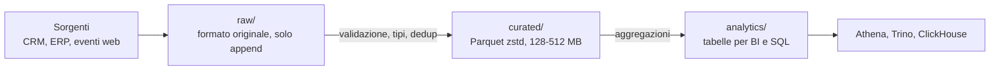

Un team di ingegneria dati ha appena migrato i propri file da un file server a un bucket Amazon S3 e li tratta come prima: i CSV grezzi convivono con i Parquet trasformati nella cartella `data/`, e a fine caricamento uno script esegue `aws s3 mv` per spostare dalla cartella di staging a quella di produzione. Il caso è ricostruito con numeri di esempio, ma ricalca una migrazione molto comune. Il bucket non ha il versioning attivo e lo script di estrazione, una notte, sovrascrive `clienti.parquet` con un file vuoto. L'unica copia dello storico è andata.

## Quaranta minuti per rinominare una cartella che non esiste

Nel caso ricostruito l'azienda conserva 25 TB di dati di CRM, ERP ed eventi web in un solo bucket. Il caricamento notturno produce 80.000 file nella cartella `staging/2026-11/`, per un totale di 160 GB, e li promuove con un comando che su un disco Linux sarebbe istantaneo. Su S3 la stessa operazione tiene occupata la pipeline per quaranta minuti, e per tutto quel tempo chi legge la cartella di produzione vede metà file vecchi e metà nuovi.

Il motivo è che S3 non ha cartelle. Un bucket è una mappa gigante da chiave a oggetto, e il carattere `/` è un normale carattere del nome. Spostare un prefisso significa copiare ogni oggetto sotto una chiave nuova e poi cancellare quello vecchio, uno per uno.

> **Idea chiave:** S3 è un archivio di oggetti immutabili con uno spazio di nomi piatto, non un disco con directory; un data lake va progettato intorno a questa natura, scrivendo subito nel percorso definitivo e proteggendo ogni zona con versioning e crittografia.

Il resto della lezione parte da qui. Prima si guarda come è fatto davvero l'archivio, poi si fanno i conti sul costo della rinomina e del formato, infine si configurano le protezioni e si decide la struttura dei bucket.

## Chiavi piatte e oggetti immutabili

Un object storage come Amazon S3, Google Cloud Storage, Cloudflare R2 o MinIO raggiunge una durabilità dichiarata di undici nove, cioè 99,999999999%, e una scalabilità praticamente illimitata rinunciando a tre caratteristiche dei file system POSIX. Le sostituisce con primitive HTTP: `PUT`, `GET`, `DELETE`, `LIST`.

Prima, non esistono directory fisiche. La chiave `curated/sales/orders/year=2026/month=11/part-001.parquet` è una sola stringa, e la console grafica la mostra come albero perché l'API `ListObjectsV2` accetta i parametri `Prefix` e `Delimiter`. Il comando seguente lo rende visibile: le "cartelle" tornano come `CommonPrefixes`, cioè gruppi di chiavi che condividono l'inizio fino al delimitatore.

```bash
# Elenca i "sottoprefissi" di un prefisso: S3 li calcola al volo dalle chiavi
aws s3api list-objects-v2 \
  --bucket acme-lake-prod-curated \
  --prefix curated/sales/orders/year=2026/ \
  --delimiter / \
  --query 'CommonPrefixes[].Prefix'
```

Seconda rinuncia: gli oggetti sono immutabili. Non si modifica una riga dentro un file né si aggiunge un blocco in coda: si scrive l'oggetto intero con un `PUT` o lo si sostituisce con uno nuovo. Terza: non esiste una rinomina atomica. Cambiare la chiave significa copiare e cancellare.

In compenso S3 offre da dicembre 2020 una consistenza forte in lettura dopo scrittura, e limiti di richieste che scalano per prefisso: almeno 3.500 richieste di scrittura (`PUT`, `COPY`, `POST`, `DELETE`) e 5.500 di lettura (`GET`, `HEAD`) al secondo per ciascun prefisso. Un lake con tabelle partizionate in prefissi distinti sfrutta questo parallelismo senza sforzo.

| Caratteristica | File system locale | Amazon S3 |
|---|---|---|
| Struttura | Directory vere con inode | Chiavi in uno spazio piatto |
| Rinomina di una cartella | Aggiorna un puntatore, tempo costante | Copia e cancella ogni oggetto, tempo lineare |
| Modifica di un file | In posto, anche per un solo byte | Riscrittura dell'intero oggetto |
| Atomicità di più file | Dipende dal sistema | Nessuna tra oggetti diversi |
| Scalabilità | Limitata dal disco | Praticamente illimitata |

## Tre zone e una convenzione di nomi che si legge senza documentazione

Un bucket senza regole diventa una palude di dati, con percorsi come `dump_finale_v2/clienti.csv` che nessuno osa cancellare. La difesa è dividere il lake in zone con un contratto diverso e scrivere un'unica convenzione di naming, valida per tutte.

La zona **raw** riceve i dati nel formato esatto della sorgente, in sola aggiunta: non si sovrascrive e non si cancella a mano. È la memoria da cui si può ricostruire qualsiasi tabella anche dopo anni. La zona **curated** contiene dati validati, tipizzati e deduplicati, in formato colonnare compresso come Parquet con Zstandard, oppure governati da un table format come Iceberg. La zona **analytics** espone le aggregazioni pronte per Athena, Trino o ClickHouse.



Lo schema di percorso consigliato è `s3://<azienda>-lake-<ambiente>-<zona>/<dominio>/<tabella>/year=YYYY/month=MM/part-<uuid>.parquet`. Le coppie `chiave=valore` nei prefissi seguono la convenzione Hive: i motori SQL le riconoscono come partizioni e leggono soltanto i prefissi che il filtro della query rende rilevanti. Nella zona raw si aggiunge la data di estrazione, per esempio `extracted_date=2026-11-12`, così ogni consegna resta distinguibile.

## Il costo della rinomina, in tempo e in richieste

Riprendiamo il caso dell'apertura con i numeri di esempio e svolgiamo il calcolo passo per passo. Il comando `aws s3 mv --recursive` esegue una copia lato server per ogni oggetto e poi una cancellazione. Supponiamo 80.000 oggetti per 160 GB, una CLI che copia circa 33 oggetti al secondo e un prezzo di 0,005 euro ogni 1.000 richieste `COPY`.

1. Le richieste di copia sono 80.000 e quelle di cancellazione altrettante, cioè 160.000 richieste in totale.
2. Il tempo di esecuzione è 80.000 / 33,3 = 2.400 secondi, pari a 40 minuti, durante i quali la cartella di produzione è incompleta.
3. Il costo delle richieste `COPY` è (80.000 / 1.000) × 0,005 = 0,40 euro, trascurabile. Le cancellazioni non sono fatturate.
4. Finché la cartella di staging non viene ripulita, i dati esistono due volte: 160 GB in più per 0,023 euro al mese per GB fanno 3,68 euro.
5. Scrivere direttamente nel prefisso definitivo azzera passi 1, 2 e 3: zero copie, zero attesa, zero finestre di lettura inconsistente.

La lezione dei numeri è che il danno non è la fattura, ma i 40 minuti di stato intermedio visibile ai lettori. Per ottenere un passaggio atomico senza spostare byte servono i manifest di un table format come Iceberg, che si studia nella lezione dedicata: la tabella cambia versione con un solo aggiornamento di metadati.

## Parquet contro CSV: dimensionare ciò che la query deve leggere

Una query analitica tocca di solito poche colonne su molte. Con il CSV, righe e colonne sono mescolate nel testo, quindi per leggere `country` e `amount` il motore scarica tutto il file. Con Parquet i dati sono organizzati per colonna e compressi, e le richieste di intervallo di byte (*byte-range*) scaricano solo i blocchi delle colonne richieste.

Prendiamo un dataset di numeri di esempio: 100 GB di CSV con 50 colonne, che in Parquet compresso con Zstandard scende a 13 GB. Una query legge 2 colonne di peso simile e Athena fattura 5 euro per terabyte scansionato.

1. In CSV la query scansiona tutti i 100 GB, cioè 0,1 TB, e costa 0,1 × 5 = 0,50 euro.
2. In Parquet legge 2 colonne su 50, quindi 13 × 2 / 50 = 0,52 GB, pari a 0,00052 TB, e costa 0,00052 × 5 = 0,0026 euro.
3. Il rapporto è 0,50 / 0,0026 ≈ 192 volte meno denaro e, in prima approssimazione, altrettanti byte in meno da trasferire.
4. Con 100 query al giorno per 30 giorni, cioè 3.000 query al mese, la spesa passa da 3.000 × 0,50 = 1.500 euro a 3.000 × 0,0026 = 7,80 euro.
5. Anche lo storage scende: 100 × 0,023 = 2,30 euro al mese contro 13 × 0,023 = 0,30 euro.

La dimensione dei singoli file conta quanto il formato. Ogni file aperto richiede almeno una richiesta e una latenza iniziale di decine di millisecondi. Gli stessi 13 GB in file da 256 MB sono circa 52 oggetti, mentre in file da 1 MB diventano 13.312 oggetti da aprire, ciascuno con la propria latenza. L'intervallo di riferimento è 128-512 MB per file nelle zone curated e analytics.

Questo script controlla la salute di un prefisso: calcola la dimensione media degli oggetti e segnala i file piccoli. L'indicatore è semplice, ma intercetta il degrado più frequente di un lake alimentato a micro-batch.

```python
# check_object_size.py: dimensione media degli oggetti in un prefisso S3
import boto3

s3 = boto3.client("s3", region_name="eu-central-1")
paginator = s3.get_paginator("list_objects_v2")

total_bytes, count, small = 0, 0, 0
for page in paginator.paginate(
    Bucket="acme-lake-prod-curated", Prefix="sales/orders/year=2026/month=11/"
):
    for obj in page.get("Contents", []):
        total_bytes += obj["Size"]
        count += 1
        if obj["Size"] < 16 * 1024 * 1024:  # sotto 16 MB: file piccolo
            small += 1

avg_mb = total_bytes / count / 1024 / 1024 if count else 0
print(f"{count} oggetti, media {avg_mb:.1f} MB, piccoli {small}")
if count and avg_mb < 100:
    raise SystemExit("Dimensione media sotto 100 MB: pianificare una compattazione")
```

## Versioning, crittografia e lifecycle: la configurazione di un bucket

Tre protezioni vanno attivate il primo giorno su ogni bucket, perché aggiungerle dopo richiede di decidere che cosa fare dei dati già scritti. Il **versioning** trasforma ogni sovrascrittura e ogni cancellazione in una nuova versione: una `DELETE` non distrugge i byte, aggiunge un *delete marker*, e il file precedente resta recuperabile. La **crittografia di default** (SSE-S3 oppure SSE-KMS con chiave gestita dal cliente) cifra ogni oggetto in scrittura. Il **blocco dell'accesso pubblico** impedisce che una policy o una ACL sbagliata esponga il bucket a Internet.

I comandi seguenti configurano un bucket della zona raw con tutte e tre le protezioni.

```bash
# Crea il bucket della zona raw in eu-central-1
aws s3api create-bucket --bucket acme-lake-prod-raw --region eu-central-1 \
  --create-bucket-configuration LocationConstraint=eu-central-1

# Blocca ogni forma di accesso pubblico
aws s3api put-public-access-block --bucket acme-lake-prod-raw \
  --public-access-block-configuration \
  BlockPublicAcls=true,IgnorePublicAcls=true,BlockPublicPolicy=true,RestrictPublicBuckets=true

# Versioning attivo: sovrascritture e cancellazioni diventano recuperabili
aws s3api put-bucket-versioning --bucket acme-lake-prod-raw \
  --versioning-configuration Status=Enabled

# Crittografia di default con una chiave KMS dedicata alla zona raw
aws s3api put-bucket-encryption --bucket acme-lake-prod-raw \
  --server-side-encryption-configuration \
  '{"Rules":[{"ApplyServerSideEncryptionByDefault":{"SSEAlgorithm":"aws:kms","KMSMasterKeyID":"alias/lake-raw"},"BucketKeyEnabled":true}]}'
```

Il versioning, da solo, fa crescere il costo, perché le versioni vecchie restano a pagamento. Il **lifecycle** lo tiene sotto controllo: sposta i dati freddi su una classe più economica, elimina le versioni non correnti dopo un periodo e abbandona i caricamenti multiparte rimasti a metà. La configurazione si scrive in JSON.

```json
{
  "Rules": [
    {
      "ID": "raw-lifecycle",
      "Status": "Enabled",
      "Filter": { "Prefix": "" },
      "Transitions": [{ "Days": 90, "StorageClass": "STANDARD_IA" }],
      "NoncurrentVersionExpiration": { "NoncurrentDays": 30 },
      "AbortIncompleteMultipartUpload": { "DaysAfterInitiation": 7 }
    }
  ]
}
```

La regola si applica con `aws s3api put-bucket-lifecycle-configuration --bucket acme-lake-prod-raw --lifecycle-configuration file://lifecycle-raw.json`. Con questa configurazione una sovrascrittura accidentale resta recuperabile per 30 giorni, poi lo spazio torna libero.

## Un bucket o più bucket: la scelta di struttura

All'inizio il team deve decidere se creare un solo bucket diviso in prefissi `raw/`, `curated/` e `analytics/`, oppure bucket distinti per zona e per ambiente, come `acme-lake-prod-raw` e `acme-lake-prod-curated`.

La separazione fisica conviene quando le zone hanno regole diverse. La zona raw contiene dati personali e richiede una chiave KMS propria, un versioning più lungo e permessi ristretti. La zona curated ha lifecycle e consumatori differenti. Mescolare sviluppo e produzione nello stesso bucket è il caso peggiore: una regola di lifecycle scritta per ripulire i test può cancellare dati reali. Un unico bucket per ambiente, con prefissi per zona, è accettabile in un team piccolo con un solo dominio amministrativo, una sola chiave di crittografia e permessi delegati a Lake Formation.

L'estremo opposto, un bucket per tabella, complica inutilmente IAM, KMS e monitoraggio, e si scontra con il limite predefinito di bucket per account. La regola pratica è un bucket per combinazione di ambiente e zona, e prefissi per tutto ciò che sta sotto.

## Tre errori tipici quando si usa S3 come un file system

### Spostare prefissi con `aws s3 mv` nelle pipeline

Il sintomo è una pipeline che resta ferma decine di minuti dopo aver finito il vero lavoro, e lettori che vedono cartelle incomplete. Succede perché `mv` su un disco è istantaneo e l'abitudine passa a S3 senza controlli. La correzione è scrivere direttamente nel percorso definitivo con il nome finale, oppure usare un table format che pubblichi la nuova versione con un solo cambio di puntatore.

### Tenere CSV e JSON nelle zone curated e analytics

Il sintomo è una bolletta di query che cresce con i dati e query lente anche su pochi campi. Succede perché il CSV è leggibile e ogni strumento lo apre, e il costo emerge solo a regime. Come mostra il calcolo di prima, per la stessa query si passa da 0,50 a 0,0026 euro. La correzione è convertire in Parquet con compressione `zstd` al passaggio verso curated e lasciare il testo solo in raw.

### Sovrascrivere un percorso fisso senza versioning

Il sintomo è la scoperta, dopo tre giorni, che l'estrazione di cui si ha bisogno è stata sostituita da una parziale, senza possibilità di recuperarla. Succede perché un nome fisso come `raw/crm/customers.parquet` sembra comodo per chi legge. La correzione è doppia: percorsi con la data di estrazione in raw e versioning attivo, in modo che anche una scrittura sbagliata lasci una versione precedente.

## Controllo prima di aprire il primo bucket

1. Una pipeline deve promuovere 120.000 oggetti da `staging/` a `prod/` e oggi usa `aws s3 mv`. A 40 oggetti al secondo quanto dura il passaggio e come lo elimini?

<details>
<summary>Mostra risposta</summary>

Dura 120.000 / 40 = 3.000 secondi, cioè 50 minuti, durante i quali `prod/` è incompleto. Lo elimini facendo scrivere al job direttamente il prefisso definitivo, oppure pubblicando la nuova versione con un table format come Iceberg, dove il passaggio è un solo aggiornamento di metadati senza copie.

</details>

2. Una tabella è in CSV da 200 GB e una query legge 4 colonne su 40. In Parquet il dataset pesa 26 GB. Quanti GB legge la query nei due formati?

<details>
<summary>Mostra risposta</summary>

In CSV legge tutti i 200 GB. In Parquet, ipotizzando colonne di peso simile, legge 26 × 4 / 40 = 2,6 GB. La riduzione è 200 / 2,6 ≈ 77 volte, con effetto diretto sul costo se il servizio fattura per byte scansionati.

</details>

3. La media degli oggetti in `curated/sales/orders/` risulta 3 MB su 40 GB. Quanti file sono e che cosa fai?

<details>
<summary>Mostra risposta</summary>

I file sono circa 40 × 1.024 / 3 ≈ 13.650. La media è molto sotto l'intervallo di 128-512 MB, quindi il lake ha il problema dei file piccoli: ogni query apre migliaia di oggetti. Pianifichi una compattazione che riscriva i dati in file da circa 256 MB, che porta il conteggio a circa 160, e correggi il job di scrittura perché non produca più micro-file.

</details>

4. Un analista cancella per errore `raw/crm/customers.parquet` in un bucket con versioning attivo. Il file è perso?

<details>
<summary>Mostra risposta</summary>

No. La cancellazione ha aggiunto un delete marker, ma la versione precedente esiste ancora: la ripristini rimuovendo il marker oppure copiando la versione desiderata come nuova versione corrente. La regola di lifecycle sulle versioni non correnti, impostata a 30 giorni, definisce per quanto tempo il recupero resta possibile.

</details>
