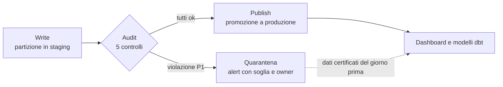

Il job notturno che esporta gli ordini dall'ERP verso il data lake termina alle 03:00 con codice di uscita `0` e scrive regolarmente `dt=2026-11-12/orders.parquet`. L'orchestratore, soddisfatto, avvia i modelli dbt e aggiorna le dashboard. Alle 09:00 l'amministratore delegato apre il report e vede le vendite di ieri crollate dell'82%. Lo scenario è costruito con numeri di esempio, ma ha una dinamica molto comune: una modifica silenziosa sull'ERP ha scartato tutti gli ordini esteri, e nel file sono finite 18.120 righe invece delle consuete 100.000, senza nessun errore tecnico.

## Un job verde che pubblica un crollo finto dell'82 per cento

Per S3 e per l'orchestratore scrivere un file Parquet da 8 MB invece che da 45 MB è un'operazione perfetta: la risposta è `HTTP 200`. Il successo del processo dice che il codice non è andato in crash, non dice nulla sul contenuto. Nello stesso scenario si possono immaginare altri due incidenti silenziosi. Un connettore, per un errore di retry, scrive due volte lo stesso estratto con nomi diversi (`part-01.parquet` e `part-02.parquet`) nella stessa partizione, e i ricavi del giorno si raddoppiano. Un terzo flusso deposita 4.000 file da 12 KB invece di uno compattato, e le query del mattino rallentano senza che nessuno capisca perché.

> **Idea chiave:** un data lake è affidabile solo se ogni partizione viene verificata nel contenuto, non solo nell'esecuzione, prima di diventare visibile agli utenti.

La causa comune dei tre incidenti è l'assenza di un contratto di osservabilità eseguito tra la scrittura su S3 e l'esposizione ai consumatori. La parte restante della lezione costruisce quel contratto: quali controlli, con quali soglie, in quale punto della pipeline e con quale messaggio quando falliscono.

## Cinque controlli e il pattern Write-Audit-Publish

Un sistema industriale di data quality guarda ogni nuova partizione da cinque lati. Il primo è la **freschezza**: non basta che il file esista, serve che sia stato scritto entro la finestra promessa al business, per esempio le 06:30, e che il massimo timestamp di business contenuto dentro i dati, `max(occurred_at)`, arrivi fino a fine giornata. Il secondo è il **volume** rispetto alla storia: righe e megabyte di oggi si confrontano con la media degli ultimi sette giorni, non con una soglia fissa scelta a caso.

Il terzo controllo riguarda la **qualità semantica**: unicità della chiave primaria, percentuale di `NULL` nelle colonne critiche, validità dei domini come importi positivi. Il quarto è la **salute fisica** dei file: numero di oggetti e dimensione media nella partizione, per riconoscere subito il problema dei file piccoli. Il quinto è l'**instradamento degli allarmi**: ogni anomalia deve arrivare a una persona con la diagnosi pronta.

Questi controlli hanno senso solo se bloccano la pubblicazione. Il pattern **Write-Audit-Publish** (scrivi, verifica, pubblica) lo realizza: il job scrive la nuova partizione in un'area isolata, un audit esegue i cinque controlli, e solo se tutti passano la partizione diventa visibile. Con Iceberg l'isolamento si ottiene con un branch o con uno snapshot non ancora promosso; con tabelle Hive si usa un prefisso di staging e una copia verso il prefisso finale.



Il vantaggio è che la dashboard, in caso di blocco, continua a mostrare i dati certificati del giorno prima con un avviso di ritardo, invece di mostrare un crollo inventato.

## Dalla media mobile alla soglia: il calcolo

Il controllo di volume è il più utile e il più frainteso. Serve una baseline, una soglia e una regola di decisione. Prendiamo i numeri di esempio dei sette giorni precedenti al 12 novembre: 99.000, 101.000, 100.000, 102.000, 98.000, 100.000 e 100.000 righe. La soglia scelta dal responsabile del dominio è meno 30% e più 50%.

1. La somma dei sette giorni è 99.000 + 101.000 + 100.000 + 102.000 + 98.000 + 100.000 + 100.000 = 700.000 righe.
2. La media mobile a 7 giorni è 700.000 / 7 = 100.000 righe.
3. L'intervallo accettato va da 100.000 × 0,70 = 70.000 a 100.000 × 1,50 = 150.000 righe.
4. Il 12 novembre il file contiene 18.120 righe. Lo scostamento è (18.120 − 100.000) / 100.000 = −0,8188, cioè −81,9%, molto oltre la soglia del −30%: la partizione viene bloccata.
5. Nel caso del doppio file le righe sono 200.000, quindi lo scostamento è +100%, oltre il +50%: bloccata anche questa. In più le chiavi distinte restano 100.000, e la differenza 200.000 − 100.000 = 100.000 è il numero di chiavi duplicate.
6. Per i file piccoli, 4.000 file da 12 KB pesano 48.000 KB, circa 47 MB, quindi il volume è normale e il controllo di volume non scatta. Apri però 4.000 file con 30 ms di latenza ciascuno: 4.000 × 0,03 = 120 secondi cumulati, circa 7,5 secondi con 16 lettori in parallelo, contro 0,03 secondi per un solo file.

L'ultimo punto spiega perché servono controlli distinti: nessuno dei cinque vede da solo tutti i guasti. Un volume corretto può convivere con duplicati compensati da righe mancanti, e una dimensione media sana può nascondere un filtro sbagliato.

La baseline va scelta con attenzione. Una media su sette giorni assorbe bene le oscillazioni normali, ma si sposta in presenza di stagionalità forte: un lunedì dopo un fine settimana di volumi bassi viene confrontato con una media che include i giorni feriali. In quel caso si affianca il confronto con lo stesso giorno della settimana precedente, oppure si mantiene una soglia diversa per giorno. La soglia, inoltre, va scritta nel repository insieme al nome del responsabile, così che ogni modifica passi da una revisione e nessuno possa allargarla di nascosto per far tacere un allarme fastidioso.

Un secondo aspetto riguarda i falsi allarmi. Una soglia troppo stretta fa suonare l'allerta ogni settimana e le persone smettono di guardarla; una troppo larga lascia passare il crollo del 40% che nessuno nota. Dopo le prime settimane conviene rivedere gli scostamenti registrati e fissare la soglia in modo che gli allarmi veri siano rari e sempre azionabili.

## L'audit sul contenuto con Athena

La query seguente, scritta per Athena su una tabella `curated_sales.orders` partizionata per `dt`, calcola in un'unica passata volume, chiavi duplicate, record invalidi e ore mancanti a fine giornata per le ultime partizioni, e confronta la partizione di ieri con la media mobile dei sette giorni precedenti.

```sql
-- Athena: audit di una partizione contro la media mobile a 7 giorni
WITH daily AS (
    SELECT
        dt,
        count(*)                                         AS row_count,
        count(*) - count(DISTINCT order_id)              AS duplicate_keys,
        count_if(amount_eur <= 0 OR customer_id IS NULL) AS invalid_records,
        max(occurred_at)                                 AS max_event_ts
    FROM curated_sales.orders
    WHERE dt BETWEEN date '2026-11-04' AND date '2026-11-12'
    GROUP BY dt
),
cmp AS (
    SELECT
        dt, row_count, duplicate_keys, invalid_records, max_event_ts,
        avg(row_count) OVER (ORDER BY dt ROWS BETWEEN 7 PRECEDING AND 1 PRECEDING) AS avg_rows_7d
    FROM daily
)
SELECT
    dt,
    row_count,
    round(avg_rows_7d)                                            AS avg_rows_7d,
    round((row_count - avg_rows_7d) * 100.0 / avg_rows_7d, 1)     AS volume_delta_pct,
    duplicate_keys,
    invalid_records,
    date_diff('hour', max_event_ts, CAST(dt AS timestamp) + interval '1' day) AS ore_mancanti
FROM cmp
WHERE dt = date '2026-11-12';
```

La query non decide nulla: restituisce i numeri. La decisione sta in un piccolo programma che li legge, li confronta con le soglie, aggiunge il controllo fisico sui file e produce l'esito per l'orchestratore. Lo script seguente usa boto3 per misurare numero e dimensione degli oggetti della partizione e per costruire il messaggio con severità e responsabile.

```python
# audit_gate.py: decisione bloccante o avviso per una partizione
import sys
import boto3

OBSERVED = {"row_count": 18120, "avg_rows_7d": 100000, "duplicate_keys": 0, "ore_mancanti": 0}
s3 = boto3.client("s3", region_name="eu-central-1")

def partition_files(bucket: str, prefix: str) -> tuple[int, float]:
    # numero di oggetti e dimensione media in MB nel prefisso della partizione
    sizes = []
    for page in s3.get_paginator("list_objects_v2").paginate(Bucket=bucket, Prefix=prefix):
        sizes += [o["Size"] for o in page.get("Contents", [])]
    return len(sizes), (sum(sizes) / len(sizes) / 1048576 if sizes else 0.0)

n_files, avg_mb = partition_files("acme-lake-prod-curated", "sales/orders/dt=2026-11-12/")
delta = (OBSERVED["row_count"] - OBSERVED["avg_rows_7d"]) / OBSERVED["avg_rows_7d"] * 100

alerts = []
if OBSERVED["duplicate_keys"] > 0:
    alerts.append(("P1", "DataEng", f"{OBSERVED['duplicate_keys']} chiavi duplicate"))
if abs(delta) > 30:
    alerts.append(("P1", "Source-ERP", f"volume {OBSERVED['row_count']} vs media 7gg {OBSERVED['avg_rows_7d']} ({delta:+.1f}%)"))
if OBSERVED["ore_mancanti"] > 2:
    alerts.append(("P1", "Source-ERP", f"estrazione tronca, mancano {OBSERVED['ore_mancanti']} ore"))
if n_files > 20 and avg_mb < 10:
    alerts.append(("P2", "Platform", f"{n_files} file, media {avg_mb:.1f} MB: compattare"))

for sev, owner, msg in alerts:
    print(f"{sev} [Owner: {owner}] partizione dt=2026-11-12: {msg}")
sys.exit(1 if any(a[0] == "P1" for a in alerts) else 0)
```

Con questi due pezzi l'incidente del caso iniziale si chiude alle 03:01. Lo script stampa `P1 [Owner: Source-ERP] partizione dt=2026-11-12: volume 18120 vs media 7gg 100000 (-81.9%)` ed esce con codice 1: l'orchestratore non promuove la partizione e non lancia dbt.

## Gate bloccante o avviso: quale controllo ferma la pipeline

Non tutti i controlli devono fermare l'azienda. Un blocco ha un costo: dati in ritardo, utenti che aspettano, qualcuno sveglio alle quattro di notte. Un avviso ha un altro costo: il dato sbagliato arriva comunque a chi decide. La regola è collegare il blocco al danno, non alla fastidiosità del controllo. Se un errore corrompe i totali che la direzione legge, il blocco è giustificato; se degrada soltanto la velocità, un avviso con un responsabile e una scadenza basta e lascia lavorare tutti gli altri.

| Controllo | Esempio di soglia | Azione | Motivo |
|---|---|---|---|
| Chiavi duplicate | più di 0 | Blocca (P1) | Raddoppia i numeri di business |
| Scostamento di volume | oltre ±30% dalla media a 7 giorni | Blocca (P1) | Estrazione troncata o doppia |
| Estrazione tronca | oltre 2 ore mancanti a fine giornata | Blocca (P1) | Dato incompleto per il giorno |
| Valori invalidi | importo minore o uguale a zero | Avviso (P2), blocca sopra 0,1% | Dipende dalla gravità |
| File piccoli | media sotto 10 MB con più di 20 file | Avviso (P2) | Degrada le prestazioni, non i numeri |
| Nuovo codice categoria | non ancora mappato | Avviso (P2) | Non corrompe i totali |

La stessa distinzione si esprime nei test di dbt con la proprietà `severity`: errore per le chiavi, avviso con soglie per le anomalie minori.

```yaml
# models/curated/sales/_orders_quality.yml
version: 2
models:
  - name: orders
    columns:
      - name: order_id
        data_tests:
          - unique:
              config: {severity: error}
          - not_null:
              config: {severity: error}
      - name: amount_eur
        data_tests:
          - dbt_utils.accepted_range:
              min_value: 0.01
              config:
                severity: warn
                warn_if: "> 10"
                error_if: "> 1000"
```

## Tre errori nel monitoraggio della qualità su S3

### Controllare solo che la partizione non sia vuota

Il sintomo è una dashboard con numeri parziali mentre tutti i test risultano verdi. Succede perché `count(*) > 0` sembra un controllo ragionevole e i sistemi sorgente raramente inviano zero righe: più spesso un filtro sbagliato o un timeout a metà paginazione dimezza la giornata. La correzione è confrontare il conteggio con la media mobile e bloccare gli scostamenti oltre la soglia dichiarata.

### Ignorare numero e dimensione dei file

Il sintomo è un rallentamento delle query senza errori di dati. Succede perché tutti i test logici su chiavi e importi passano anche quando le 100.000 righe sono scritte in 5.000 file da pochi kilobyte. La correzione è misurare gli oggetti del prefisso, come nello script, e assegnare al risultato un avviso con azione di compattazione.

### Inviare alert privi di numeri, severità e responsabile

Il sintomo è un messaggio che dice solo `Data Quality Check Failed on table orders`, e diagnosi che richiedono ore. Succede perché emettere il messaggio generico è la via più breve. Un buon alert contiene la regola violata, il valore osservato rispetto all'atteso, la severità e il team responsabile, come la riga stampata dallo script. Se il messaggio non permette di agire senza aprire altri strumenti, è incompleto.

## Controllo del sistema di monitoring

1. Una partizione contiene 74.000 righe e la media dei sette giorni precedenti è 100.000. Con soglia a meno 30%, viene bloccata?

<details>
<summary>Mostra risposta</summary>

Lo scostamento è (74.000 − 100.000) / 100.000 = −26%. È dentro la soglia del −30%, quindi la partizione passa il controllo di volume. Il limite inferiore è 70.000 righe: con 69.000 sarebbe stata bloccata. Se il calo del 26% è insolito per quel giorno della settimana, conviene confrontare anche con lo stesso giorno della settimana precedente.

</details>

2. Il job termina con codice 0 e la partizione ha 100.000 righe, ma `max(occurred_at)` è alle 14:00 invece che a fine giornata. Quale controllo lo intercetta e di quale severità?

<details>
<summary>Mostra risposta</summary>

Lo intercetta il controllo di freschezza sul timestamp di business: mancano circa 10 ore, oltre la soglia di 2. È un P1 bloccante, perché la giornata è incompleta anche se il volume totale non è anomalo, magari per un'estrazione che ha ripreso parte del giorno precedente.

</details>

3. Una partizione di 600 MB è scritta in 3.000 file. Quanto vale la dimensione media e il controllo blocca o avvisa?

<details>
<summary>Mostra risposta</summary>

La media è 600 / 3.000 = 0,2 MB, cioè circa 200 KB, molto sotto i 10 MB con più di 20 file. È un avviso P2: i numeri di business non sono sbagliati, ma ogni query apre 3.000 oggetti. L'azione è pianificare la compattazione verso file da circa 256 MB, che porterebbero la partizione a 3 file.

</details>

4. Perché un job con exit code 0 non basta come prova che i dati sono corretti?

<details>
<summary>Mostra risposta</summary>

Perché il codice di uscita misura se il programma è arrivato in fondo senza eccezioni, non che cosa ha scritto. Un filtro errato, un connettore che scrive due volte o un'estrazione troncata producono file validi e risposte `HTTP 200`. Solo i controlli sul contenuto, eseguiti prima della pubblicazione, distinguono un dato corretto da uno semplicemente scritto.

</details>
