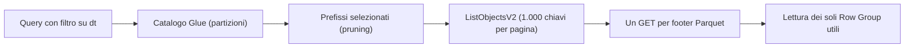

Un data engineer deve velocizzare le query su una tabella di eventi marketing da 15 GB al giorno e decide di partizionarla per `dt`, `country`, `device` e `campaign_id`. Un mese dopo il bucket contiene 4,2 milioni di file Parquet, e una query sull'ultima settimana passa quasi tutto il tempo a elencare prefissi e ad aprire connessioni prima di leggere un solo byte utile. Questo è uno scenario costruito con numeri di esempio, ma riproduce un errore che si incontra spesso: la dimensione della tabella non c'entra, il guasto nasce da come le cartelle sono state tagliate.

## Quattro milioni di file da 107 KB e una settimana di query

La tabella cresce di 15 GB al giorno in Parquet compresso, quindi circa 450 GB al mese. Il team ragiona così: più colonne metto nel percorso, meno dati dovrà leggere il motore. Il percorso diventa `dt=2026-11-12/country=IT/device=iOS/campaign_id=8841/`, e ogni combinazione di valori produce almeno un file.

Con 40 paesi, 4 dispositivi e 900 campagne attive le combinazioni teoriche per giorno sono 144.000. Non tutte si popolano, e il conteggio reale dopo un mese è di 4,2 milioni di file, cioè circa 140.000 al giorno. Dividendo 450 GB per 4,2 milioni di file si ottiene un peso medio di circa 107 KB: molto meno della soglia sotto cui un oggetto S3 diventa antieconomico da leggere.

Un analista chiede gli eventi degli ultimi 7 giorni senza filtrare per campagna. Il motore deve ricavare dal catalogo oltre 980.000 file (140.000 × 7) e per ciascuno pagare una richiesta HTTP e un footer Parquet da leggere. La latenza fissa di un GET su S3 è dell'ordine di 30 ms. Eseguite in serie, 980.000 richieste da 30 ms sono 29.400 secondi; con 200 richieste in parallelo restano circa 147 secondi, quasi due minuti e mezzo, solo di latenza. I dati utili sono pochi gigabyte, ma il tempo se ne va nel numero degli oggetti.

> **Idea chiave:** su un object storage il costo di una query dipende dal numero di file aperti quanto dai byte letti, quindi le cartelle servono a tagliare il tempo in fette grandi, e i filtri secondari si risolvono dentro il file.

## Come una partizione diventa richieste HTTP

Una partizione in stile Hive è soltanto una convenzione sui nomi degli oggetti: `dt=2026-11-12/` è un prefisso, non una struttura dati. Quando il motore riceve la query, il coordinatore consulta il catalogo (per esempio AWS Glue Data Catalog), individua i prefissi compatibili con il `WHERE` e per ogni prefisso elenca gli oggetti con `ListObjectsV2`, che restituisce al massimo 1.000 chiavi per pagina. Poi distribuisce i file ai worker, che leggono il footer Parquet e solo dopo i Row Group necessari.



Il pruning, cioè lo scarto dei prefissi che non servono, avviene prima del primo `LIST`, ed è il risparmio più economico possibile. Ma ogni livello di partizione moltiplica il numero di prefissi. Il numero di file è, nel caso peggiore, il prodotto delle cardinalità delle colonne di partizione moltiplicato per il numero di scritture per prefisso, e per questo l'aggiunta di una colonna come `campaign_id` o `user_id` fa crescere il conteggio di ordini di grandezza.

Tre regole pratiche discendono da qui. La chiave deve comparire nel `WHERE` della grande maggioranza delle query, altrimenti il pruning non scatta. Deve avere bassa cardinalità, e per le tabelle di eventi è quasi sempre una granularità temporale. Deve infine produrre file abbastanza grandi: nel dimensionamento usiamo come riferimento 128-512 MB per file Parquet, valore che bilancia il parallelismo del motore con il costo fisso di ogni richiesta.

## Dimensionare la partizione partendo dalla crescita giornaliera

La granularità temporale non si sceglie per abitudine ma con un calcolo. Si parte dalla crescita giornaliera della tabella in Parquet compresso, si divide per la dimensione obiettivo del file e si controlla che il risultato abbia senso.

Riprendiamo la tabella da 15 GB al giorno e fissiamo un obiettivo di 256 MB per file. Esempio numerico svolto, con arrotondamento per eccesso:

1. Crescita giornaliera: 15 GB × 1.000 = 15.000 MB al giorno.
2. File per partizione giornaliera: 15.000 MB / 256 MB = 58,6, quindi 59 file al giorno.
3. File sulla finestra di 7 giorni: 59 × 7 = 413 file, contro i 980.000 dello schema a quattro colonne.
4. Latenza fissa con 200 richieste in parallelo: 413 × 30 ms = 12,4 secondi in serie, cioè meno di 0,1 secondi con 200 richieste in parallelo.
5. Costo di richieste GET, con un prezzo indicativo di listino di 0,0004 USD ogni 1.000 richieste (verifica la tariffa della tua regione): lo schema a quattro colonne costa 980.000 / 1.000 × 0,0004 = 0,39 USD a query, lo schema giornaliero 413 / 1.000 × 0,0004 = 0,00017 USD.

Con 100 query al giorno la differenza è 39 USD contro 1,7 centesimi di dollaro, solo di richieste, senza contare il tempo. Il rapporto tra i due schemi è 980.000 / 413, circa 2.373 volte.

Lo stesso calcolo vale al contrario per le tabelle piccole. Una tabella di anagrafica fatture che cresce di 20 MB al giorno, partizionata per giorno, produce un file da 20 MB al giorno, sotto la soglia di 128 MB. Si ottiene un file adeguato aggregando per periodo: 128 MB / 20 MB al giorno = 6,4 giorni, quindi la granularità giusta è la settimana o il mese (20 MB × 30 = 600 MB al mese, file in linea con l'obiettivo). Partizionare la stessa tabella per ora produrrebbe 8.760 file da meno di 1 MB all'anno.

La regola riassuntiva: sotto circa 4 GB al mese si partiziona per mese, tra 4 GB e 400 GB al mese per giorno, e solo oltre qualche centinaio di GB al giorno ha senso scendere all'ora. Sono soglie ricavate dal vincolo dei 128 MB per file e vanno ricalcolate se cambia il formato o la compressione.

## Ordinare dentro il file invece di annidare cartelle

Quando si rinuncia a `country` e `campaign_id` come cartelle, resta il problema di filtrare per queste colonne. La soluzione è ordinare le righe prima di scrivere il file. Ogni Row Group Parquet registra nel footer il valore minimo e massimo di ogni colonna; se le righe sono ordinate per `country`, i Row Group di un solo paese hanno un intervallo `[min, max]` stretto e il motore può scartare gli altri senza leggerli. Se invece le righe sono mescolate, ogni Row Group contiene tutti i paesi, gli intervalli coprono l'intero alfabeto e le statistiche non escludono nulla.

La scrittura si fa con un job Spark che partiziona per `dt` e ordina dentro ogni file. Il codice seguente è un job PySpark completo:

```python
# Compattazione giornaliera: legge i micro-file della zona raw e scrive Parquet ordinato
from pyspark.sql import SparkSession

spark = SparkSession.builder.appName("compact-marketing-events").getOrCreate()

day = "2026-11-12"
src = f"s3://acme-lake-prod/raw/marketing_events/ingested_date={day}/"
dst = "s3://acme-lake-prod/curated/marketing_events/"

df = spark.read.parquet(src)

# 59 file da circa 256 MB: 15.000 MB / 256 MB = 58,6 arrotondato per eccesso
n_files = 59

(
    df.repartitionByRange(n_files, "country", "device", "campaign_id")
      .sortWithinPartitions("country", "device", "campaign_id")
      .write.mode("overwrite")
      .option("compression", "zstd")
      .option("parquet.block.size", 128 * 1024 * 1024)
      .partitionBy("dt")
      .parquet(dst)
)
```

Nel codice `repartitionByRange` suddivide i dati in intervalli contigui di `country`, `device` e `campaign_id`, e `sortWithinPartitions` ordina le righe dentro ciascun file. Il risultato è che una query su `country = 'IT' AND device = 'iOS'` apre i 59 file del giorno, legge i footer, e scarica solo i Row Group in cui l'intervallo include `IT` e `iOS`. Nessuna cartella aggiuntiva è stata creata.

Il limite dell'ordinamento è che privilegia le prime colonne della lista. Per `campaign_id`, in terza posizione, il beneficio dipende da quanto le prime due colonne spezzano i dati. Se le query filtrano di frequente per `campaign_id` da solo, sulle colonne ad alta cardinalità conviene aggiungere i Bloom filter Parquet, di cui parla la lezione sulle prestazioni.

## Audit di una tabella esistente dalla riga di comando

Prima di cambiare schema si misura lo stato attuale. Il comando `aws s3 ls` con `--summarize` conta oggetti e byte di un prefisso, e basta un piccolo calcolo per ottenere il peso medio dei file:

```bash
# Conta file e byte di un giorno di dati e calcola il peso medio per file
PREFIX="s3://acme-lake-prod/curated/marketing_events/dt=2026-11-12/"

aws s3 ls "$PREFIX" --recursive --summarize | tail -n 2 > /tmp/summary.txt
OBJS=$(grep "Total Objects" /tmp/summary.txt | awk '{print $3}')
BYTES=$(grep "Total Size" /tmp/summary.txt | awk '{print $3}')

# Peso medio in KB: byte / oggetti / 1024
echo "oggetti: $OBJS  peso medio KB: $((BYTES / OBJS / 1024))"

# Un valore sotto 51200 (50 MB) segnala un problema di piccoli file
```

Il confronto con la soglia lavora sui dati reali: sullo schema a quattro colonne il comando riporta circa 140.000 oggetti per giorno e un peso medio di 107 KB; dopo la compattazione, 59 oggetti con peso medio di circa 254 MB (15.000 MB / 59). Lo scan ratio, cioè la frazione dei byte della tabella letta da una query tipica, completa l'audit: una query settimanale su una tabella annuale ben partizionata per data legge circa 7/365, cioè il 1,9% dei file, prima ancora di contare lo skipping dei Row Group.

Il caso del flusso in streaming merita un passaggio a parte. Se un consumer scrive su S3 ogni 5 minuti, nascono 288 batch al giorno (24 × 60 / 5), e 15.000 MB / 288 = 52 MB per file: già sotto l'obiettivo, e la situazione peggiora se il carico è diviso tra più partizioni Kafka, perché ogni scrittore produce il proprio file. La compattazione notturna del giorno precedente, come nel job PySpark sopra, riporta il giorno a 59 file.

## Data di evento o data di ingestione

Su una tabella di eventi esistono due colonne temporali candidate: `event_date`, il momento in cui il fatto è accaduto, e `ingested_date`, il momento in cui il record è arrivato nel lake. La scelta dipende dalla zona del lake.

Nella zona `raw` conviene partizionare per `ingested_date`. Ogni batch scrive in append nella cartella di oggi senza mai riaprire i giorni passati, anche quando arrivano eventi in ritardo. Nelle zone `curated` e `analytics` conviene `event_date`, perché le dashboard e le domande dei manager riguardano quando è avvenuto l'ordine o il clic.

Un esempio numerico spiega il costo del passaggio. Supponiamo che il 2% degli eventi arrivi con un giorno di ritardo: 15.000 MB × 2% = 300 MB di eventi tardivi al giorno. Se la zona curated è partizionata per data di evento, ogni notte il job deve ricalcolare una finestra mobile e non solo il giorno corrente. Con una finestra di 3 giorni si riscrivono 15 GB × 3 = 45 GB al giorno, ma si ottiene che gli ordini del 10 novembre incluso quelli arrivati alle 00:05 dell'11 siano tutti nella partizione `dt=2026-11-10`. Con `ingested_date` anche sulla zona curated si evita la riscrittura, ma una query su `event_date = '2026-11-10'` non trova gli ordini delle 23:58 caricati dopo la mezzanotte, oppure deve scansionare l'intero lake.

Il compromesso è quindi tra costo di riscrittura e completezza dei numeri. Per le tabelle di analisi la completezza vince, e la finestra mobile va dimensionata sulla coda reale del ritardo: se il 99,9% degli eventi arriva entro 3 giorni, 3 giorni bastano. Le tabelle Iceberg trattano questo problema con la partizione nascosta e l'evoluzione della partizione, argomento della lezione dedicata.

## Tre errori che polverizzano la tabella

### Partizionare su colonne ad alta cardinalità

Il sintomo è un conteggio di file che cresce più della tabella e query lente su filtri che non riguardano la colonna di partizione. Sembra ragionevole perché `user_id` o `campaign_id` compaiono in molte query, e si pensa che una cartella per valore elimini i dati inutili. Il motivo del guasto è che ogni valore distinto è un prefisso e ogni prefisso contiene almeno un file: con 900 campagne, 40 paesi e 4 dispositivi, il numero di combinazioni è 900 × 40 × 4 = 144.000 al giorno. La correzione è tenere solo la data come cartella, ordinare per le altre colonne dentro il file e, se serve la ricerca puntuale, aggiungere Bloom filter.

### Scegliere una granularità più fine di quanto la crescita consenta

Il sintomo è un'enorme quantità di file piccoli su una tabella modesta. Sembra ragionevole perché la partizione oraria è un default di molti esempi e dà l'impressione di query più veloci. La causa è l'assenza del calcolo: se la tabella cresce di 20 MB al giorno, ogni ora produce meno di 1 MB. Si corregge con la formula del paragrafo sul dimensionamento: dividere la crescita per l'obiettivo di 128 MB e arrotondare la granularità verso l'alto, ad esempio a mese.

### Avvolgere la colonna di partizione in una funzione

Il sintomo è una query su un mese che scansiona tutto lo storico, con un costo uguale a quello di una query senza filtro. Il codice sembra corretto perché il filtro c'è, ad esempio `WHERE date_format(dt, '%Y-%m') = '2026-11'`. Il motivo è che il motore deve valutare la funzione per ogni partizione, quindi non può decidere dai soli metadati quali prefissi escludere. La correzione è esprimere il filtro come confronto diretto sulla colonna:

```sql
-- Athena/Trino: confronto diretto su dt, il pruning scarta i prefissi fuori intervallo
SELECT campaign_id,
       count(*)        AS conversioni,
       sum(revenue_eur) AS ricavo_totale_eur
FROM acme_lake.marketing_events
WHERE dt >= DATE '2026-11-01'
  AND dt <  DATE '2026-12-01'
  AND country = 'IT'
  AND device  = 'iOS'
GROUP BY campaign_id
ORDER BY ricavo_totale_eur DESC;
```

Il filtro su `dt` seleziona i prefissi del mese, mentre `country` e `device` sfruttano le statistiche dei Row Group scritti in ordine dal job PySpark. Il costo di una query di questo tipo su 450 GB mensili dipende dalla selettività, ma i file aperti restano 59 × 30 = 1.770, non milioni.

## Controllo prima di fissare la chiave di partizione

1. Una tabella cresce di 6 GB al giorno in Parquet compresso e il tuo obiettivo è un file da 256 MB: quanti file produce una partizione giornaliera, e la granularità è adeguata?

<details>
<summary>Mostra risposta</summary>

6 GB × 1.000 = 6.000 MB al giorno. 6.000 / 256 = 23,4, cioè 24 file al giorno, ciascuno di circa 250 MB. La granularità giornaliera è adeguata: i file sono sopra la soglia minima di 128 MB e non troppo numerosi. Scendere all'ora darebbe 250 MB / 24 = circa 10 MB per file, troppo piccoli.

</details>

2. Una query settimanale su una tabella annuale partizionata per giorno legge il 12% dei byte totali. Il pruning funziona?

<details>
<summary>Mostra risposta</summary>

No. Sette partizioni su 365 corrispondono a 7 / 365 = 1,9% dei byte, prima dello skipping dei Row Group. Un 12% indica che il filtro non è riconosciuto dal motore, per esempio perché la colonna di partizione è avvolta in una funzione, oppure che la query non filtra la colonna di partizione e legge molti giorni.

</details>

3. Perché partizionare la zona raw per `ingested_date` e la zona curated per `event_date`?

<details>
<summary>Mostra risposta</summary>

In raw ogni batch scrive in append nella cartella del giorno corrente e non riapre mai i giorni passati, anche con eventi in ritardo. In curated le query degli analisti filtrano per quando l'evento è avvenuto; la partizione per `event_date` evita scansioni complete, al prezzo di riscrivere una finestra mobile di giorni per includere gli eventi tardivi.

</details>

4. Un consumer scrive su S3 ogni 10 minuti 20 GB al giorno. Quanti file nascono per giorno, quanto pesano in media e che cosa fai?

<details>
<summary>Mostra risposta</summary>

Ci sono 24 × 60 / 10 = 144 scritture al giorno. 20.000 MB / 144 = circa 139 MB per file, già dentro la fascia 128-512 MB, quindi la compattazione è meno urgente, ma resta utile se più scrittori in parallelo moltiplicano i file per batch. Si misura con `aws s3 ls --summarize` e si compatta solo se il peso medio scende sotto circa 50 MB.

</details>
