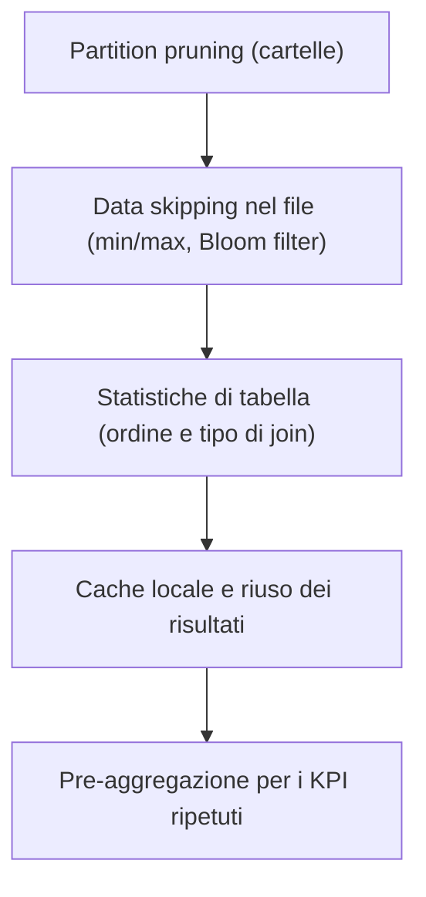

Una query unisce una tabella di fatti da 800 milioni di righe a tre tabelle dimensionali e filtra per un singolo indirizzo email. Impiega 95 secondi e legge 180 GB, a ogni esecuzione, benché i file siano già Parquet e partizionati per mese. Questo è uno scenario costruito con numeri di esempio: il guasto che racconta si incontra spesso quando ci si ferma al partizionamento delle cartelle e si trascura che cosa succede dentro i file.

## Novantacinque secondi su una tabella già Parquet

Il dataset delle transazioni del mese pesa 180 GB compressi. L'analista lancia una query con filtro su `customer_email` e su `country_code`, più i join con l'anagrafica punti vendita e con l'anagrafica contratti. L'analisi del piano con `EXPLAIN ANALYZE` mostra tre colli di bottiglia.

Il primo riguarda i dati: le righe sono scritte nell'ordine in cui arrivano, quindi ogni Row Group contiene email di tutto l'alfabeto. Nel footer del file il minimo di `customer_email` è un valore che comincia per `a` e il massimo uno che comincia per `z`, per ogni Row Group di ogni file. Le statistiche min/max non escludono nulla e il motore scarica l'intera colonna dai 700 e più file del mese.

Il secondo riguarda il catalogo: non esistono statistiche di cardinalità sulle tabelle, quindi l'ottimizzatore dei join non sa quale tabella è piccola. Sceglie un join con ridistribuzione sulla rete di tutte le 800 milioni di righe, invece del broadcast di una dimensione di poche migliaia di righe.

Il terzo è la ripetizione: la stessa query rilanciata due minuti dopo riscarica i 180 GB, perché nessuna cache conserva i blocchi già letti.

> **Idea chiave:** dopo il partition pruning i byte letti si abbattono con quattro leve distinte, ordinamento interno dei file, statistiche per il join, cache e pre-aggregazione, e si verifica ciascuna misurando i MB scansionati prima e dopo.

## Le quattro leve dopo il pruning

Il pruning delle partizioni toglie le cartelle fuori intervallo, ma dentro la cartella resta molto da fare. Le quattro leve operano su livelli fisici diversi e vanno applicate in ordine, perché ognuna riduce il lavoro su cui agisce la successiva.



Il data skipping nel file dipende da come i dati sono scritti. Un file di 256 MB con Row Group da 128 MB espone due intervalli min/max per colonna: se i dati sono ordinati per `country_code` e poi per `customer_email`, quegli intervalli sono stretti e disgiunti tra Row Group diversi. Il motore legge il footer con una richiesta HTTP di tipo Range, confronta il valore cercato con gli intervalli e scarica solo i Row Group che possono contenerlo.

Le statistiche di tabella servono al Cost-Based Optimizer, il componente che decide l'ordine dei join e se una tabella va replicata su tutti i worker (broadcast) o se entrambe vanno ridistribuite per chiave. Senza numero di righe e valori distinti, il CBO ripiega su euristiche, e con tabelle grandi l'euristica sbaglia di ordini di grandezza.

La cache e il riuso dei risultati azzerano la rilettura delle stesse informazioni. La pre-aggregazione, infine, evita di ricalcolare ogni volta le stesse metriche su miliardi di righe quando una dashboard chiede sempre i totali per paese e giorno.

## Ordinare i dati e controllare i Row Group con PyArrow

Il controllo più rapido sulla qualità dell'ordinamento è leggere le statistiche dei Row Group di un file campione. Il blocco seguente scrive un file ordinato e stampa, per ogni Row Group, minimo e massimo della colonna di filtro:

```python
# Scrive un campione ordinato e verifica che i Row Group abbiano intervalli disgiunti
import pyarrow.parquet as pq

table = pq.read_table("orders_sample.parquet")

# Ordinamento per le colonne di filtro più selettive, nello stesso ordine del WHERE
table = table.sort_by([("country_code", "ascending"), ("customer_email", "ascending")])

pq.write_table(
    table,
    "orders_sorted.parquet",
    compression="zstd",
    row_group_size=500_000,
    write_statistics=True,
)

meta = pq.ParquetFile("orders_sorted.parquet").metadata
names = [meta.schema.column(i).name for i in range(meta.num_columns)]
col = names.index("country_code")

for i in range(meta.num_row_groups):
    stats = meta.row_group(i).column(col).statistics
    # Intervalli disgiunti tra gruppi consecutivi significa skipping efficace
    print(i, stats.min, stats.max)
```

Se l'output mostra, per esempio, il Row Group 0 con intervallo `AT..DE`, il Row Group 1 con `DE..FR` e il Row Group 5 con `IT..IT`, una query con `country_code = 'IT'` scarta quasi tutti i gruppi. Se invece ogni riga stampa `AT US`, le statistiche non servono a niente e l'ordinamento va rifatto.

Le colonne ad alta cardinalità che non stanno ai primi posti dell'ordinamento, come `order_id` o `trace_id`, hanno intervalli ampi anche nei dati ordinati. Per queste i Bloom filter Parquet aggiungono nel footer una struttura compatta che può dire con certezza che un valore non è presente in un blocco. Con Spark si attivano per colonna con l'opzione di scrittura `parquet.bloom.filter.enabled#customer_email`. Un Bloom filter può dare falsi positivi, ma non falsi negativi: nel peggiore dei casi si legge un blocco in più, non si perde una riga.

## Quanti MB legge davvero la query, prima e dopo

Esempio numerico svolto sulla tabella del mese, con 1 TB pari a 1.000 GB per semplicità e un prezzo indicativo di 5 USD per TB scansionato (verifica il listino della tua regione):

1. Prima: la query legge 180 GB, quindi il costo è 180 / 1.000 × 5 = 0,90 USD per esecuzione. Con una dashboard che la lancia 400 volte al mese si arriva a 400 × 0,90 = 360 USD.
2. File della tabella dopo la riscrittura: 180.000 MB / 256 MB = 703 file, ciascuno con 2 Row Group da 128 MB, per un totale di 1.406 Row Group.
3. Footer da leggere: il motore legge un footer per file, supponiamo 0,2 MB ciascuno, quindi 703 × 0,2 MB = 140,6 MB.
4. Row Group da scaricare: con dati ordinati per `country_code` e `customer_email` la ricerca dell'email di un cliente italiano cade in 1 Row Group da 128 MB.
5. Totale letto: 140,6 MB + 128 MB = 268,6 MB, cioè 0,2686 GB.
6. Costo dopo: 0,2686 / 1.000 × 5 = 0,00134 USD per esecuzione, e 400 × 0,00134 = 0,54 USD al mese.

La riduzione dei byte è 1 − 268,6 / 180.000 = 99,85%. Va notato che i 140,6 MB dei footer pesano più del Row Group utile: oltre un certo numero di file il costo dei metadati domina, ed è la ragione per cui la dimensione dei file non va ridotta sotto i 128 MB nemmeno per migliorare lo skipping. I tempi vanno sempre misurati sul proprio motore; a questa scala il lavoro si riduce a una lettura di poche centinaia di MB, che in genere si chiude in pochi secondi anche su un motore serverless.

## Statistiche di tabella e scelta del join

Per il secondo collo di bottiglia, Athena usa le statistiche di colonna del Glue Data Catalog. Si generano con un task di Glue, avviabile da riga di comando:

```bash
# Avvia il calcolo delle statistiche di colonna su una tabella Glue
aws glue start-column-statistics-task-run \
  --database-name acme_lake \
  --table-name orders_sorted \
  --role arn:aws:iam::123456789012:role/GlueColumnStatsRole \
  --sample-size 100

# Controlla l'esito del task
aws glue get-column-statistics-task-runs \
  --database-name acme_lake \
  --table-name orders_sorted \
  --max-results 1
```

Su Trino con connettore Hive o Iceberg il comando equivalente è `ANALYZE acme_lake.orders_sorted`. Le statistiche vanno rigenerate dopo ogni carico importante, altrimenti il CBO lavora su una fotografia vecchia.

Il vantaggio si calcola. Supponiamo che la query proietti 40 byte per riga dalla tabella dei fatti e che la dimensione punti vendita abbia 50.000 righe da 200 byte, su un cluster di 8 worker. Con la ridistribuzione di entrambe le tabelle, la tabella dei fatti attraversa la rete: 800.000.000 righe × 40 byte = 32.000 MB. Con il broadcast, la dimensione viene copiata su ogni worker: 50.000 × 200 byte = 10 MB, per 8 worker pari a 80 MB. Il rapporto è 32.000 / 80 = 400 volte meno traffico di rete. Senza statistiche il CBO non sa che la dimensione è piccola e sceglie la strada da 32 GB, spesso fermandosi con l'errore di memoria superata.

## Cache locale, riuso dei risultati e pre-aggregazioni

Per le dashboard, il terzo livello è non rifare ciò che è già stato fatto. In Athena si può chiedere il riuso dei risultati di un'esecuzione recente, con un'età massima:

```bash
# Esegue la query riusando il risultato di una esecuzione identica degli ultimi 60 minuti
aws athena start-query-execution \
  --query-string "SELECT country_code, count(*) AS ordini FROM acme_lake.orders_sorted WHERE dt = DATE '2026-11-16' GROUP BY country_code" \
  --work-group dashboard-bi \
  --result-reuse-configuration "ResultReuseByAgeConfiguration={Enabled=true,MaxAgeInMinutes=60}"
```

Un'esecuzione che riusa un risultato non scansiona dati e quindi non costa per i byte. Su Trino gestito in proprio la cache del filesystem si abilita nelle proprietà del catalogo (`fs.cache.enabled=true` e `fs.cache.directories` puntato al disco NVMe locale): i blocchi letti da S3 restano sul nodo e la seconda lettura avviene dal disco locale.

Per le metriche ripetitive la pre-aggregazione è più efficace del cache. Una tabella giornaliera di KPI si costruisce con una CTAS:

```sql
-- Athena: tabella di KPI giornaliera, la colonna di partizione dt va in coda al SELECT
CREATE TABLE acme_lake.orders_daily_kpi
WITH (
    format = 'PARQUET',
    write_compression = 'ZSTD',
    external_location = 's3://acme-lake-prod/curated/orders_daily_kpi/',
    partitioned_by = ARRAY['dt']
) AS
SELECT
    country_code,
    count(*)        AS ordini,
    sum(amount_eur) AS ricavo_eur,
    CAST(date(occurred_at) AS date) AS dt
FROM acme_lake.orders_sorted
GROUP BY country_code, CAST(date(occurred_at) AS date);
```

Con 20 paesi e 365 giorni la tabella ha circa 7.300 righe: la dashboard legge kilobyte invece di gigabyte, e il costo del ricalcolo si paga una sola volta per giorno.

## Ordinamento lineare o Z-order

Se quasi tutte le query includono la stessa colonna di testa, per esempio `tenant_id` o `country_code`, l'ordinamento lineare `ORDER BY col1, col2` è la scelta giusta: le statistiche di `col1` sono strettissime e quelle di `col2` lo sono dentro ciascun valore di `col1`. Il limite è che le query che filtrano solo per `col2` non traggono beneficio, perché `col2` è ordinata solo all'interno di ogni `col1`.

Lo Z-order, disponibile su Delta Lake e come funzione di riscrittura su Iceberg, interlaccia i bit di più colonne e tiene vicine nello spazio le righe simili su tutte. Conviene quando due o tre colonne vengono filtrate in modo indipendente, per esempio `customer_id` in alcune query e `product_id` in altre. Oltre le tre o quattro colonne la risoluzione per dimensione si riduce e il beneficio crolla, mentre il costo di riscrittura rimane. Per le ricerche puntuali sulle colonne restanti, un ordinamento sulle due principali più Bloom filter sulle altre è di solito la combinazione più semplice da mantenere.

## Tre errori che annullano le ottimizzazioni

### Convertire in Parquet senza ordinare

Il sintomo è una tabella Parquet piccola ma lenta quanto il CSV di partenza sulle query selettive. Sembra ragionevole perché Parquet è colonnare e la conversione sembra già sufficiente. La causa è che senza `ORDER BY` ogni Row Group contiene valori sparsi di ogni colonna, quindi min/max non scartano niente. La correzione è riscrivere con ordinamento sulle colonne di filtro e verificare le statistiche con lo script PyArrow visto sopra.

### Non rigenerare le statistiche dopo il caricamento

Il sintomo è un join che prima funzionava e dopo un grosso backfill va in errore di memoria o diventa dieci volte più lento. La causa è che il catalogo contiene numeri di righe e cardinalità del vecchio stato della tabella, e il CBO sceglie un piano adatto a una tabella che non esiste più. La correzione è inserire la rigenerazione delle statistiche nel job di caricamento, subito dopo la scrittura delle partizioni.

### Rileggere ogni volta i dati caldi

Il sintomo è una dashboard con latenza mediana alta e costo proporzionale al numero di utenti. Sembra normale perché ogni utente esegue la sua query. La causa è l'assenza di cache e di riuso dei risultati: le stesse partizioni degli ultimi 7 giorni vengono scaricate decine di volte. La correzione combina riuso dei risultati con età di 15-60 minuti per i report identici e tabelle pre-aggregate per i KPI fissi.

## Controllo sulla query lenta

1. Una query legge 90 GB a 5 USD per TB: quanto costa, e quanto costerebbe dopo una riduzione del 99,5% dei byte?

<details>
<summary>Mostra risposta</summary>

Prima: 90 / 1.000 × 5 = 0,45 USD. Dopo: i byte scendono a 90 GB × 0,5% = 0,45 GB, e il costo è 0,45 / 1.000 × 5 = 0,00225 USD, circa un quinto di centesimo.

</details>

2. Dopo la riscrittura i file sono 703 con footer da 0,2 MB: perché ridurre i file a 64 MB non migliora necessariamente la query?

<details>
<summary>Mostra risposta</summary>

Con file da 64 MB il numero di file raddoppia, circa 1.406, e i footer passano da 703 × 0,2 = 140,6 MB a 1.406 × 0,2 = 281,2 MB. Si legge più metadato e si aprono più oggetti, mentre lo skipping non migliora in modo corrispondente.

</details>

3. Come verifichi che l'ordinamento abbia prodotto statistiche utili sulla colonna `country_code`?

<details>
<summary>Mostra risposta</summary>

Si legge il footer di un file campione con PyArrow e si stampano minimo e massimo per ogni Row Group. Se gli intervalli di Row Group consecutivi sono disgiunti o quasi, lo skipping funziona. Se ogni gruppo copre l'intero intervallo, l'ordinamento non è stato applicato o non è sulla colonna giusta.

</details>

4. Un join tra 800 milioni di righe da 40 byte e una dimensione da 10 MB su 8 worker: quanti MB attraversano la rete con la ridistribuzione e quanti con il broadcast?

<details>
<summary>Mostra risposta</summary>

Con la ridistribuzione passa la tabella dei fatti: 800.000.000 × 40 byte = 32.000 MB. Con il broadcast la dimensione va a ogni worker: 10 MB × 8 = 80 MB. La differenza è di 400 volte, ed è il motivo per cui le statistiche vanno mantenute aggiornate.

</details>
