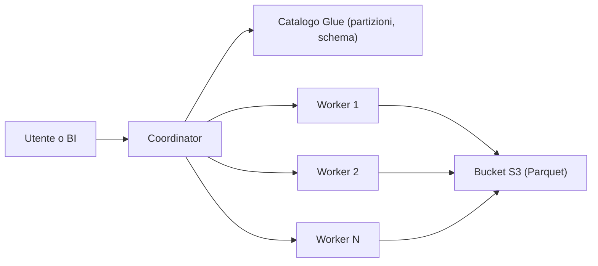

Una dashboard aziendale usata da 60 persone è collegata ad Amazon Athena sopra una tabella da 4 TB di log in JSON non compresso. Ogni volta che qualcuno cambia un filtro, lo strumento di BI esegue `SELECT *`. A fine mese la fattura di sola scansione è di 14.000 USD e il lunedì mattina le query restano in coda. Questo è uno scenario costruito con numeri di esempio: il prezzo di listino non è il colpevole, il guasto sta nell'abbinare un motore a consumo, che fattura i byte letti, a file orientati alle righe e a una dashboard che rilancia la stessa scansione centinaia di volte.

## Quattordicimila dollari per rileggere sempre gli stessi dati

I log applicativi e gli eventi di vendita di un anno occupano 4 TB in JSON su S3. Athena fattura circa 5 USD per ogni TB letto, quindi una scansione completa costa 4 × 5 = 20 USD. La dashboard produce 700 esecuzioni al mese: 60 utenti che la aprono e la aggiornano circa 35 volte ciascuno non sono 700, ma il ragionamento del team era quello di una media prudente per il report principale. Con questi numeri la spesa è 700 × 20 = 14.000 USD, per interrogare ogni volta gli stessi dati.

Nessuna query contiene un filtro sulla chiave di partizione, e il formato JSON per riga obbliga a leggere tutte le 80 colonne anche se il grafico ne usa tre. Il lunedì alle 09:30, quando 25 utenti lanciano i report insieme, le query superano la quota di esecuzioni attive per l'account e regione e finiscono in coda.

I rimedi sono due e indipendenti. Il primo riguarda i dati: Parquet compresso, partizionato per data e letto per sole colonne, riduce di oltre il 99% i byte. Il secondo riguarda il motore: un carico ripetitivo ad alta concorrenza ha un costo diverso su un motore a consumo e su uno dedicato, e conviene calcolare dove si incrociano.

> **Idea chiave:** su S3 non si paga la complessità della query, si pagano i byte che escono dal bucket, quindi ogni scelta di formato, partizione e colonne va giudicata dai gigabyte scansionati.

## Un motore MPP separato dallo storage

Athena, Trino, Presto e Redshift Spectrum seguono lo stesso schema: i nodi di calcolo sono separati dallo storage, che resta su S3. Athena è Trino gestito da AWS in modalità serverless; Presto e Trino sono lo stesso progetto prima e dopo la separazione della comunità. Quando arriva una query, il coordinatore interroga il catalogo (AWS Glue Data Catalog o Hive Metastore) per sapere in quali prefissi risiedono le partizioni richieste, divide i file in porzioni chiamate split e le assegna ai worker, che scaricano i byte da S3 in parallelo direttamente in memoria.



Con Parquet entrano in gioco due ottimizzazioni che riducono i byte trasferiti. La proiezione di colonna legge solo le colonne indicate nel `SELECT` e nei filtri, perché in Parquet ogni colonna è un blocco fisico distinto. Il predicate pushdown confronta i filtri con le statistiche min/max dei Row Group e salta i blocchi che non possono contenere righe valide.

Il terzo meccanismo è la governance dei costi. In Athena ogni team o applicazione va isolato in un workgroup con un tetto di byte per singola query: chi dimentica il filtro sulla partizione viene fermato prima di pagare l'intera scansione.

## Il modello di costo come prodotto di fattori

I byte letti sono il prodotto del volume della tabella per quattro riduzioni indipendenti: la frazione di partizioni che il filtro seleziona, la frazione di colonne richieste, il rapporto di compressione del formato e la frazione di Row Group non scartati. Esempio numerico svolto, con 1 TB pari a 1.000 GB per semplicità:

1. Formato: i 4 TB di JSON (4.000 GB) convertiti in Parquet compresso con `zstd` scendono a 600 GB, circa il 15% del volume originale.
2. Partizioni: con partizione mensile e un filtro su un solo mese si leggono 600 / 12 = 50 GB.
3. Colonne: il grafico usa 4 colonne su 80, quindi il 5% dei byte, 50 × 0,05 = 2,5 GB.
4. Costo: 2,5 / 1.000 × 5 = 0,0125 USD per query, contro i 20 USD iniziali.
5. Riduzione: 2,5 / 4.000 = 0,0625% dei byte originali, quindi una riduzione del 99,94%.

Con 700 esecuzioni al mese la spesa diventa 700 × 0,0125 = 8,75 USD invece di 14.000 USD. Va ricordato che Athena arrotonda ogni query a un minimo fatturabile di 10 MB, quindi per query minuscole il costo ha un pavimento, e che i valori di compressione e frazione di colonne dipendono dai dati reali: il 15% è un ordine di grandezza tipico per log testuali, non una garanzia.

## Convertire il JSON e registrare le partizioni

La conversione è una operazione una tantum per i dati storici e una operazione giornaliera per i dati nuovi. Su Athena si esegue con una CTAS. Il blocco seguente legge una tabella esterna sul JSON grezzo e scrive Parquet `zstd` partizionato per data:

```sql
-- Athena: conversione da JSON grezzo a Parquet ZSTD partizionato per data
CREATE TABLE acme_lake.events_opt
WITH (
    format = 'PARQUET',
    write_compression = 'ZSTD',
    external_location = 's3://acme-lake-prod/curated/events_opt/',
    partitioned_by = ARRAY['dt']
) AS
SELECT
    tenant_id,
    event_type,
    user_id,
    amount_eur,
    CAST(date(occurred_at) AS varchar) AS dt   -- la colonna di partizione va per ultima
FROM acme_lake.raw_events_json
WHERE occurred_at >= TIMESTAMP '2026-01-01 00:00:00';
```

Una volta che la tabella ha migliaia di prefissi `dt=...`, la registrazione delle partizioni diventa un problema a sé. `MSCK REPAIR TABLE` scandisce ricorsivamente tutti i prefissi e su cinque anni di storico richiede minuti. La Partition Projection elimina la necessità: Athena calcola i percorsi dalle proprietà della tabella, senza interrogare il catalogo né fare `LIST`:

```sql
-- Athena: tabella con Partition Projection su dt, nessun MSCK REPAIR necessario
CREATE EXTERNAL TABLE acme_lake.events_curated (
    tenant_id   string,
    event_type  string,
    user_id     string,
    amount_eur  double
)
PARTITIONED BY (dt string)
STORED AS PARQUET
LOCATION 's3://acme-lake-prod/curated/events_opt/'
TBLPROPERTIES (
    'projection.enabled'           = 'true',
    'projection.dt.type'           = 'date',
    'projection.dt.format'         = 'yyyy-MM-dd',
    'projection.dt.range'          = '2025-01-01,NOW',
    'storage.location.template'    = 's3://acme-lake-prod/curated/events_opt/dt=${dt}/'
);
```

La query ottimizzata sulla tabella proietta solo le colonne necessarie e filtra sulla partizione. Se il join è con una dimensione piccola, conviene mettere la tabella grande a sinistra e quella piccola a destra, così che la piccola venga replicata sui worker:

```sql
-- Query con pruning su dt, tre colonne proiettate e join con dimensione piccola a destra
SELECT e.tenant_id, t.plan_tier, e.event_type,
       count(*)        AS eventi_totali,
       sum(e.amount_eur) AS ricavo_eur
FROM acme_lake.events_curated AS e
JOIN acme_lake.dim_tenants AS t ON e.tenant_id = t.tenant_id
WHERE e.dt = '2026-11-13'
  AND e.tenant_id = 'acme-it'
GROUP BY e.tenant_id, t.plan_tier, e.event_type
ORDER BY ricavo_eur DESC;
```

## Workgroup, limiti e misura dei byte per query

Il tetto di byte per query si imposta a livello di workgroup. Il comando seguente crea un workgroup dedicato alla BI con un limite di 50 GB per esecuzione (50 × 1024 × 1024 × 1024 = 53.687.091.200 byte):

```bash
# Workgroup per la BI: blocca ogni query che tenti di leggere più di 50 GB
aws athena create-work-group \
  --name dashboard-bi \
  --configuration "ResultConfiguration={OutputLocation=s3://acme-athena-results/dashboard-bi/},EnforceWorkGroupConfiguration=true,PublishCloudWatchMetricsEnabled=true,BytesScannedCutoffPerQuery=53687091200"
```

La misura del costo reale di ogni esecuzione si legge dalle statistiche. Lo script Python calcola i byte scansionati, il tempo in coda e il costo stimato, applicando il minimo fatturabile di 10 MB:

```python
# Legge le statistiche di una esecuzione Athena e stima il costo (5 USD per TB)
import boto3

athena = boto3.client("athena", region_name="eu-central-1")

def query_cost(query_execution_id: str) -> dict:
    stats = athena.get_query_execution(QueryExecutionId=query_execution_id)[
        "QueryExecution"]["Statistics"]
    scanned = stats["DataScannedInBytes"]
    billed = max(scanned, 10 * 1024**2)          # minimo di 10 MB per query
    return {
        "mb_scansionati": round(scanned / 1024**2, 2),
        "ms_in_coda": stats.get("QueryQueueTimeInMillis", 0),
        "ms_totali": stats["TotalExecutionTimeInMillis"],
        "costo_usd": round(billed / 1024**4 * 5, 6),
    }
```

Le due metriche da tenere sotto controllo per ogni dashboard sono i MB scansionati per query e il tempo in coda: una query ben progettata su Parquet partizionato legge decine o centinaia di MB e attende in coda un tempo vicino a zero.

## Athena, Trino o ClickHouse: dove sta il pareggio

La scelta del motore dipende dal profilo di carico. Il confronto seguente riassume i tre casi tipici:

| Motore | Modello di costo | Punto di forza | Limite |
|---|---|---|---|
| Athena serverless | Circa 5 USD per TB letto | Esplorazione saltuaria, nessun cluster da gestire | Costo variabile e quota di concorrenza |
| Trino su cluster dedicato | Costo fisso mensile dei nodi | Federazione tra S3 e molti database, volumi alti | Si paga anche da fermo, richiede gestione |
| ClickHouse con mart aggregati | Costo fisso del cluster | Latenza sotto il secondo con molti utenti concorrenti | I dati vanno caricati e mantenuti |

Il punto di pareggio sul solo costo si calcola. Un cluster dedicato da 1.500 USD al mese, a 5 USD per TB su Athena, equivale a 1.500 / 5 = 300 TB scansionati al mese, cioè circa 10 TB al giorno. Un cluster Trino da 8 nodi sempre acceso a 4.000 USD al mese corrisponde a 4.000 / 5 = 800 TB mensili. Sotto queste soglie, Athena costa meno; sopra, conviene il cluster. Un team di tre analisti con venti query esplorative a settimana resta lontanissimo dal pareggio e un cluster fisso resterebbe inattivo per quasi tutto il tempo.

Il limite di latenza e concorrenza scatta però prima di quello economico. Una dashboard rivolta ai clienti con decine di migliaia di query al giorno e un obiettivo di risposta sotto i 2 secondi va servita da mart aggregati in un motore pensato per la bassa latenza, anche se i terabyte scansionati sarebbero pochi.

## Tre errori che moltiplicano costi e tempi

### Scrivere SELECT * su una tabella colonnare

Il sintomo è un costo per query proporzionale al numero di colonne della tabella. Su un database a righe come PostgreSQL l'effetto è modesto perché la pagina contiene comunque la riga intera, e per questo l'abitudine resta. In Parquet ogni colonna è un blocco separato: leggere 80 colonne quando il report ne usa 3 moltiplica i byte per 80 / 3, circa 27 volte. La correzione è elencare solo le colonne necessarie e farlo rispettare nei modelli della BI.

### Credere che LIMIT riduca i dati scansionati

Il sintomo è una query di prova con `LIMIT 10` che costa quanto una scansione completa. Sembra una precauzione sensata, ma con un `ORDER BY occurred_at DESC` il motore deve leggere tutti i file per sapere quali sono le dieci righe più recenti. La correzione è filtrare sulla chiave di partizione, per esempio `WHERE dt >= DATE '2026-11-10'`, perché è il filtro, non il `LIMIT`, a ridurre i byte.

### Registrare le partizioni a ogni esecuzione

Il sintomo è una pipeline che lancia `MSCK REPAIR TABLE` prima di ogni query e impiega minuti. La causa è che il comando elenca ricorsivamente tutti i prefissi su S3, e con cinque anni di storico sono migliaia. La correzione è la Partition Projection per schemi stabili, oppure un formato di tabella come Iceberg che tiene l'elenco dei file nei propri metadati.

## Controllo prima di collegare una dashboard al lake

1. Una query scansiona 600 GB a 5 USD per TB: quanto costa, e quanto costa dopo aver selezionato 4 colonne su 80 e un mese su 12?

<details>
<summary>Mostra risposta</summary>

Prima: 600 / 1.000 × 5 = 3 USD. Dopo: 600 × (4 / 80) × (1 / 12) = 600 × 0,05 × 0,0833 = 2,5 GB, quindi 2,5 / 1.000 × 5 = 0,0125 USD. La riduzione è di 240 volte.

</details>

2. Perché una query con `LIMIT 10` e `ORDER BY` globale può costare quanto una scansione completa?

<details>
<summary>Mostra risposta</summary>

Per sapere quali sono le prime dieci righe in ordine, il motore deve leggere tutte le righe della tabella o delle partizioni selezionate. Il `LIMIT` interviene dopo l'ordinamento, quindi non riduce i byte scansionati. Il filtro sulla partizione sì.

</details>

3. Un cluster dedicato costa 2.500 USD al mese: a partire da quanti TB scansionati al mese Athena a 5 USD per TB costa di più?

<details>
<summary>Mostra risposta</summary>

2.500 / 5 = 500 TB al mese, cioè circa 16,7 TB al giorno. Sotto questa soglia Athena costa meno. Se però la concorrenza o la latenza richieste non sono sostenibili sul motore serverless, il cambio può convenire prima.

</details>

4. A che serve la Partition Projection e quando non è adatta?

<details>
<summary>Mostra risposta</summary>

Permette ad Athena di calcolare i percorsi delle partizioni da una regola (per esempio un intervallo di date) senza leggere il catalogo e senza `MSCK REPAIR TABLE`. Funziona quando lo schema dei prefissi è regolare e prevedibile. Non è adatta a partizioni con valori irregolari o non enumerabili, dove un catalogo esplicito o Iceberg sono più indicati.

</details>
