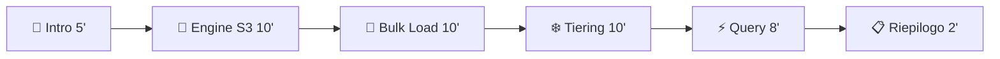

## S3 e ClickHouse: Il Data LakeHouse Moderno — Lezione Completa

Per anni, il Data Lake (S3) e il Data Warehouse (ClickHouse/Redshift) sono stati mondi separati. I dati morivano nel Lake perché spostarli nel Warehouse era lento e costoso. Oggi, ClickHouse può leggere direttamente da S3 con prestazioni incredibili, unendo la scalabilità infinita dello storage a oggetti con la velocità di query del colonnare. In questa lezione, costruiremo un'architettura ibrida (LakeHouse) che elimina la necessità di ETL complessi.

### Obiettivi di Apprendimento

Al termine di questa lezione, lo studente sarà in grado di:
1.  Configurare l'`S3 Table Engine` in ClickHouse per leggere file Parquet/JSON direttamente dal bucket.
2.  Utilizzare la funzione `s3()` per query ad-hoc e importazioni massive ultra-veloci (`INSERT INTO ... SELECT ...`).
3.  Progettare una strategia di "Tiered Storage" (Dati caldi su SSD, dati freddi su S3) trasparente all'utente.
4.  Ottimizzare le performance di lettura da S3 usando il parallelismo e il formato Parquet.
5.  Gestire l'autenticazione sicura (IAM Roles) tra ClickHouse e AWS S3.

### Timeline della Lezione

| Fase | Argomento | Durata |
|------|-----------|--------|
| 1 | Introduzione: Il problema dei silos di dati | 5 min |
| 2 | Teoria: S3 Table Engine e Funzione s3() | 10 min |
| 3 | Pratica: Importazione Massiva (Bulk Load) | 10 min |
| 4 | Architettura: Tiered Storage (Hot/Cold) | 10 min |
| 5 | Esercizi: Query Federata su Petabyte | 8 min |
| 6 | Riepilogo e Domande | 2 min |
| **Totale** | | **45 min** |



### Fase 1 — Introduzione: Il problema dei silos di dati (5 min)

Hai 100 TB di log su S3. Vuoi analizzarli.
*   *Vecchio metodo:* Scarichi i file, li trasformi, li carichi nel DB. (Tempo: giorni).
*   *Nuovo metodo (LakeHouse):* Dici al DB "i dati sono là". Il DB li legge al volo. (Tempo: secondi).

ClickHouse eccelle in questo perché parallelizza il download. Se hai un cluster di 10 nodi, scaricheranno i file da S3 in parallelo, saturando la banda di rete (che su AWS è enorme).

### Fase 2 — Teoria: S3 Table Engine e Funzione s3() (10 min)

ClickHouse ha due modi per toccare S3.

**1. Funzione `s3()` (Ad-hoc):**
Ottima per esplorazione rapida o importazione one-shot.
```sql
SELECT count()
FROM s3(
    'https://s3.us-east-1.amazonaws.com/my-bucket/data/*.parquet',
    'AWS_KEY', 'AWS_SECRET',
    'Parquet'
)
```
Supporta i "Glob patterns" (`*.parquet`, `data_2023_*.csv`).

**2. Table Engine `S3` (Virtual Table):**
Definisci una tabella che *sembra* locale, ma i dati restano su S3.
```sql
CREATE TABLE s3_logs (
    dt Date,
    user_id UInt64
) ENGINE = S3('https://.../logs.csv', 'CSV');
```
Quando fai `SELECT`, ClickHouse scarica, processa e ti dà il risultato. Non salva nulla su disco locale.

### Fase 3 — Pratica: Importazione Massiva (Bulk Load) (10 min)

Il caso d'uso più comune è spostare dati dal Lake (economico) al Warehouse (veloce).

`INSERT INTO clickhouse_table SELECT * FROM s3(...)`

**Ottimizzazioni:**
1.  **Formato:** Usa Parquet su S3. È colonnare e compresso. ClickHouse legge solo le colonne che servono.
2.  **Thread:** Aumenta `max_insert_threads` per parallelizzare il download.
3.  **Compressione:** Se usi CSV, comprimilo (GZIP). La rete è il collo di bottiglia, la CPU no.

### Fase 4 — Architettura: Tiered Storage (Hot/Cold) (10 min)

I dischi NVMe costano. S3 costa poco.
ClickHouse permette di definire policy di storage su più volumi.

**Configurazione XML:**
*   `default`: Disco NVMe veloce.
*   `cold`: Disco S3 (tramite VFS - Virtual File System).

**TTL (Time To Live):**
```sql
CREATE TABLE hits (...)
ENGINE = MergeTree
ORDER BY time
TTL time + INTERVAL 7 DAY TO VOLUME 'cold';
```
Dopo 7 giorni, ClickHouse sposta automaticamente i file vecchi su S3. L'utente non si accorge di nulla. La query legge sia da NVMe che da S3 in modo trasparente.

### Fase 5 — Esercizi: Query Federata su Petabyte (8 min)

**Scenario:** Hai un archivio di 5 anni di log su S3 (Cold) e gli ultimi 30 giorni su ClickHouse (Hot).
Il CEO chiede: "Qual è il trend annuale?".

**Soluzione:**
1.  Crea una tabella `history` con Engine S3 che punta al bucket storico.
2.  Crea una tabella `live` con Engine MergeTree.
3.  Crea una vista `union_all`:
    ```sql
    CREATE VIEW all_data AS
    SELECT * FROM live
    UNION ALL
    SELECT * FROM history
    ```
4.  Interroga `all_data`. ClickHouse è abbastanza intelligente da spingere i filtri (`WHERE year=2019`) giù fino a S3, scaricando solo il necessario.

### Fase 6 — Riepilogo e Domande (2 min)

1.  **S3 è lento?** No, se leggi in parallelo.
2.  **Parquet.** Il formato universale del LakeHouse.
3.  **Tiering.** Usa NVMe per oggi, S3 per la storia.
4.  **Zero ETL.** Leggi dove sta il dato.

### Domande di Verifica

1.  Qual è la differenza tra l'uso della funzione `s3()` e il motore di tabella `S3` in ClickHouse?
2.  Perché il formato Parquet è preferibile al CSV quando si leggono dati da S3 con ClickHouse?
3.  Spiega il concetto di "Tiered Storage" e come ClickHouse gestisce automaticamente lo spostamento dei dati "freddi".
4.  Cosa sono i "Glob Patterns" e come aiutano a leggere migliaia di file da un bucket S3 in una sola query?
5.  Qual è il vantaggio principale dell'architettura "LakeHouse" rispetto al tradizionale Data Warehouse on-premise?

### Riferimenti Bibliografici

-   ClickHouse Docs, "S3 Table Engine".
-   Altinity, "Tiered Storage in ClickHouse".
-   AWS, "Building a Data LakeHouse on AWS".
