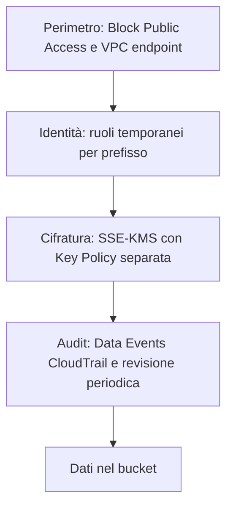

Uno sviluppatore crea un utente IAM per una pipeline esterna e, per fare in fretta, gli assegna `AmazonS3FullAccess`. Le chiavi statiche finiscono in un file `.env` che per errore viene committato in un repository visibile a fornitori esterni. Sul bucket non sono mai stati attivati i Data Events di CloudTrail, per risparmiare qualche dollaro. Quando la chiave esposta viene scoperta, tre settimane dopo, nessuno può dire se i 40 TB di anagrafiche clienti siano stati scaricati. Questo è uno scenario costruito con numeri di esempio, ma il suo schema è quello di molti incidenti reali sui data lake.

## Una chiave statica su Git e nessun log per sapere cosa è uscito

Il data lake aziendale contiene contratti, fatture e profili utente in tre bucket. L'indagine dopo l'incidente trova tre debolezze.

La prima riguarda l'identità. Il job usava una chiave utente di lunga durata con `Action: "s3:*"` e `Resource: "*"`: chi la possedeva poteva leggere e cancellare ogni bucket dell'account da qualsiasi indirizzo IP. Un ruolo temporaneo limitato a `raw/partner_x/*` avrebbe contenuto il danno a una sola cartella.

La seconda riguarda la rete e la cifratura. Il bucket accettava connessioni da Internet e usava la cifratura `SSE-S3`, che decifra in automatico per chiunque abbia il permesso `s3:GetObject`. Con una chiave KMS dedicata, servirebbe anche `kms:Decrypt`, un secondo permesso indipendente.

La terza riguarda la traccia. CloudTrail registra di default i Management Events, come `CreateBucket` e `PutBucketPolicy`, ma non i Data Events (`GetObject`, `PutObject`, `DeleteObject`). Davanti alla domanda del revisore su quali file siano stati scaricati con quella chiave, i log sono vuoti, e l'azienda deve trattare l'evento come una potenziale violazione di dati personali. Per dare un ordine di grandezza all'impatto, 40 TB in uscita verso Internet a 0,09 USD per GB (tariffa indicativa di listino) sarebbero 40.000 × 0,09 = 3.600 USD di solo trasferimento, un costo piccolo rispetto a quello legale e reputazionale.

> **Idea chiave:** la sicurezza di un data lake è una difesa a strati in cui ogni strato deve fallire da solo, quindi un permesso troppo largo in un punto non deve bastare a leggere i dati.

## Quattro barriere concentriche

Le misure si dispongono in quattro cerchi, dall'esterno verso i dati.



Il perimetro è costituito dal blocco dell'accesso pubblico a livello di account e da una bucket policy con `Deny` espliciti. Su S3 un `Deny` esplicito prevale sempre su qualsiasi `Allow`: anche un amministratore che assegna per errore un permesso troppo ampio non scavalca una regola di negazione scritta sul bucket.

L'identità si basa su credenziali temporanee. Le applicazioni su Kubernetes o EC2 ricevono ruoli tramite IAM Roles for Service Accounts o profili di istanza, le pipeline di integrazione continua usano la federazione OIDC, e i token scadono in un'ora al massimo. Nessun essere umano e nessun job deve possedere una coppia di chiavi statiche.

La cifratura con `SSE-KMS` aggiunge il secondo lucchetto. La revoca del grant su una chiave rende illeggibili gli oggetti cifrati con essa, anche quando la policy S3 resta aperta. L'audit chiude il cerchio: senza una registrazione dei Data Events non esiste modo di rispondere a chi ha letto che cosa.

## Ruoli temporanei con minimo privilegio

Il ruolo del produttore di dati deve poter solo scrivere nel proprio prefisso. La policy seguente concede `s3:PutObject` su `raw/partner_x/*` e nient'altro, quindi non permette né di leggere altri prefissi né di cancellare:

```json
{
  "Version": "2012-10-17",
  "Statement": [
    {
      "Sid": "ScritturaSoloPrefissoPartnerX",
      "Effect": "Allow",
      "Action": "s3:PutObject",
      "Resource": "arn:aws:s3:::acme-lake-prod/raw/partner_x/*"
    },
    {
      "Sid": "UsoChiaveKmsRaw",
      "Effect": "Allow",
      "Action": ["kms:GenerateDataKey", "kms:Encrypt"],
      "Resource": "arn:aws:kms:eu-central-1:123456789012:key/aaaa-bbbb-cccc"
    }
  ]
}
```

Il job di trasformazione ha una policy distinta: legge `raw/` e scrive `curated/`. Gli analisti non hanno accesso diretto a S3 e passano dai permessi di colonna e di tabella di Lake Formation o dal motore di query, così il controllo sta in un solo punto. La separazione per ruolo e per prefisso ha un effetto pratico: se la chiave di `partner_x` si compromette, l'attaccante può solo aggiungere file in una cartella, ed è un danno che si individua e si ripulisce.

## Bucket policy con Deny espliciti

La bucket policy impone tre regole che valgono per chiunque, qualunque sia il suo ruolo. La prima rifiuta il traffico non cifrato, la seconda rifiuta l'accesso da fuori dal VPC endpoint autorizzato, la terza rifiuta le scritture senza cifratura KMS:

```json
{
  "Version": "2012-10-17",
  "Statement": [
    {
      "Sid": "DenyTrafficoNonTls",
      "Effect": "Deny",
      "Principal": "*",
      "Action": "s3:*",
      "Resource": ["arn:aws:s3:::acme-lake-prod", "arn:aws:s3:::acme-lake-prod/*"],
      "Condition": { "Bool": { "aws:SecureTransport": "false" } }
    },
    {
      "Sid": "DenyFuoriVpcEndpoint",
      "Effect": "Deny",
      "Principal": "*",
      "Action": "s3:*",
      "Resource": ["arn:aws:s3:::acme-lake-prod", "arn:aws:s3:::acme-lake-prod/*"],
      "Condition": {
        "StringNotEquals": { "aws:SourceVpce": "vpce-0123456789abcdef0" },
        "ArnNotLike": { "aws:PrincipalArn": "arn:aws:iam::123456789012:role/BreakGlassAdmin" }
      }
    },
    {
      "Sid": "DenyScritturaSenzaKms",
      "Effect": "Deny",
      "Principal": "*",
      "Action": "s3:PutObject",
      "Resource": "arn:aws:s3:::acme-lake-prod/*",
      "Condition": {
        "StringNotEquals": { "s3:x-amz-server-side-encryption": "aws:kms" }
      }
    }
  ]
}
```

La seconda regola contiene un'eccezione per un ruolo di emergenza, indispensabile: senza di essa un errore nella condizione del VPC endpoint bloccherebbe anche gli amministratori, e il bucket non sarebbe più gestibile. Il ruolo di emergenza va protetto con autenticazione a più fattori e monitorato, perché ogni suo utilizzo deve far scattare un allarme.

Tre impostazioni del bucket completano il perimetro e si attivano da riga di comando:

```bash
# Blocco dell'accesso pubblico a livello di account
aws s3control put-public-access-block \
  --account-id 123456789012 \
  --public-access-block-configuration BlockPublicAcls=true,IgnorePublicAcls=true,BlockPublicPolicy=true,RestrictPublicBuckets=true

# ACL legacy disattivate: ogni oggetto appartiene al proprietario del bucket
aws s3api put-bucket-ownership-controls \
  --bucket acme-lake-prod \
  --ownership-controls 'Rules=[{ObjectOwnership=BucketOwnerEnforced}]'

# Cifratura predefinita SSE-KMS con S3 Bucket Key attiva
aws s3api put-bucket-encryption \
  --bucket acme-lake-prod \
  --server-side-encryption-configuration '{"Rules":[{"ApplyServerSideEncryptionByDefault":{"SSEAlgorithm":"aws:kms","KMSMasterKeyID":"arn:aws:kms:eu-central-1:123456789012:key/aaaa-bbbb-cccc"},"BucketKeyEnabled":true}]}'
```

## SSE-S3 o SSE-KMS e il costo delle chiamate a KMS

`SSE-S3` cifra gli oggetti con chiavi gestite da S3, senza costo aggiuntivo e senza una policy di chiave separata. `SSE-KMS` usa una chiave in AWS Key Management Service, con una Key Policy indipendente, un registro di utilizzo in CloudTrail e la possibilità di revoca immediata. La differenza di sicurezza è concreta: con `SSE-S3` un ruolo con `s3:GetObject` legge in chiaro; con `SSE-KMS` lo stesso ruolo riceve `AccessDenied` se non compare nella Key Policy.

Il prezzo da pagare sono le chiamate a KMS. Esempio numerico svolto, con tariffa indicativa di 0,03 USD ogni 10.000 richieste (verifica il listino della tua regione):

1. Volume: un bucket riceve 100 milioni di richieste al mese tra `PUT` e `GET` su oggetti cifrati.
2. Senza Bucket Key ogni richiesta chiama KMS: 100.000.000 / 10.000 = 10.000 blocchi da 10.000 richieste, quindi 10.000 × 0,03 = 300 USD al mese.
3. Con la S3 Bucket Key S3 genera una chiave temporanea a livello di bucket e riduce le chiamate verso KMS di circa il 99%: restano 1.000.000 di chiamate, cioè 100 blocchi, quindi 100 × 0,03 = 3 USD al mese.
4. Risparmio: 300 − 3 = 297 USD al mese, a parità di Key Policy e di audit.

Oltre al costo, esiste una quota di richieste al secondo per chiave KMS, che nelle pipeline ad alto parallelismo si raggiunge prima del costo: la Bucket Key allontana anche questo limite. Le zone `raw` e `curated` con dati personali o finanziari meritano `SSE-KMS`; i bucket di log tecnici non sensibili possono restare su `SSE-S3`.

## Audit con i Data Events di CloudTrail

I Data Events si attivano per bucket con selettori avanzati, così si limita la registrazione ai soli bucket critici e si contiene il costo:

```bash
# Registra GetObject, PutObject e DeleteObject solo sul bucket di produzione
aws cloudtrail put-event-selectors \
  --trail-name lake-audit \
  --advanced-event-selectors '[{"Name":"S3 data events lake prod","FieldSelectors":[{"Field":"eventCategory","Equals":["Data"]},{"Field":"resources.type","Equals":["AWS::S3::Object"]},{"Field":"resources.ARN","StartsWith":["arn:aws:s3:::acme-lake-prod/"]}]}]'
```

Il costo si stima in anticipo. Con una tariffa indicativa di 0,10 USD ogni 100.000 eventi di dati e 50 milioni di operazioni al mese sul bucket, il calcolo è 50.000.000 / 100.000 = 500 blocchi, quindi 500 × 0,10 = 50 USD al mese. È una cifra trascurabile accanto al valore dei dati che protegge, e infatti risparmiarla è l'errore che apre lo scenario iniziale.

Una volta che i log sono su S3, una tabella Athena sui file di CloudTrail permette la ricerca di anomalie. La query seguente isola, nell'ultima ora, gli accessi con identità `IAMUser` (chiavi statiche) e i ruoli con molti rifiuti:

```sql
-- Athena su tabella CloudTrail: chiavi statiche e picchi di AccessDenied nell'ultima ora
SELECT
    useridentity.arn                 AS principal_arn,
    useridentity.type                AS tipo_identita,
    sourceipaddress                  AS ip_origine,
    count_if(errorcode IN ('AccessDenied', 'AllAccessDisabled')) AS tentativi_negati,
    count_if(eventname = 'GetObject' AND errorcode IS NULL)      AS letture_riuscite,
    count(DISTINCT requestparameters['key'])                     AS oggetti_distinti
FROM cloudtrail_logs
WHERE eventsource = 's3.amazonaws.com'
  AND from_iso8601_timestamp(eventtime) > current_timestamp - INTERVAL '1' HOUR
GROUP BY useridentity.arn, useridentity.type, sourceipaddress
HAVING useridentity.type = 'IAMUser'
    OR count_if(errorcode IN ('AccessDenied', 'AllAccessDisabled')) >= 5
ORDER BY tentativi_negati DESC, letture_riuscite DESC;
```

Se la query restituisce una riga con `IAMUser` e un indirizzo IP esterno, c'è una chiave statica in uso da fuori dalla rete aziendale. Con i Data Events attivi, la stessa query avrebbe risposto in pochi secondi alla domanda del revisore: chi, da quale IP, quali oggetti. Una revisione trimestrale dei permessi con IAM Access Analyzer, che segnala i privilegi mai usati, riduce nel tempo la superficie esposta.

Un secondo calcolo mostra perché la finestra di rilevamento conta. Nello scenario iniziale la chiave è rimasta esposta 21 giorni, cioè 21 × 24 = 504 ore. Se l'allarme sui picchi di `AccessDenied` e sui download anomali scatta entro 1 ora, la finestra scende da 504 ore a 1 ora, una riduzione del 99,8% (1 / 504 = 0,2%). A parità di velocità di scaricamento, i dati che l'attaccante poteva portare via passano da 40 TB a una frazione di quella cifra. Il costo di questa protezione, tra Data Events e query di controllo, resta nell'ordine di qualche decina di euro al mese, quindi il rapporto tra spesa e rischio evitato è nettamente favorevole. La regola che ne deriva è semplice: ogni misura di prevenzione va accompagnata da una di rilevamento, perché nessun perimetro è perfetto e il tempo che passa tra un accesso illecito e la sua scoperta determina l'entità del danno e gli obblighi di notifica verso l'autorità.

## Tre errori che lasciano esposto il lake

### Usare utenti IAM con chiavi statiche

Il sintomo è un utente IAM con chiavi attive da anni, usate da script, server di BI e laptop. Sembra comodo perché funziona subito e non richiede federazione. Il motivo del rischio è che le chiavi finiscono nei log di errore, nella cronologia della shell e nei ticket, e non scadono. Si corregge sostituendole con ruoli assunti tramite STS e, dove un fornitore esterno lo richiede, con un ruolo cross-account con condizione sull'identificativo esterno e durata breve della sessione.

### Attivare SSE-KMS senza la Bucket Key

Il sintomo è una fattura KMS inattesa e, nei picchi, errori di throttling sulle pipeline. Sembra un effetto collaterale normale della cifratura, ma dipende dal fatto che S3 chiama KMS per ogni oggetto. Con 100 milioni di richieste il conto passa da 3 a 300 USD, come nel calcolo sopra. La correzione è impostare `BucketKeyEnabled` sulla cifratura predefinita del bucket.

### Non registrare i Data Events

Il sintomo è l'impossibilità di ricostruire un accesso dopo un incidente. Sembra una scelta ragionevole perché la configurazione predefinita di CloudTrail registra la creazione e la cancellazione dei bucket, e ci si sente coperti. In realtà quella configurazione non traccia chi ha letto o cancellato i singoli file. La correzione è attivare i selettori avanzati sui bucket con dati personali o critici e inviare i log a un bucket separato, con versioning e blocco della cancellazione.

## Controllo sulla postura del bucket

1. Un bucket riceve 20 milioni di richieste al mese cifrate con `SSE-KMS`, senza Bucket Key, a 0,03 USD ogni 10.000 richieste: quanto costa KMS, e quanto con la Bucket Key che riduce del 99%?

<details>
<summary>Mostra risposta</summary>

Senza Bucket Key: 20.000.000 / 10.000 = 2.000 blocchi, quindi 2.000 × 0,03 = 60 USD al mese. Con la riduzione del 99% restano 200.000 chiamate, cioè 20 blocchi, quindi 20 × 0,03 = 0,60 USD al mese.

</details>

2. Un amministratore assegna `AmazonS3FullAccess` a un ruolo, ma la bucket policy contiene un `Deny` per il traffico fuori dal VPC endpoint: che cosa succede a una richiesta da Internet?

<details>
<summary>Mostra risposta</summary>

La richiesta viene rifiutata. Su S3 un `Deny` esplicito prevale su qualsiasi `Allow`, quindi il permesso ampio del ruolo non basta. L'eccezione prevista per il ruolo di emergenza è l'unico percorso di accesso da fuori dal VPC endpoint.

</details>

3. Stimi 80 milioni di operazioni al mese sul bucket critico: quanto costano i Data Events a 0,10 USD ogni 100.000 eventi?

<details>
<summary>Mostra risposta</summary>

80.000.000 / 100.000 = 800 blocchi, quindi 800 × 0,10 = 80 USD al mese. Restringere i selettori ai soli prefissi con dati personali, se il resto del bucket è poco sensibile, riduce la cifra proporzionalmente.

</details>

4. Perché `SSE-KMS` protegge da un ruolo con policy S3 troppo permissiva e `SSE-S3` no?

<details>
<summary>Mostra risposta</summary>

Con `SSE-S3` la decifratura è automatica per chiunque abbia `s3:GetObject`. Con `SSE-KMS` la lettura richiede anche `kms:Decrypt` sulla chiave, concesso dalla Key Policy: un ruolo che ha accesso a S3 ma non alla chiave riceve `AccessDenied`. Inoltre revocare il grant sulla chiave rende illeggibili gli oggetti in un solo passo.

</details>
