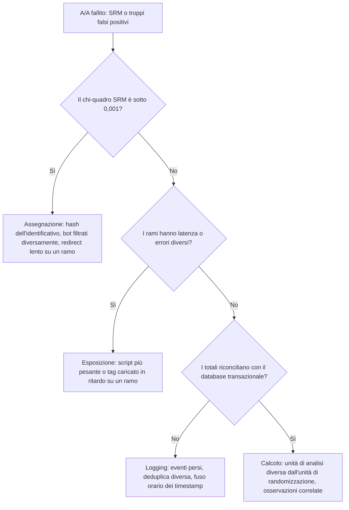

Scenario costruito, con numeri di esempio: un sito editoriale italiano vuole collaudare la nuova piattaforma di sperimentazione prima di usarla per il paywall. Divide 200.000 utenti in due metà e mostra a tutti la stessa home page, poi misura l'iscrizione alla newsletter. Dopo sette giorni il ramo B ha il 3,18% di iscritti contro il 3,00% del ramo A, e il cruscotto della piattaforma accende il badge verde "significativo". Su due pagine identiche non dovrebbe esserci nessun vincitore, quindi il cruscotto sta dicendo una cosa falsa, e la domanda utile è dove nasce.

> **Idea chiave:** Un A/A test non misura nulla del prodotto: misura lo strumento. Se due esperienze identiche producono differenze significative più spesso di $\alpha$, ogni A/B test successivo eredita lo stesso difetto, qualunque sia la qualità del disegno.

## Che cosa deve dimostrare un test A/A

Un test A/A usa la macchina completa: assegnazione, esposizione, tracciamento, aggregazione e calcolo statistico. L'unica cosa che manca è la differenza reale tra i rami. Questo lo rende un controllo di taratura, come pesare un campione noto su una bilancia prima di fidarsi della bilancia.

Il risultato atteso è preciso. Con soglia $\alpha = 0{,}05$ e nessun effetto, il p-value di un confronto ben fatto è distribuito in modo uniforme tra 0 e 1, quindi circa un test su venti scende sotto 0,05 per puro caso. Quel 5% non è un difetto: è il prezzo accettato in partenza. Il difetto compare quando la quota di test "significativi" è chiaramente più alta, oppure quando i due rami non hanno nemmeno lo stesso numero di utenti previsto.

Un singolo A/A positivo non dimostra molto, perché una differenza significativa può comparire una volta su venti senza che nulla sia rotto. Per questo il collaudo ha due livelli. Il primo livello controlla in modo deterministico l'integrità della ripartizione e dei log su un esperimento. Il secondo livello ripete il confronto molte volte, su metriche o finestre diverse, e giudica la frequenza dei falsi positivi con un test sul numero di successi.

| Controllo | Che cosa verifica | Esito atteso | Segnale di guasto |
|---|---|---|---|
| Sample Ratio Mismatch | Numero di utenti per ramo rispetto alla ripartizione prevista | Chi-quadro con p-value maggiore di 0,001 | Scostamento sistematico, ad esempio 50,5% contro 49,5% su 200.000 utenti |
| Latenza e errori tecnici | Tempo di caricamento ed errori JavaScript per ramo | Differenze entro il rumore | Un ramo costantemente più lento dell'altro |
| Frequenza dei falsi positivi | Quota di p-value sotto 0,05 su molte metriche o ripetizioni | Intorno al 5%, dentro l'intervallo binomiale | Quota nettamente superiore, ad esempio 14 su 100 |
| Riconciliazione dei totali | Conversioni della piattaforma contro il database transazionale | Scarto sotto l'1% su entrambi i rami | Un ramo perde eventi che l'altro conserva |

## Il calcolo svolto: SRM e confronto di due proporzioni

Torniamo al sito editoriale. Il primo controllo è sulla ripartizione, perché una ripartizione sbagliata invalida tutto ciò che viene dopo. La piattaforma doveva assegnare 100.000 utenti per ramo, ma i log di esposizione ne contano 101.000 nel ramo A e 99.000 nel ramo B. Lo scarto è del 1% rispetto all'atteso e sembra trascurabile, ma con campioni così grandi non lo è.

Il chi-quadro di bontà di adattamento si calcola sommando, per ogni ramo, il quadrato dello scarto diviso per il valore atteso:

$$\chi^2 = \sum_i \frac{(O_i - E_i)^2}{E_i}$$

Con $O_A = 101.000$, $O_B = 99.000$ ed $E_A = E_B = 100.000$ si ottiene $(1.000)^2 / 100.000 = 10$ per ciascun ramo, quindi $\chi^2 = 10 + 10 = 20$ con un grado di libertà. Il p-value corrispondente è circa $7{,}7 \times 10^{-6}$, molto sotto la soglia convenzionale di 0,001 usata per i controlli SRM. Una ripartizione casuale perfetta produrrebbe uno scarto così grande una volta ogni 130.000 esperimenti circa, quindi il bug esiste e il confronto sulla newsletter va sospeso.

Per vedere quanto vale la conclusione sul 3,18%, calcoliamo comunque il confronto, come lo calcolerebbe la piattaforma. Nel ramo A, 3.000 iscritti su 100.000 utenti danno il 3,00%; nel ramo B, 3.180 iscritti su 100.000 danno il 3,18%. La proporzione complessiva è $\hat p = (3.000 + 3.180) / 200.000 = 0{,}0309$. L'errore standard della differenza è:

$$SE = \sqrt{\hat p (1-\hat p)\left(\frac{1}{n_A}+\frac{1}{n_B}\right)} = \sqrt{0{,}0309 \times 0{,}9691 \times 0{,}00002} \approx 0{,}000774$$

La differenza osservata è $0{,}0318 - 0{,}0300 = 0{,}0018$, cioè 0,18 punti percentuali, quindi $z = 0{,}0018 / 0{,}000774 \approx 2{,}33$ e il p-value bilaterale è circa 0,020. È sotto 0,05, e per questo il cruscotto accende il badge. Ma il risultato non è un evento fortunato: nasce da una pipeline che tratta i due rami in modo diverso, come mostra l'SRM. Quando il collaudo trova uno squilibrio, il p-value sulla metrica non ha più il significato dichiarato.

## Ripetere il collaudo: la distribuzione dei p-value

Un solo esperimento A/A può essere sfortunato. Per giudicare lo strumento serve una serie di ripetizioni: ad esempio 100 confronti A/A su finestre settimanali diverse, oppure 100 metriche indipendenti sullo stesso test. In una pipeline sana il numero di p-value sotto 0,05 è una variabile binomiale con $n = 100$ e $p = 0{,}05$, cioè in media 5 con deviazione standard $\sqrt{100 \times 0{,}05 \times 0{,}95} \approx 2{,}2$.

Supponi che la piattaforma del sito editoriale restituisca 14 p-value sotto 0,05 su 100 ripetizioni. La quota è del 14% contro il 5% atteso. Il test binomiale esatto dà un p-value di circa 0,0005: la probabilità di vedere 14 o più successi, con un tasso vero del 5%, è molto bassa. Se invece i p-value sotto soglia fossero 5, il p-value del test binomiale sarebbe 1 e lo strumento supererebbe il controllo. Su 1.000 ripetizioni l'intervallo di accettazione al 95% per il numero di falsi positivi va da 37 a 64, quindi una quota osservata intorno al 5% è difficile da distinguere dal caso, mentre un valore come 90 indicherebbe un guasto netto.

Il blocco seguente simula il collaudo su dati sintetici con un tasso di conversione vero del 3% e confronta la frequenza dei falsi positivi con la soglia attesa. Sostituendo la simulazione con le conversioni per utente e per finestra estratte dai log reali, lo stesso codice diventa il test di accettazione dello strumento.

```python
# Collaudo A/A: frequenza di falsi positivi e Sample Ratio Mismatch
import numpy as np
from scipy import stats

rng = np.random.default_rng(42)
n_per_arm, p_true, runs, alpha = 100_000, 0.03, 1_000, 0.05

def two_prop_pvalue(x_a, n_a, x_b, n_b):
    # z-test a due code con errore standard poolato
    p_pool = (x_a + x_b) / (n_a + n_b)
    se = np.sqrt(p_pool * (1 - p_pool) * (1 / n_a + 1 / n_b))
    z = (x_b / n_b - x_a / n_a) / se
    return 2 * stats.norm.sf(abs(z))

# Ogni ripetizione: due rami identici, stessa probabilita' di conversione
pvals = np.array([
    two_prop_pvalue(rng.binomial(n_per_arm, p_true), n_per_arm,
                    rng.binomial(n_per_arm, p_true), n_per_arm)
    for _ in range(runs)
])
fp = int((pvals < alpha).sum())

# Test binomiale esatto: la quota di falsi positivi e' compatibile con alpha?
res = stats.binomtest(fp, runs, alpha)
print(f"falsi positivi: {fp}/{runs}  p-value binomiale: {res.pvalue:.3f}")

# Controllo SRM sui conteggi di esposizione (101.000 contro 99.000)
chi2, p_srm = stats.chisquare([101_000, 99_000], [100_000, 100_000])
print(f"SRM chi2 = {chi2:.1f}  p-value = {p_srm:.2e}")
```

L'esito della prima parte cambia a ogni seme, ma resta quasi sempre vicino a 50 falsi positivi su 1.000, con p-value binomiale alto. La seconda parte è deterministica e restituisce 20,0 e circa $7{,}7 \times 10^{-6}$, gli stessi valori calcolati a mano nella sezione precedente.

## Dove cercare quando i falsi allarmi sono troppi

Un collaudo fallito è un'indagine, non un verdetto sul fornitore. La causa sta quasi sempre in uno di quattro punti, che conviene controllare in ordine, dal più vicino alla randomizzazione al più vicino al calcolo.



Il ramo dell'assegnazione è il più frequente. Se l'hash dell'identificativo non è uniforme, oppure se i bot vengono filtrati prima dell'assegnazione su un ramo e dopo sull'altro, il rapporto di traffico si sposta e l'SRM lo segnala subito. Nel sito editoriale, ad esempio, un controllo anti-bot applicato solo alla pagina con il nuovo script elimina circa 2.000 sessioni sospette dal ramo B e non dal ramo A, e il conteggio 101.000 contro 99.000 si spiega in gran parte così.

Il ramo dell'esposizione riguarda un difetto più silenzioso. Se il tag di tracciamento carica con 50 ms di ritardo su un ramo, una parte degli utenti lascia la pagina prima che l'evento di esposizione parta, e il ramo più lento perde utenti proprio tra i più impazienti. La differenza di conversione non dipende dalla grafica ma dal fatto che i due gruppi non contengono più la stessa popolazione.

Il ramo del logging è quello che si verifica confrontando la piattaforma con una fonte indipendente. Se gli ordini della piattaforma sono il 10% in meno del database transazionale, oppure se un ramo ne perde il 3% e l'altro l'1%, la metrica osservata è già distorta prima di entrare nel calcolo. L'ultimo ramo, quello del calcolo, resta da guardare quando i tre precedenti sono puliti: randomizzare per utente e poi calcolare l'errore standard per singola pagina vista tratta come indipendenti osservazioni che non lo sono, e gonfia la significatività.

## Tre errori tipici nel collaudo

### Un solo A/A su una sola metrica, poi nessuna ripetizione

**Sintomo:** il collaudo viene fatto una volta all'adozione della piattaforma, su una metrica sola, e il badge verde viene considerato una garanzia permanente. **Perché succede:** il controllo sembra costoso e il primo esito pulito dà fiducia. Eppure un singolo confronto, con probabilità del 5% di sbagliare per caso, dice poco sulla frequenza dei falsi positivi, e non copre le modifiche successive all'SDK o al tracciamento. **Come si corregge:** pianifica il collaudo come una procedura periodica, almeno su 10 metriche e dopo ogni cambio importante dell'infrastruttura, e valuta la quota di falsi positivi con il test binomiale e non a occhio.

### Trattare lo scarto SRM piccolo come rumore

**Sintomo:** il rapporto è 50,5 contro 49,5 e qualcuno lo archivia dicendo che "è quasi 50 e 50". **Perché succede:** a occhio l'1% sembra poco, ma il chi-quadro cresce con la dimensione del campione, e su 200.000 utenti lo stesso scarto dà $\chi^2 = 20$. **Come si corregge:** decidi la soglia di allarme prima del test, di norma un p-value sotto 0,001, e tratta ogni superamento come un bug da spiegare prima di leggere qualsiasi metrica.

### Non riconciliare la piattaforma con il database ufficiale

**Sintomo:** la piattaforma conta 9.000 ordini nel periodo e il database transazionale ne registra 10.000. **Perché succede:** il tracciamento lato client perde eventi per ad blocker, chiusura anticipata della pagina o errori JavaScript, e le perdite non sono uguali nei due rami se uno dei due ha un codice diverso. **Come si corregge:** esegui una riconciliazione per ramo, dichiara una tolleranza, per esempio 1%, e verifica che il tasso di perdita sia lo stesso nei due gruppi. Una perdita uniforme riduce la potenza, mentre una perdita asimmetrica crea differenze che non esistono.

## Il caso del collaudo senza tempo: l'A/A offline

Se la direzione non vuole aspettare due settimane per un A/A live, puoi simulare il collaudo sullo storico. Prendi le due settimane precedenti, assegna gli utenti ai rami con la stessa funzione di hash che userà la piattaforma e calcola le metriche come farebbe l'analisi reale. Poiché nessun utente ha visto una variante, qualunque differenza significativa riflette il tuo hash, la tua deduplica o il tuo calcolo.

Questa procedura non copre i difetti dell'esposizione, perché non c'è un vero caricamento di pagina, ma intercetta ugualmente due difetti diffusi: l'hash non uniforme e l'unità di analisi sbagliata. Ripetuta su 100 finestre mobili, produce una distribuzione dei p-value da confrontare con l'attesa del 5%. È un compromesso accettabile quando il tempo manca, purché il rapporto finale dichiari che il collaudo era offline e che l'esposizione non è stata verificata.

## Controllo sul collaudo

1. In un A/A su 200.000 utenti con ripartizione prevista 50/50 osservi 100.600 utenti nel ramo A e 99.400 nel ramo B. Qual è il chi-quadro, e fermeresti l'analisi?

<details>
<summary>Mostra risposta</summary>

Lo scarto è di 600 utenti su ciascun ramo rispetto a 100.000 attesi. Il contributo è $600^2 / 100.000 = 3{,}6$ per ramo, quindi $\chi^2 = 7{,}2$ con un grado di libertà. Il p-value è circa 0,007, sopra la soglia di 0,001 ma non trascurabile. Fermare l'analisi dipende dalla soglia decisa prima: con 0,001 il test passa, con 0,01 fallisce. Il punto è che la soglia va fissata in anticipo e che, in caso di dubbio, conviene indagare sull'hash e sui filtri anti-bot.

</details>

2. Su 100 ripetizioni A/A, la piattaforma produce 9 p-value sotto 0,05. Lo strumento è fuori controllo?

<details>
<summary>Mostra risposta</summary>

No. Con $n = 100$ e $p = 0{,}05$ l'atteso è 5 con deviazione standard di circa 2,2, quindi 9 si trova a circa 1,8 deviazioni dalla media. Il test binomiale esatto dà un p-value di circa 0,06 a una coda (0,10 a due code), non abbastanza basso per dichiarare un difetto. Conviene comunque ripetere su più ripetizioni: con 1.000 prove, 9 su 100 corrisponderebbe a circa 90 falsi positivi, fuori dall'intervallo di accettazione 37-64.

</details>

3. Una piattaforma conta 9.000 conversioni nel ramo A e 9.450 nel ramo B, mentre il database ufficiale ne registra 10.000 per ramo. Che cosa indicano questi numeri?

<details>
<summary>Mostra risposta</summary>

La perdita è del 10% nel ramo A e del 5,5% nel ramo B, dunque asimmetrica. La differenza osservata di 450 conversioni, pari al 5% del totale ufficiale per ramo, è prodotta dal tracciamento e non dagli utenti. Un confronto fatto sui dati della piattaforma attribuirebbe al ramo B un vantaggio che non esiste. Bisogna correggere il tracciamento del ramo A prima di qualsiasi test.

</details>

4. Perché un A/A positivo non dimostra da solo che la piattaforma è difettosa?

<details>
<summary>Mostra risposta</summary>

Perché con $\alpha = 0{,}05$ una differenza significativa compare comunque una volta ogni venti confronti anche con una pipeline perfetta. Un solo risultato può essere il 5% atteso. Per giudicare lo strumento serve la frequenza su molte ripetizioni, confrontata con 0,05 tramite un test binomiale, insieme ai controlli deterministici su SRM e riconciliazione.

</details>
