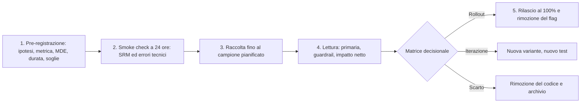

Caso ricostruito, con numeri di esempio: un team prodotto di un servizio in abbonamento testa una nuova pagina prezzi che mette in evidenza il piano annuale. Il test finisce, la differenza è positiva, il report parte come PDF per email e nessuno convoca la riunione di chiusura. Quattro mesi dopo il feature flag è ancora acceso al 50% del traffico, nessuno sa se la variante sia stata approvata, e un altro test sulla stessa pagina sta leggendo dati contaminati. Il calcolo statistico era corretto, ma è mancato il passaggio dal numero alla decisione.

> **Idea chiave:** Un A/B test finisce quando la decisione è stata eseguita e il codice della variante scartata è stato rimosso, non quando compare il p-value. Le regole per decidere si scrivono prima del lancio, quando nessuno sa ancora chi vincerà.

## Cinque fasi dalla scheda alla pulizia del codice

Un flusso sperimentale maturo separa la preparazione dal giudizio. Prima del lancio si congelano ipotesi, metrica primaria, guardrail, effetto minimo rilevabile e durata. Nelle prime 24 ore si guarda soltanto la salute tecnica. Durante la raccolta non si decide nulla. Alla chiusura si applica la matrice concordata, e entro una settimana si rimuove il codice che non serve più.



La tabella indica per ogni fase che cosa si fa e che cosa è vietato. Il divieto è la parte più importante, perché le tentazioni cambiano a seconda del momento del test.

| Fase | Quando | Si fa | È vietato |
|---|---|---|---|
| Pre-registrazione | Giorno 0 | Scrivere ipotesi, metrica, guardrail, MDE, soglie di decisione | Modificare i criteri a test avviato |
| Smoke check | Prime 24 ore | Controllare SRM, errori JavaScript, volumi | Guardare chi sta vincendo |
| Raccolta | Durata pianificata | Monitorare solo guardrail tecnici | Fermare il test al primo picco |
| Lettura e decisione | A chiusura | Confrontare primaria, guardrail e costo di manutenzione | Cambiare soglie dopo aver visto i dati |
| Pulizia e archivio | Entro 7 giorni | Rilasciare o rimuovere, registrare l'esito | Lasciare i flag aperti per mesi |

## La scheda di pre-registrazione

La scheda è un documento breve, di una pagina, che il proprietario dell'esperimento scrive e condivide prima di accendere il traffico. Non serve a produrre burocrazia: serve a rendere impossibile la negoziazione a posteriori. Quando i dati sono già visibili, ogni soglia sembra ragionevole se la si sposta nella direzione giusta.

Per il test sulla pagina prezzi la scheda può avere questa forma.

> **Domanda:** mettere in evidenza il piano annuale aumenta la quota di visitatori che sottoscrivono un abbonamento annuale?
> **Metrica primaria:** abbonamenti annuali per visitatore unico, test a due code con $\alpha = 0{,}05$.
> **Guardrail:** tasso di rimborso entro 30 giorni sugli abbonamenti annuali, con soglia di allarme a +4 punti percentuali rispetto al controllo.
> **Disegno:** 40.000 visitatori per ramo, durata 21 giorni, effetto minimo rilevabile +0,2 punti percentuali sul 1,2% di partenza.
> **Decisione:** rollout se l'intervallo di confidenza della primaria sta sopra zero e il limite superiore del guardrail resta sotto +4 punti; iterazione se la primaria è positiva ma il guardrail non è chiuso; scarto se la primaria non supera lo zero.

Le tre righe finali sono quelle che contano di più. Scrivere in anticipo che cosa si fa in ciascun esito costringe il team a decidere il valore del rischio prima di sapere quale esito si presenterà. Un guardrail con soglia numerica evita che, a risultato ottenuto, i rimborsi vengano letti come "un segnale da tenere d'occhio" invece che come una condizione di stop.

## Smoke check e raccolta: cosa si guarda e cosa no

Dopo 24 ore si controlla l'integrità, non il risultato. Nel test sulla pagina prezzi la piattaforma conta 5.040 visitatori nel controllo e 4.960 nella variante, contro un atteso di 5.000 per ramo. Il chi-quadro è $(40^2/5.000) \times 2 = 0{,}64$ con un grado di libertà, quindi un p-value di circa 0,42: la ripartizione è compatibile con una randomizzazione corretta e il test prosegue. Se il p-value fosse stato sotto 0,001, il test si sospende e si cerca il bug prima di raccogliere altro traffico.

Nei giorni successivi il team guarda soltanto errori JavaScript, tempi di caricamento e volumi. Lo scopo è proteggere gli utenti da guasti evidenti, non anticipare la lettura. Se qualcuno apre il report della conversione ogni mattina e ferma il test quando vede un valore favorevole, il tasso reale di falsi positivi sale ben oltre il 5% dichiarato, come si vede nella lezione su peeking e test multipli.

## Il calcolo di chiusura passo per passo

Il test si chiude alla data prevista, con 40.000 visitatori per ramo. I numeri di esempio sono questi: nel controllo 480 abbonamenti annuali, nella variante 560. I rimborsi entro 30 giorni sono 29 nel controllo e 51 nella variante.

**Passo 1, metrica primaria.** I tassi sono $480/40.000 = 1{,}20\%$ e $560/40.000 = 1{,}40\%$. La differenza è $+0{,}20$ punti percentuali. Per il test sotto $H_0$ la proporzione complessiva è $(480+560)/80.000 = 1{,}30\%$ e l'errore standard è $\sqrt{0{,}013 \times 0{,}987 \times (2/40.000)} \approx 0{,}000801$. Quindi $z = 0{,}002/0{,}000801 \approx 2{,}50$ e il p-value a due code è circa 0,013.

**Passo 2, intervallo di confidenza.** Per l'intervallo si usa l'errore standard non poolato, $\sqrt{0{,}012 \times 0{,}988/40.000 + 0{,}014 \times 0{,}986/40.000} \approx 0{,}000801$. Il limite inferiore è $0{,}002 - 1{,}96 \times 0{,}000801 \approx 0{,}00043$ e il superiore $0{,}002 + 1{,}96 \times 0{,}000801 \approx 0{,}00357$. L'effetto sulla quota di abbonamenti annuali sta quindi tra +0,04 e +0,36 punti percentuali, tutto sopra zero.

**Passo 3, guardrail.** Il tasso di rimborso sugli abbonamenti annuali è $29/480 = 6{,}04\%$ nel controllo e $51/560 = 9{,}11\%$ nella variante, con differenza di $+3{,}07$ punti. La proporzione complessiva è $80/1.040 \approx 7{,}69\%$ e l'errore standard $\sqrt{0{,}0769 \times 0{,}9231 \times (1/480 + 1/560)} \approx 0{,}0166$. L'intervallo al 95% va da circa $-0{,}2$ a $+6{,}3$ punti. Il limite superiore supera la soglia di +4 punti, quindi il guardrail non è chiuso: non è dimostrato che i rimborsi siano aumentati oltre la tolleranza, ma nemmeno che restino dentro.

**Passo 4, impatto economico.** Con 100.000 visitatori al mese e un abbonamento annuale da 96 euro, l'effetto stimato sulla primaria vale $0{,}002 \times 100.000 = 200$ abbonamenti in più, cioè $200 \times 96 = 19.200$ euro al mese. I rimborsi per visitatore passano da $29/40.000 = 0{,}0725\%$ a $51/40.000 = 0{,}1275\%$: su 100.000 visitatori sono circa 55 rimborsi aggiuntivi, pari a $55 \times 96 = 5.280$ euro. L'effetto netto è $19.200 - 5.280 = 13.920$ euro al mese; sottraendo 3.000 euro di manutenzione mensile della variante restano circa 10.920 euro.

La lettura combinata è la raccomandazione: la metrica primaria è chiaramente positiva e l'impatto netto è positivo anche con la stima centrale dei rimborsi, ma il guardrail ha un intervallo troppo largo per essere chiuso. Per la matrice scritta in anticipo l'esito è "iterazione", cioè un rollout controllato con un holdout del 10% per altri 30 giorni, mirato a stringere l'intervallo dei rimborsi.

## Lo stesso calcolo in Python

Il blocco seguente riproduce i passi precedenti e applica la matrice di decisione in modo meccanico, così la raccomandazione non dipende da chi legge il report.

```python
# Chiusura di un A/B test: primaria, guardrail e decisione dalla matrice
import math
from scipy import stats

def diff_ci(x_a, n_a, x_b, n_b, z=1.96):
    # differenza di proporzioni con intervallo al 95% (errore standard non poolato)
    p_a, p_b = x_a / n_a, x_b / n_b
    se = math.sqrt(p_a * (1 - p_a) / n_a + p_b * (1 - p_b) / n_b)
    d = p_b - p_a
    return d, d - z * se, d + z * se

def pooled_p(x_a, n_a, x_b, n_b):
    p = (x_a + x_b) / (n_a + n_b)
    se = math.sqrt(p * (1 - p) * (1 / n_a + 1 / n_b))
    return 2 * stats.norm.sf(abs((x_b / n_b - x_a / n_a) / se))

# Primaria: abbonamenti annuali su 40.000 visitatori per ramo
d, lo, hi = diff_ci(480, 40_000, 560, 40_000)
print(f"primaria: {d*100:.2f} pp  IC95% [{lo*100:.2f}, {hi*100:.2f}]  p = {pooled_p(480, 40_000, 560, 40_000):.3f}")

# Guardrail: rimborsi sugli abbonamenti annuali (29/480 contro 51/560)
g, g_lo, g_hi = diff_ci(29, 480, 51, 560)
print(f"guardrail: {g*100:.2f} pp  IC95% [{g_lo*100:.2f}, {g_hi*100:.2f}]")

# Matrice scritta nella scheda di pre-registrazione
if lo > 0 and g_hi <= 0.04:
    decisione = "rollout"
elif lo > 0:
    decisione = "iterazione (primaria positiva, guardrail non chiuso)"
else:
    decisione = "scarto"
print("decisione:", decisione)
```

L'output riporta una differenza primaria di 0,20 punti con intervallo da 0,04 a 0,36 e p-value di circa 0,013, un guardrail di 3,07 punti con limite superiore vicino a 6,3 e la decisione "iterazione". Il codice è corto di proposito: la parte importante è che soglie e condizioni siano nel documento di pre-registrazione, non nella testa di chi legge.

## Tre errori tipici nella chiusura di un test

### Decidere guardando solo il segno della primaria

**Sintomo:** il report si chiude con "la variante vince" e il guardrail compare in una tabella in fondo. **Perché succede:** la metrica primaria è quella per cui il test è stato disegnato e attira tutta l'attenzione, mentre il guardrail sembra un controllo di routine. **Come si corregge:** metti nella matrice decisionale una condizione sul guardrail con soglia numerica e calcola l'impatto netto, come nel passo 4: un guadagno di 19.200 euro con 5.280 euro di rimborsi cambia il quadro rispetto al solo guadagno lordo.

### Lasciare aperti i feature flag delle varianti scartate

**Sintomo:** il codice contiene decine di flag di esperimenti conclusi, il caricamento rallenta e i test nuovi si scontrano con le condizioni vecchie. **Perché succede:** rimuovere un flag non produce un risultato visibile e nessuno ne è proprietario. **Come si corregge:** assegna alla scheda un proprietario e una scadenza di pulizia di 7 giorni, e controlla periodicamente quanti flag sono attivi da più di 30 giorni dopo la chiusura.

### Non archiviare i test neutri o negativi

**Sintomo:** dopo sei mesi un altro team propone la stessa idea e la ripete. **Perché succede:** un test che non vince sembra un fallimento, quindi viene dimenticato. **Come si corregge:** ogni test chiuso entra in un registro con ipotesi, effetto stimato con intervallo, decisione e motivo. Un risultato neutro con intervallo stretto è un'informazione preziosa, perché esclude effetti grandi.

## Quando il risultato è neutro ma l'intuizione qualitativa resta forte

Capita che un test chiuda in pareggio statistico mentre le registrazioni di sessione mostrano che molti utenti non hanno nemmeno notato il nuovo elemento. In questo caso la conclusione corretta non è che l'idea sia sbagliata: è che l'esecuzione era troppo debole per generare un effetto misurabile. La scheda del test successivo deve dichiarare questa ipotesi, con una variante più evidente, e non tentare di salvare il primo test con analisi su sottogruppi scelti dopo avere visto i dati.

Per un test neutro è utile guardare l'intervallo di confidenza e non il p-value. Se l'intervallo va da $-0{,}1$ a $+0{,}1$ punti, puoi escludere effetti superiori a 0,1 punti e archiviare l'idea con serenità. Se va da $-0{,}5$ a $+0{,}6$, il test non ha detto nulla: la potenza era insufficiente e il caso va rivisto con un campione più grande.

## Controllo sul flusso di chiusura

1. Alla fine delle 24 ore trovi 5.100 visitatori nel controllo e 4.900 nella variante, con atteso 5.000 per ramo. Il test può proseguire?

<details>
<summary>Mostra risposta</summary>

Il contributo di ciascun ramo è $100^2/5.000 = 2$, quindi $\chi^2 = 4$ con un grado di libertà. Il p-value è circa 0,046: è sotto 0,05 ma sopra la soglia SRM di 0,001 indicata nella scheda. Il test prosegue, ma il valore va annotato e riletto a metà test. Se lo scostamento si allarga con più traffico, la causa va cercata nell'assegnazione.

</details>

2. In un test con 20.000 utenti per ramo, il controllo ha 300 conversioni e la variante 340. Calcola differenza e intervallo di confidenza al 95%.

<details>
<summary>Mostra risposta</summary>

I tassi sono $300/20.000 = 1{,}50\%$ e $340/20.000 = 1{,}70\%$, con differenza di +0,20 punti. L'errore standard non poolato è $\sqrt{0{,}015 \times 0{,}985/20.000 + 0{,}017 \times 0{,}983/20.000} \approx 0{,}00128$. L'intervallo è $0{,}002 \pm 1{,}96 \times 0{,}00128$, cioè da circa $-0{,}05$ a $+0{,}45$ punti: comprende lo zero, quindi la matrice porta allo scarto o a un test più potente.

</details>

3. La primaria è positiva con intervallo sopra zero, ma il guardrail ha limite superiore oltre la soglia. Quale esito indica la matrice della scheda e perché non è un rollout?

<details>
<summary>Mostra risposta</summary>

Indica l'iterazione. Il rollout richiede entrambe le condizioni: primaria sopra zero e guardrail chiuso sotto soglia. Un intervallo del guardrail che supera la soglia non prova un danno, ma non esclude un danno oltre la tolleranza; rilasciare significherebbe accettare il rischio senza averlo misurato. Un rollout con holdout permette di stringere l'intervallo.

</details>

4. Perché la scheda scrive la decisione per ogni esito prima del lancio invece di discuterla dopo?

<details>
<summary>Mostra risposta</summary>

Perché dopo avere visto i dati ogni soglia può essere spostata in modo che favorisca l'esito preferito, senza che nessuno se ne accorga. Fissare in anticipo la matrice fa pagare il costo della decisione a chi non sa ancora il risultato, ed è l'unico momento in cui la discussione è davvero neutrale.

</details>
