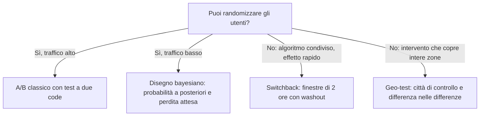

Caso ricostruito, con numeri di esempio: un'azienda italiana di logistica e retail multicanale vuole misurare due interventi. Il primo è una campagna radio regionale su quattro province. Il secondo è un algoritmo di prezzo dinamico per la consegna in giornata. Nessuno dei due si presta a un A/B classico per utente: la radio raggiunge intere città senza che si possa scegliere chi la ascolta, e prezzi diversi per la stessa consegna sullo stesso sito produrrebbero proteste in pochi minuti. Il team ha comunque bisogno di una stima causale, con un intervallo e una soglia economica.

> **Idea chiave:** Quando non puoi randomizzare gli utenti, cambi l'unità della randomizzazione, che diventa la finestra temporale o l'area geografica, e di conseguenza cambia il modo di calcolare l'incertezza. L'obiettivo resta una stima causale con un confronto onesto.

## Tre vincoli, tre disegni

Ogni metodo risponde a un vincolo specifico. Il disegno bayesiano non cambia l'unità, ma cambia il linguaggio del risultato e il modo di decidere con traffico basso. Lo switchback alterna controllo e trattamento nel tempo sullo stesso mercato, quindi funziona quando l'effetto si esaurisce in fretta e quando l'intervento non può essere mostrato a metà degli utenti nello stesso istante. Il geo-test assegna intere aree al trattamento o al controllo, ed è la scelta per radio, affissioni, promozioni locali.



| Metodo | Unità randomizzata | Quando si usa | Rischio principale |
|---|---|---|---|
| Bayesiano | Utente o sessione | Poco traffico, decisioni rapide | Prior troppo ottimistico |
| Switchback | Finestra temporale (2 ore) | Prezzo dinamico, dispatch, logistica | Effetto residuo tra finestre |
| Geo-test | Città o provincia | Radio, TV, affissioni, promozioni locali | Trend diversi prima del test |

## Approccio bayesiano: una probabilità invece di un p-value

Supponi che un nuovo layout del checkout sia stato testato con traffico limitato: 4.000 utenti per ramo, 120 acquisti nel controllo e 146 nella variante. I tassi osservati sono $120/4.000 = 3{,}00\%$ e $146/4.000 = 3{,}65\%$. Il test frequentista a due code darebbe un p-value intorno a 0,10, "non significativo" a soglia 0,05, e il team non saprebbe che cosa fare.

Nel modello Beta-Binomiale la conversione di ciascun ramo ha un prior Beta con parametri $(\alpha_0, \beta_0)$. Con un prior non informativo $\text{Beta}(1, 1)$, il posterior dopo $x$ acquisti su $n$ utenti è $\text{Beta}(\alpha_0 + x, \beta_0 + n - x)$. Per il controllo si ottiene $\text{Beta}(121, 3.881)$ con media $121/4.002 \approx 3{,}02\%$. Per la variante si ottiene $\text{Beta}(147, 3.855)$ con media $147/4.002 \approx 3{,}67\%$.

La domanda decisionale diventa: qual è la probabilità che la conversione della variante superi quella del controllo? Si calcola campionando dai due posterior o con l'approssimazione normale, usando la differenza delle medie e la radice della somma delle varianze. Il risultato è $P(p_B > p_A) \approx 0{,}947$, cioè circa il 94,7%. L'intervallo di credibilità al 95% della differenza va da circa $-0{,}14$ a $+1{,}44$ punti percentuali. La probabilità che la variante batta il controllo di almeno 0,5 punti, la soglia che il team considera rilevante, è circa il 64,5%.

Queste frasi si leggono con un significato diretto: c'è il 94,7% di probabilità che B sia migliore, e il 64,5% che sia migliore di almeno mezzo punto. Non si può però decidere con la sola probabilità. La regola da dichiarare prima è del tipo "rilascia se la probabilità di superare la soglia economica è sopra il 90%" oppure "rilascia se la perdita attesa è sotto una cifra". Con la prima regola, un valore del 64,5% non basta per il rollout, e il team continua a raccogliere dati o rinuncia.

Il prior pesa quando i dati sono pochi. Con un prior informativo $\text{Beta}(30, 970)$, costruito su una conversione storica del 3%, la stessa evidenza dà $P(p_B > p_A) \approx 0{,}929$: la probabilità scende perché il prior avvicina le due stime. Un prior ottimista, scelto senza base storica, spingerebbe in modo artificiale verso il risultato che il team vuole. Il prior va dichiarato nella scheda di pre-registrazione, con il motivo, e va confrontato con almeno una sensibilità.

## Switchback: il calcolo sulle finestre temporali

L'algoritmo di prezzo dinamico viene applicato a tutte le consegne in giornata di un mercato, quindi non si può mostrare a metà degli utenti. Lo switchback alterna controllo e trattamento in finestre di 2 ore sullo stesso mercato, con assegnazione casuale della finestra al ramo. L'unità statistica è la finestra, non l'ordine, perché gli ordini nella stessa finestra condividono la stessa condizione di traffico e di disponibilità dei corrieri.

Il test dura 14 giorni con 12 finestre al giorno, cioè 168 finestre, 84 per ramo. La metrica è la quota di consegne in orario, calcolata per finestra. Nel controllo la media è 90,6%, nel trattamento 91,8%, e la deviazione standard delle medie di finestra è 2,4 punti in entrambi i rami. L'errore standard della differenza è $2{,}4 \times \sqrt{2/84} \approx 0{,}37$ punti. La differenza è $91{,}8 - 90{,}6 = 1{,}2$ punti, quindi $t = 1{,}2/0{,}37 \approx 3{,}24$ con circa 166 gradi di libertà e p-value di circa 0,0014.

Questo calcolo regge solo se le finestre sono indipendenti, e qui entra l'effetto residuo. Un ordine che parte alle 11:55 nel trattamento può essere consegnato dopo le 12:00, quando il ramo è già tornato al controllo. Una prassi comune è escludere dall'analisi i primi 15 minuti di ogni finestra, che equivalgono al 12,5% di una finestra di 2 ore, come periodo di washout. Il costo è una riduzione del 12,5% dei dati utili, e il beneficio è che gli ordini analizzati appartengono davvero alla condizione assegnata.

Per la stessa ragione le finestre vanno bilanciate per ora e giorno della settimana: se le ore di punta cadono per caso più spesso nel trattamento, il confronto diventa una misura del traffico e non dell'algoritmo. La randomizzazione a blocchi, con una finestra per ramo in ogni coppia ora-giorno, risolve il problema.

## Geo-test: la differenza nelle differenze

Per la campagna radio, il team sceglie quattro province di test e quattro province di controllo con dinamiche simili. La campagna dura 8 settimane. Il confronto più semplice, test contro controllo dopo la campagna, è un errore: le province di test potrebbero già avere livelli più alti, e quel divario sarebbe attribuito alla radio.

La differenza nelle differenze corregge questo problema usando il periodo precedente come baseline. Supponi che le province di test vendano in media 410.000 euro a settimana nelle 8 settimane precedenti e 452.000 euro durante la campagna, mentre le province di controllo passino da 380.000 a 391.400 euro. Il controllo è cresciuto del $391.400/380.000 - 1 = 3{,}0\%$, quindi senza campagna il test sarebbe arrivato a $410.000 \times 1{,}03 = 422.300$ euro. L'effetto stimato è $452.000 - 422.300 = 29.700$ euro a settimana, pari al 7,0% della baseline controfattuale.

La stima ha senso economico solo contro il costo. Se la campagna costa 18.000 euro a settimana e il margine lordo è del 30%, il margine incrementale è $29.700 \times 0{,}30 = 8.910$ euro a settimana. Il risultato è inferiore ai 18.000 euro di costo, quindi la campagna non si ripaga: il ricavo sale, ma il margine non copre la spesa. È il motivo per cui il risultato del geo-test va sempre tradotto in margine prima di essere comunicato.

Il blocco seguente replica il calcolo bayesiano e la differenza nelle differenze, con la stessa struttura che puoi applicare ai dati reali.

```python
# Caso studio: probabilita' a posteriori Beta-Binomiale e differenza nelle differenze
import numpy as np
from scipy import stats

rng = np.random.default_rng(1)

# 1) Disegno bayesiano: 4.000 utenti per ramo, prior non informativo Beta(1, 1)
post_a = stats.beta(1 + 120, 1 + 4_000 - 120)
post_b = stats.beta(1 + 146, 1 + 4_000 - 146)
xa = post_a.rvs(400_000, random_state=rng)
xb = post_b.rvs(400_000, random_state=rng)
print(f"P(B > A) = {(xb > xa).mean():.3f}")
print(f"P(B - A > 0,5 pp) = {((xb - xa) > 0.005).mean():.3f}")
print("IC95% differenza (pp):", np.round(np.percentile(xb - xa, [2.5, 97.5]) * 100, 2))

# 2) Geo-test: differenza nelle differenze sul fatturato settimanale (euro)
test_pre, test_post = 410_000, 452_000
ctrl_pre, ctrl_post = 380_000, 391_400
crescita_controllo = ctrl_post / ctrl_pre - 1          # trend senza campagna
atteso_test = test_pre * (1 + crescita_controllo)      # controfattuale del test
effetto = test_post - atteso_test                      # incremento attribuibile alla campagna
margine = effetto * 0.30                               # margine lordo del 30%
print(f"effetto = {effetto:,.0f} euro/sett  margine = {margine:,.0f} euro/sett  costo = 18.000")
```

L'output riporta circa 0,947 per la probabilità che B batta A, circa 0,645 per la soglia di 0,5 punti, e un effetto geo di 29.700 euro a settimana con margine di 8.910 euro, sotto il costo di 18.000.

## Il controllo dei trend paralleli prima di partire

Il geo-test regge se, in assenza dell'intervento, test e controllo sarebbero cresciuti in parallelo. Questa ipotesi non si dimostra, ma si controlla sulle 8 settimane precedenti: il rapporto settimanale tra fatturato del test e del controllo deve restare quasi costante. Se oscilla tra 1,05 e 1,25 senza ragione, le province non sono confrontabili, e la differenza nelle differenze incorpora un divario che non c'entra con la radio.

Un criterio pratico è calcolare il rapporto per ciascuna settimana, guardarne la media e la deviazione, e rifiutare coppie di aree con scostamento superiore al 3% della media. Gli eventi locali noti, come una fiera, uno sciopero dei trasporti o il maltempo in una sola provincia, vanno annotati nel calendario sperimentale prima di leggere i dati, per non attribuirli alla campagna.

## Tre errori tipici nei disegni non classici

### Ignorare l'effetto residuo tra finestre switchback

**Sintomo:** l'effetto stimato cambia molto se si escludono i primi minuti di ogni finestra. **Perché succede:** gli ordini avviati nella finestra precedente vengono consegnati nella finestra corrente e portano con sé l'effetto dell'altra condizione. **Come si corregge:** introduci un washout di durata dichiarata, per esempio 15 minuti su 2 ore, e verifica la robustezza del risultato variando la durata.

### Scegliere le province di controllo a caso

**Sintomo:** nel periodo precedente la campagna le due serie di fatturato si allontanano già prima della radio. **Perché succede:** si scelgono aree grandi o note senza guardare la storia. **Come si corregge:** costruisci il controllo guardando le 8 settimane precedenti, con il rapporto stabile, e se possibile confronta più coppie di controllo per vedere se la stima resta simile.

### Usare un prior per forzare una vittoria

**Sintomo:** la probabilità di successo cresce se si cambiano i parametri del prior. **Perché succede:** un prior ottimista aggiunge di fatto dati inventati a favore della variante. **Come si corregge:** dichiara il prior prima, basalo su dati storici e riporta una sensibilità con un prior neutro. Con $\text{Beta}(1, 1)$ la probabilità era 0,947, con il prior storico 0,929: la conclusione regge se resta nella stessa fascia.

## Controllo sulla scelta del disegno

1. Un nuovo algoritmo di dispatch viene applicato a tutti i corrieri di una città. Quale disegno scegli e perché non l'A/B per utente?

<details>
<summary>Mostra risposta</summary>

Lo switchback, perché l'algoritmo è condiviso e non può essere applicato a metà dei corrieri nello stesso momento senza interferenze: i corrieri competono per gli stessi ordini. Alternare il trattamento in finestre temporali sullo stesso mercato mantiene confrontabili le condizioni e rende la finestra l'unità statistica.

</details>

2. In un geo-test le province di test passano da 200.000 a 230.000 euro a settimana e quelle di controllo da 190.000 a 199.500. Qual è l'effetto stimato con la differenza nelle differenze?

<details>
<summary>Mostra risposta</summary>

Il controllo cresce di $199.500/190.000 - 1 = 5\%$. Il test atteso senza campagna è $200.000 \times 1{,}05 = 210.000$ euro. L'effetto è $230.000 - 210.000 = 20.000$ euro a settimana, pari al 9,5% della baseline controfattuale di 210.000 euro.

</details>

3. Con 4.000 utenti per ramo, un'analisi bayesiana dà una probabilità del 92% che B sia migliore. Rilasci?

<details>
<summary>Mostra risposta</summary>

Dipende dalla regola scritta prima. Se la soglia di rilascio era 90%, sì; se era 95%, no. Conviene anche guardare la probabilità di superare l'effetto minimo economico e la perdita attesa: una probabilità alta di un effetto trascurabile non giustifica il costo di manutenzione. In assenza di una regola scritta, il 92% non permette di decidere in modo difendibile.

</details>

4. Perché in uno switchback l'unità statistica è la finestra e non l'ordine?

<details>
<summary>Mostra risposta</summary>

Perché gli ordini della stessa finestra condividono traffico, disponibilità dei corrieri e condizioni meteo, e non sono indipendenti. Trattarli come indipendenti sottostima l'errore standard, come accade con le pagine viste dello stesso utente. Con 84 finestre per ramo il campione efficace è molto più piccolo del numero di ordini, e il test va calcolato sulle medie di finestra.

</details>
