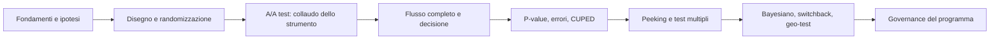

Scenario costruito, con numeri di esempio: un team prodotto italiano passa da due esperimenti all'anno a trenta in un trimestre. Tre squadre lanciano test sulla stessa pagina di checkout nella stessa settimana, ciascuna convinta di avere il traffico a disposizione. Nessuno ha un registro comune. Alla riunione di fine mese un test mostra +4% sulla conversione, un altro mostra -3% sulla stessa metrica, e nessuno sa se i due risultati si sono contaminati a vicenda. Il problema non è più la formula statistica, ma l'organizzazione che la usa.

> **Idea chiave:** La maturità sperimentale non si misura da quanti test vincono, ma dalla quota di test affidabili, documentati e trasformati in decisioni eseguite. La governance è l'insieme delle poche regole che rendono ogni test confrontabile con gli altri.

## Mappa del modulo e ordine di lettura

Le dieci lezioni del modulo seguono il ciclo di vita di un esperimento. Si parte da che cosa significa significatività, si passa alla formulazione della domanda e al disegno, si collauda lo strumento, si calcola la dimensione del campione e si legge il risultato con p-value e intervalli. Le ultime tappe riguardano i comportamenti che rovinano un test già ben disegnato, come il peeking, e i metodi per i casi in cui l'A/B classico non basta.



Quando hai un problema concreto, la tabella seguente indica dove andare. Non sostituisce le lezioni, ma accorcia la ricerca quando un test dà un risultato strano.

| Sintomo che osservi | Lezione da riaprire | Controllo da fare per primo |
|---|---|---|
| Ripartizione del traffico diversa da quella prevista | Disegno sperimentale e A/A test | Chi-quadro SRM con soglia 0,001 |
| Troppi test "significativi" su metriche che non dovrebbero muoversi | A/A test e peeking | Frequenza dei falsi positivi contro 5% |
| Il test non rileva mai nulla | Dimensione del campione, potenza e CUPED | Effetto minimo rilevabile e varianza della metrica |
| Il risultato cambia a seconda del giorno in cui lo guardi | Peeking e test sequenziali | Regola di arresto scritta prima |
| Randomizzare per utente non è possibile | Bayesiano, switchback e geo-test | Unità sperimentale e trend paralleli |

## Quali regole servono davvero

Una governance utile non rallenta i team: previene collisioni e discussioni a posteriori. Poche regole bastano. Ogni esperimento ha un proprietario nominato, una scheda di pre-registrazione di una pagina, un controllo automatico dello SRM nelle prime 24 ore, una soglia di decisione per ciascun esito e un'etichetta finale tra rilasciato, iterato e scartato.

| Elemento | Che cosa previene | Quando si controlla | Responsabile |
|---|---|---|---|
| Registro unico degli esperimenti | Test duplicati o sovrapposti sullo stesso flusso | Prima di ogni lancio | Prodotto e analisi |
| Controllo SRM e errori a 24 ore | Bug di assegnazione che invalidano il test | Giorno 1 | Ingegneria e dati |
| Layer ortogonali o mutua esclusione | Interazioni non misurate tra test | Alla registrazione | Piattaforma di sperimentazione |
| Archivio dei test neutri e negativi | Ripetere errori già pagati | A chiusura | Proprietario del test |
| Rimozione dei flag | Debito tecnico in produzione | Entro 7 giorni dalla chiusura | Ingegneria |

La distinzione tra ortogonalità e mutua esclusione merita una frase. Con layer ortogonali, ogni test usa un hash con sale diverso e può coprire il 100% del traffico: gli esperimenti si sovrappongono, ma in modo indipendente, e l'effetto di uno si distribuisce in modo uguale tra i rami dell'altro. Con la mutua esclusione, il traffico viene diviso in fette riservate a un solo test. La seconda opzione è necessaria quando due test modificano lo stesso elemento e un'interazione è plausibile, per esempio due varianti dello stesso pulsante.

## Quanti falsi vincitori produce un programma di trenta test

Il calcolo seguente mostra perché un programma ha bisogno di regole anche quando ogni singolo test è disegnato bene. Il team lancia 30 esperimenti in un trimestre con soglia $\alpha = 0{,}05$ e potenza 80%. Supponi che il 20% delle idee abbia un effetto reale, cioè 6 test, e che il restante 80%, cioè 24 test, non abbia alcun effetto.

Tra i 6 test con effetto vero, la potenza dell'80% porta a $6 \times 0{,}80 = 4{,}8$ vincitori corretti. Tra i 24 test nulli, il tasso di falsi positivi del 5% porta a $24 \times 0{,}05 = 1{,}2$ falsi vincitori. I test dichiarati vincenti sono quindi in media $4{,}8 + 1{,}2 = 6{,}0$, e la quota di falsi vincitori tra loro è $1{,}2/6{,}0 = 20\%$. Un vincitore su cinque è un falso, anche se ogni test ha rispettato la soglia.

Un secondo conto riguarda la probabilità di avere almeno un falso vincitore nel trimestre. Se tutti i 30 test fossero nulli, sarebbe $1 - 0{,}95^{30} \approx 0{,}785$, cioè il 78,5%. Con la composizione precedente la probabilità di almeno un falso è $1 - 0{,}95^{24} \approx 0{,}708$. In pratica, in un trimestre con trenta test è quasi certo che almeno un rilascio sarà basato su un effetto inesistente.

Ne derivano tre azioni concrete. Rilasciare con un intervallo di confidenza che esclude effetti trascurabili, e non con il solo p-value. Ripetere o confermare i vincitori con effetto grande in modo sospetto. Seguire nel tempo i rilasci con un holdout, cioè una piccola quota di traffico che resta sulla versione precedente, per verificare che l'effetto dichiarato si mantenga.

## Audit delle collisioni tra esperimenti

Il blocco seguente è un controllo periodico sul registro delle esposizioni. Conta quanti utenti sono stati esposti a due esperimenti attivi sullo stesso percorso e segnala le coppie sopra una soglia, per decidere se serve un layer ortogonale o una mutua esclusione.

```python
# Audit collisioni: coppie di esperimenti con molti utenti esposti a entrambi
import pandas as pd

# esposizioni: una riga per utente ed esperimento (colonne: user_id, experiment_id, flow)
esposizioni = pd.read_csv("esposizioni_ultime_2_settimane.csv")
checkout = esposizioni[esposizioni["flow"] == "checkout"]

# join del registro con se stesso: stessa persona, esperimenti diversi
coppie = checkout.merge(checkout, on="user_id", suffixes=("_a", "_b"))
coppie = coppie[coppie["experiment_id_a"] < coppie["experiment_id_b"]]

sovrapposizioni = (
    coppie.groupby(["experiment_id_a", "experiment_id_b"])["user_id"]
    .nunique()
    .reset_index(name="utenti_in_comune")
)

# soglia: oltre 5.000 utenti in comune si valuta layer ortogonale o mutua esclusione
print(sovrapposizioni[sovrapposizioni["utenti_in_comune"] > 5_000]
      .sort_values("utenti_in_comune", ascending=False))
```

Un esempio numerico chiarisce l'ordine di grandezza. Con 120.000 utenti a settimana sul checkout e due test indipendenti che coinvolgono ciascuno il 50% del traffico, la quota di utenti esposti a una variante di entrambi i test è $0{,}5 \times 0{,}5 = 25\%$, pari a 30.000 utenti. Se i test sono ortogonali, l'effetto dell'uno si distribuisce uguale tra i rami dell'altro e le stime restano corrette. Se i due test toccano lo stesso pulsante, quei 30.000 utenti ricevono una combinazione che nessuno dei due ha pianificato.

## Il decision memo di chiusura

Ogni test chiuso produce un memo di mezza pagina, scritto sempre nello stesso formato, per permettere il confronto nel tempo.

> **Effetto osservato:** differenza sulla metrica primaria con intervallo al 95%, calcolata sul campione pianificato.
> **Rischio residuo:** esito dei guardrail con intervallo, controllo SRM e riconciliazione dei totali.
> **Impatto economico netto:** guadagno stimato meno costo di manutenzione, in euro al mese.
> **Prossima azione:** rilascio, iterazione o scarto, con il proprietario e la data di rimozione dei flag.

La divisione tra effetto, rischio e azione evita il difetto più comune dei report: mescolare numeri, opinioni e raccomandazioni in un unico paragrafo, dove ciascun lettore cerca la frase che conferma la sua posizione.

## Tre errori tipici nella governance

### Valutare i team sul numero di test vincenti

**Sintomo:** crescono i test con piccoli effetti e il peeking. **Perché succede:** chi viene misurato sui test verdi sceglie modifiche banali, e se il risultato non arriva guarda i dati finché compare. **Come si corregge:** misura la qualità del processo, cioè la quota di test con scheda completa, SRM controllato e decisione eseguita, e premia anche i test neutri ben documentati.

### Lasciare che più test modifichino lo stesso flusso senza coordinamento

**Sintomo:** due varianti dello stesso pulsante producono risultati in conflitto. **Perché succede:** ogni squadra vede solo il proprio test. **Come si corregge:** registro unico con un campo "elemento modificato", e mutua esclusione quando due test toccano lo stesso elemento.

### Dimenticare l'aggiornamento di documentazione e flag dopo la chiusura

**Sintomo:** nel codice restano flag di esperimenti conclusi da mesi e nessuno sa quale versione sia attiva. **Perché succede:** la pulizia non ha un proprietario né una scadenza. **Come si corregge:** una scadenza di 7 giorni nella scheda e un controllo mensile dei flag attivi da più di 30 giorni.

## Quando il management chiede di saltare il processo

Quando arriva la richiesta urgente di lanciare una modifica senza test, un rifiuto di principio raramente funziona. Una proposta più utile è un rilascio controllato: la modifica va al 90% del traffico, un holdout del 10% resta sulla versione precedente, i guardrail vengono monitorati per 48 ore e le soglie di rollback sono scritte prima. Il business ottiene la velocità, e il team conserva un gruppo di confronto con cui misurare l'effetto dopo il lancio.

## Controllo sulla governance

1. Con 40 test in un trimestre, soglia 0,05, potenza 80% e il 10% di idee con effetto reale, quanti falsi vincitori ti aspetti e quale quota dei vincitori è falsa?

<details>
<summary>Mostra risposta</summary>

I test con effetto vero sono 4 e i nulli sono 36. I vincitori corretti sono $4 \times 0{,}80 = 3{,}2$ e i falsi sono $36 \times 0{,}05 = 1{,}8$. I vincitori totali sono 5,0 e la quota di falsi è $1{,}8/5{,}0 = 36\%$. Più la quota di idee valide è bassa, più la soglia 0,05 produce falsi vincitori in proporzione.

</details>

2. Due test indipendenti coinvolgono il 40% e il 30% del traffico di una pagina con 50.000 utenti a settimana. Quanti utenti vedono una variante di entrambi?

<details>
<summary>Mostra risposta</summary>

La quota è $0{,}40 \times 0{,}30 = 12\%$, quindi $50.000 \times 0{,}12 = 6.000$ utenti. Con assegnazione indipendente e sali diversi, questo non invalida le stime di ciascun test; se i due test modificano lo stesso elemento, serve invece la mutua esclusione.

</details>

3. Qual è la differenza tra layer ortogonali e mutua esclusione, e quando preferisci la seconda?

<details>
<summary>Mostra risposta</summary>

Con layer ortogonali ogni test usa tutto il traffico con un hash indipendente e le sovrapposizioni si distribuiscono in modo uniforme tra i rami. Con la mutua esclusione ogni test ha una fetta riservata. Si preferisce la seconda quando due test cambiano lo stesso elemento e un'interazione è plausibile, o quando un effetto di rete rende la sovrapposizione problematica.

</details>

4. Perché il decision memo separa effetto osservato, rischio residuo e prossima azione?

<details>
<summary>Mostra risposta</summary>

Perché ogni lettore deve poter verificare i numeri senza essere guidato dalla raccomandazione. L'effetto con intervallo e il rischio con i guardrail sono dati controllabili, mentre la prossima azione è una scelta che discende dalla matrice scritta in anticipo. Mescolarli rende difficile capire se la decisione segue i dati o l'opinione di chi scrive.

</details>
