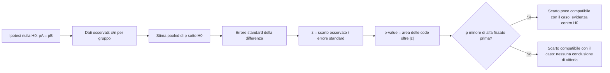

## Un test chiuso dopo due giorni su un +9% che non esisteva

Scenario costruito, con numeri di esempio: un e-commerce italiano di abbigliamento sostituisce il pulsante di pagamento del checkout. Il venerdì mattina, dopo quarantotto ore, la dashboard mostra 200 acquisti su 4.000 sessioni per il vecchio pulsante e 218 acquisti su 4.000 sessioni per il nuovo. Il tasso passa dal 5,00% al 5,45%, cioè un miglioramento relativo del 9%. Il responsabile di prodotto ferma il test e rilascia la variante al cento per cento del traffico. Nelle tre settimane successive il tasso di conversione torna a oscillare attorno al 5,0% e il fatturato netto resta identico alla media storica.

Nessuno ha sbagliato un calcolo. Il problema è che nessuno si era chiesto quanto spesso due pulsanti identici producano, per puro caso, uno scarto di 18 acquisti su 4.000 sessioni. La risposta, che calcoleremo tra poco, è: circa una volta su tre. Un numero che compare una volta su tre in assenza di qualsiasi effetto non è una prova di nulla.

> **Idea chiave:** la significatività statistica non misura quanto è grande o utile un effetto, ma quanto sarebbe facile ottenere per sola variabilità di campionamento uno scarto grande almeno quanto quello osservato, se in realtà le due varianti fossero uguali.

Questa lezione costruisce il vocabolario e il calcolo minimo per rispondere a quella domanda: che cosa si assume prima di guardare i dati, come si misura il rumore, come si trasforma una differenza in un p-value e come si verifica che il proprio sistema di test non inventi vittorie.

## Ipotesi nulla, ipotesi alternativa e i due modi di sbagliare

Un test frequentista non cerca di dimostrare che la variante è migliore. Procede per assurdo: assume che tra controllo e variante non ci sia alcuna differenza reale, e valuta se i dati osservati sono compatibili con quell'assunzione. L'assunzione di partenza si chiama ipotesi nulla, indicata con $H_0$: nel nostro caso $p_B = p_A$, cioè le due varianti hanno lo stesso tasso di conversione vero. L'ipotesi alternativa $H_1$ afferma che i tassi sono diversi, oppure, se hai una ragione scritta in anticipo per farlo, che $p_B > p_A$.

La scelta tra alternativa bilaterale e unilaterale va fatta prima del lancio, non dopo aver visto in quale direzione si muove il numero. Nella pratica aziendale conviene quasi sempre il test bilaterale, perché una variante peggiorativa ti interessa tanto quanto una migliorativa.

Ogni decisione basata su un test può sbagliare in due modi, e il modo in cui li gestisci determina il disegno dell'esperimento.

| Errore | Che cosa succede | Probabilità | Valore tipico | Costo per il business |
| --- | --- | --- | --- | --- |
| Tipo I (falso positivo) | Dichiari vincente una variante che in realtà è uguale | $\alpha$ | 5% | Rilasci modifiche inutili o dannose |
| Tipo II (falso negativo) | Scarti una variante che in realtà è migliore | $\beta$ | 20% | Perdi un miglioramento reale |
| Potenza | Individui un effetto reale quando esiste | $1-\beta$ | 80% | Dipende dal campione e dall'effetto minimo |
| MDE | Differenza minima che vuoi riuscire a vedere | scelta di business | es. 0,45 pp | Un MDE troppo piccolo allunga il test, uno troppo grande ti rende cieco |

Il valore $\alpha = 0{,}05$ è una convenzione: Ronald Fisher lo propose come soglia pratica nel 1925, in *Statistical Methods for Research Workers*, e da allora è rimasto lo standard. Non c'è nulla di fisico in quel numero. Un prodotto con alto costo di errore, per esempio una modifica al prezzo, può richiedere $\alpha = 0{,}01$; un esperimento a basso rischio e facilmente reversibile può tollerare $\alpha = 0{,}10$. L'importante è fissarlo per iscritto prima di guardare i risultati.

## La distribuzione campionaria: perché due gruppi identici danno numeri diversi

Se estraessi 4.000 sessioni dal checkout oggi e altre 4.000 domani, con lo stesso pulsante, non otterresti due volte esattamente 200 acquisti. Il numero di conversioni in un campione di dimensione $n$ con probabilità vera $p$ segue una distribuzione binomiale, con media $np$ e varianza $np(1-p)$. Per campioni di migliaia di unità la proporzione osservata $\hat{p}$ si distribuisce in modo molto vicino a una normale, centrata su $p$ e con deviazione standard

$$\mathrm{SE}(\hat{p}) = \sqrt{\frac{p(1-p)}{n}}$$

Questa deviazione standard della proporzione campionaria si chiama errore standard. Se il tasso vero è il 5% e $n = 4.000$, vale $\sqrt{0{,}05 \cdot 0{,}95 / 4000} \approx 0{,}00345$, cioè 0,345 punti percentuali. Un campione di 4.000 sessioni produce quindi un tasso che, da un giorno all'altro, può spostarsi di circa mezzo punto senza che nulla sia cambiato.

Per confrontare due gruppi indipendenti ci interessa la distribuzione della differenza $\hat{p}_B - \hat{p}_A$. Le varianze si sommano, e sotto $H_0$ i due gruppi condividono lo stesso tasso vero, che si stima con la proporzione complessiva (pooled) $\hat{p} = (x_A + x_B)/(n_A + n_B)$:

$$z = \frac{\hat{p}_B - \hat{p}_A}{\sqrt{\hat{p}(1-\hat{p})\left(\frac{1}{n_A}+\frac{1}{n_B}\right)}}$$

La statistica $z$ esprime lo scarto osservato in unità di errore standard. Sotto $H_0$ si distribuisce come una normale standard: valori attorno a zero sono tipici, valori oltre $\pm 1{,}96$ capitano solo nel 5% dei casi. Il p-value è l'area delle code oltre $|z|$: $p = 2\,(1 - \Phi(|z|))$ per il test bilaterale.



## Il calcolo completo sul checkout: da 5,00% e 5,45% al p-value

Riprendiamo i numeri dell'apertura e svolgiamo ogni passaggio, usando solo le quattro quantità osservate: 4.000 sessioni e 200 acquisti per il controllo, 4.000 sessioni e 218 acquisti per la variante.

1. Tassi osservati: $\hat{p}_A = 200/4000 = 0{,}0500$ (5,00%) e $\hat{p}_B = 218/4000 = 0{,}0545$ (5,45%). La differenza è $0{,}0045$, cioè 0,45 punti percentuali, pari a un incremento relativo del 9%.
2. Proporzione pooled: $\hat{p} = (200 + 218)/(4000 + 4000) = 418/8000 = 0{,}05225$.
3. Varianza sotto $H_0$: $\hat{p}(1-\hat{p}) = 0{,}05225 \times 0{,}94775 = 0{,}049520$.
4. Errore standard della differenza: $\sqrt{0{,}049520 \times (1/4000 + 1/4000)} = \sqrt{0{,}049520 \times 0{,}0005} = \sqrt{0{,}00002476} \approx 0{,}004976$, cioè 0,498 pp.
5. Statistica test: $z = 0{,}0045 / 0{,}004976 \approx 0{,}904$.
6. p-value bilaterale: $2\,(1 - \Phi(0{,}904)) = 2 \times 0{,}183 \approx 0{,}366$.

Lo scarto di 0,45 pp è meno di una volta l'errore standard: è un risultato del tutto ordinario per due gruppi identici. Un p-value di 0,366 significa che, se il nuovo pulsante non cambiasse nulla, ti aspetteresti uno scarto così o più grande in oltre un test su tre. Non hai dimostrato che il pulsante sia inefficace: hai dimostrato che con 4.000 sessioni per gruppo non puoi distinguere un +0,45 pp dal rumore.

Quanto campione serve per vederlo? Con baseline del 5%, effetto minimo di interesse di 0,45 pp, $\alpha = 0{,}05$ bilaterale e potenza 80%, servono circa 38.400 sessioni per gruppo. A 2.000 sessioni al giorno per gruppo sono 19,2 giorni, quindi si arrotonda a 21 giorni per coprire tre cicli settimanali completi. Il test fermato dopo due giorni aveva raccolto il 10% del campione necessario.

## Calibrare il sistema con un test A/A

Prima di fidarti della tua piattaforma di sperimentazione, controlla che non produca vincitori inesistenti. Il test A/A assegna gli utenti a due gruppi che vedono la stessa identica esperienza. Se la pipeline di assegnazione, il tracciamento e il calcolo statistico sono corretti, solo il 5% degli A/A deve risultare significativo a $\alpha = 0{,}05$. Se ne trovi il 12%, il problema non è la variante: è il sistema.

Il codice seguente simula 5.000 test A/A con i parametri del checkout e conta quanti risultano significativi e quanti mostrano per puro caso uno scarto di almeno 0,45 pp.

```python
import numpy as np
from scipy import stats

# Simulazione di 5.000 test A/A: stesso tasso vero (5%) in entrambi i gruppi
rng = np.random.default_rng(7)
n, p_vero, runs = 4000, 0.05, 5000

conv_a = rng.binomial(n, p_vero, runs)
conv_b = rng.binomial(n, p_vero, runs)

# Stima pooled, errore standard e statistica z per ogni run
pooled = (conv_a + conv_b) / (2 * n)
se = np.sqrt(pooled * (1 - pooled) * 2 / n)
diff = conv_b / n - conv_a / n
z = diff / se
p_value = 2 * (1 - stats.norm.cdf(np.abs(z)))

print("Falsi positivi a alfa 5%:", (p_value < 0.05).mean())
print("A/A con scarto assoluto >= 0,45 pp:", (np.abs(diff) >= 0.0045).mean())
```

Con questo seme l'esecuzione restituisce circa 4,8% di falsi positivi, coerente con il 5% teorico, e circa 36% di A/A con scarto assoluto di almeno 0,45 pp. Il secondo numero coincide con il p-value di 0,366 calcolato a mano e smonta l'intuizione che uno scarto del 9% relativo sia di per sé impressionante: a questa dimensione di campione capita più di una volta su tre senza alcun intervento.

Se la tua piattaforma mostra una frequenza di falsi positivi sensibilmente superiore al 5% in un A/A reale, cerca le cause tipiche: assegnazione non casuale (per esempio basata su cookie persistenti che cambiano tra dispositivi), conteggio delle conversioni per sessione invece che per utente, bot non filtrati, esposizione registrata solo per una delle due varianti.

## Tre errori che falsano la lettura di un test

### Confondere la significatività statistica con la rilevanza di business

Il sintomo è un report che celebra un p-value minuscolo su un effetto economicamente trascurabile. Succede perché l'errore standard scende con la radice del campione: con milioni di sessioni anche una differenza di 0,05 pp supera la soglia di significatività, ma un guadagno di 0,05 pp su un tasso del 5% può valere meno del costo di manutenere il codice della variante. Si corregge dichiarando prima l'MDE in euro, non solo in punti percentuali, e riportando sempre la stima dell'effetto con il suo intervallo accanto al p-value.

### Fermare il test appena il p-value scende sotto 0,05

Il sintomo è un test chiuso al terzo o quarto giorno perché la dashboard ha mostrato un verde. Succede perché ogni controllo intermedio con facoltà di fermarsi offre al caso una nuova occasione di superare la soglia: la probabilità complessiva di un falso positivo cresce ben oltre il 5% dichiarato. La lezione dedicata a peeking e confronti multipli quantifica il fenomeno; qui basta fissare la regola. Si corregge scrivendo la dimensione del campione e la data di lettura prima del lancio, e leggendo il p-value solo allora.

### Usare la media su metriche asimmetriche senza guardare gli outlier

Il sintomo è una variante vincente sul ricavo medio per utente nonostante il comportamento tipico non sia cambiato. Succede perché la media di una distribuzione con coda lunga è dominata da pochi valori: un singolo ordine B2B da 50.000 euro in un gruppo di 4.000 utenti sposta il ricavo medio di 12,5 euro per utente. Si corregge scegliendo prima una metrica robusta, come il tasso di acquisto, oppure dichiarando in anticipo una soglia di winsorizzazione, e controllando il peso dei valori estremi prima di leggere la differenza.

## I limiti del frequentismo e il caso del traffico ridotto

Il p-value risponde a una domanda indiretta: quanto sono sorprendenti questi dati se $H_0$ fosse vera. Non restituisce la probabilità che la variante sia migliore, né la probabilità che $H_0$ sia vera. Per ottenere quelle probabilità servirebbe un approccio bayesiano con una distribuzione a priori, che ha costi propri e che molte piattaforme implementano in modo opaco. Il test frequentista resta lo standard operativo perché le sue garanzie sono semplici da dichiarare: se rispetti il disegno, il tasso di falsi positivi a lungo termine è quello che hai fissato.

La conseguenza pratica più dura riguarda i siti con poco traffico. Un portale B2B con 600 lead al mese e una conversione del 3% che volesse rilevare un miglioramento relativo del 10% (da 3,0% a 3,3%) avrebbe bisogno di oltre 53.000 sessioni per gruppo: a 20.000 sessioni al mese sarebbero cinque mesi di test per una singola idea. In quel contesto le scelte sensate sono tre: testare solo modifiche con effetto atteso grande, usare metriche più vicine al comportamento (per esempio il click sul modulo, purché il legame con il lead sia validato), oppure affiancare all'esperimento una ricerca qualitativa strutturata. Fare finta che un test di due settimane possa distinguere un +10% su quel volume non produce evidenza: produce un altro 36% di vittorie casuali.

Un'ultima disciplina tiene insieme tutto: mantieni un registro delle ipotesi, delle metriche primarie, delle durate effettive e delle decisioni, compresi i test neutri e negativi. Il registro serve a calibrare le stime di durata sulle esperienze reali e a impedire che la stessa idea venga ritestata sei mesi dopo senza memoria.

## Controllo sui fondamenti

1. In un test su due varianti identiche, quale frequenza di risultati significativi a $\alpha = 0{,}05$ ti aspetti e che cosa concludi se il tuo A/A ne mostra il 12%?

<details>
<summary>Mostra risposta</summary>

Ti aspetti circa il 5%, perché $\alpha$ è per definizione la frequenza dei falsi positivi quando $H_0$ è vera. Un 12% indica che il sistema non rispetta le assunzioni del test: assegnazione non casuale, unità di analisi sbagliata (sessioni al posto degli utenti), bot non filtrati o esposizione tracciata in modo asimmetrico. Prima di lanciare altri esperimenti va corretta la pipeline, perché ogni risultato successivo ne eredita il difetto.

</details>

2. Con 3.000 utenti per gruppo, 150 conversioni nel controllo e 171 nella variante, calcola il tasso di ciascun gruppo, la proporzione pooled e stabilisci se lo scarto supera $z = 1{,}96$?

<details>
<summary>Mostra risposta</summary>

Tassi: 150/3000 = 5,00% e 171/3000 = 5,70%, differenza 0,70 pp. Pooled: (150 + 171)/6000 = 321/6000 = 0,0535. Errore standard: $\sqrt{0{,}0535 \times 0{,}9465 \times (2/3000)} = \sqrt{0{,}050638 \times 0{,}000667} = \sqrt{0{,}00003376} \approx 0{,}005810$. Quindi $z = 0{,}0070 / 0{,}005810 \approx 1{,}20$, inferiore a 1,96: il p-value è circa 0,23 e lo scarto non è distinguibile dal rumore.

</details>

3. Un collega ti mostra un p-value di 0,03 e dice che c'è il 97% di probabilità che la variante sia migliore. Che cosa correggi?

<details>
<summary>Mostra risposta</summary>

Il p-value non è la probabilità che l'alternativa sia vera. Dice che, se non ci fosse alcuna differenza, dati così estremi comparirebbero nel 3% dei casi. La probabilità che la variante sia migliore dipende anche dalla plausibilità iniziale dell'idea e richiederebbe un'analisi bayesiana. Si riporta il p-value come misura di incompatibilità con $H_0$ e si affianca la stima dell'effetto con il suo intervallo di confidenza.

</details>

4. Il tuo sito genera 1.500 sessioni al giorno per gruppo e vuoi rilevare 0,45 pp su una baseline del 5%. Sapendo che servono circa 38.400 sessioni per gruppo, quanti giorni di test pianifichi e perché non ne basta il numero grezzo?

<details>
<summary>Mostra risposta</summary>

38.400 / 1.500 = 25,6 giorni, quindi 26 giorni. Si arrotonda per eccesso a 28 giorni, quattro settimane complete, perché il comportamento di acquisto cambia tra giorni feriali e fine settimana e un test che copre solo parti del ciclo settimanale produce una stima distorta. Il campione non va mai ridotto per rientrare in una scadenza: se la scadenza non è compatibile, si alza l'MDE oppure si rinuncia al test.

</details>
