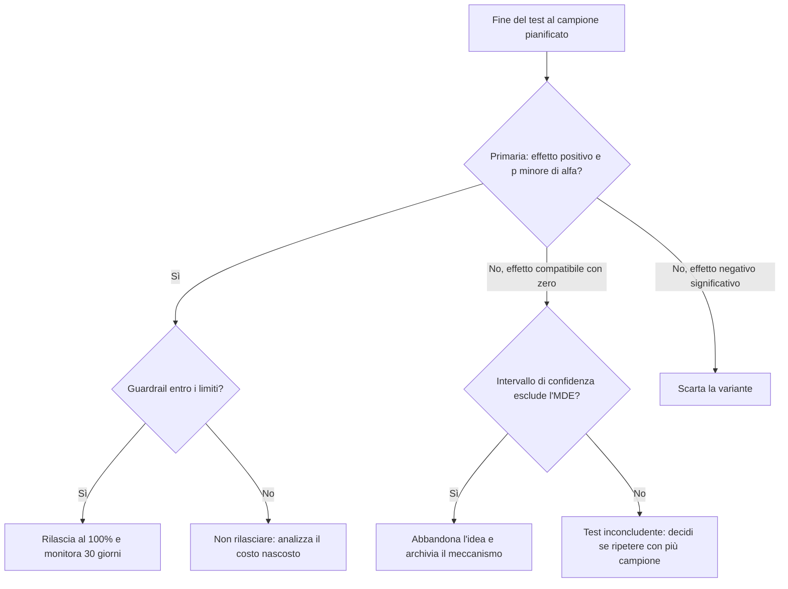

## Tre modifiche in un solo test: la pagina piani cambiata "per vedere cosa succede"

Scenario costruito, con numeri di esempio: una piattaforma SaaS italiana di fatturazione elettronica cambia in un solo rilascio il titolo della pagina piani, il colore del pulsante di prova gratuita e il prezzo del piano intermedio, da 29 a 25 euro al mese. Il test gira per tre settimane e la conversione in iscrizioni di prova passa dal 3,0% al 3,4%. Nessuno sa a quale dei tre cambiamenti attribuire il +0,4 pp. Peggio, nessuno sa se il rialzo sia stato pagato con un calo dell'attivazione, cioè con prove iscritte da persone che non useranno mai il prodotto, o con un abbassamento del prezzo medio incassato.

Quando il test finisce, le riunioni successive sono dedicate a interpretare il risultato invece che a decidere. Chi ha proposto il prezzo lo difende, chi ha proposto il titolo rivendica il merito, e il numero non risolve la discussione perché non era stato scritto in anticipo che cosa avrebbe dovuto accadere per dire sì o no a ciascuna idea.

> **Idea chiave:** un esperimento produce apprendimento solo se, prima del lancio, hai scritto quale meccanismo stai mettendo alla prova, quale unica metrica decide, di quanto deve muoversi per giustificare il costo e quale limite non puoi superare su altre metriche.

La statistica arriva dopo. Il valore di un test dipende al 70% dalla qualità della domanda e solo per il resto dalla correttezza del calcolo: un p-value perfetto su un'ipotesi mal posta resta una risposta alla domanda sbagliata.

## Dalla domanda causale all'ipotesi scritta

Una domanda causale ha la forma "se cambio X, cambia Y?" e presuppone un intervento che puoi assegnare a caso. Domande come "perché gli utenti abbandonano la pagina piani?" sono osservazionali: servono a generare idee, non a decidere. L'esperimento prende l'idea e la trasforma in una proposizione falsificabile, cioè una frase che i dati possono smentire.

Il formato più utile contiene cinque elementi in un'unica frase, come nel modello seguente, che puoi copiare nel documento di progetto di ogni test.

> **Ipotesi.** Se mostriamo ai nuovi visitatori della pagina piani un prezzo annuale equivalente mensile accanto al prezzo mensile,
> ci aspettiamo che la percentuale di visitatori che avvia la prova gratuita aumenti di almeno 0,5 punti percentuali,
> perché il confronto riduce il costo percepito e rimuove un passaggio di calcolo mentale,
> senza che il tasso di attivazione a 14 giorni scenda di oltre 2 punti percentuali rispetto al 60% attuale.

Ogni parte della frase svolge un lavoro preciso e ha un errore tipico associato.

| Elemento | Domanda a cui risponde | Esempio | Errore tipico |
| --- | --- | --- | --- |
| Intervento isolato | Quale unica leva cambia | Prezzo annuale in equivalente mensile | Cambiare titolo, colore e prezzo insieme |
| Popolazione | Su chi si applica | Nuovi visitatori della pagina piani | Includere clienti già paganti |
| Metrica primaria | Che cosa decide | Visitatori che avviano la prova / visitatori | Scegliere tra cinque metriche dopo il test |
| Effetto minimo (MDE) | Quanto deve muoversi | +0,5 pp su base 3,0% | Nessuna soglia, quindi qualunque numero verde vince |
| Meccanismo | Perché dovrebbe funzionare | Minore costo cognitivo | "Proviamo e vediamo" |
| Guardrail | Che cosa non deve peggiorare | Attivazione a 14 giorni almeno al 58% | Ottimizzare il clic distruggendo la qualità |

Il meccanismo non è un ornamento. Se il test è neutro, il meccanismo ti dice che cosa hai imparato: l'idea che il costo cognitivo del prezzo sia un freno non è supportata, e puoi abbandonare tutta la famiglia di modifiche che ne discendono. Un test senza meccanismo dichiarato, se è neutro, non insegna nulla.

## Metrica primaria, unità di analisi e direzione attesa

La metrica primaria è una sola, perché ogni metrica aggiuntiva dichiarata come decisiva moltiplica le occasioni di falso positivo. Scegli quella più vicina al valore economico che sei in grado di misurare nella finestra del test. Per la pagina piani, la candidata più vicina al ricavo sarebbe il tasso di pagamento a 30 giorni, ma richiede un mese di attesa dopo la fine dell'esposizione. Il compromesso ragionevole è una metrica anticipatrice con legame validato, per esempio l'avvio della prova gratuita, accompagnata da un guardrail sull'attivazione che intercetta la qualità delle iscrizioni.

L'unità di analisi deve coincidere con l'unità di randomizzazione. Se assegni per utente, calcoli il tasso su utenti; se calcoli su sessioni mentre assegni per utente, le osservazioni di uno stesso utente sono correlate e l'errore standard viene sottostimato, con p-value troppo ottimisti. Per la pagina piani l'unità naturale è il visitatore identificato dal cookie di primo livello, con la limitazione nota che un utente che cambia dispositivo può vedere entrambe le varianti.

La direzione attesa va scritta insieme alla scelta tra test bilaterale e unilaterale. Una direzione dichiarata e giustificata non autorizza a ignorare l'effetto opposto: nel dubbio usa il bilaterale e riserva il unilaterale ai casi in cui un effetto contrario ti porterebbe comunque a non rilasciare.

## Dall'ipotesi all'MDE: il calcolo economico passo per passo

L'MDE non è un parametro statistico scelto per comodità: è la risposta alla domanda "sotto quale miglioramento non vale la pena rilasciare". Si ricava dal confronto tra costo della modifica e valore che genera. Prendiamo i numeri dell'esempio: 60.000 visitatori al mese sulla pagina piani, tasso base di iscrizione del 3,0%, margine atteso di 40 euro per ogni iscrizione che diventa cliente, costo di sviluppo e manutenzione della modifica pari a 12.000 euro in un anno.

1. Iscrizioni extra necessarie per coprire il costo: 12.000 euro / 40 euro = 300 iscrizioni in 12 mesi, cioè 25 iscrizioni al mese.
2. Break-even in punti percentuali: 25 / 60.000 = 0,0417 pp, quindi da 3,000% a 3,042%.
3. Campione per rilevare quell'effetto con $\alpha = 0{,}05$ bilaterale e potenza 80%: circa 2,64 milioni di visitatori per gruppo, cioè 5,29 milioni in totale, pari a oltre 88 mesi di traffico. Il break-even esiste ma nessun test può misurarlo.
4. Si cerca allora un MDE che sia sia economicamente rilevante sia misurabile. Con MDE = 0,5 pp (da 3,0% a 3,5%) servono circa 19.743 visitatori per gruppo, 39.486 in totale: 39.486 / 60.000 = 0,66 mesi, cioè 20 giorni. Si pianificano 21 giorni, tre cicli settimanali completi.
5. Valore economico di un effetto pari all'MDE: 0,005 × 60.000 = 300 iscrizioni extra al mese, 300 × 40 = 12.000 euro al mese. Il costo di 12.000 euro è ripagato in un mese.
6. Alternativa con MDE = 0,3 pp: servono circa 53.211 visitatori per gruppo, 106.422 in totale, pari a 1,77 mesi (circa 8 settimane); valore 0,003 × 60.000 × 40 = 7.200 euro al mese, rientro in 1,7 mesi.

Il confronto tra le righe 4 e 6 rende esplicito il compromesso. Un MDE più piccolo costa più tempo e quindi più ritardo nelle decisioni successive. La scelta di 0,5 pp è difendibile perché la modifica, se funziona, vale molto più del suo costo, e perché un effetto più piccolo di 0,3 pp non cambierebbe la decisione di prodotto in modo apprezzabile.

Il calcolo si replica in poche righe di Python, utile per ricalcolare le alternative quando traffico, baseline o costo cambiano.

```python
from scipy import stats

# Break-even economico e campione necessario per diversi MDE
visite_mese = 60_000
base = 0.03
margine_per_iscrizione = 40
costo_12_mesi = 12_000

def campione_per_gruppo(p0, delta, alpha=0.05, potenza=0.80):
    """Campione per gruppo per un test z bilaterale su due proporzioni."""
    p1 = p0 + delta
    pm = (p0 + p1) / 2
    za = stats.norm.ppf(1 - alpha / 2)
    zb = stats.norm.ppf(potenza)
    num = (za * (2 * pm * (1 - pm)) ** 0.5
           + zb * (p0 * (1 - p0) + p1 * (1 - p1)) ** 0.5) ** 2
    return num / delta ** 2

# Break-even: iscrizioni extra mensili necessarie per coprire il costo
extra_mese = costo_12_mesi / margine_per_iscrizione / 12
print("Break-even (pp):", round(extra_mese / visite_mese * 100, 4))

for mde in (0.003, 0.005):
    n = campione_per_gruppo(base, mde)
    mesi = 2 * n / visite_mese
    valore = mde * visite_mese * margine_per_iscrizione
    print(f"MDE {mde*100:.1f} pp: {n:,.0f} per gruppo, {mesi:.2f} mesi, {valore:,.0f} euro/mese")
```

## Guardrail e regola di decisione scritta prima del lancio

Un guardrail è una metrica che non deve peggiorare oltre un limite dichiarato, anche se la metrica primaria migliora. Serve a impedire vittorie che distruggono valore altrove. Un nuovo flusso di sconto può far crescere gli ordini del 15% e ridurre il margine unitario del 20%: senza un guardrail sul margine il test appare un successo, con il guardrail il rilascio viene bloccato. I guardrail tipici sono qualità (attivazione, tasso di reso), margine (ricavo netto per ordine) e velocità (tempo di caricamento).

La regola di decisione è una tabella a tre righe, scritta nel documento di progetto e approvata da prodotto, marketing e analisi prima di assegnare il primo utente.



Il ramo più trascurato è il centrale. Un test neutro con intervallo di confidenza che esclude l'MDE ti permette di chiudere un'idea con fiducia; un test neutro con intervallo molto ampio ti dice solo che il campione era insufficiente. Distinguere i due casi in anticipo evita di raccontare entrambi come "non ha funzionato".

## Tre errori comuni nel formulare le ipotesi

### Misurare una metrica di vanità invece dell'obiettivo

Il sintomo è un test vinto sui clic che non si traduce in ricavo. Succede perché i clic sono rapidi da misurare e rispondono subito a titoli aggressivi, mentre l'attivazione o il pagamento arrivano giorni dopo. Si corregge scegliendo come primaria la metrica più vicina al valore che puoi osservare nella durata prevista e ponendo la metrica di qualità come guardrail con soglia numerica.

### Cambiare la metrica primaria dopo aver visto i risultati

Il sintomo è un test piatto sulla metrica dichiarata e un rialzo "interessante" su una secondaria, trasformato in vittoria. Succede perché dieci metriche secondarie a $\alpha = 0{,}05$ producono in media 0,5 falsi positivi anche in assenza di effetto, e la mente cerca una storia nei dati. Si corregge congelando la metrica primaria nel documento di progetto con data e firma, e trattando ogni altra scoperta come ipotesi da testare in un esperimento successivo.

### Dichiarare un MDE senza collegarlo a un valore economico

Il sintomo è un MDE scelto perché "è quello che il tool propone" e un test che chiude con 0,1 pp significativi che nessuno sa se rilasciare. Succede perché l'MDE appare come un parametro tecnico, non come una soglia di decisione. Si corregge calcolando il break-even come nell'esempio sopra e scegliendo l'MDE più piccolo che sia sia sopra il break-even sia misurabile nel traffico disponibile.

## Il caso difficile: un flusso che aiuta un segmento e peggiora l'altro

Capita che un nuovo flusso di registrazione semplificato aiuti molto i nuovi utenti e rallenti gli utenti esperti, abituati alla vecchia interfaccia. Se hai un motivo per sospettarlo prima del lancio, dichiara nel piano l'analisi per segmento, indicando quali segmenti (non più di due o tre) e la direzione attesa. Un'analisi per segmento dichiarata in anticipo è un'ipotesi; la stessa analisi scoperta dopo, tra venti possibili suddivisioni, è pesca a strascico, e con venti segmenti ti aspetti un falso positivo anche senza effetto reale. La regola pratica è che gli effetti eterogenei scoperti a posteriori diventano nuove ipotesi per il test successivo, non motivi di rilascio parziale.

## Controllo sulle ipotesi

1. Un collega propone "rinnovare la home page" e misurare le vendite. Quali tre elementi mancano per chiamarla un'ipotesi sperimentale?

<details>
<summary>Mostra risposta</summary>

Mancano l'intervento isolato (che cosa cambia, esattamente), il meccanismo (perché dovrebbe aumentare le vendite) e l'effetto minimo che giustifica il rilascio. Mancano inoltre un guardrail e una regola di decisione. "Rinnovare la home page" raggruppa più modifiche, quindi anche un test positivo non indicherebbe quale parte ha funzionato.

</details>

2. Una modifica costa 18.000 euro in un anno, ogni conversione vale 60 euro di margine e hai 90.000 visite al mese. Qual è il break-even in conversioni mensili e in punti percentuali?

<details>
<summary>Mostra risposta</summary>

Conversioni necessarie in 12 mesi: 18.000 / 60 = 300, cioè 25 al mese. Break-even in punti percentuali: 25 / 90.000 = 0,0278 pp. L'MDE di test va scelto sopra questo valore e entro quanto il traffico permette di misurare, non uguale al break-even, che richiederebbe un campione enorme.

</details>

3. Il test chiude con effetto +0,2 pp sulla primaria, intervallo di confidenza da -0,1 a +0,5 pp e MDE dichiarato pari a 0,5 pp. Come lo classifichi e che cosa decidi?

<details>
<summary>Mostra risposta</summary>

È un test inconcludente, non neutro: l'intervallo include sia zero sia l'MDE, quindi i dati non escludono né un effetto nullo né un effetto pari al valore minimo che ti interessava. Non rilasci per evidenza insufficiente. La decisione dipende dal costo di ripetere con campione maggiore o con riduzione della varianza, non dal fatto che il punto stimato sia positivo.

</details>

4. Prima del lancio dichiari come guardrail "attivazione a 14 giorni non sotto il 58%". A fine test la primaria sale di 0,6 pp ma l'attivazione scende al 55%. Che cosa fai e perché?

<details>
<summary>Mostra risposta</summary>

Non rilasci. Il guardrail è stato violato, quindi l'aumento delle prove gratuite è stato ottenuto attirando utenti che attivano meno. Il test rivela un costo nascosto che l'analisi della sola primaria avrebbe nascosto. Si analizza se il calo riguarda un canale o un segmento specifico e si formula una nuova ipotesi che ne tenga conto.

</details>
