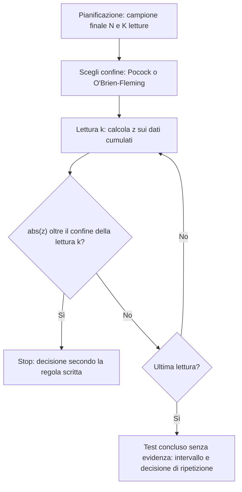

## La dashboard del martedì: quattordici controlli su due varianti identiche

Scenario costruito, con numeri di esempio: un'azienda SaaS italiana lancia un test sul banner della home page. Le due varianti, per un difetto di configurazione scoperto solo mesi dopo, mostrano in realtà lo stesso identico banner. Il team ha una dashboard con il p-value aggiornato in tempo reale e, per due settimane, la apre ogni mattina. Il quarto giorno compare un +6% con p = 0,038. Il responsabile di prodotto ferma il test, annuncia la vittoria e fa rilasciare. Un mese dopo il tasso di conversione è quello di prima.

Non c'è stata sfortuna. Un test che si può fermare ogni volta che il p-value attraversa la soglia ha una probabilità di falso positivo molto più alta del 5% dichiarato. Con quattordici letture giornaliere su dati senza alcun effetto, la simulazione che vedremo tra poco indica circa il 22%: quasi un test su cinque produce una vittoria immaginaria.

> **Idea chiave:** il 5% di $\alpha$ vale solo se guardi il risultato una volta, al campione pianificato. Ogni lettura intermedia con facoltà di decidere, ogni variante in più e ogni metrica in più aggiunge occasioni al caso, e la soglia va corretta oppure la regola di lettura va resa sequenziale.

La lezione separa tre problemi che hanno la stessa radice, cioè il numero di confronti che la tua decisione può sfruttare: i controlli ripetuti nel tempo, i confronti multipli tra varianti e metriche, e la governance che impedisce di aggirare entrambi.

## Perché guardare i dati fa salire i falsi positivi

Il p-value di un test a orizzonte fisso ha una garanzia precisa: se l'ipotesi nulla è vera e leggi il risultato una sola volta, la probabilità che sia sotto 0,05 è il 5%. Lungo la durata del test, però, la statistica $z$ calcolata sui dati cumulati compie una passeggiata casuale attorno a zero. Anche in assenza di effetto, la traiettoria sale e scende, e la probabilità che attraversi almeno una volta la soglia $\pm 1{,}96$ è molto maggiore della probabilità che la superi nel punto finale.

La tabella riassume le tre sorgenti di inflazione degli errori e la contromisura standard per ciascuna.

| Sorgente | Come nasce | Probabilità di almeno un falso positivo (con $\alpha = 0{,}05$) | Contromisura |
| --- | --- | --- | --- |
| Peeking | 14 letture su un test a orizzonte fisso | circa 22% (simulazione) | Confini sequenziali o lettura unica |
| Più varianti | 4 confronti con lo stesso controllo | $1 - 0{,}95^4 = 18{,}55\%$ | Bonferroni, Holm |
| Più metriche | 10 metriche tutte valutate come decisive | $1 - 0{,}95^{10} = 40{,}13\%$ | Una sola metrica primaria, FDR sulle secondarie |
| Segmenti a posteriori | 14 sottogruppi guardati dopo il test | $1 - 0{,}95^{14} = 51{,}23\%$ | Analisi dichiarate prima, altrimenti ipotesi nuove |

Le probabilità delle ultime tre righe valgono per confronti indipendenti: $1-(1-\alpha)^m$. Per il peeking i controlli sono correlati, perché i dati cumulati di un giorno includono quelli del giorno prima, e l'inflazione risulta minore del caso indipendente (con 14 controlli indipendenti sarebbe oltre il 51%) ma resta pesante.

## Misurare il peeking con una simulazione

Il modo più convincente per fidarsi del fenomeno è riprodurlo. Il codice genera 2.000 test A/A con tasso vero del 5% in entrambi i gruppi, 1.000 utenti per gruppo al giorno per 14 giorni, e conta in quanti test almeno una delle 14 letture cumulate ha p minore di 0,05.

```python
import numpy as np
from scipy import stats

# Simulazione di 2.000 test A/A letti ogni giorno per 14 giorni
rng = np.random.default_rng(42)
looks, per_day, runs, p_vero = 14, 1000, 2000, 0.05
falsi_positivi = 0

for _ in range(runs):
    a = rng.random((looks, per_day)) < p_vero
    b = rng.random((looks, per_day)) < p_vero
    # Conversioni e utenti cumulati a ogni lettura
    ca, cb = a.sum(axis=1).cumsum(), b.sum(axis=1).cumsum()
    n = per_day * np.arange(1, looks + 1)
    pooled = (ca + cb) / (2 * n)
    z = (cb - ca) / n / np.sqrt(pooled * (1 - pooled) * 2 / n)
    p = 2 * (1 - stats.norm.cdf(np.abs(z)))
    falsi_positivi += (p < 0.05).any()   # basta una lettura sotto soglia

print("Falsi positivi con peeking:", falsi_positivi / runs)
```

Con il seme indicato il risultato è 0,2195, cioè il 22% circa. Il tasso di falsi positivi calcolato guardando solo l'ultima lettura, nella stessa simulazione, è del 4,9%. La differenza tra i due numeri è il costo statistico di aver guardato ogni giorno.

## Confronti multipli: Bonferroni, Holm e Benjamini-Hochberg su un esempio

Quando confronti più ipotesi nello stesso test, la domanda è quale errore vuoi controllare. Il tasso di errore a livello di famiglia (FWER) è la probabilità di avere almeno un falso positivo nell'insieme; il tasso di false scoperte (FDR) è la frazione attesa di falsi positivi tra le scoperte dichiarate. Il primo è adatto a decisioni di rilascio con costo alto, il secondo a esplorazioni con molte metriche secondarie.

Prendi quattro varianti confrontate con lo stesso controllo, con p-value già ordinati: 0,004, 0,014, 0,027, 0,041. Svolgiamo i tre metodi con $\alpha = 0{,}05$ e $m = 4$.

Con Bonferroni la soglia comune è $\alpha/m = 0{,}05/4 = 0{,}0125$: solo il p-value 0,004 la supera, quindi si ottiene 1 scoperta su 4.

Holm confronta il $k$-esimo p-value ordinato con $\alpha/(m-k+1)$ e si ferma al primo rifiuto mancato. Le soglie sono 0,0125, 0,0167, 0,025 e 0,05. Il primo p-value, 0,004, sta sotto 0,0125 e il secondo, 0,014, sta sotto 0,0167. Il terzo, 0,027, supera 0,025 e la procedura si ferma: le scoperte sono 2 su 4.

Benjamini-Hochberg con FDR al 5% usa le soglie $k\alpha/m$, cioè 0,0125, 0,025, 0,0375 e 0,05, e cerca il $k$ più grande con $p_{(k)}$ sotto soglia. Il valore 0,041 sta sotto 0,05, quindi tutte e quattro le ipotesi vengono dichiarate scoperte: 4 su 4.

I tre metodi rispondono a domande diverse. Bonferroni è il più prudente e il più semplice da spiegare; Holm controlla lo stesso FWER ed è sempre almeno altrettanto potente, quindi non c'è ragione di usare Bonferroni al suo posto; Benjamini-Hochberg accetta che una frazione delle scoperte sia falsa, circa il 5% in media, e per questo conserva più risultati. Se la decisione è "rilascia o non rilascia una variante" scegli Holm; se stai ordinando metriche secondarie da approfondire in un test successivo, Benjamini-Hochberg è appropriato.

```python
# Holm e Benjamini-Hochberg su un vettore di p-value
import numpy as np

def holm(p, alpha=0.05):
    p = np.asarray(p); m = len(p); ordine = np.argsort(p)
    rifiutate = np.zeros(m, dtype=bool)
    for k, i in enumerate(ordine):
        if p[i] <= alpha / (m - k):        # soglia alpha/(m-k+1) con k da 1
            rifiutate[i] = True
        else:
            break                           # fermata al primo non rifiutato
    return rifiutate

def benjamini_hochberg(p, q=0.05):
    p = np.asarray(p); m = len(p); ordine = np.argsort(p)
    sotto = p[ordine] <= (np.arange(1, m + 1) / m) * q
    if not sotto.any():
        return np.zeros(m, dtype=bool)
    k = np.max(np.where(sotto)[0])          # ultimo p-value sotto la retta
    rifiutate = np.zeros(m, dtype=bool)
    rifiutate[ordine[:k + 1]] = True
    return rifiutate

pvals = [0.004, 0.014, 0.027, 0.041]
print("Holm:", holm(pvals).sum(), "BH:", benjamini_hochberg(pvals).sum())
```

## Sequential testing: guardare ogni giorno senza barare

Se il management vuole davvero poter fermare il test in anticipo, la soluzione corretta non è guardare di nascosto ma usare un disegno che lo preveda. I test sequenziali di gruppo dividono il livello $\alpha$ tra le letture pianificate, con soglie diverse a ogni lettura, in modo che la probabilità complessiva di falso positivo resti al 5%.

Il confronto più semplice è una correzione di Bonferroni sulle letture: con 5 letture pianificate usi $\alpha = 0{,}05/5 = 0{,}01$ a ciascuna. Funziona ma spreca potenza, perché le letture sono correlate. I due disegni classici sono più efficienti. Il confine di Pocock usa la stessa soglia a ogni lettura: per 5 letture è circa $|z| > 2{,}413$ (livello nominale 0,0158 per lettura). Il confine di O'Brien-Fleming è molto severo all'inizio e quasi pari alla soglia standard alla fine: per 5 letture vale circa $2{,}04\sqrt{5/k}$ alla $k$-esima lettura, cioè 4,56, 3,22, 2,63, 2,28 e 2,04.



Un esempio numerico mostra la differenza. Alla seconda lettura su cinque, con il 40% dei dati, osservi $z = 2{,}5$ (p = 0,012). Con Pocock il confine è 2,413: fermi e dichiari un effetto. Con O'Brien-Fleming il confine alla seconda lettura è circa 3,22: continui. Un test a orizzonte fisso senza correzione avrebbe fermato con 1,96, cioè avrebbe fermato anche a $z = 2{,}0$, dove i due disegni sequenziali non si fermano. O'Brien-Fleming è la scelta più comune in sperimentazione online perché conserva quasi tutta la potenza dell'orizzonte fisso e rende difficile fermarsi per un picco precoce. Va però dichiarato in anticipo, insieme al calendario delle letture: la soglia dipende da quante letture hai pianificato, non da quante ne fai.

## Governance: regole scritte che impediscono di aggirare la statistica

La statistica corretta si perde se i processi consentono scorciatoie. Una buona governance sperimentale è un insieme minuscolo di regole scritte nel documento di progetto, firmate prima del lancio e controllate nel retrospettivo mensile.

| Regola | Contenuto scritto prima del lancio | Perché serve |
| --- | --- | --- |
| Campione e durata | N per gruppo, giorni minimi, cicli settimanali interi | Impedisce di fermare quando il numero piace |
| Metrica primaria | Una sola, con definizione e unità di analisi | Elimina la scelta a posteriori tra cinque metriche |
| Calendario delle letture | Date e confini sequenziali, oppure lettura unica | Rende espliciti i controlli e la correzione |
| Famiglia di confronti | Numero di varianti e metriche secondarie, metodo di correzione | Fissa il denominatore dei confronti multipli |
| Dashboard di monitoraggio | Solo volumi, SRM ed errori tecnici fino alla lettura | Evita di mostrare il p-value ai decisori in corsa |
| Stop di emergenza | Soglie su guardrail operativi, per esempio crollo degli ordini sopra il 30% | Distingue la sicurezza dal peeking statistico |

L'ultima riga merita attenzione. Se una variante rompe il pagamento e gli ordini crollano del 30% al primo giorno, fermarla non è peeking: è un arresto di sicurezza con soglia molto severa decisa a priori, e non contribuisce all'inferenza sulla metrica primaria.

## Tre errori comuni su peeking e confronti multipli

### Guardare il p-value cumulato giorno per giorno su un test classico

Il sintomo è un test fermato appena la curva scende sotto 0,05. Succede perché un "+6% significativo" al quarto giorno esercita una pressione enorme e perché il rischio è invisibile: la dashboard non mostra le molte traiettorie che sarebbero risalite. Si corregge togliendo il p-value dalla dashboard fino alla lettura pianificata oppure adottando un disegno sequenziale con confini scritti.

### Testare quattro varianti contro il controllo senza correggere la soglia

Il sintomo è un report con "la variante C vince" su quattro candidate. Succede perché ogni confronto, preso da solo, rispetta il 5%, ma la probabilità che almeno uno dei quattro superi la soglia per caso è il 18,55%. Si corregge dichiarando il numero di confronti e usando Holm: nell'esempio con p = 0,004, 0,014, 0,027, 0,041 solo due varianti sopravvivono, non quattro.

### Scegliere a posteriori la metrica vincente tra cinque secondarie

Il sintomo è una primaria piatta e una secondaria "significativa" promossa a prova di successo. Succede perché dieci metriche secondarie con $\alpha = 0{,}05$ producono in media 0,5 risultati falsi, e a posteriori una storia si trova sempre. Si corregge trattando la secondaria come ipotesi per un nuovo test e riportando, se serve, solo risultati con correzione FDR dichiarata in anticipo.

## Controllo sul disegno delle letture

1. Perché leggere il p-value ogni giorno e fermare al primo valore sotto 0,05 porta il tasso di falsi positivi a circa il 22% con 14 letture, invece del 5%?

<details>
<summary>Mostra risposta</summary>

Perché la statistica test cumulata compie una traiettoria casuale attorno a zero e ogni lettura offre una nuova occasione di superare la soglia. La garanzia del 5% vale solo per una lettura unica pianificata. Con 14 letture correlate la probabilità che almeno una cada sotto soglia sale fino a circa un quinto dei test, come mostra la simulazione sui test A/A.

</details>

2. Hai 5 metriche decisive valutate ciascuna a $\alpha = 0{,}05$. Qual è la probabilità di almeno un falso positivo con confronti indipendenti e quale soglia Bonferroni usi?

<details>
<summary>Mostra risposta</summary>

Probabilità: 1 − 0,95⁵ = 1 − 0,7738 = 22,62%. Soglia Bonferroni: 0,05/5 = 0,01 per metrica. Meglio ancora, dichiara una sola metrica primaria e tratta le altre come secondarie con correzione FDR.

</details>

3. Con p-value 0,006, 0,018, 0,030 e 0,049 su quattro metriche, quante ipotesi rifiuta Holm a $\alpha = 0{,}05$?

<details>
<summary>Mostra risposta</summary>

Soglie di Holm per $m = 4$: 0,0125, 0,0167, 0,025, 0,05. Il primo p-value, 0,006, è sotto 0,0125: rifiutata. Il secondo, 0,018, supera 0,0167: la procedura si ferma. Holm rifiuta 1 ipotesi su 4. Bonferroni, con soglia 0,0125, ne rifiuterebbe lo stesso numero.

</details>

4. Alla lettura 2 di 5 osservi $z = 2{,}5$. Che cosa decidi con un confine di Pocock e con uno di O'Brien-Fleming?

<details>
<summary>Mostra risposta</summary>

Con Pocock il confine è circa 2,413 e $2{,}5$ lo supera: fermi il test secondo la regola. Con O'Brien-Fleming il confine alla seconda lettura è circa 3,22: $2{,}5$ non basta e continui fino alla lettura successiva. La scelta del disegno va fatta prima del lancio, perché cambia la decisione sugli stessi dati.

</details>
