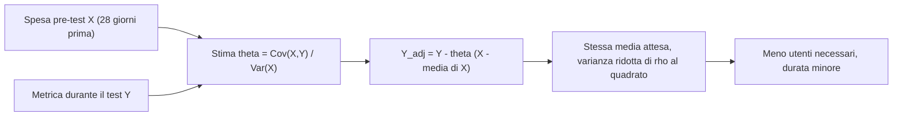

## Sei settimane di test su un valore medio con troppa varianza

Scenario costruito, con numeri di esempio: un marketplace italiano di articoli per la casa vuole testare un widget di upsell nel carrello e misurare il valore medio dell'ordine per utente. Il valore medio vale 60 euro, ma gli scontrini variano molto: la deviazione standard è di 55 euro, quasi quanto la media. Il team di prodotto considera interessante un miglioramento del 2%, cioè 1,20 euro. Il traffico eleggibile è di 5.500 utenti per gruppo a settimana. Il calcolo del campione dice che servono quasi sei settimane.

Sei settimane per un singolo esperimento rallentano tutta la roadmap, ma accorciarle fermando prima distrugge la potenza del test. C'è una terza via: riportare nella stima la parte di variabilità che era già nota prima dell'esperimento. Un utente che spendeva 300 euro al mese nei ventotto giorni precedenti continuerà probabilmente a spendere molto durante il test, qualunque variante veda. Quella spesa passata, che non può dipendere dal trattamento, si può usare per ripulire la metrica dal rumore individuale.

> **Idea chiave:** CUPED sottrae a ogni utente la parte del suo risultato prevedibile da un dato precedente all'esperimento. La media del gruppo non cambia, ma la dispersione scende, e a parità di effetto da rilevare servono meno utenti e meno giorni.

La lezione procede in due tempi: prima la formula del campione con i suoi quattro parametri, poi la riduzione della varianza con CUPED e il suo effetto sulla durata.

## Il campione necessario: quattro parametri, una formula

Per confrontare due medie con deviazione standard comune $\sigma$, il numero di unità per gruppo che garantisce livello $\alpha$ e potenza $1-\beta$ nel rilevare una differenza $\delta$ è

$$n = \frac{2\,\sigma^2\,(z_{1-\alpha/2} + z_{1-\beta})^2}{\delta^2}$$

con $z_{1-\alpha/2} = 1{,}96$ per $\alpha = 0{,}05$ bilaterale e $z_{1-\beta} = 0{,}84$ per potenza 80%. La somma $(1{,}96 + 0{,}84)^2 = 7{,}84$ è una costante che ricorrerà in ogni calcolo con questi due parametri.

La formula rende evidente come i quattro parametri si muovono. Il campione cresce con il quadrato della deviazione standard: dimezzare $\sigma$ divide $n$ per quattro. Cresce con l'inverso del quadrato dell'effetto: dimezzare l'MDE moltiplica $n$ per quattro. Cresce con la confidenza richiesta, perché alzare la potenza dall'80% al 90% porta $z_{1-\beta}$ da 0,84 a 1,28 e il fattore costante da 7,84 a circa 10,5.

| Parametro | Simbolo | Valore nell'esempio | Come cambia $n$ se lo raddoppi |
| --- | --- | --- | --- |
| Deviazione standard della metrica | $\sigma$ | 55 euro | $n$ moltiplicato per 4 |
| Effetto minimo di interesse (MDE) | $\delta$ | 1,20 euro | $n$ diviso per 4 |
| Livello di significatività | $\alpha$ | 0,05 | Raddoppiare $\alpha$ a 0,10 riduce $n$ di circa il 21% |
| Potenza | $1-\beta$ | 80% | Passare al 90% aumenta $n$ di circa il 34% |

Il parametro su cui hai più controllo operativo, dopo l'MDE, è $\sigma$. Ridurla senza toccare l'effetto è il modo più economico di accorciare il test, ed è esattamente quello che fa CUPED.

## Calcolo del campione e della durata sul valore medio dell'ordine

Svolgiamo il dimensionamento con i dati dell'apertura: $\sigma = 55$ euro, $\delta = 1{,}20$ euro, $\alpha = 0{,}05$, potenza 80%, 5.500 utenti eleggibili per gruppo a settimana.

1. Varianza: $\sigma^2 = 55^2 = 3.025$ euro².
2. Numeratore: $2 \times 3.025 \times 7{,}84 = 47.432$.
3. Denominatore: $\delta^2 = 1{,}20^2 = 1{,}44$.
4. Campione per gruppo: $n = 47.432 / 1{,}44 \approx 32.939$ utenti.
5. Durata: $32.939 / 5.500 = 5{,}99$ settimane, che si arrotonda a 6 settimane intere. Il test deve coprire cicli settimanali completi perché il comportamento di acquisto differisce tra giorni feriali e festivi.

Il calcolo vale per la settimana tipica. Se il traffico che hai usato per stimare 5.500 utenti a settimana proviene da un periodo di saldi, il test sarà sottodimensionato nei mesi normali: la stima della durata va fatta su una media di almeno quattro settimane non anomale, e le festività vanno escluse o dichiarate come covariate di calendario.

## CUPED: la derivazione del coefficiente e della riduzione di varianza

CUPED, sigla di Controlled-experiment Using Pre-Experiment Data, usa una covariata $X$ misurata prima dell'esperimento, tipicamente la stessa metrica nei 14-28 giorni precedenti. La metrica corretta è

$$Y_{\text{adj}} = Y - \theta\,(X - \bar{X})$$

dove $\bar{X}$ è la media di $X$ su tutti gli utenti dell'esperimento, entrambi i gruppi compresi. Poiché $X$ è precedente alla randomizzazione, la sua distribuzione è uguale nei due gruppi e la sottrazione non sposta la differenza attesa tra le medie: la stima dell'effetto resta non distorta.

Il coefficiente $\theta$ si sceglie minimizzando la varianza di $Y_{\text{adj}}$. Sviluppando $\mathrm{Var}(Y_{\text{adj}}) = \mathrm{Var}(Y) + \theta^2\,\mathrm{Var}(X) - 2\theta\,\mathrm{Cov}(X,Y)$ e annullando la derivata rispetto a $\theta$ si ottiene

$$\theta = \frac{\mathrm{Cov}(X,Y)}{\mathrm{Var}(X)} = \rho\,\frac{\sigma_Y}{\sigma_X}$$

che coincide con la pendenza della regressione di $Y$ su $X$. Sostituendo, la varianza minima è

$$\mathrm{Var}(Y_{\text{adj}}) = \mathrm{Var}(Y)\,(1 - \rho^2)$$

dove $\rho$ è la correlazione tra metrica e covariata. La riduzione dipende solo da $\rho^2$: con $\rho = 0{,}5$ si elimina il 25% della varianza, con $\rho = 0{,}7$ quasi il 49%, con $\rho = 0{,}3$ solo il 9%.



La condizione essenziale è che $X$ sia stata misurata prima dell'assegnazione. Una covariata raccolta dopo l'inizio può essere influenzata dal trattamento, e in quel caso la sottrazione assorbe parte dell'effetto reale invece di rimuovere solo rumore.

## L'effetto di CUPED su campione e durata, con i numeri del marketplace

Supponi che la spesa dei 28 giorni precedenti abbia deviazione standard $\sigma_X = 50$ euro e correlazione $\rho = 0{,}59$ con la spesa durante il test, un valore plausibile per una metrica di acquisti ripetuti. Svolgiamo il confronto.

1. Coefficiente: $\theta = \rho\,\sigma_Y/\sigma_X = 0{,}59 \times 55/50 = 0{,}649$.
2. Quota di varianza spiegata: $\rho^2 = 0{,}59^2 = 0{,}3481$, quindi la riduzione è del 34,8%.
3. Fattore residuo: $1 - \rho^2 = 0{,}6519$. La deviazione standard corretta vale $55 \times \sqrt{0{,}6519} = 55 \times 0{,}8074 \approx 44{,}4$ euro.
4. Nuovo campione: $32.939 \times 0{,}6519 \approx 21.473$ utenti per gruppo.
5. Nuova durata: $21.473 / 5.500 = 3{,}90$ settimane, cioè 4 settimane intere.

Il test passa da 6 a 4 settimane, con un risparmio di due settimane, pari al 33% del tempo. Nota che il calcolo non offre tre settimane: arrotondare 3,90 a 3 significherebbe fermarsi con il 77% del campione necessario e potenza ben sotto l'80%. Una riduzione di varianza del 35% si traduce in una riduzione di campione del 35%, ma la durata scende in gradini settimanali.

Il guadagno dipende da $\rho$, quindi va valutato prima di investire nella pipeline: su una metrica di conversione di nuovi visitatori, dove la correlazione con un dato storico è praticamente nulla, il guadagno è nullo.

## Implementazione in Python e verifica che la media non si sposti

Il codice seguente calcola il campione, simula un esperimento con effetto vero di 1,20 euro e confronta la stima e l'errore standard con e senza CUPED. Per semplicità la spesa è generata come normale, una semplificazione: nei dati reali la distribuzione ha una coda lunga e conviene valutare una winsorizzazione dichiarata in anticipo.

```python
import numpy as np

rng = np.random.default_rng(11)

def campione_per_gruppo(sigma, delta, z_alpha=1.96, z_beta=0.84):
    """Campione per gruppo per un confronto tra due medie."""
    return 2 * sigma**2 * (z_alpha + z_beta) ** 2 / delta**2

print("Senza CUPED:", round(campione_per_gruppo(55, 1.2)))
print("Con rho = 0,59:", round(campione_per_gruppo(55 * (1 - 0.59**2) ** 0.5, 1.2)))

# Simulazione: X = spesa pre-test, Y = spesa nel test con effetto vero di 1,20 euro
n = 20_000
x = rng.normal(60, 50, n)
gruppo = rng.integers(0, 2, n)                      # randomizzazione 50/50
rumore = rng.normal(0, np.sqrt(55**2 - 0.649**2 * 50**2), n)
y = 60 + 0.649 * (x - 60) + rumore + 1.2 * gruppo

# theta stimato sui dati di entrambi i gruppi, media di X globale
theta = np.cov(y, x)[0, 1] / x.var(ddof=1)
y_adj = y - theta * (x - x.mean())

def stima(metrica):
    d = metrica[gruppo == 1].mean() - metrica[gruppo == 0].mean()
    se = np.sqrt(metrica[gruppo == 1].var(ddof=1) / (gruppo == 1).sum()
                 + metrica[gruppo == 0].var(ddof=1) / (gruppo == 0).sum())
    return d, se

for nome, m in (("grezza", y), ("CUPED", y_adj)):
    d, se = stima(m)
    print(f"{nome}: effetto {d:.2f} euro, errore standard {se:.3f}")
print("Rapporto varianze:", round(y_adj.var() / y.var(), 3))
```

Le prime due righe stampano 32.939 e 21.473 utenti per gruppo, come nei calcoli svolti. Nella simulazione, la correlazione empirica tra $X$ e $Y$ è circa 0,6 e il rapporto tra le varianze è circa 0,64: la stima dell'effetto resta vicina a 1,20 euro con entrambe le metriche, mentre l'errore standard con CUPED è circa il 20% più piccolo, come predice $\sqrt{1-\rho^2} \approx 0{,}81$. È la verifica che conta: l'effetto non cambia, l'incertezza scende.

## Tre errori comuni nell'applicare CUPED e nel dimensionare il test

### Usare come covariata un dato raccolto dopo l'inizio dell'esperimento

Il sintomo è una riduzione di varianza sorprendentemente grande, con un effetto stimato che si riduce rispetto alla versione grezza. Succede perché una covariata come "ordini durante il test" è influenzata dalla variante: sottrarla rimuove parte dell'effetto vero insieme al rumore. Si corregge ammettendo solo covariate calcolate su una finestra che termina prima dell'assegnazione di ogni utente, e verificando che la covariata abbia la stessa media nei due gruppi.

### Calcolare il campione su un periodo non rappresentativo

Il sintomo è un test che a metà percorso mostra un errore standard più grande del previsto. Succede perché la deviazione standard e il traffico sono stati stimati su una settimana di saldi, con scontrini e volumi diversi dal mese normale. Si corregge stimando $\sigma$ e traffico su almeno quattro settimane non anomale e aggiungendo un margine del 10-15% quando la stima è incerta.

### Arrotondare la durata per difetto e fermare al primo segno di significatività

Il sintomo è un test chiuso a 3 settimane quando il calcolo indicava 3,9. Succede perché la scadenza di prodotto preme e il numero sembra già stabile. Con il 77% del campione la potenza scende attorno al 70%, e se leggi anche i risultati intermedi sei nel caso di peeking descritto nella lezione successiva. Si corregge fissando la durata in settimane intere, per eccesso, e comunicandola come vincolo del disegno.

## Il caso difficile: test su soli visitatori anonimi

Quando l'esperimento riguarda utenti che arrivano per la prima volta da una campagna, non esiste storico individuale. La covariata pre-test è nulla o costante, $\rho \approx 0$, e CUPED non offre alcun beneficio: $1 - \rho^2 \approx 1$. In questo caso si possono usare covariate alternative note prima dell'assegnazione, come il canale di provenienza, il dispositivo o la fascia geografica, in una regressione o in una stratificazione, che raggiungono tipicamente riduzioni di varianza del 10-25%. Per gli utenti nuovi in un test misto, tratta la covariata mancante imputando la media della coorte e inserisci un indicatore di "nuovo utente" nel modello, senza escludere nessuno dall'analisi: escluderli cambierebbe la popolazione su cui stimi l'effetto.

## Controllo sul dimensionamento e su CUPED

1. Dimezzando l'MDE da 1,20 a 0,60 euro, con tutto il resto uguale, come cambia il campione e perché?

<details>
<summary>Mostra risposta</summary>

Il campione si moltiplica per quattro, perché $n$ dipende dall'inverso del quadrato di $\delta$: da circa 32.939 a circa 131.756 utenti per gruppo. A 5.500 utenti a settimana per gruppo sono 24 settimane. Prima di inseguire effetti più piccoli conviene verificare se il loro valore economico giustifica una durata di mesi.

</details>

2. Con $\sigma_Y = 40$ euro, $\sigma_X = 32$ euro e $\rho = 0{,}5$, quanto valgono $\theta$ e la deviazione standard dopo CUPED?

<details>
<summary>Mostra risposta</summary>

$\theta = 0{,}5 \times 40/32 = 0{,}625$. Il fattore di varianza è $1 - 0{,}25 = 0{,}75$ e la deviazione standard corretta è $40 \times \sqrt{0{,}75} = 40 \times 0{,}866 \approx 34{,}6$ euro, con una riduzione della varianza del 25%.

</details>

3. Un test richiede 21.000 utenti per gruppo e hai 4.800 utenti per gruppo a settimana. Quanto dura il test pianificato?

<details>
<summary>Mostra risposta</summary>

21.000 / 4.800 = 4,375 settimane, che si arrotondano per eccesso a 5 settimane intere per coprire cicli settimanali completi. Arrotondare a 4 settimane darebbe 19.200 utenti per gruppo, circa il 91% del campione, con potenza inferiore all'80%.

</details>

4. Un collega propone come covariata CUPED il numero di ordini effettuati durante il test, perché "ha correlazione 0,9 con la spesa". Accetti?

<details>
<summary>Mostra risposta</summary>

No. La covariata è misurata dopo l'assegnazione e può essere influenzata dalla variante, per esempio se il widget di upsell aumenta gli ordini. Sottrarla assorbirebbe parte dell'effetto reale, distorcendo la stima. L'alta correlazione è proprio il segnale d'allarme: una covariata valida deve essere pre-trattamento, con la stessa distribuzione nei due gruppi, per esempio la spesa dei 28 giorni precedenti.

</details>
