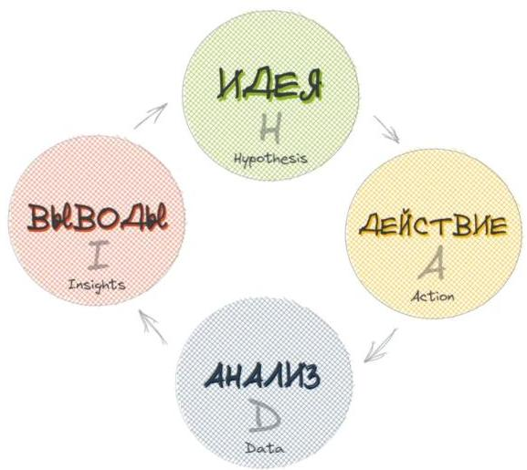

Деминг, HADI и путь микроулучшений

https://www.tidydata.ru/rebelytics/hadi

Оглавление → Раздел 1. Data-Driven Менеджмент → Деминг, HADI и путь микроулучшений

# Деминг, HADI и путь микроулучшений

Как управлять чем угодно

Если записать главный секрет менеджмента меньшим числом слов, то он будет звучать так:

&gt; 1. Декомпозируйте цель на составляющие, измеряйте их и непрерывно улучшайте каждый элемент, выдвигая идеи и проверяя их на объективных данных.

Дедушка Дёминг (совиновник японского экономического чуда) еще в 1950-х завещал простой принцип управления, известный как PDSA цикл Деминга-Шухерта: «планируй — делай — проверяй — действуй».

В современной стартап тусовке этот подход известен, как HADI цикл. Это фреймворк, который применим к управлению чем угодно, будь то поиск идеи для новой компании или ведение соцсетей:

- H — это Hypothesis: гипотеза, идея;
- A — Action: действие, проверка;
- D — Data: анализ объективных данных;
- I — Insights: выводы.

Стор. 1 з 3

14.09.2025, 4:14