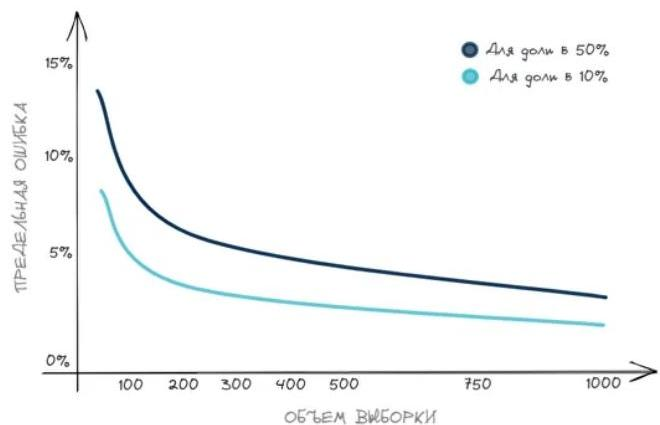

Количественные исследования

https://tidydata.ru/rebelytics/quantitative-research

Почему 100 на сегмент? Потому что это хороший баланс между стоимостью и точностью. Дальнейшее повышение размера выборки будет линейно увеличивать стоимость исследования, ошибка выборки при этом сократится непропорционально.

Зависимость ошибки выборки от количества респондентов и уровня энтропии.

Для вопросов с единогласным мнением (когда 90% респондентов выбирают один ответ, а 10% другой) ошибка выборки меньше. В случае, когда два варианта ответов собирают по 50% голосов — энтропия и ошибка выборки максимальны.

Учитывая, что средняя цена респондента порядка 15$ аналитики должны всегда взвешивать ценность от прироста точности и цену этого прироста. Например, ошибка на выборке 100 респондентов будет +-9%, а на выборке в 200 +-7%.

# Случайный отбор

Случайный отбор — это важнейший элемент репрезентативности. Случайный отбор — это когда у каждого элемента генеральной совокупности одинаковая вероятность попадания в выборку. Возвращаясь к нашему примеру с ростом россиян — это значит, что нам так нужно отбирать 100 участников в выборку, чтобы в нее с одинаковой вероятностью могли попасть и высокие карелы и низкие пигмеи.

Самая распространенная ошибка — это формировать выборку «по удобству». Например, выйти во двор и измерить рост всех, кто попадется. Если в вашем дворе баскетбольная площадка, то результат измерений предрешен с ошибкой в большую сторону.

На практике идеально случайных выборок не бывает, но к ним нужно стремиться. Для этого социологи разработали различные способы отбора: перемешивать телефонные номера случайным образом (кстати, даже в таком случае в выборке не будет представлены те, у кого нет телефона) или случайно перемешивать номера квартир. По-квартирный обход тоже сулит ошибки. Если интервьюеры будут проводить опрос в рабочие часы, то выборка будет смещена в пользу пенсионеров, домохозяек и домохозяинов, которых легче застать в дневные часы. В исследованиях с самыми высокими стандартами случайный список квартир обозначается заранее и респонденты посещают их в разные часы, пока не застанут дома всех из запланированных объектов.

Дополнительный материал:

- Репрезентативность: Объем выборки. Квоты. Случайный отбор.

Планируем исследования и эксперименты

14.09.2025, 4:21