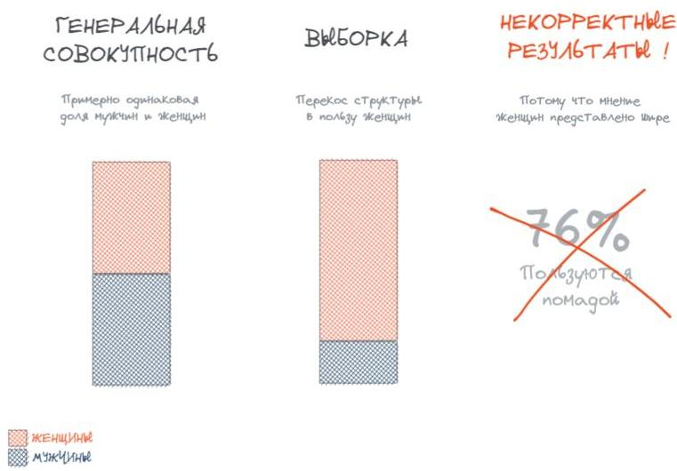

Количественные исследования

https://tidydata.ru/rebelytics/quantitative-research

# Методы сбора данных

## Поквартирный опрос

Наиболее репрезентативный метод социологических опросов из имеющихся. Применяется для переписи населения и в научных исследованиях с высокими стандартами. Для бизнес целей не распространен из-за дороговизны.

## Телефонный опрос

Основной метод опросов до распространения интернета. Средний уровень стоимости и качества. От 300 руб. за анкету.

## Интернет опросы

Самый доступный вид опросов. Точность не сильно ниже, чем у телефонных опросов, зато цена кратно ниже. На «Яндекс Взгляде» цена анкеты достигает 30 руб. Самый распространенный метод сбора данных для бизнеса.

# Квоты

Квоты — это еще один инструмент для обеспечения репрезентативности. Суть квот в том, чтобы обеспечить выборку, которая по структуре совпадает с генеральной совокупностью.

Подгруппы в выборке должны быть представлены также, как и в генеральной совокупности

Например, люди старшего возраста менее склонны участвовать в опросах, поэтому в какой то момент вам потребуется остановить приём ответов от молодых респондентов и продолжать «набирать» взрослую аудиторию. Если вы этого не сделаете, то мнение молодой аудитории будет представлено сильнее, чем мнение старшей.

Если соблюдение квот невозможно, то применяется «взвешивание». Голоса мало представленных групп умножаются на величину непредставленности этой группы. Например, если доля пенсионеров в выборке в два раза меньше, чем в генеральной совокупности, то ответ каждого пенсионера при подсчете ответов умножается на два, чтобы это компенсировать.

Стор. 3 з 7

14.09.2025, 4:21