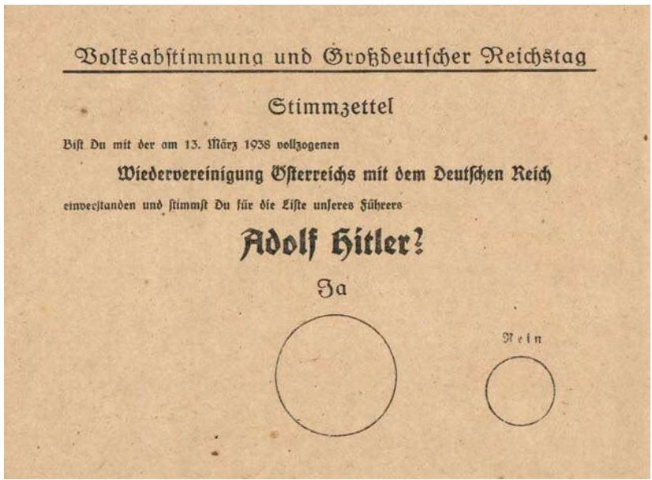

Количественные исследования

https://tidydata.ru/rebelytics/quantitative-research

# Формулировки вопросов — это очень важно

Те ответы, которые мы получаем во многом зависят от того, КАК мы спрашиваем:

Бюллетень для голосования во время референдума в Австрии по аншлюсу с Германией.

«Согласен ли ты с произошедшим 13 марта 1938 года воссоединением Австрии с Германией и голосуешь ли за нашего фюрера?»

Да — большой кружок, Нет — маленький.

Придерживайтесь следующих правил при составлении анкеты, чтобы получить объективные ответы:

1. Чем проще, тем лучше. Проверяйте анкеты на людях, которые не участвовали в их составлении. Вероятно многие вопросы и ответы будут им непонятны. Упрощайте до тех пор, пока ваша бабушка не сможет пройти анкету. Когда придумываете вопросы представляйте человека, который отвечает на них ведя в машину в пробке с радио играющим на фоне и сигаретой в руке.

2. Не закладывайте нужный ответ в вопрос. Вопрос «Вы купите этот прекрасный, качественный товар X» даст вам гораздо более позитивные результаты, чем вопрос «Насколько вероятно, что вы купите или НЕ купите товар X»?

3. Будьте внимательны к тому, что спрашиваете. Другими словами будьте буквальны. Например вопрос «Вы хотите купить X?» не несет никакой пользы. Большинство согласятся с тем, что хотят купить мерседес или вертолет, но это не означает, что у них есть реальная возможность и намеренье это сделать.

4. Перемешивайте варианты ответов. Верхние варианты ответов в списке всегда набирают чуть больше голосов. Не спекулируйте на этом — перемешивайте варианты ответов для каждого респондента в случайном порядке. У большинства сервисов для опросов есть функция «ротации ответов».

5. Добавляйте вариант «Затрудняюсь ответить». Если его не будет, то респонденты будут вынуждены тыкать куда попало, если не знают, что сказать.

6. Варианты ответа должны быть одинаковыми по сущности. «Куда вы ходили в последнее время?»

14.09.2025, 4:21